# First project onboarding: proposal

**Status:** decided on 2026-10-31 (intent accepted, spec signed off: [docs/work/first-project-onboarding/](../work/first-project-onboarding/spec.md)) · **Epic:** #628 · **Date:** 2026-10-31 · [Português](README.pt-BR.md)

Adding the first project is the first thing anyone does in the app. It has to be simple, and it has to leave the project ready for the whole flow. This proposal turns today's "New project" dialog into a four-step wizard:

1. Choose to create or import.
2. Import a repository (or create one).
3. Analyze the project and pick its workflows.
4. Review and finish.

The clone and the analyses run in the background. At the end the project has its city, a refactor backlog and three default workflows: **feature**, **fix** and **release** (hotfix is fix's urgent mode). The proposal also reorganizes the bundled workflows: 15 become 11 (the Planning ones are left for the next proposal).

The same proposal as a page with all the mock screens: [index.html](index.html) ([pt-BR](index.pt-BR.html)). Open it locally; GitHub shows HTML as source.

Nothing here is built yet. The decisions are recommendations until the owner confirms them; then they go to [docs/agents/decisions.md](../agents/decisions.md).

## Contents

- [The recommendations](#the-recommendations)
- [Where we are today](#where-we-are-today)
- [End-to-end flow](#end-to-end-flow)
- [What runs in the background](#what-runs-in-the-background)
- [Workflows: the default set and the reorganization](#workflows-the-default-set-and-the-reorganization)
- [Alignment with Anthropic's AI-native SDLC](#alignment-with-anthropics-ai-native-sdlc)
- [Automatic screenshots of the project](#automatic-screenshots-of-the-project)
- [Monitor: production errors become intents](#monitor-production-errors-become-intents)
- [Cost of real-model calls](#cost-of-real-model-calls)
- [Phased plan](#phased-plan)
- [Files and areas](#files-and-areas)
- [Open questions](#open-questions)
- [Hard rules check](#hard-rules-check)
- [How to contribute](#how-to-contribute)

## The recommendations

1. **One wizard, two doors.** The same flow opens as the last step of Setup and from Projects › New project. Setup loses its Workflows step: workflows are now chosen per project.
2. **Step 1** has two big cards, "Create new project" and "Import a repository". GitHub and GitLab share the import card (the provider comes from the URL or a selector); smaller links cover any git URL and a local folder.
3. **Step 2** checks the repository with `git ls-remote`, and the clone starts in the background as soon as you go on. A tray shows its progress in the next steps.
4. **Step 3:** the **Ways of working** profile comes free from the git history. The model analyses (city + architecture, refactor proposals) come checked, with their total cost on screen, and run only on the click.
5. **Workflows are suggested by rules** from the profile (#487's `workflow-compose.js` already does most of it). Each suggestion shows why, and a selector changes it.
6. **Ways of working revisited.** Solo or team leaves the profile: the flow is the same. The main axis is **Local** (merge locally, push main) or **Local + remote** (pull requests on GitHub/GitLab, followed there). **CI** is a separate axis: none, on releases only (e.g. macOS, Linux and Windows builds on a tag), or on pull requests and releases.
7. **Tests by kind of work.** With an E2E suite, feature writes the E2E tests first (as today's local hero does) and fix implements with unit tests and runs E2E after. Without E2E, both implement and then write the unit tests. The strategy comes from the analysis (the E2E suite, the order of the CI jobs), and the wizard asks when there is an E2E suite.
8. **The bundled workflows go from 15 to 11**, with three defaults per project (`feature`, `fix`, `release`; hotfix is fix's urgent mode) and aliases for the old names. The Planning workflows stay as they are for now.
9. **Aligned with Anthropic's AI-native SDLC.** Code & Build covers Build, Test and Deploy. At onboarding the project picks a work model (Light, Standard or Full): which artifacts (`intent.md`, `spec.md`, `plan.md`, `REVIEW.md`) each item produces. The markdown (English source, Portuguese translation) is committed to the repository, and a reader renders it.
10. **Automatic screenshots.** The analysis detects how to run the project's front, and "Next steps" offers to prioritize a spike on the project's roadmap to find how to capture its screens in a sandbox.
11. **Last, a Monitor.** A new menu group polls production errors (status 500, error logs), groups them, and each new group becomes an intent in the Inbox with its diagnosis; a fix runs only on your click and stops at the gate.
12. **Nothing goes to the roadmap by itself.** At the end, a "Next steps" card offers to add chosen refactors and to capture the first idea.

## Where we are today

The pieces for a good onboarding exist, but they are scattered. Setup only opens the generic project dialog. The analysis, the city and the refactor backlog sit in tabs and buttons of the project's page, to be found later.

| | |
|---|---|
| 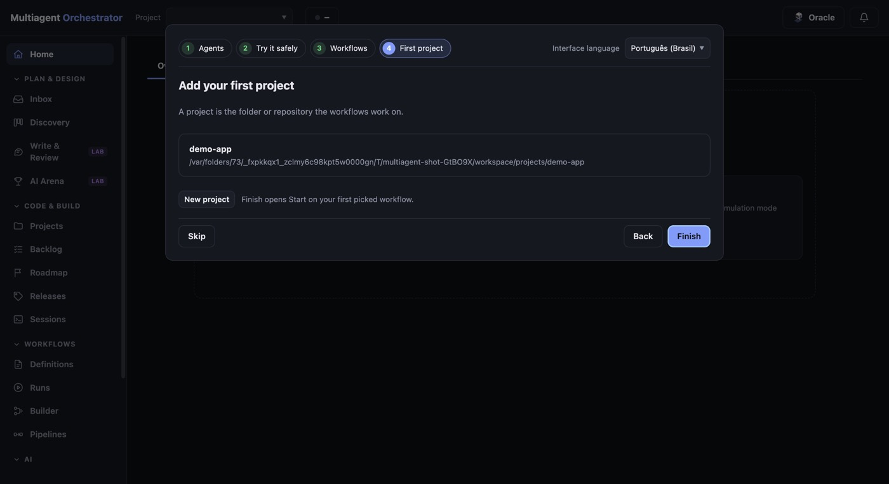 | 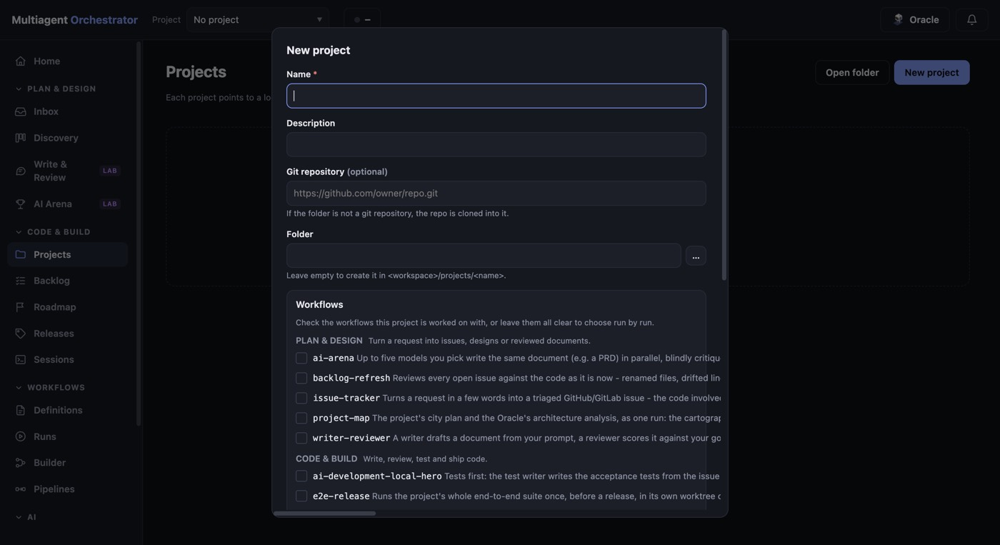 |
| **Setup › First project** (#319): the 4th step, after Agents, Try it safely and Workflows. It lists the projects and opens the New project dialog. | **New project**: name, description, git URL, folder and 15 workflow checkboxes, before the app knows the project. The clone runs *inside* Create (`createProject` awaits `git clone` into `<workspace>/repos/<owner>-<repo>`). |
| 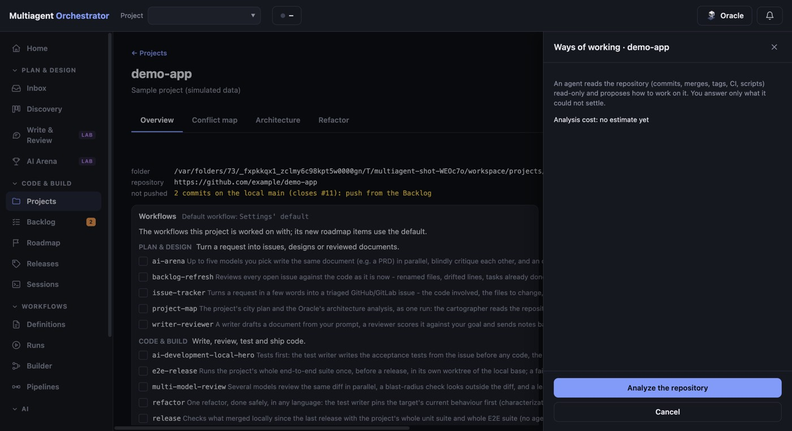 | 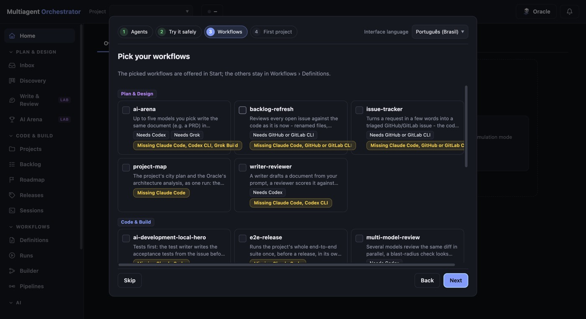 |
| **Ways of working** (#487): a button on the project page's header, drawer `project-ways-of-working.js`. It reads commits, merges, tags, CI and scripts, builds a profile and composes intake + development + release from the fragments. | **Setup › Workflows**: asks you to pick among the bundled workflows before any project exists. |
| 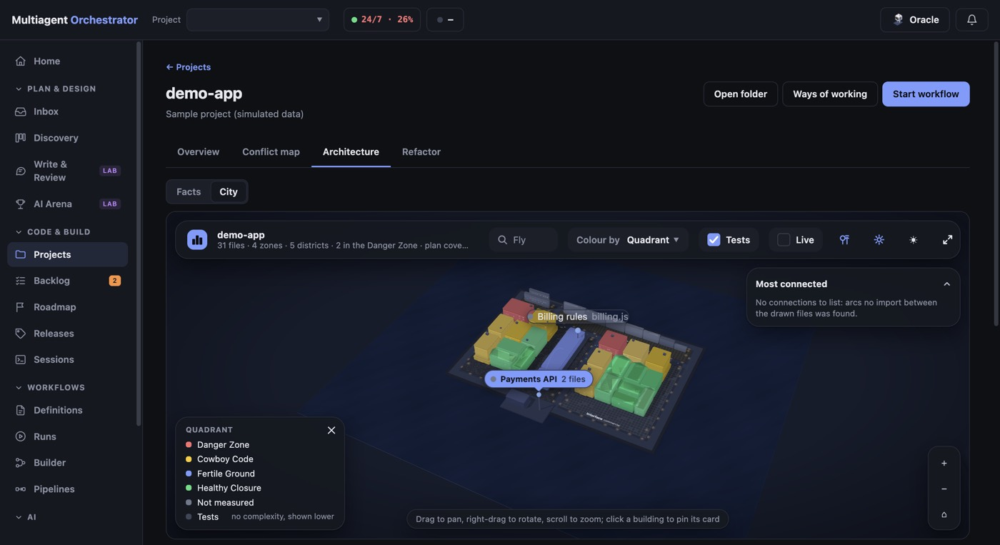 | 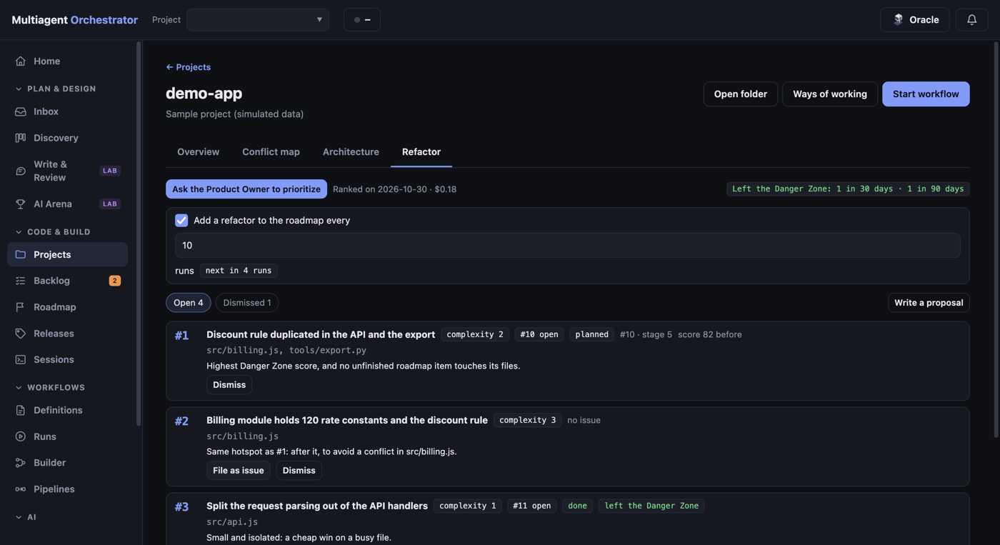 |
| **Architecture › City** (#373): made by the `project-map` workflow (the cartographer's plan, validated by rules, then the Oracle's analysis) in one run. | **Refactor** (#357): proposals from the architecture findings, ranked by the Product Owner, each with "Add to roadmap", plus the cadence. |

Reused as they are:
- `createProject` and the `.craftorio/project.yaml` manifest (#486);
- the `ways-of-working` seed and its existing deterministic path (what simulation mode runs);
- `workflow-compose.js` and the step fragments (#487);
- `project-map` (#372, #381);
- `refactor:prioritize` and `refactor:addToRoadmap` (#357, #435);
- Setup's ▶ Install / ▶ Sign in buttons.

## End-to-end flow

0. Entry: Setup or Projects (**D1**).
1. Choose: create or import (**D2**).
2. Import: repository, name, background clone (**D3**, **D4**).
2b. Or create new: folder, repository, three questions (**D5**).
3. Analysis and workflows (**D6**, **D7**, **D13**, **D14**, **D8**), with the workflow set (**D9**, **D10**).
3b. The work model, aligned with Anthropic's AI-native SDLC (**D15**, **D16**).
4. Review and finish (**D11**).
5. Then the roadmap: you choose what goes in (**D12**).
5b. Automatic screenshots: a spike in the project, from "Next steps" (**D19**).
6. Last phase: the Monitor, production errors become intents (**D17**, **D18**).

### 0 · Entry

Setup keeps Agents and Try it safely, and its third step becomes the whole wizard. The same wizard opens from Projects › New project, the header's project selector and the empty Home.

**D1. Where the flow lives**
- **Recommended:** its own wizard, used by Setup and by Projects. One flow to maintain and test. Setup goes from 4 steps to 3, and the old dialog stays for **Edit project** only.
- Alternatives:
  - Setup only: the second project goes back to the old dialog.
  - Improving today's dialog: one screen cannot hold a background clone, the analysis and a review.

### 1 · Choose

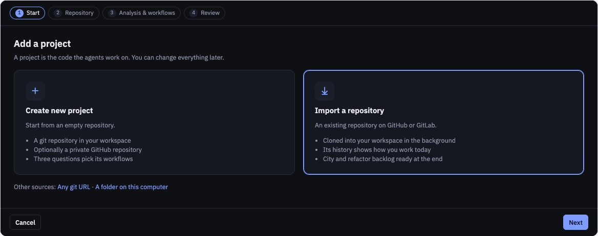

**D2. Which sources show**
- **Recommended:** two cards, with GitHub and GitLab together in "Import a repository". They differ little in the app (`gh` or `glab`, the same git URL): one card, the provider detected from the URL, and a GitHub | GitLab selector for the repository list. Any git URL and a local folder stay as smaller links.
- Alternatives:
  - Four equal cards: dilutes the decision.
  - Separate GitHub and GitLab cards: two near-identical screens to maintain, and three cards dilute the first choice.

### 2 · Import

You give the repository (a URL or `owner/repo` on GitHub or GitLab, with `gh repo list` or `glab repo list` suggestions when that CLI is signed in; pasting a URL picks the provider) and the project name, prefilled from the repo. On **Next** the app checks access with `git ls-remote` and starts the clone in the background. You move on to step 3.

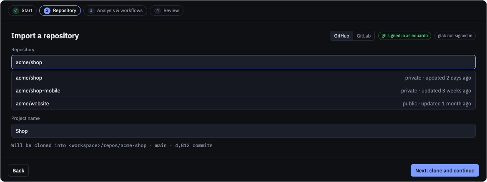

**D3. How the clone happens**
- **Recommended:** a background job with a progress tray, and a full clone. The project is created as `status: cloning`; an error shows in the tray with Retry. A blobless partial clone (`--filter=blob:none`) is a later optimization, measured on big repositories.
- Alternatives:
  - Synchronous, as today: a big repository blocks the screen for minutes.
  - Shallow (`--depth`): Ways of working and the city need the history.

**D4. No `gh`/`glab`, no sign-in or no access**
- **Recommended:** check on Next and offer the fix right there.
  - A public repository clones over HTTPS without `gh`.
  - A private one with no access turns the `ls-remote` error into "Sign in to GitHub" or "Sign in to GitLab", following the URL (Setup's ▶ runs `gh auth login` or `glab auth login` in the terminal dock), then "Try again".
  - With no `gh` at all, the card says issues and PRs will be unavailable, and the import goes on.
- Alternatives:
  - Require `gh` up front: blocks public and local-only users.
  - Let the clone fail: the problem shows up minutes later.
- **GitHub and GitLab take the same path:** only the CLI behind the list and the sign-in changes.

### 2b · Create new

With no code there is nothing to analyze. The wizard creates the repository and replaces the analysis with three questions: the ones Ways of working asks when the history cannot answer them (where changes land: local, or local + remote pull requests; CI: none, on releases, or on pull requests and releases; how you release).

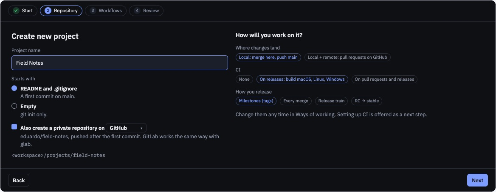

**D5. What "Create new project" creates**
- **Recommended:** a local git repository: `git init`, a README and `.gitignore`, and a first commit on `main`. "Also create a private repository on GitHub | GitLab" (`gh repo create --private` or `glab repo create --private`) is offered only when that provider's CLI is signed in, and creating a remote always needs its explicit click.
- Alternatives:
  - An empty folder (today, with no URL): no git, so the workflows (worktrees, local merge) cannot run.
  - A stack template: choosing a stack is a product decision, better as the first roadmap item, done by the feature workflow.

### 3 · Analysis and workflows

While the clone runs, step 3 shows what can be analyzed and what each item costs. The suggested workflows on the right update as results arrive: first from the free profile, then refined by the model analysis.

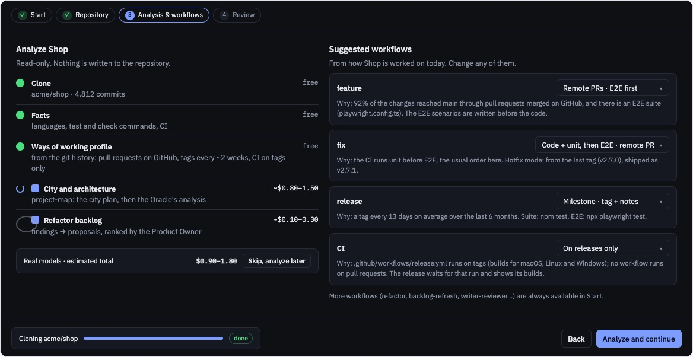

**D6. Automatic or optional analysis**
- **Recommended:** what is free always runs. What costs comes checked, with the total shown, and runs on the click.
  - Clone, facts and the git profile cost nothing and unlock the workflow suggestion.
  - "Skip, analyze later" leaves everything to the Architecture and Refactor tabs.
  - The Ways of working seed already has a deterministic path (what simulation runs). It is always used, and the model is called only for the fields left `null`, such as a release style with no clear tags.
- Alternatives:
  - Everything automatic: spends money without asking.
  - Nothing at onboarding: misses the point (a city, a backlog and real suggestions at the end).

**D7. What runs alongside the clone**
- **Recommended:** a chain by dependency, in the service.
  - Nothing reads the repository before the clone ends.
  - Then the profile and `project-map` run in parallel, and the refactor ranking waits for the findings.
  - It respects the machine's slots (#367) and calls what exists: `createProject`, `architecture-facts`, `workflows:interview` and the `project-map` run, which still shows in Runs.
- Alternative: an "onboarding" bundled workflow. It would show in Runs, but it is a workflow for things that are not agents (clone, facts).

**D13. The axes of a way of working**
Today the Ways of working profile (#487) has team (solo or team), merge (local or PR), release, commands, CI and languages.
- **Recommended:** mode and CI as the axes; team leaves.
  - **Local:** the run merges into the local base, and the workflow's last step pushes main, with no remote PR. The project's auto-push (the Backlog toggle) leaves the app.
  - **Local + remote:** the run opens the pull request on GitHub/GitLab and follows it there (review, CI when it runs on PRs, merge).
  - **CI:** none, on releases only (e.g. macOS, Linux and Windows builds when a tag is pushed), or on pull requests and releases. This covers GitHub Free with no actions on PRs.
  - CI is read from the CI files' triggers (`on: pull_request`, `on: push: tags`, `release` on GitHub; `rules` / `only: tags` on GitLab). With no CI, the wizard writes nothing: "Set up release CI" shows up in the next steps.
- Alternatives:
  - Keep solo/team: both run the same flow, so the question decides nothing.
  - CI inside the mode (remote = with CI): wrong for someone who works locally and wants CI on releases only.

**D14. The test strategy of feature and fix**
Today `ai-development-local-hero` writes the tests before the code and serves both features and fixes.
- **Recommended:** follow the suite the project has.
  - **With E2E:** feature writes the E2E scenarios first and implements until they pass (today's local hero); fix implements with unit tests and runs E2E after.
  - **Unit only:** feature and fix implement and then write the unit tests, the flow many companies use.
  - The analysis reads the E2E suite and the order of the CI jobs; with E2E, the wizard asks "Write the E2E tests first for features?" (default yes).
- Alternatives:
  - Always tests first: odd for fixes and for teams on the usual flow; without E2E it is unit-only test-first.
  - Always code first: loses what works well today for features with E2E.

**D8. How the workflow suggestion comes from the analysis**
- **Recommended:** rules on the profile (`composeWorkflowSet`, #487). Deterministic, testable, and it explains why with the profile's evidence.
- Alternatives:
  - A model picks the workflows: expensive and hard to test, and there are few choices anyway.
  - Always the same set: ignores the analysis.

| Profile field | Affects | Rule |
|---|---|---|
| `mode: local \| remote` | feature, fix | local → merge into the local base and, as the workflow's last step, push main; remote → branch, PR on GitHub/GitLab, followed and merged there |
| `ci: none \| release \| pr+release` | feature, release | pr+release → remote feature waits for the PR's CI (`pr-pipeline`'s "watch CI"); release → the release pushes the tag, waits for the CI run and shows its builds; none → the local suite only, and "Set up release CI" in the next steps |
| `tests: unit \| unit+e2e` (`e2eCommand`) | feature, fix | unit+e2e → feature with E2E first, fix with E2E after; unit → both implement, then write unit tests. Read from configs (Playwright, Cypress…), `e2e` scripts and the order of the CI jobs |
| `release: milestone \| per-merge \| train \| rc-stable` | release, fix (hotfix mode) | with tags → a hotfix branches from the last tag and ships as a patch; per-merge → from main |
| `testCommand`, `checkCommand` | all three | go into the prompts and suite steps |
| `languages` | all three | pick the `*-js`, `*-python`, `*-go`… skills |

## What runs in the background

For a medium repository:
1. The user fills step 2.
2. The clone runs (free) while the user works on step 3.
3. Facts (free), then the Ways of working profile: git first (free), then the model only for null fields.
4. `project-map` runs from the end of the clone: the plan, the rules, then the analysis (model).
5. The Product Owner ranks the refactor proposals once the findings exist (model).
6. The user reviews and finishes; the review shows "still analyzing" for what is left.

The project page fills in by itself, with a notification when the city and the backlog are ready.

## Workflows: the default set and the reorganization

Today there are **15 workflows** and **6 pipelines** bundled. The owner uses one in practice: `ai-development-local-hero`, the real name of "AI Local Hero" (tests first, local merge, no push), for features and fixes alike. There are three development variants, two release workflows and two analysis workflows that overlap. The proposal: **11 workflows**, with three defaults per project. The Planning workflows (`writer-reviewer`, `ai-arena`, `issue-tracker`) stay as they are: the next proposal, a writing flow with manual review, reorganizes them.

**D9. The workflows every project gets**
- **Recommended:** feature, fix and release, with hotfix as fix's urgent mode (from the last tag). Make, fix, ship. It separates what the local hero mixes today (features and fixes in one flow) and matches Discovery's bug/hotfix fast lane. Fix is the only new workflow.
- Alternative: #487's intake + development + release. It is already built, but it has no fix path, and intake (filing an issue) is better as a Planning tool than as a project workflow.

| Today | Proposed | Action |
|---|---|---|
| `ai-development-local-hero` | **`feature`** variant "E2E first" (the default with an E2E suite), local or remote; single or multi-model review. Its use for fixes moves to `fix` | base |
| `software-development-local-hero` | `feature` / `fix` variant "code first": implement, then write the unit tests | becomes a variant |
| `software-development` | `feature` / `fix` mode `remote` (PR, CI, preview, deploy; from `pr-pipeline`) | becomes a variant |
| `multi-model-review` | `feature` option "review: multi-model" | becomes an option |
| (none) | **`fix`**: implement with unit tests, run E2E after (when there is a suite), merge; hotfix mode branches from the last tag and prepares the patch | new |
| `release` | **`release`** with the milestone / per-merge / train / rc-stable styles (`release-pipeline`), waiting for the release CI when there is one | kept |
| `e2e-release` | `release`'s E2E step | becomes a step |
| `project-map` | **`analyze-project`**: city, architecture and refactor proposals in one run (what onboarding calls) | merged |
| `refactor-proposals` | `analyze-project` with "since: last tag" | becomes a mode |
| `refactor` | **`refactor`** | kept |
| `backlog-refresh` | **`backlog-refresh`** | kept |
| `test-batch` | **`test-backfill`** (a candidate to become an optional release step later) | renamed |
| `run-retrospective` | **`retrospective`** | renamed |
| `writer-reviewer`, `ai-arena`, `issue-tracker` | unchanged for now (next proposal) | kept |

Pipelines, 6 → 5:

| Today | Proposed |
|---|---|
| `issue-to-roadmap` | kept |
| `enrich-save-develop` | kept; its development step points to `feature` (through the alias) |
| `rfc-to-issues` | kept (Planning, next proposal) |
| `release-then-refactors` | kept: release → analyze-project (since last tag) → roadmap |
| `ai-arena-write-review` | kept (Planning, next proposal) |
| `develop-to-retrospective` | removed; feature gets "retrospective after" as an option |

**D10. Renaming without breaking existing users**
- **Recommended:** aliases in the workflow loader, with variants passed as inputs. An old name resolves to the new one with its variant's inputs (`software-development` → `feature` with `mode: remote`). Manifests, `settings.hiddenWorkflows`, roadmap items and the run history keep working. The alias table lives for two releases.
- Alternatives:
  - Rename at once: breaks repository manifests and saved roadmaps.
  - Keep all 15 and hide some: reduces nothing that has to be maintained.
- **Where a project's workflows live:** by default the project only references bundled variants (in its JSON, in the workspace), and nothing is written to the repository at onboarding. "Customize" writes to `.craftorio/`, as Ways of working's "Write to the repository" does today, uncommitted.

## Alignment with Anthropic's AI-native SDLC

In August 2026 Anthropic published the [AI-native SDLC playbook](https://claude.com/blog/the-ai-native-sdlc-playbook): six stages in a loop, each ending in a version-controlled artifact a person approves and the next stage reads. The app already has most of the pieces; what is missing is treating the documents as stage artifacts, with a format and a place set per project.

| Stage | Artifact (approver) | In the app today | Missing |
|---|---|---|---|
| Plan | `intent.md`: problem, outcome, affected users and systems, constraints, open questions (product owner) | Inbox and Discovery (Triage/Shape), clarity, Grill me | the card's document in the intent format |
| Design | `spec.md`: requirements + design, concerns (product owner; tech lead when riskier) | Discovery Define, Write & Review, AI Arena, Mockups (#625) | a spec format: the write doc flow |
| **Build** | `plan.md` + code (the engineer accepts the plan) | **Code & Build**: feature and fix, the developer's brief, AGENTS.md, skills, capabilities, worktrees, roadmap | the brief as a versioned `plan.md` |
| **Test** | evidence: tests, build, screenshot diffs, evals (code owner) | test writer, E2E first, suite, base check, screenshots with axe (#387) | evals of skills and workflows in CI |
| **Deploy** | `REVIEW.md` + PR (code owner, release manager) | review with the `code-review` rules, remote mode with PRs, release with the Ship gate and release CI | a per-project `REVIEW.md` |
| Maintain | a new `intent.md` from an incident or anomaly (service owner) | Night watch, analyze-project, backlog-refresh, ci-failure-triage, dependency audit | findings entering as an Inbox card, closing the loop |

**Code & Build covers Build and Test, plus Deploy** (the release with Ship, the release CI and the PR in remote mode). Plan and Design are Plan & Design; Maintain is spread across Night watch, Refactor and the Oracle.

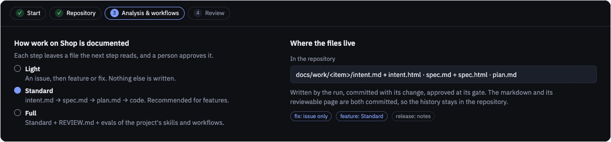

**D15. A work model per project**
- **Recommended:** Light / Standard / Full, per kind of work. The project picks at onboarding; feature uses Standard, fix uses Light, and an item can step up. The app's existing gates approve artifacts: the Discovery commit approves intent and spec, the developer's gate approves the plan.
  - Light: an issue, then feature or fix.
  - Standard: `intent.md` → `spec.md` → `plan.md` → code.
  - Full: Standard + `REVIEW.md` + evals of the project's skills and workflows.
- Alternatives:
  - Always the full model: heavy for fixes and small projects.
  - Not now: the documents stay scattered (issue, card, brief), with no loop.

**D16. Where the artifacts live**
- **Decided by the owner:** the markdown is committed to the project's repository, in `docs/work/<item>/`: the source in English (`intent.md`) with a Portuguese translation beside it (`intent.pt-BR.md`), plus the before/after images. No HTML is committed: a reader renders the markdown at runtime (with a theme, export to PDF and a home page listing the items), so a markdown edited in Maintain never needs a page regenerated. Versioned with the change and readable by any agent and anyone who clones the repository; the feature's and the issue's data, not the user's workspace data. (Replaces an earlier "markdown and HTML committed".)
- Alternatives:
  - Only the markdown in the repository: loses the reviewed page's history and the browsing front.
  - Only in the workspace: gone for anyone who clones; outside agents cannot read them.
- **Scope:** this proposal only records the choice at onboarding and the default path. Generating and reviewing the documents is the write doc flow; the browsing front comes later. The run writes and commits these files at its usual gate; onboarding never writes to the repository.

### 4 · Review

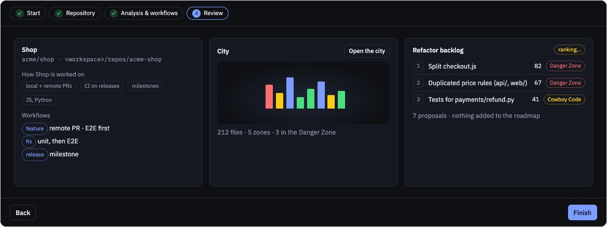

The refactor backlog shows each file's score (0–100) and quadrant, as on the Facts view.

**D11. Does the review wait for the analyses?**
- **Recommended:** no. Finish works at any time, and what is left arrives on the project page with a notification.
- Alternative: wait for everything, which keeps the user watching a bar for minutes.

### 5 · Then the roadmap

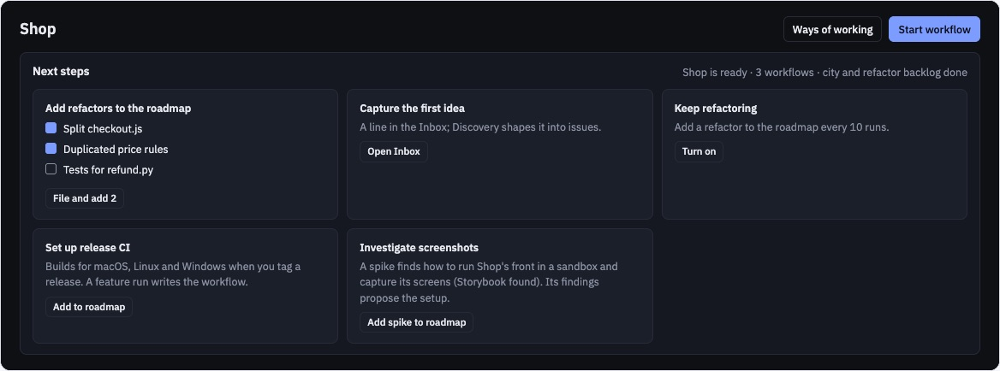

**D12. How the project reaches the roadmap**
- **Recommended:** the user picks in "Next steps".
  - It reuses `refactor:file` + `refactor:addToRoadmap` (#357, #435) and the cadence.
  - With no release CI, a "Set up release CI" card (macOS, Linux and Windows builds on a tag) adds a roadmap item that the feature workflow does with the `ci-pipeline-gh` / `ci-pipeline-gl` skills.
  - Nothing starts without a click, and the roadmap stays stopped until Start.
- Alternative: the PO builds an initial roadmap by itself. That costs money and makes decisions without the owner.

## Automatic screenshots of the project

The people who plan, write and review are often not technical: they clone the repository, but setting the application up to run is painful, so they take screenshots by hand. In this app it already works (`npm run screenshot` and the workflows' `screenshots` step); the idea is to offer the same to the project being added, starting with a **spike in the user's project**.

**D19. How the project gets automatic screenshots**
- **Recommended:** a spike on the project's roadmap, from "Next steps".
  - Step 3 already detects the signals (Storybook, Playwright, mocks, the Local preview run command); the "Investigate screenshots" card puts a spike on the project's roadmap if the user wants.
  - The spike runs in the project, read-only plus sandboxed tries (sample data, no network, no real secrets): it tries a generic capture through Local preview and evaluates a harness that follows the app's `screenshot` contract.
  - Its result is a findings document (in the project's work model) and a proposed "Set up screenshots" item, which the user approves like any item.
- Alternatives:
  - Implement the harness straight away: writes code in the project without knowing the path works; expensive when it fails.
  - Only a generic capture, no code in the project: breaks with login, empty data and external APIs.
- **Meanwhile:** in the write doc flow the owner can paste or attach screenshots in the chat of the iterations (#130's pasted images), and the writer uses the project's screenshot command once it exists.

## Monitor: production errors become intents

The last piece of the SDLC loop (Maintain), and the last phase of the plan. The app listens to the running project's errors, such as 500 responses and error logs, groups what repeats and proposes a fix. The app has no monitor like this today; it comes as a new menu group, **Monitor**, next to the Night watch.

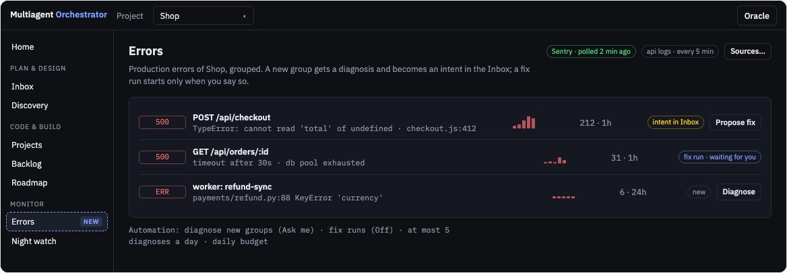

**D17. How errors reach the app**
- **Recommended:** polling connected sources (Sentry, Datadog, CloudWatch, GCP Logging, or a log URL / file with a filter such as status 500 or level error). Outgoing connections only, so it works in the .exe without exposing anything. Grouping (route + message + file:line) and deduplication run with no model. The sources' tokens live in the system keychain (Electron's `safeStorage`), never in a workspace file.
- Alternatives:
  - A webhook received by the app: immediate, but it needs a public URL. Later, through the engine server, after the security review (#466–#470).
  - An agent reading logs on its own: expensive and unpredictable for what a filter does; the model only diagnoses.

**D18. What happens with a new error**
- **Recommended:** the diagnosis becomes an intent, and a fix runs only on a click.
  - A read-only Oracle turn crosses the stack trace with the code and writes the diagnosis as `intent.md` in an Inbox card (the playbook's Maintain).
  - "Propose fix" starts the `fix` workflow, which stops at the human gate like any run.
  - Ask me / On / Off modes, like Discovery's column automations (#259), with a daily cap.
- Alternatives:
  - An automatic fix up to the merge: it would cross the human gate, which AGENTS.md forbids.
  - Only listing errors: no loop, one more dashboard.

## Cost of real-model calls

These are orders of magnitude, not measured. All development runs on the mock provider (`CRAFTORIO_SIMULATION_ONLY=1`). The wizard shows the total before the click, and it counts toward the daily budget (#206).

| Item | When | Model | Estimate |
|---|---|---|---|
| Check access, clone, facts | always | none | $0 |
| Ways of working profile from git | always | none | $0 |
| Ways of working: fields git cannot settle | only when one is null | Oracle | $0.05–0.30 |
| City: the cartographer's plan | checked by default | workflow default | $0.30–1.00 |
| Architecture analysis (findings) | with the city | Oracle | ~$0.50 |
| Refactor ranking by the PO | checked by default | PO default | $0.10–0.30 |
| Monitor: polling, grouping, deduplication | every few minutes | none | $0 |
| Monitor: diagnosis of a new error group | Ask me by default, at most 5 a day | Oracle | $0.10–0.50 |
| Create new project (with or without GitHub) | path 2b | none | $0 |

A typical import with everything checked costs about $1–2. The ~$0.50 for the architecture analysis is the app's own estimate (from the `release-then-refactors` pipeline); the other figures are guesses to confirm on the first real run, announced first.

## Phased plan

**Phase 1: MVP, the wizard with what exists**
- The 4-step wizard (Setup and Projects) with the source cards.
- Import from GitHub or GitLab in the same card, with the `ls-remote` check, the background clone and the progress tray.
- Step 3: the free profile + `project-map` + the refactor ranking, with the cost shown.
- Suggestions among today's workflows (local hero / software-development / release) through the compose rules.
- A non-blocking review and the "Next steps" card.
- Setup without its Workflows step.
- Done when: going from an empty Home to a project with a city, a backlog and workflows works fully simulated, with the access errors covered.

**Phase 2: the feature / fix / release set**
- The new `fix` workflow (a `fix-pipeline` fragment) with its hotfix mode.
- `feature` with the local / remote modes, the E2E first / code first variants and its options.
- `release` with the E2E step and the wait for the release CI when there is one.
- Remove the project's auto-push and add a "push main" step at the end of feature and fix in Local mode (closes #617).
- Ways of working revisited: `team` leaves the profile, `merge` becomes `mode: local | remote`, `ci` becomes `none | release | pr+release` read from the CI triggers, and `tests` / `e2eCommand` are added.
- Aliases for the old names; #487's compose generates feature/fix/release.
- Done when: an old project, with its manifest and saved roadmap, runs the same through the new names.

**Phase 3: reorganize the rest (not Planning)**
- `analyze-project`, `test-backfill`, `retrospective`.
- Pipelines from 6 to 5.
- The workflow docs and README rewritten.
- Done when: 11 bundled workflows and the whole suite green.

**Phase 4: create new and other sources**
- "Create new project" with `git init` and an optional remote on GitHub or GitLab (`gh` / `glab repo create`).
- A partial clone for big repositories, if measurements call for it.
- Done when: a new project is born with a local and a remote repository and runs its first feature.

**Phase 5: later, the SDLC loop**
- The work model picked at onboarding takes effect: intent and spec in Discovery (the write doc format), `plan.md` instead of the developer's brief, all committed in `docs/work/<item>/`.
- A per-project `REVIEW.md` read by the review.
- Night watch and analyze-project findings enter the Inbox as intents.
- Evals of skills and workflows in CI; a front to browse the intents.
- Done when: an item goes from intent to release with its artifacts in the repository, and a Night watch finding comes back as an intent.

**Phase 6: last, the Monitor**
- A new menu group, **Monitor**: Errors and the Night watch.
- Polling connectors (Sentry, Datadog, CloudWatch, GCP, log URL / file) with their tokens in the system keychain.
- Grouping and deduplication with no model; the diagnosis becomes `intent.md` in the Inbox.
- "Propose fix" starts the `fix` workflow; Ask me / On / Off modes with a daily cap.
- A webhook through the engine server, after the security review.
- Done when: a simulated 500 becomes an Inbox card with its diagnosis, and the proposed fix stops at the gate.

## Files and areas

**New**
- `fronts/build/views/projects/project-wizard.js` and `project-wizard.css`
- `packages/shared/onboarding-model.js` (steps, rules, the cost sum)
- `packages/engine/service/areas/project-onboarding.js` (jobs: clone → facts → analyses)
- `packages/engine/service/channels/onboarding.js`
- Workflows: `workflows/feature.yaml`, `fix.yaml`, `analyze-project.yaml`
- `fragments/fix-pipeline.yaml`
- `scripts/screenshot/views/onboarding.js`
- `features/onboarding.feature`
- `packages/shared/work-model.js` (Light / Standard / Full, the artifact paths)
- `fronts/monitor/` (a new front: `views/errors`, `engine/domains/error-sources`, the connectors) and `packages/ui-kit/nav-groups.js` (the Monitor group)

**Changed**
- `fronts/build/views/projects/projects.js` (New project opens the wizard)
- `packages/ui-kit/setup.js` and `packages/shared/setup-model.js`
- `fronts/analyser/views/project/project.js` (the Next steps card)
- `packages/engine/domains/project/projects.js` (background clone, status, `git init`, `gh`/`glab repo create`; `autoPush` removed)
- `packages/engine/service/areas/local-push.js` and `fronts/build/views/backlog/backlog.js` (the auto-push removed; the manual Push stays)
- `packages/engine/service/areas/workflow-interview.js` (free profile, the model only for nulls)
- `packages/engine/domains/workflow/workflow-compose.js`
- The workflow loader (the alias table)
- `workflows/release.yaml` and `pipelines/*.yaml`
- `seeds/ways-of-working/seed.md` (profile: mode, ci and tests; no team)
- `packages/shared/i18n/*`
- `docs/readme/040-workflows.md` and `docs/agents/engine.md`
- `docs/agents/decisions.md`, once decided

## Open questions

Each has a recommended default.

- **Q-1.** Does Setup's Workflows step go away? Default: **yes**. Definitions stays for hiding workflows.
- **Q-2.** A private repository with no `gh` or `glab`? Default: **offer the URL's provider sign-in on Next**. A working git credential helper is fine too.
- **Q-3.** Does onboarding write files to the user's repository? Default: **no**. "Customize" writes to `.craftorio/`, uncommitted.
- **Q-4.** Do the model analyses come checked? Default: **yes, with the total shown and "Skip, analyze later"**. In simulation mode everything is simulated.
- **Q-5.** Does "Create new project" create a remote repository by default? Default: **only with `gh` or `glab` signed in, private, and unchecked the first time**.
- **Q-6.** How long do old names keep working? Default: **two releases**, with a notice in Start and a line in the release notes.
- **Q-7.** Monorepo: several projects in one repository? Default: **one project per repository for now**.
- **Q-8.** Where does a fix in hotfix mode branch from? Default: **the last tag when releases use tags; main otherwise**.
- **Q-9.** Does onboarding put anything on the roadmap by itself? Default: **no**, only the "Next steps" card.
- **Q-10.** In Local mode, is main pushed after every merge? **Decided by the owner: yes, as the workflow's last step**, after the merge into main. The project's auto-push (the Backlog toggle and the push after each `merge: local`) leaves the app. That also ends the race between Ship and the auto-push (#617): each workflow does its own push. When the push is refused because origin moved, the step updates main and tries again, and a conflict goes back to the run's developer, as the manual push does today.
- **Q-11.** Does onboarding write the CI files? Default: **no**. "Set up release CI" becomes a roadmap item, done by the feature workflow with `ci-pipeline-gh` / `ci-pipeline-gl`, with its gate and review like any change.
- **Q-12.** Which work model comes checked? Default: **Standard for feature, Light for fix**; Full only when the project has CI and wants evals.
- **Q-13.** Where do the artifacts live in the repository? Default: **`docs/work/<item>/`** (markdown, HTML and images), configurable; Ways of working detects a folder already in use (`docs/rfcs`, `adr/`).
- **Q-14.** Which error sources first? Default: **Sentry and a log URL / file with a filter**; Datadog, CloudWatch and GCP later, as asked for.
- **Q-15.** Does the Monitor diagnose on its own? Default: **Ask me**, at most 5 diagnoses a day; fix runs off until you turn them on.
- **Q-16.** Does the "Investigate screenshots" card always show? Default: **only when the project has a front end** and no screenshot command yet; with Storybook or Playwright, the card says what it found.

## Hard rules check

How the proposal follows [AGENTS.md](../../AGENTS.md):
- The app stays in English; what the agents write follows Settings › Language.
- The workspace is the product: clones go in `<workspace>/repos/`, new projects in `<workspace>/projects/`, analyses in `<workspace>/architecture/`.
- Agents run unattended and record assumptions. The user answers the three questions in the wizard.
- Onboarding starts no development run and answers no gate. The roadmap only gets what the user picks.
- Actions that reach outside (creating a GitHub repository, signing in to `gh`) need an explicit click.
- Automated checks run simulated only, with `npm run screenshot` and the mock provider.
- Every real action shows its cost first.

## How to contribute

1. Read [AGENTS.md](../../AGENTS.md) and the topic docs for your area, especially [engine.md](../agents/engine.md), [renderer.md](../agents/renderer.md), [storage.md](../agents/storage.md) and [testing.md](../agents/testing.md), plus [seeds.md](../agents/seeds.md) for Ways of working.
2. Comment on the epic (#628) before picking a phase. The phases become sub-issues once the owner confirms the decisions.
3. Phase 1 needs no workflow changes. Phases 2 and 3 change bundled workflows and need the alias table first.
4. Work on a branch and open a PR. Never run real models in checks: the mock provider for tests, `npm run screenshot` for screens.
