# Onboarding do primeiro projeto: proposta

**Status:** decidida em 2026-10-31 (intent aceito, spec assinado: [docs/work/first-project-onboarding/](../work/first-project-onboarding/spec.md)) · **Épico:** #628 · **Data:** 2026-10-31 · [English](README.md)

Cadastrar o primeiro projeto é a primeira coisa que alguém faz no app. Tem que ser simples e deixar o projeto pronto para o fluxo completo. A proposta transforma o diálogo "New project" de hoje num assistente de quatro etapas:

1. Escolher entre criar e importar.
2. Importar um repositório (ou criar um).
3. Analisar o projeto e escolher os fluxos.
4. Revisar e concluir.

O clone e as análises rodam em segundo plano. No fim, o projeto tem a cidade, um backlog de refatoração e três fluxos padrão: **feature**, **fix** e **release** (o hotfix é o modo urgente do fix). A proposta também reorganiza os workflows bundled: de 15 para 11 (os de Planning ficam para a próxima proposta).

A mesma proposta como página, com todas as telas mock: [index.pt-BR.html](index.pt-BR.html) ([English](index.html)). Abra localmente, porque o GitHub mostra HTML como código.

Nada disso está construído. As decisões são recomendações até o dono confirmar; confirmadas, vão para [docs/agents/decisions.md](../agents/decisions.md).

## Conteúdo

- [As recomendações](#as-recomendações)
- [Onde estamos hoje](#onde-estamos-hoje)
- [Fluxo ponta a ponta](#fluxo-ponta-a-ponta)
- [O que roda em segundo plano](#o-que-roda-em-segundo-plano)
- [Workflows: o conjunto padrão e a reorganização](#workflows-o-conjunto-padrão-e-a-reorganização)
- [Alinhamento com o AI-native SDLC da Anthropic](#alinhamento-com-o-ai-native-sdlc-da-anthropic)
- [Screenshots automáticos do projeto](#screenshots-automáticos-do-projeto)
- [Monitor: erros de produção viram intents](#monitor-erros-de-produção-viram-intents)
- [Custo das chamadas reais](#custo-das-chamadas-reais)
- [Plano faseado](#plano-faseado)
- [Arquivos e áreas](#arquivos-e-áreas)
- [Perguntas em aberto](#perguntas-em-aberto)
- [Regras do AGENTS.md](#regras-do-agentsmd)
- [Como contribuir](#como-contribuir)

## As recomendações

1. **Um assistente, duas portas.** O mesmo fluxo abre como último passo do Setup e em Projects › New project. O passo Workflows do Setup some, porque os fluxos passam a ser escolhidos por projeto.
2. **Etapa 1:** dois cards grandes, "Create new project" e "Import a repository". GitHub e GitLab dividem o card de import (o provedor sai da URL ou de um seletor); links menores cobrem qualquer URL git e uma pasta local.
3. **Etapa 2:** o repositório é validado com `git ls-remote`, e o clone começa em segundo plano assim que você avança. Uma bandeja mostra o progresso nas etapas seguintes.
4. **Etapa 3:** o perfil do **Ways of working** sai de graça da história do git. As análises com modelo (cidade + arquitetura, propostas de refatoração) vêm marcadas, com o custo total na tela, e só rodam no clique.
5. **Os fluxos são sugeridos por regras** a partir do perfil (o `workflow-compose.js` do #487 já faz quase tudo). Cada sugestão mostra o porquê, e um seletor troca.
6. **Formas de trabalho revisitadas.** Solo ou time sai do perfil: o fluxo é o mesmo. O eixo principal é **Local** (merge local e push no main) ou **Local + remoto** (PRs no GitHub/GitLab, acompanhados lá). **CI** vira um eixo à parte: nenhum, só na release (por exemplo, builds para macOS, Linux e Windows na tag) ou nos PRs e na release.
7. **Testes por tipo de trabalho.** Com suíte E2E, a feature escreve o E2E primeiro (como o local hero faz hoje) e o fix implementa com unitário e roda o E2E depois. Sem E2E, os dois implementam e depois escrevem o unitário. A estratégia sai da análise (a suíte E2E, a ordem dos jobs no CI), e o assistente pergunta quando há E2E.
8. **Os workflows bundled vão de 15 para 11**, com três padrão por projeto (`feature`, `fix`, `release`; o hotfix é o modo urgente do fix) e aliases para os nomes antigos. Os workflows de Planning ficam como estão por enquanto.
9. **Alinhado ao AI-native SDLC da Anthropic.** O Code & Build cobre Build, Test e Deploy. No onboarding, o projeto escolhe o modelo de trabalho (Leve, Padrão ou Completo): quais artefatos (`intent.md`, `spec.md`, `plan.md`, `REVIEW.md`) cada item gera. O markdown (fonte em inglês, tradução em português) é commitado no repositório, e um leitor renderiza.
10. **Screenshots automáticos.** A análise detecta como rodar o front do projeto, e o "Next steps" oferece priorizar um spike no roadmap do projeto para achar o jeito de capturar as telas em sandbox.
11. **Por último, um Monitor.** Um grupo novo no menu busca erros de produção (status 500, logs de erro) por polling, agrupa, e cada grupo novo vira um intent no Inbox com o diagnóstico; o fix só roda com o seu clique e para no gate.
12. **Nada vai para o roadmap sozinho.** No fim, um cartão "Next steps" oferece adicionar refatorações escolhidas e capturar a primeira ideia.

## Onde estamos hoje

As peças para um bom onboarding existem, mas estão espalhadas. O Setup só abre o diálogo genérico de projeto. A análise, a cidade e o backlog de refatoração ficam em abas e botões da página do projeto, para descobrir depois.

| | |
|---|---|
| 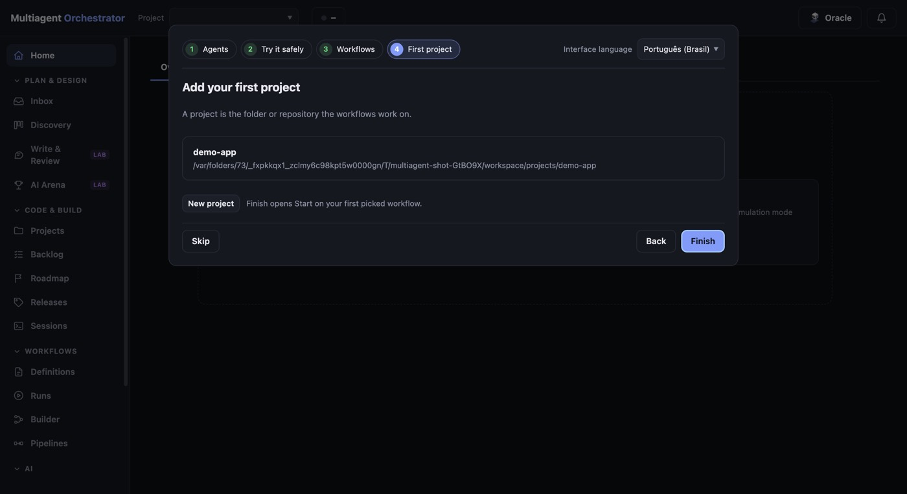 | 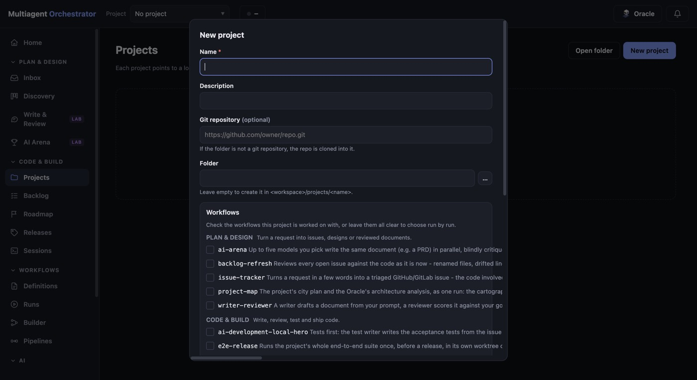 |
| **Setup › First project** (#319): o 4º passo, depois de Agents, Try it safely e Workflows. Lista os projetos e abre o diálogo New project. | **New project**: nome, descrição, URL git, pasta e 15 caixas de workflow, antes de o app conhecer o projeto. O clone roda *dentro* do Create (`createProject` espera o `git clone` em `<workspace>/repos/<owner>-<repo>`). |
| 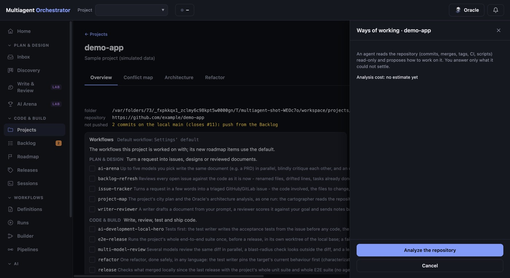 | 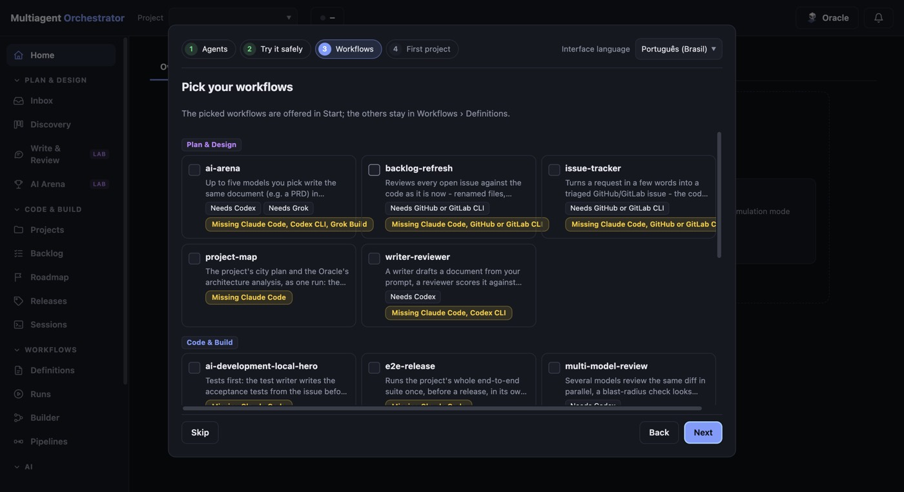 |
| **Ways of working** (#487), o nome real do "Way of Work": botão no cabeçalho da página do projeto, gaveta `project-ways-of-working.js`. Lê commits, merges, tags, CI e scripts, monta um perfil e compõe intake + desenvolvimento + release a partir dos fragments. | **Setup › Workflows**: pede para escolher entre os workflows bundled antes de existir projeto. |
| 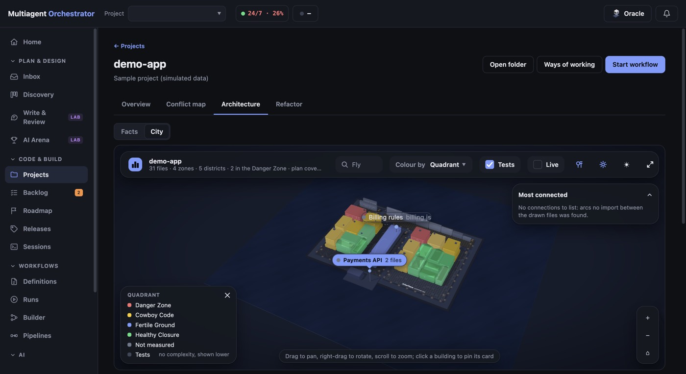 | 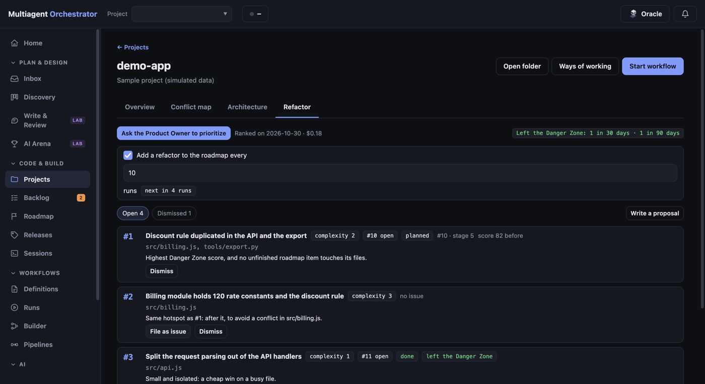 |
| **Architecture › City** (#373): feita pelo workflow `project-map` (o plano do cartógrafo, validado por regras, depois a análise do Oracle) num run só. | **Refactor** (#357): propostas vindas dos achados da arquitetura, ranqueadas pelo Product Owner, cada uma com "Add to roadmap", e a cadência. |

Reaproveitado como está:
- `createProject` e o manifesto `.multiagent/project.yaml` (#486);
- o seed `ways-of-working` e o caminho determinístico que ele já tem (o que o modo simulado roda);
- o `workflow-compose.js` e os fragments (#487);
- o `project-map` (#372, #381);
- `refactor:prioritize` e `refactor:addToRoadmap` (#357, #435);
- os botões ▶ Install / ▶ Sign in do Setup.

## Fluxo ponta a ponta

0. Entrada: Setup ou Projects (**D1**).
1. Escolha: criar ou importar (**D2**).
2. Importar: repositório, nome, clone em segundo plano (**D3**, **D4**).
2b. Ou criar novo: pasta, repositório, três perguntas (**D5**).
3. Análise e fluxos (**D6**, **D7**, **D13**, **D14**, **D8**), com o conjunto de fluxos (**D9**, **D10**).
3b. O modelo de trabalho, alinhado ao AI-native SDLC da Anthropic (**D15**, **D16**).
4. Revisar e concluir (**D11**).
5. Depois, o roadmap: você escolhe o que entra (**D12**).
5b. Screenshots automáticos: um spike no projeto, a partir do "Next steps" (**D19**).
6. Última fase: o Monitor, erros de produção viram intents (**D17**, **D18**).

### 0 · Entrada

O Setup mantém Agents e Try it safely, e o terceiro passo vira o assistente inteiro. O mesmo assistente abre em Projects › New project, no seletor de projeto do header e no Home vazio.

**D1. Onde o fluxo vive**
- **Recomendado:** um assistente próprio, usado pelo Setup e por Projects. Um fluxo só para manter e testar. O Setup vai de 4 para 3 passos, e o diálogo antigo fica só para **Edit project**.
- Alternativas:
  - Só no Setup: o segundo projeto volta ao diálogo antigo.
  - Melhorar o diálogo atual: uma tela não comporta clone em fundo, análise e revisão.

### 1 · Escolha

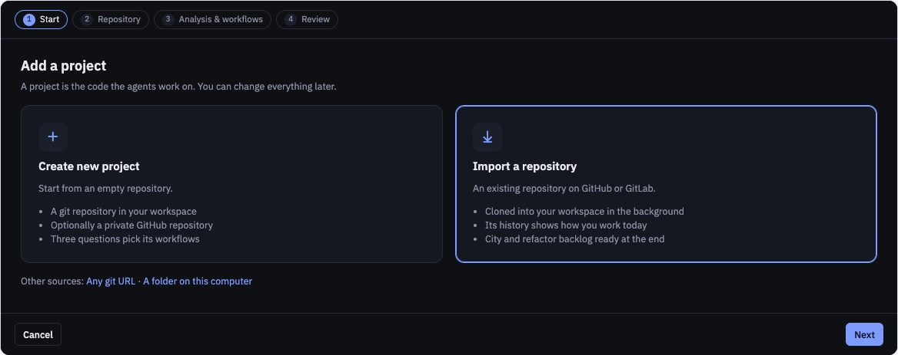

**D2. Quais origens aparecem**
- **Recomendado:** dois cards, com GitHub e GitLab juntos em "Import a repository". Mudam pouco no app (`gh` ou `glab`, a mesma URL git): um card só, o provedor detectado pela URL e um seletor GitHub | GitLab para a lista de repos. Outra URL git e pasta local ficam como links menores.
- Alternativas:
  - Quatro cards iguais: dilui a decisão.
  - Cards separados para GitHub e GitLab: duas telas quase iguais para manter, e três cards diluem a primeira escolha.

### 2 · Importar

Você informa o repositório (URL ou `owner/repo` do GitHub ou do GitLab, com sugestões do `gh repo list` ou do `glab repo list` quando o CLI está logado; colar uma URL escolhe o provedor) e o nome do projeto, preenchido a partir do repo. No **Next**, o app valida o acesso com `git ls-remote` e começa o clone em segundo plano. Você segue para a etapa 3.

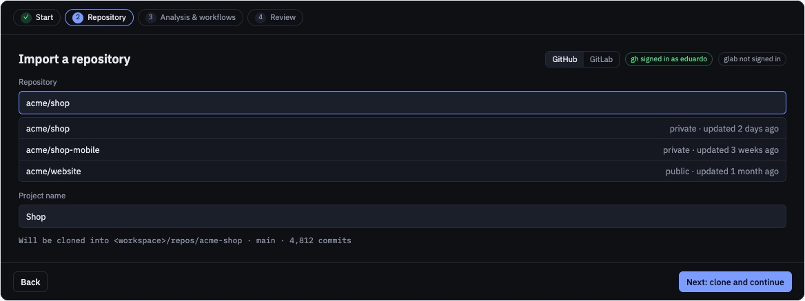

**D3. Como o clone acontece**
- **Recomendado:** um job em segundo plano com bandeja de progresso, e clone completo. O projeto é criado como `status: cloning`; um erro aparece na bandeja com Retry. O clone parcial sem blobs (`--filter=blob:none`) é uma otimização para depois, medida em repos grandes.
- Alternativas:
  - Síncrono, como hoje: um repo grande prende a tela por minutos.
  - Raso (`--depth`): o Ways of working e a cidade precisam da história.

**D4. Sem `gh`/`glab`, sem login ou sem acesso**
- **Recomendado:** validar no Next e oferecer o conserto ali mesmo.
  - Repo público clona por HTTPS sem `gh`.
  - Repo privado sem acesso: o erro do `ls-remote` vira "Sign in to GitHub" ou "Sign in to GitLab", conforme a URL (o ▶ do Setup roda `gh auth login` ou `glab auth login` no terminal), depois "Try again".
  - Sem `gh` nenhum: o card avisa que issues e PRs ficam indisponíveis, e o import segue.
- Alternativas:
  - Exigir `gh` antes de tudo: bloqueia repos públicos e quem trabalha só local.
  - Deixar o clone falhar: o problema aparece minutos depois.
- **GitHub e GitLab seguem o mesmo caminho:** só muda o CLI por trás da lista e do login.

### 2b · Criar novo

Sem código, não há o que analisar. O assistente cria o repositório e troca a análise por três perguntas, as mesmas que o Ways of working faz quando a história não responde: onde as mudanças chegam (local, ou local + PRs remotos), o CI (nenhum, só na release, ou nos PRs e na release) e como é feita a release.

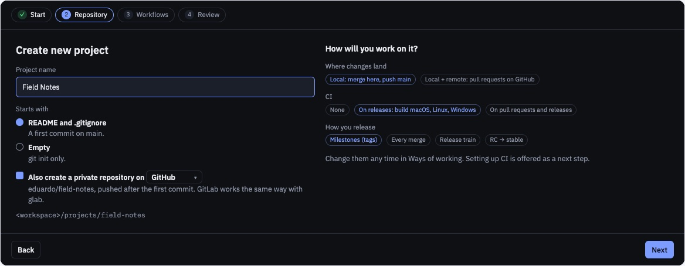

**D5. O que "Create new project" cria**
- **Recomendado:** um repo git local: `git init`, README e `.gitignore`, primeiro commit em `main`. "Also create a private repository on GitHub | GitLab" (`gh repo create --private` ou `glab repo create --private`) só aparece com o CLI do provedor logado, e criar o remoto sempre exige o clique explícito.
- Alternativas:
  - Uma pasta vazia (hoje, sem URL): sem git, os workflows (worktrees, merge local) não rodam.
  - Um template de stack: escolher stack é decisão de produto, melhor como o primeiro item do roadmap, feito pelo fluxo feature.

### 3 · Análise e fluxos

Enquanto o clone roda, a etapa 3 mostra o que pode ser analisado e quanto cada item custa. Os fluxos sugeridos à direita se atualizam conforme os resultados chegam: primeiro pelo perfil de graça, depois refinados pela análise com modelo.

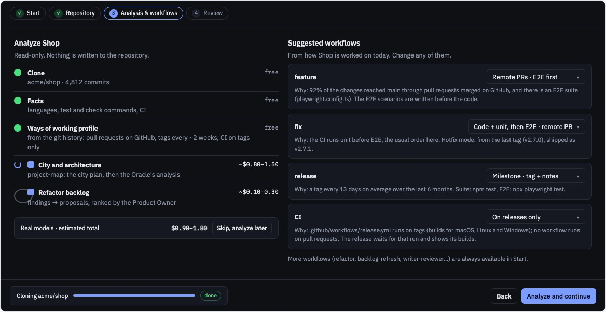

**D6. Análise automática ou opcional**
- **Recomendado:** o que é grátis roda sempre. O que custa vem marcado, com o total visível, e roda no clique.
  - Clone, fatos e o perfil do git não custam nada e destravam a sugestão de fluxos.
  - "Skip, analyze later" deixa tudo para as abas Architecture e Refactor.
  - O seed do Ways of working já tem um caminho determinístico (o que o modo simulado roda). Ele é usado sempre, e o modelo só é chamado para os campos que ficaram `null`, como um estilo de release sem tags claras.
- Alternativas:
  - Tudo automático: gasta dinheiro sem pedir.
  - Nada no cadastro: perde o objetivo (cidade, backlog e sugestões reais no fim).

**D7. O que roda junto com o clone**
- **Recomendado:** um encadeamento por dependência, no serviço.
  - Nada lê o repositório antes de o clone terminar.
  - Depois, o perfil e o `project-map` rodam em paralelo, e o ranking da refatoração espera os achados.
  - Respeita os slots da máquina (#367) e chama o que existe: `createProject`, `architecture-facts`, `workflows:interview` e o run do `project-map`, que continua aparecendo em Runs.
- Alternativa: um workflow "onboarding" bundled. Apareceria em Runs, mas seria um workflow para coisas que não são agentes (clone, fatos).

**D13. Os eixos da forma de trabalho**
Hoje o perfil do Ways of working (#487) tem time (solo ou time), merge (local ou PR), release, comandos, CI e linguagens.
- **Recomendado:** modo e CI como eixos; time sai.
  - **Local:** o run mescla na base local e o último passo do workflow faz push do main, sem PR remoto. O auto-push do projeto (o botão do Backlog) sai do app.
  - **Local + remoto:** o run abre o PR no GitHub/GitLab e acompanha por lá (revisão, CI quando roda no PR, merge).
  - **CI:** nenhum, só na release (por exemplo, builds para macOS, Linux e Windows quando sobe uma tag) ou nos PRs e na release. Cobre o caso do GitHub Free sem actions nos PRs.
  - O CI é lido dos gatilhos dos arquivos de CI (`on: pull_request`, `on: push: tags`, `release` no GitHub; `rules` / `only: tags` no GitLab). Sem CI, o assistente não escreve nada: "Set up release CI" aparece nos próximos passos.
- Alternativas:
  - Manter solo/time: os dois rodam o mesmo fluxo, então a pergunta não decide nada.
  - CI dentro do modo (remoto = com CI): errado para quem trabalha local e quer CI só na release.

**D14. A estratégia de testes de feature e fix**
Hoje o `ai-development-local-hero` escreve os testes antes do código e serve tanto para feature quanto para fix.
- **Recomendado:** seguir a suíte que o projeto tem.
  - **Com E2E:** a feature escreve os cenários E2E primeiro e implementa até passarem (o local hero de hoje); o fix implementa com unitário e roda o E2E depois.
  - **Só unitário:** feature e fix implementam e depois escrevem o unitário, o fluxo que muitas empresas usam.
  - A análise lê a suíte E2E e a ordem dos jobs no CI; com E2E, o assistente pergunta "Write the E2E tests first for features?" (padrão sim).
- Alternativas:
  - Sempre testes primeiro: estranho para fix e para quem usa o fluxo tradicional; sem E2E, vira teste primeiro só com unitário.
  - Sempre código primeiro: perde o que funciona bem hoje para features com E2E.

**D8. Como a sugestão de fluxos sai da análise**
- **Recomendado:** regras sobre o perfil (`composeWorkflowSet`, #487). Determinístico, testável, e explica o porquê com a evidência do perfil.
- Alternativas:
  - Um modelo escolhe os fluxos: caro, difícil de testar, e as escolhas são poucas.
  - Sempre o mesmo conjunto: ignora a análise.

| Campo do perfil | Afeta | Regra |
|---|---|---|
| `mode: local \| remote` | feature, fix | local → merge na base local e, como último passo do workflow, push do main; remote → branch, PR no GitHub/GitLab, acompanhamento e merge por lá |
| `ci: none \| release \| pr+release` | feature, release | pr+release → o feature remoto espera o CI do PR (o "watch CI" do `pr-pipeline`); release → a release faz push da tag, espera o run de CI e mostra os builds; none → só a suíte local, e "Set up release CI" nos próximos passos |
| `tests: unit \| unit+e2e` (`e2eCommand`) | feature, fix | unit+e2e → feature com E2E primeiro, fix com E2E depois; unit → os dois implementam e depois escrevem o unitário. Lido de configs (Playwright, Cypress…), scripts `e2e` e da ordem dos jobs no CI |
| `release: milestone \| per-merge \| train \| rc-stable` | release, fix (modo hotfix) | com tags → o hotfix sai da última tag e vira patch; per-merge → sai de main |
| `testCommand`, `checkCommand` | os três | vão nos prompts e nos passos de suíte |
| `languages` | os três | escolhem as skills `*-js`, `*-python`, `*-go`… |

## O que roda em segundo plano

Para um repo médio:
1. O usuário preenche a etapa 2.
2. O clone roda (grátis) enquanto o usuário está na etapa 3.
3. Fatos (grátis), depois o perfil do Ways of working: primeiro o git (grátis), depois o modelo só para os campos nulos.
4. O `project-map` roda a partir do fim do clone: plano, regras e depois a análise (modelo).
5. O Product Owner ranqueia as propostas de refatoração quando os achados existem (modelo).
6. O usuário revisa e conclui; a revisão mostra "still analyzing" para o que falta.

A página do projeto se completa sozinha, com uma notificação quando a cidade e o backlog ficam prontos.

## Workflows: o conjunto padrão e a reorganização

Hoje são **15 workflows** e **6 pipelines** bundled. O dono usa um só na prática: `ai-development-local-hero`, o nome real do "AI Local Hero" (testes primeiro, merge local, sem push), tanto para feature quanto para fix. Existem três variações de desenvolvimento, dois workflows de release e dois de análise que se sobrepõem. A proposta: **11 workflows**, com três padrão por projeto. Os workflows de Planning (`writer-reviewer`, `ai-arena`, `issue-tracker`) ficam como estão: a próxima proposta, um fluxo de escrita com revisão manual, reorganiza esses.

**D9. Os fluxos que todo projeto recebe**
- **Recomendado:** feature, fix e release, com o hotfix como modo urgente do fix (saindo da última tag). Fazer, consertar, entregar. Separa o que o local hero mistura hoje (feature e fix no mesmo fluxo) e bate com o fast lane de bug/hotfix do Discovery. O fix é o único workflow novo.
- Alternativa: o intake + desenvolvimento + release do #487. Já está construído, mas não tem caminho de fix, e o intake (abrir issue) funciona melhor como ferramenta do Planning do que como fluxo do projeto.

| Hoje | Proposta | Ação |
|---|---|---|
| `ai-development-local-hero` | **`feature`** variante "E2E first" (o padrão quando há suíte E2E), local ou remote; revisão simples ou multi-modelo. O uso para fix passa para o `fix` | base |
| `software-development-local-hero` | `feature` / `fix` variante "code first": implementa e depois escreve o unitário | vira variante |
| `software-development` | `feature` / `fix` modo `remote` (PR, CI, preview, deploy; do `pr-pipeline`) | vira variante |
| `multi-model-review` | `feature` com a opção "review: multi-model" | vira opção |
| (não existe) | **`fix`**: implementa com unitário, roda o E2E depois (quando há suíte), mescla; o modo hotfix sai da última tag e prepara o patch | novo |
| `release` | **`release`** com os estilos milestone / per-merge / train / rc-stable (`release-pipeline`), esperando o CI da release quando existe | mantém |
| `e2e-release` | o passo E2E da `release` | vira passo |
| `project-map` | **`analyze-project`**: cidade, arquitetura e propostas de refatoração num run (é o que o onboarding chama) | une |
| `refactor-proposals` | `analyze-project` com "since: last tag" | vira modo |
| `refactor` | **`refactor`** | mantém |
| `backlog-refresh` | **`backlog-refresh`** | mantém |
| `test-batch` | **`test-backfill`** (candidato a virar passo opcional da release depois) | renomeia |
| `run-retrospective` | **`retrospective`** | renomeia |
| `writer-reviewer`, `ai-arena`, `issue-tracker` | sem mudança agora (próxima proposta) | mantém |

Pipelines, de 6 para 5:

| Hoje | Proposta |
|---|---|
| `issue-to-roadmap` | mantém |
| `enrich-save-develop` | mantém; o passo de desenvolvimento passa a apontar para `feature` (pelo alias) |
| `rfc-to-issues` | mantém (Planning, próxima proposta) |
| `release-then-refactors` | mantém: release → analyze-project (since last tag) → roadmap |
| `ai-arena-write-review` | mantém (Planning, próxima proposta) |
| `develop-to-retrospective` | removido; o feature ganha "retrospective after" como opção |

**D10. Renomear sem quebrar quem já usa**
- **Recomendado:** aliases no carregador de workflows, com as variantes passadas como inputs. O nome antigo resolve para o novo com os inputs da variante (`software-development` → `feature` com `mode: remote`). Manifestos, `settings.hiddenWorkflows`, itens do roadmap e o histórico de runs continuam funcionando. A tabela de aliases vale por duas versões.
- Alternativas:
  - Renomear de uma vez: quebra manifestos de repositórios e roadmaps salvos.
  - Manter os 15 e esconder alguns: não reduz nada do que precisa ser mantido.
- **Onde ficam os fluxos de um projeto:** por padrão o projeto só referencia as variantes bundled (no JSON dele, no workspace), e nada é escrito no repositório durante o onboarding. "Customize" escreve em `.multiagent/`, como o "Write to the repository" do Ways of working faz hoje, sem commit.

## Alinhamento com o AI-native SDLC da Anthropic

Em agosto de 2026 a Anthropic publicou o [AI-native SDLC playbook](https://claude.com/blog/the-ai-native-sdlc-playbook): seis etapas em loop, cada uma terminando num artefato versionado que uma pessoa aprova e que a etapa seguinte lê. O app já tem quase todas as peças; o que falta é tratar os documentos como artefatos de etapa, com formato e lugar definidos por projeto.

| Etapa | Artefato (quem aprova) | No app hoje | Falta |
|---|---|---|---|
| Plan | `intent.md`: problema, resultado, usuários e sistemas afetados, restrições, perguntas (product owner) | Inbox e Discovery (Triage/Shape), clarity, Grill me | o documento do card no formato de intent |
| Design | `spec.md`: requisitos + design, pontos de atenção (product owner; tech lead se o risco é maior) | Discovery Define, Write & Review, AI Arena, Mockups (#625) | um formato de spec: o fluxo de write doc |
| **Build** | `plan.md` + código (o engenheiro aceita o plano) | **Code & Build**: feature e fix, o brief do desenvolvedor, AGENTS.md, skills, capabilities, worktrees, roadmap | o brief virar `plan.md` versionado |
| **Test** | evidência: testes, build, diff de screenshots, evals (code owner) | test writer, E2E primeiro, suíte, base check, screenshots com axe (#387) | evals de skills e workflows no CI |
| **Deploy** | `REVIEW.md` + PR (code owner, release manager) | review com as rules do `code-review`, modo remote com PR, release com o gate do Ship e CI na release | um `REVIEW.md` por projeto |
| Maintain | um novo `intent.md` a partir de um incidente ou anomalia (service owner) | Night watch, analyze-project, backlog-refresh, ci-failure-triage, dependency audit | os achados entrarem como card no Inbox, fechando o loop |

**O Code & Build cobre Build e Test, mais Deploy** (a release com o Ship, o CI na release e o PR no modo remote). Plan e Design são o Plan & Design; o Maintain está espalhado entre Night watch, Refactor e o Oracle.

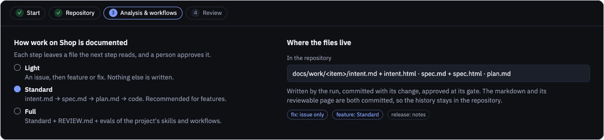

**D15. Modelo de trabalho por projeto**
- **Recomendado:** Leve / Padrão / Completo, por tipo de trabalho. O projeto escolhe no onboarding; feature usa Padrão, fix usa Leve, e cada item pode subir de nível. Os gates que o app já tem passam a aprovar artefatos: o commit do Discovery aprova o intent e o spec, o gate do desenvolvedor aprova o plano.
  - Leve: uma issue, depois feature ou fix.
  - Padrão: `intent.md` → `spec.md` → `plan.md` → código.
  - Completo: Padrão + `REVIEW.md` + evals das skills e workflows do projeto.
- Alternativas:
  - Sempre o modelo completo: pesado para fix e projetos pequenos.
  - Não adotar agora: os documentos continuam soltos (issue, card, brief), sem o loop.

**D16. Onde os artefatos ficam**
- **Decidido pelo dono:** o markdown é commitado no repositório do projeto, em `docs/work/<item>/`: a fonte em inglês (`intent.md`) com a tradução em português ao lado (`intent.pt-BR.md`), mais as imagens de antes e depois. Nenhum HTML é commitado: um leitor renderiza o markdown na hora (com tema, export to PDF e uma página inicial com os itens), então um markdown editado no Maintain nunca precisa de página regenerada. Versionado junto com a mudança e lido por qualquer agente e por quem clona o repo; dados da feature e da issue, não do workspace do usuário. (Substitui o "markdown e HTML commitados" anterior.)
- Alternativas:
  - Só o markdown no repo: perde o histórico da página revisada e o front de navegação.
  - Só no workspace: some para quem clona; agentes de fora não leem.
- **Escopo:** esta proposta só registra a escolha no onboarding e o caminho padrão. Gerar e revisar os documentos é o fluxo de write doc; o front de navegação fica para depois. O run escreve e commita esses arquivos com o gate de sempre; o onboarding nunca escreve no repositório.

### 4 · Revisão

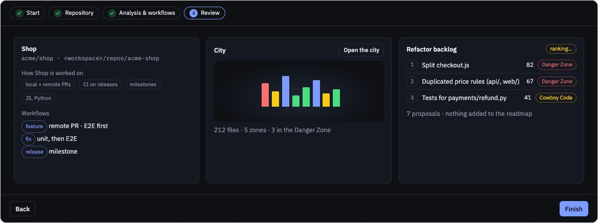

O backlog de refatoração mostra a nota de cada arquivo (0–100) e o quadrante, como na aba Facts.

**D11. A revisão espera as análises?**
- **Recomendado:** não. O Finish funciona a qualquer momento, e o que falta chega na página do projeto com uma notificação.
- Alternativa: esperar tudo, o que prende o usuário olhando uma barra por minutos.

### 5 · Depois, o roadmap

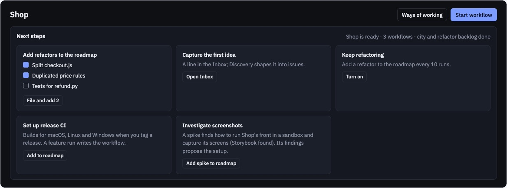

**D12. Como o projeto chega ao roadmap**
- **Recomendado:** o usuário escolhe no "Next steps".
  - Reaproveita `refactor:file` + `refactor:addToRoadmap` (#357, #435) e a cadência.
  - Sem CI de release, um cartão "Set up release CI" (builds para macOS, Linux e Windows na tag) adiciona um item ao roadmap, feito pelo fluxo feature com as skills `ci-pipeline-gh` / `ci-pipeline-gl`.
  - Nada começa sem clique, e o roadmap continua parado até o Start.
- Alternativa: o PO monta um roadmap inicial sozinho. Gera custo e toma decisões sem o dono.

## Screenshots automáticos do projeto

Quem escreve o plan, o write e o review muitas vezes não é técnico: clona o repositório, mas configurar a aplicação para rodar é doloroso, e acaba tirando screenshot na mão. Neste app isso já funciona (`npm run screenshot` e o passo `screenshots` dos workflows); a ideia é oferecer o mesmo para o projeto que está sendo cadastrado, começando por um **spike no projeto do usuário**.

**D19. Como o projeto ganha screenshots automáticos**
- **Recomendado:** um spike no roadmap do projeto, a partir do "Next steps".
  - A etapa 3 já detecta os sinais (Storybook, Playwright, mocks, o comando de run do Local preview); o cartão "Investigate screenshots" coloca um spike no roadmap do projeto, se o usuário quiser.
  - O spike roda no projeto, só-leitura mais tentativas em sandbox (dados de exemplo, sem rede, sem segredos reais): tenta a captura genérica pelo Local preview e avalia um harness no contrato `screenshot` do app.
  - O resultado é um documento de achados (no modelo de trabalho do projeto) e uma proposta de item "Set up screenshots", que o usuário aprova como qualquer item.
- Alternativas:
  - Implementar o harness direto: escreve código no projeto sem saber se o caminho funciona; caro quando falha.
  - Só captura genérica, sem código no projeto: quebra com login, dados vazios e APIs externas.
- **Enquanto isso:** no fluxo de write doc, o dono pode colar ou anexar screenshots no chat das iterações (as imagens coladas do #130), e o writer usa o comando de screenshot do projeto quando ele existir.

## Monitor: erros de produção viram intents

A última peça do loop do SDLC (o Maintain) e a última fase do plano. O app passa a ouvir os erros do projeto rodando, como respostas 500 e logs de erro, agrupa o que se repete e propõe um fix. Hoje o app não tem esse tipo de monitor; ele entra como um grupo novo do menu, **Monitor**, junto do Night watch.

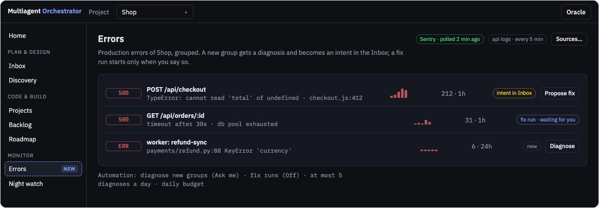

**D17. Como os erros chegam ao app**
- **Recomendado:** polling de fontes conectadas (Sentry, Datadog, CloudWatch, GCP Logging, ou uma URL / arquivo de log com filtro, como status 500 ou nível error). Só conexões de saída, então funciona no .exe sem expor nada. O agrupamento (rota + mensagem + arquivo:linha) e a deduplicação rodam sem modelo. Os tokens das fontes ficam no cofre do sistema (o `safeStorage` do Electron), nunca num arquivo do workspace.
- Alternativas:
  - Webhook recebido pelo app: na hora, mas precisa de uma URL pública. Depois, pelo servidor do engine, após a revisão de segurança (#466–#470).
  - Um agente lendo logs por conta própria: caro e imprevisível para o que um filtro resolve; o modelo só diagnostica.

**D18. O que acontece com um erro novo**
- **Recomendado:** o diagnóstico vira intent, e o fix só roda com um clique.
  - Um turno só-leitura do Oracle cruza o stack trace com o código e escreve o diagnóstico como `intent.md` num card do Inbox (o Maintain do playbook).
  - "Propose fix" começa o fluxo `fix`, que para no gate humano como qualquer run.
  - Modos Ask me / On / Off, como as automações das colunas do Discovery (#259), com teto diário.
- Alternativas:
  - Fix automático até o merge: atravessaria o gate humano, o que o AGENTS.md proíbe.
  - Só listar os erros: não fecha o loop, vira mais um dashboard.

## Custo das chamadas reais

São ordens de grandeza, sem medição. Todo o desenvolvimento roda no provedor simulado (`MULTIAGENT_SIMULATION_ONLY=1`). O assistente mostra o total antes do clique, e ele conta no orçamento diário (#206).

| Item | Quando | Modelo | Estimativa |
|---|---|---|---|
| Validar acesso, clonar, fatos | sempre | nenhum | $0 |
| Perfil do Ways of working pelo git | sempre | nenhum | $0 |
| Ways of working: campos que o git não resolve | só quando algum fica null | Oracle | $0.05–0.30 |
| Cidade: plano do cartógrafo | marcado por padrão | padrão do workflow | $0.30–1.00 |
| Análise de arquitetura (achados) | junto da cidade | Oracle | ~$0.50 |
| Ranking da refatoração pelo PO | marcado por padrão | padrão do PO | $0.10–0.30 |
| Monitor: polling, agrupamento, deduplicação | a cada poucos minutos | nenhum | $0 |
| Monitor: diagnóstico de um grupo de erro novo | Ask me por padrão, até 5 por dia | Oracle | $0.10–0.50 |
| Create new project (com ou sem GitHub) | caminho 2b | nenhum | $0 |

Um import típico com tudo marcado custa cerca de $1–2. Os ~$0.50 da análise de arquitetura são a estimativa do próprio app (no pipeline `release-then-refactors`); os outros valores são chutes a confirmar no primeiro run real, avisado antes.

## Plano faseado

**Fase 1: MVP, o assistente com o que já existe**
- O assistente de 4 etapas (Setup e Projects), com os cards de origem.
- Import do GitHub ou do GitLab no mesmo card, com a validação por `ls-remote`, o clone em segundo plano e a bandeja de progresso.
- Etapa 3: o perfil grátis + o `project-map` + o ranking da refatoração, com o custo visível.
- Sugestões entre os workflows de hoje (local hero / software-development / release) pelas regras do compose.
- A revisão não bloqueante e o cartão "Next steps".
- O Setup sem o passo Workflows.
- Pronto quando: ir do Home vazio a um projeto com cidade, backlog e fluxos funciona todo no simulado, com os erros de acesso cobertos.

**Fase 2: o conjunto feature / fix / release**
- O workflow `fix` novo (um fragment `fix-pipeline`) com o modo hotfix.
- O `feature` com os modos local / remote, as variantes E2E first / code first e as opções.
- A `release` com o passo E2E e a espera pelo CI da release quando existe.
- Remover o auto-push do projeto e pôr o passo "push main" no fim de feature e fix no modo Local (fecha o #617).
- Ways of working revisitado: `team` sai do perfil, `merge` vira `mode: local | remote`, `ci` vira `none | release | pr+release` lido dos gatilhos do CI, e entram `tests` / `e2eCommand`.
- Aliases para os nomes antigos; o compose do #487 passa a gerar feature/fix/release.
- Pronto quando: um projeto antigo, com manifesto e roadmap salvos, roda igual pelos nomes novos.

**Fase 3: reorganizar o resto (fora o Planning)**
- `analyze-project`, `test-backfill`, `retrospective`.
- Pipelines de 6 para 5.
- Docs e README dos workflows reescritos.
- Pronto quando: 11 workflows bundled e a suíte inteira verde.

**Fase 4: criar novo e outras origens**
- "Create new project" com `git init` e remoto opcional no GitHub ou no GitLab (`gh` / `glab repo create`).
- Clone parcial para repos grandes, se as medições pedirem.
- Pronto quando: um projeto novo nasce com repo local e remoto e roda o primeiro feature.

**Fase 5: depois, o loop do SDLC**
- O modelo de trabalho do onboarding passa a valer: intent e spec no Discovery (o formato do write doc), `plan.md` no lugar do brief do desenvolvedor, tudo commitado em `docs/work/<item>/`.
- Um `REVIEW.md` por projeto lido pelo review.
- Achados do Night watch e do analyze-project entram como intent no Inbox.
- Evals de skills e workflows no CI; um front para navegar pelos intents.
- Pronto quando: um item vai de intent a release com os artefatos no repo, e um achado do Night watch volta como intent.

**Fase 6: por último, o Monitor**
- Um grupo novo no menu, **Monitor**: Errors e o Night watch.
- Conectores de polling (Sentry, Datadog, CloudWatch, GCP, URL / arquivo de log) com os tokens no cofre do sistema.
- Agrupamento e deduplicação sem modelo; o diagnóstico vira `intent.md` no Inbox.
- "Propose fix" começa o fluxo `fix`; modos Ask me / On / Off com teto diário.
- Webhook pelo servidor do engine, depois da revisão de segurança.
- Pronto quando: um 500 simulado vira um card no Inbox com o diagnóstico, e o fix proposto para no gate.

## Arquivos e áreas

**Novos**
- `fronts/build/views/projects/project-wizard.js` e `project-wizard.css`
- `packages/shared/onboarding-model.js` (etapas, regras, soma do custo)
- `packages/engine/service/areas/project-onboarding.js` (jobs: clone → fatos → análises)
- `packages/engine/service/channels/onboarding.js`
- Workflows: `workflows/feature.yaml`, `fix.yaml`, `analyze-project.yaml`
- `fragments/fix-pipeline.yaml`
- `scripts/screenshot/views/onboarding.js`
- `features/onboarding.feature`
- `packages/shared/work-model.js` (Leve / Padrão / Completo, caminhos dos artefatos)
- `fronts/monitor/` (um front novo: `views/errors`, `engine/domains/error-sources`, os conectores) e `packages/ui-kit/nav-groups.js` (o grupo Monitor)

**Alterados**
- `fronts/build/views/projects/projects.js` (New project abre o assistente)
- `packages/ui-kit/setup.js` e `packages/shared/setup-model.js`
- `fronts/analyser/views/project/project.js` (o cartão Next steps)
- `packages/engine/domains/project/projects.js` (clone em fundo, status, `git init`, `gh`/`glab repo create`; sai o `autoPush`)
- `packages/engine/service/areas/local-push.js` e `fronts/build/views/backlog/backlog.js` (sai o auto-push; o Push manual fica)
- `packages/engine/service/areas/workflow-interview.js` (perfil grátis, modelo só para os nulos)
- `packages/engine/domains/workflow/workflow-compose.js`
- O carregador de workflows (a tabela de aliases)
- `workflows/release.yaml` e `pipelines/*.yaml`
- `seeds/ways-of-working/seed.md` (perfil: mode, ci e tests; sem team)
- `packages/shared/i18n/*`
- `docs/readme/040-workflows.md` e `docs/agents/engine.md`
- `docs/agents/decisions.md`, depois das decisões

## Perguntas em aberto

Cada uma tem um padrão recomendado.

- **Q-1.** O passo Workflows do Setup some? Padrão: **sim**. O Definitions continua servindo para esconder workflows.
- **Q-2.** Repo privado sem `gh` ou `glab`? Padrão: **oferecer o login do provedor da URL no Next**. Um git credential helper que já funcione também serve.
- **Q-3.** O onboarding escreve arquivos no repositório do usuário? Padrão: **não**. "Customize" escreve em `.multiagent/`, sem commit.
- **Q-4.** As análises com modelo vêm marcadas? Padrão: **sim, com o total visível e "Skip, analyze later"**. No modo simulado, tudo é simulado.
- **Q-5.** "Create new project" cria repo remoto por padrão? Padrão: **só com o `gh` ou o `glab` logado, privado, e desmarcado na primeira vez**.
- **Q-6.** Por quanto tempo os nomes antigos funcionam? Padrão: **duas versões**, com aviso no Start e uma linha nas notas de release.
- **Q-7.** Monorepo: vários projetos num repositório? Padrão: **um projeto por repositório por enquanto**.
- **Q-8.** De onde sai o fix em modo hotfix? Padrão: **da última tag quando a release usa tags; senão de main**.
- **Q-9.** O onboarding coloca algo no roadmap sozinho? Padrão: **não**, só o cartão "Next steps".
- **Q-10.** No modo Local, o push no main é a cada merge? **Decidido pelo dono: sim, como último passo do workflow**, depois do merge no main. O auto-push do projeto (o botão do Backlog e o push depois de cada `merge: local`) sai do app. Isso também acaba com a corrida entre o Ship e o auto-push (#617): cada workflow faz o próprio push. Se o push for recusado porque o origin andou, o passo atualiza o main e tenta de novo, e um conflito volta para o desenvolvedor do run, como o push manual faz hoje.
- **Q-11.** O onboarding escreve os arquivos de CI? Padrão: **não**. "Set up release CI" vira um item do roadmap, feito pelo fluxo feature com `ci-pipeline-gh` / `ci-pipeline-gl`, com gate e revisão como qualquer mudança.
- **Q-12.** Qual modelo de trabalho vem marcado? Padrão: **Standard para feature, Light para fix**; Full só quando o projeto tem CI e quer evals.
- **Q-13.** Onde ficam os artefatos no repositório? Padrão: **`docs/work/<item>/`** (markdown, HTML e imagens), configurável; o Ways of working detecta uma pasta já usada (`docs/rfcs`, `adr/`).
- **Q-14.** Quais fontes de erro primeiro? Padrão: **Sentry e uma URL / arquivo de log com filtro**; Datadog, CloudWatch e GCP depois, conforme a demanda.
- **Q-15.** O Monitor diagnostica sozinho? Padrão: **Ask me**, até 5 diagnósticos por dia; fix runs desligados até você ligar.
- **Q-16.** O cartão "Investigate screenshots" aparece sempre? Padrão: **só quando o projeto tem front** e ainda não tem comando de screenshot; com Storybook ou Playwright, o cartão diz o que encontrou.

## Regras do AGENTS.md

Como a proposta segue o [AGENTS.md](../../AGENTS.md):
- O app continua em inglês; o que os agentes escrevem segue Settings › Language.
- O workspace é o produto: clones vão para `<workspace>/repos/`, projetos novos para `<workspace>/projects/`, análises para `<workspace>/architecture/`.
- Os agentes rodam sem supervisão e registram suposições. O usuário responde às três perguntas no assistente.
- O onboarding não começa run de desenvolvimento nem responde gate. O roadmap só recebe o que o usuário escolhe.
- Ações que saem da máquina (criar repo no GitHub, logar no `gh`) exigem clique explícito.
- As checagens automáticas rodam só no simulado, com `npm run screenshot` e o provedor mock.
- Toda ação real mostra o custo antes.

## Como contribuir

1. Leia o [AGENTS.md](../../AGENTS.md) e os docs de tópico da sua área, principalmente [engine.md](../agents/engine.md), [renderer.md](../agents/renderer.md), [storage.md](../agents/storage.md) e [testing.md](../agents/testing.md), além do [seeds.md](../agents/seeds.md) para o Ways of working.
2. Comente no épico (#628) antes de pegar uma fase. As fases viram sub-issues quando o dono confirmar as decisões.
3. A fase 1 não mexe em workflows. As fases 2 e 3 mudam workflows bundled e precisam da tabela de aliases antes.
4. Trabalhe numa branch e abra um PR. Nunca rode modelos reais nas checagens: provedor mock para os testes, `npm run screenshot` para as telas.
