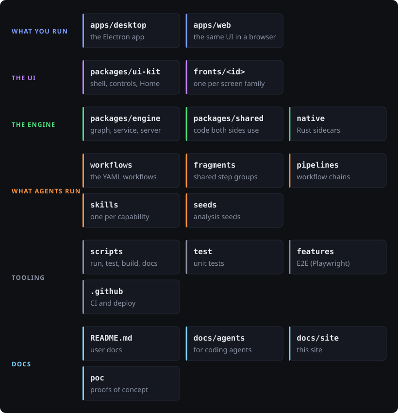
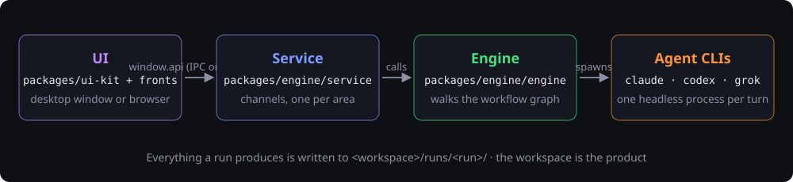

The repository has six kinds of folders. Everything the user edits or produces lives outside it, in the **workspace** folder.

## The folders

| Folder | What it is for |
| --- | --- |
| `apps/desktop` | The Electron app: main process, preload, the composed page. |
| `apps/web` | The same UI served by the engine at `/`, for a browser. |
| `packages/ui-kit` | Plain HTML/CSS/JS: the shell, the run kernel, controls, Home, Settings. No bundler. |
| `fronts/<id>` | Screen families (`analyser`, `build`, `plan`, `ai`), one folder per screen under `views/`. |
| `packages/engine` | The engine (runs the YAML graph), the service (channels the UI calls), the HTTP server. |
| `packages/shared` | Modules both the UI and the engine use, including the CLI providers. |
| `native` | Small Rust sidecars shipped next to the app: MCP server, session tail, control client. |
| `workflows`, `fragments`, `pipelines` | The bundled YAML: workflows, reusable step groups, chains of workflows. |
| `skills`, `seeds` | What agents read: one skill per capability, analysis seeds. |
| `scripts`, `test`, `features`, `.github` | Run, test, build and docs scripts; unit tests; E2E; CI. |
| `README.md`, `docs/` | User docs, the docs for coding agents (`docs/agents`), this site (`docs/site`). |

{.map}

## At run time

- The UI only talks to `window.api`. The same screens run in the desktop window and in a browser against a remote engine.
- The engine starts each agent turn as a headless CLI process and stops at human gates.
- Bundled workflows and skills are **copied into the workspace** on startup; the app folder stays read-only.

## Where things go

| You want to… | Look in |
| --- | --- |
| Change a screen | `fronts/<id>/views/<view>/` or `packages/ui-kit/` |
| Change how a run works | `packages/engine/engine/` |
| Add a channel the UI can call | `packages/engine/service/channels/` |
| Change what an agent does | `workflows/*.yaml`, then `skills/<name>/SKILL.md` |
| Read the rules | `AGENTS.md`, then `docs/agents/` |

