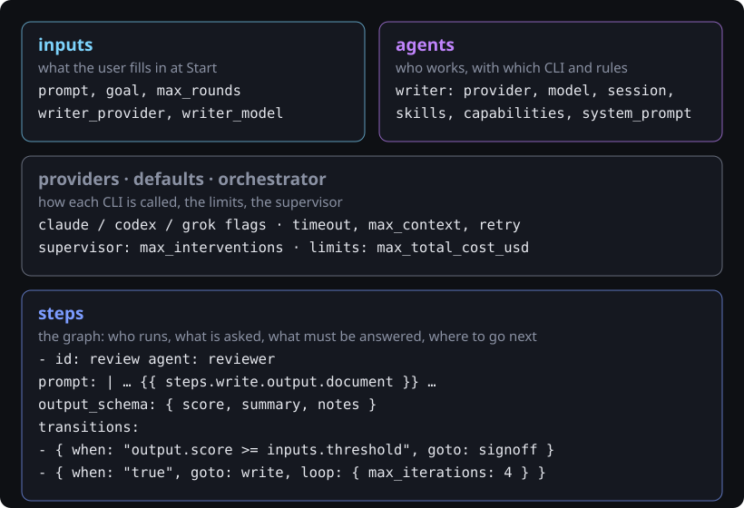
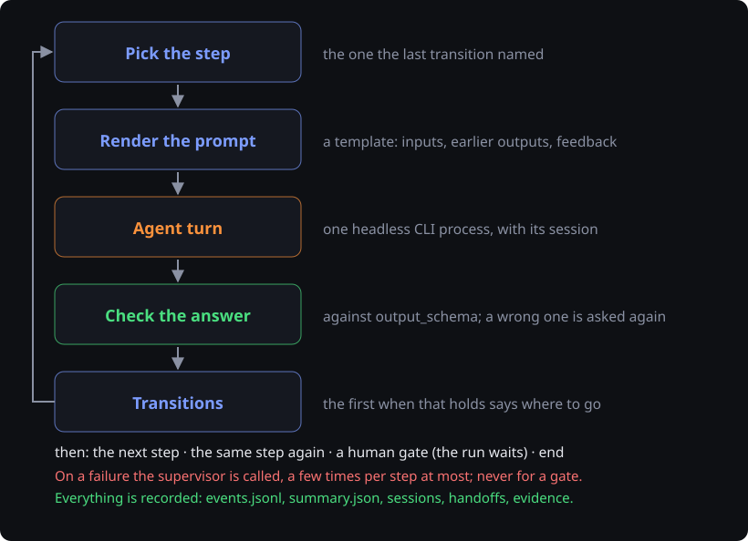
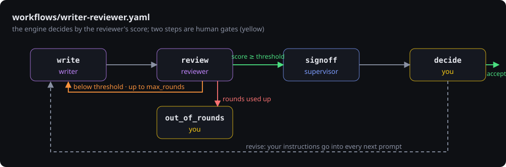

The engine is not an AI. It reads a YAML workflow, walks its steps and transitions, and starts one headless CLI process per agent turn. Every decision between steps is an expression in the YAML, not a model's opinion.

## A workflow



| Part | What it declares |
| --- | --- |
| `inputs` | The form at Start. Everything else reads them as `{{ inputs.x }}`. |
| `agents` | Who works: CLI and model, session mode, skills, capabilities, system prompt. |
| `providers` | How each CLI is called. The engine turns capabilities into each CLI's flags. |
| `defaults`, `orchestrator` | Timeouts, context and retry limits, the run's budget, the supervisor. |
| `steps` | The graph: who runs, the prompt, the answer's schema, and the transitions. |

{.map}

## One visit of a step



- **Prompts are templates.** They read the inputs, earlier outputs (`steps.review.output.score`), the visit count and the user's feedback.
- **Answers are checked.** A step with `output_schema` gets its answer as JSON; a wrong answer is asked again, then the supervisor is called.
- **Transitions decide.** `when` expressions are tried in order; `loop` caps how many times a step is revisited and names where to go when it runs out.
- **Gates stop the run.** A `human_approval` step waits for you. Nothing automated, the supervisor included, ever answers one.

## An example



The reviewer answers `{ score, summary, notes }`. The engine compares the score to the threshold: above, the sign-off; below, back to the writer with the notes in its next prompt, up to `max_rounds`.

## Step types

| `type` | What runs |
| --- | --- |
| *(agent)* | One agent turn. `agents: [a, b]` fans out in parallel. |
| `human_approval` | A gate: choices, optional free text and images. |
| `suite`, `test_ids`, `check` | The project's tests or a command, no model. |
| `screenshots` | The app's screens as evidence for a later reviewer. |
| `workflow` | Another workflow as child runs, with `foreach`. |

{.map}

## Sessions

| `session` | Each turn |
| --- | --- |
| `persistent` | Continues the same conversation for the whole run (default). |
| `ephemeral` | Starts fresh with only the prompt. |
| `handoff` | Starts fresh from the agent's own handoff note. |

{.map}

Persistent agents write a **handoff note** after each turn. When the context grows past `max_context`, or the agent sat idle past `fresh_after_idle`, the next turn opens a new session from that note instead of a cold, expensive resume.

## How a run ends

| Status | When |
| --- | --- |
| `success` | A transition reaches `end`, or ships. |
| `failed` | A failure gate is rejected, a limit is hit, or a step cannot recover. |
| `cancelled` | You stop it, or reject a review gate. |
| `paused` | You pause it, or an agent is cut by its request budget; it resumes later. |

{.map}

## On disk

```
<workspace>/runs/<id>/
  events.jsonl      every event, in order (the source of truth)
  summary.json      the run as the lists show it
  sessions/         each agent's conversation
  handoffs/         <step>-v<visit>-<agent>.md
  evidence/         screenshots per step and round
  decisions.tsv     what each transition decided, and why
```

## In the code

| Area | File |
| --- | --- |
| The run loop | `packages/engine/engine/workflow.js` |
| Loading and validating the YAML | `packages/engine/engine/run/load.js` |
| Transitions, loops, merge, ship | `packages/engine/engine/run/transitions.js` |
| Gates | `packages/engine/engine/run/gates.js` |
| Sessions and handoff notes | `packages/engine/engine/run/sessions.js` |
| The provider call, retries, fallbacks | `packages/engine/engine/run/turns.js` |
| The supervisor | `packages/engine/engine/run/supervision.js` |

{.map}
