A workflow is a YAML file in `workflows/`, copied into your workspace on startup. The diagrams below are drawn from those files: each row is a stage, each chip a step, coloured by who runs it. Orange arcs go back to an earlier stage; **→ end** marks a stage a run can end from.

Pick one at **Start**; the ones a computer cannot run (no Codex, no GitHub CLI) are hidden until it can.

## Build

### Software development

Implements, reviews, tests, builds, watches CI and the PR/MR, publishes a preview and, once approved, merges and tracks the production deploy. Works with several languages on GitHub or GitLab.

Agents: developer, reviewer, test_writer, builder, verifier, evidence, ci_pusher, pr_babysitter, deployer.

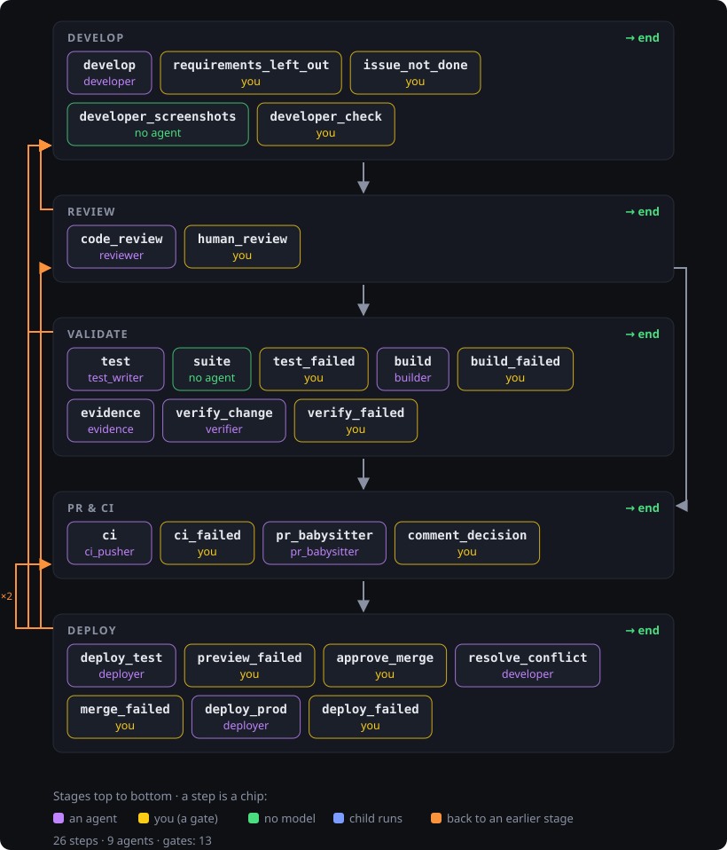

### Software development, local hero

Implements, reviews, tests, builds and verifies a change in its own worktree, then merges it into the local base branch automatically, resolving conflicts on the way. No push, no PR, no CI; push when you want.

Agents: developer, reviewer, test_writer, builder, verifier, evidence.

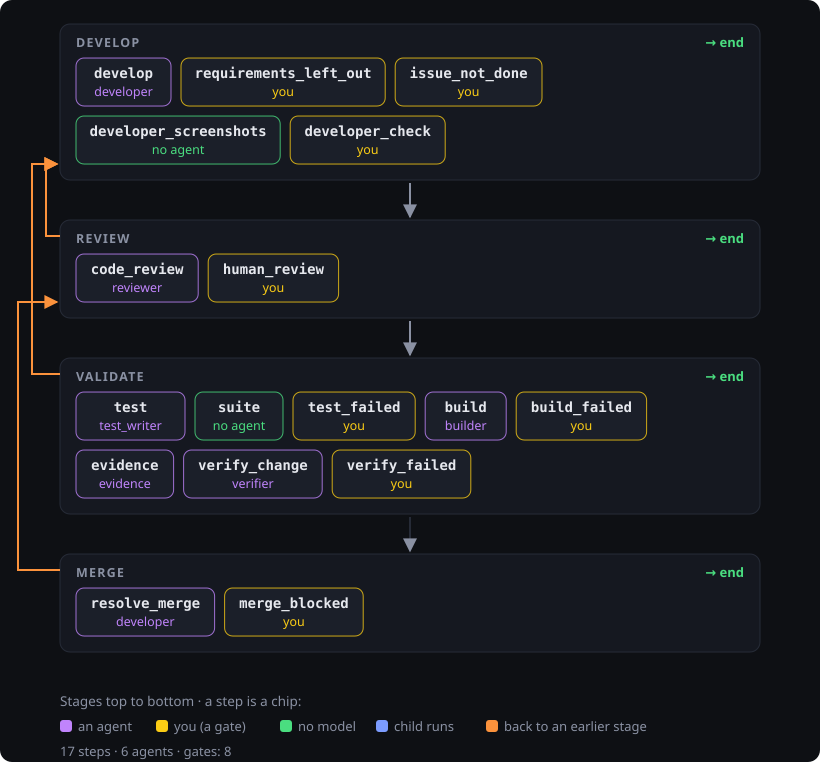

### AI development, local hero

Tests first: the test writer writes the acceptance tests from the issue before any code, the developer implements until they pass (never editing them), then review, the suite, build, verification and the local merge. No push, no PR, no CI.

Agents: developer, reviewer, ui_reviewer, test_writer, mapper, builder, verifier, evidence, healer.

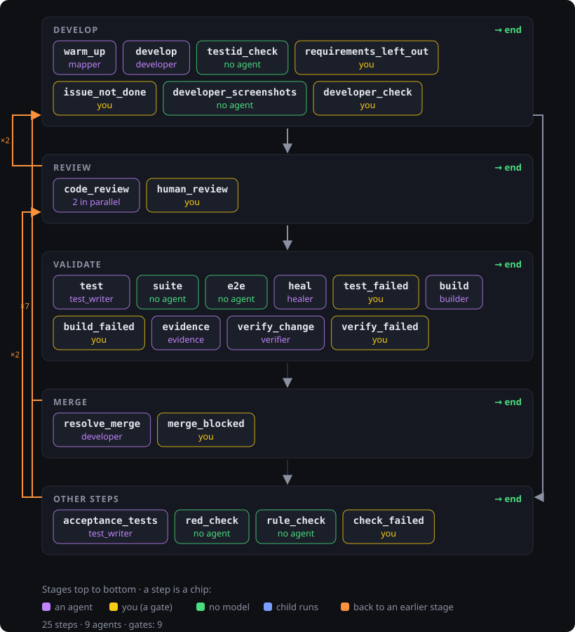

### Refactor

One refactor, done safely, in any language: the test writer pins the target's current behaviour first, the developer changes structure only, then the full suite, the build audit and a review of "same behaviour, simpler structure?", and the local merge.

Agents: test_writer, developer, reviewer, builder.

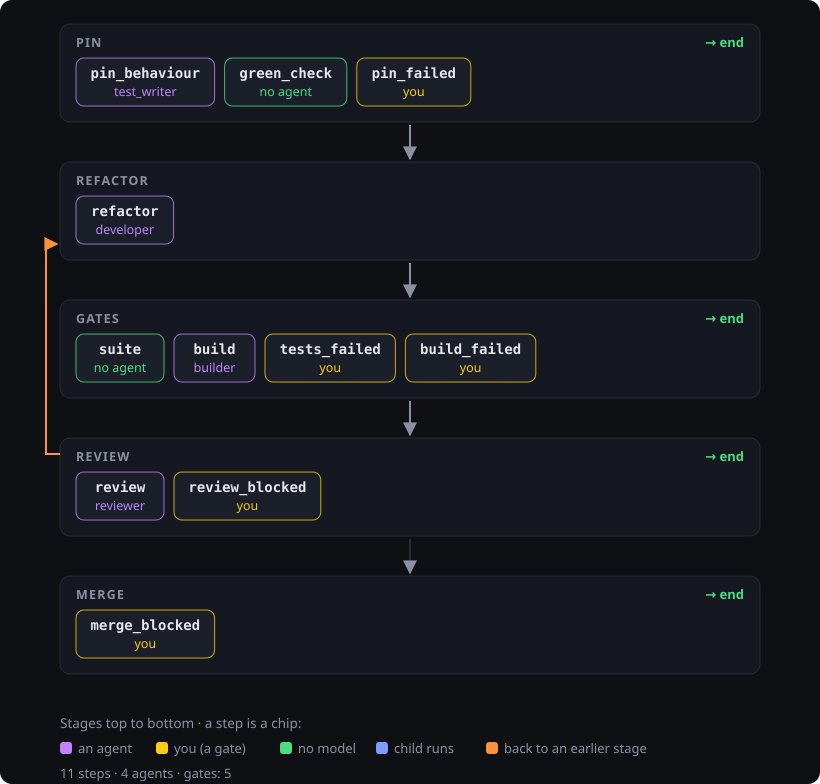

### Test batch

Writes the missing tests for the work merged locally since the last green batch in one test writer session, runs the whole suite once per round without an agent, and merges the tests into the local base. Never pushes.

Agents: test_writer, developer.

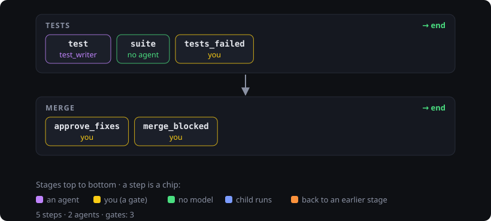

### E2E release

Runs the project's whole end-to-end suite once, before a release, in its own worktree of the local base; a failing scenario goes to the developer and back to the suite, then you approve the fix. Never pushes or tags.

Agents: e2e_runner, developer, reviewer.

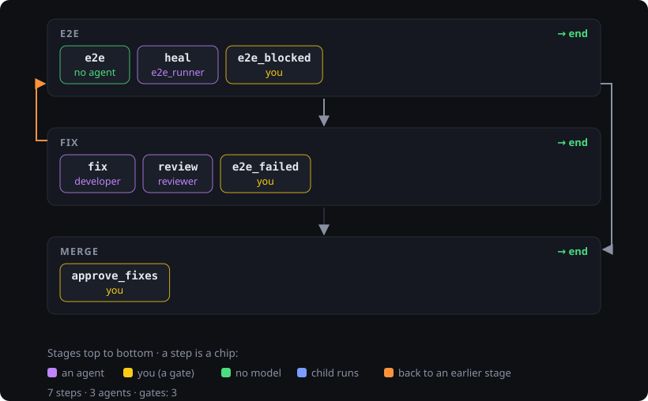

### Release

Checks what merged locally since the last release with the whole unit suite and the whole E2E suite (no agent while they are green; a regression goes to the developer), then you Ship (push the local base, tag, optional build) or Hold. Nothing is pushed without your Ship.

Agents: developer, reviewer.

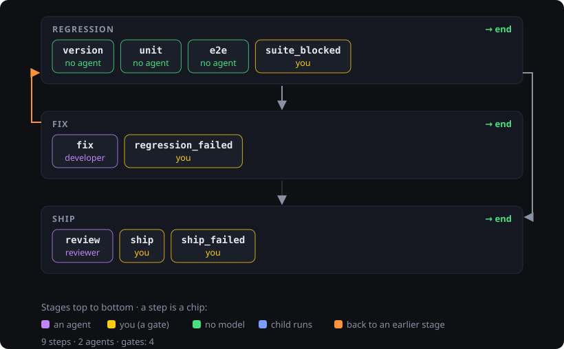

### Multi-model review

Several models review the same diff in parallel, a blast-radius check looks outside the diff, and a lead judge merges, verifies and ranks the findings.

Agents: opus, sonnet, gpt, blaster, judge.

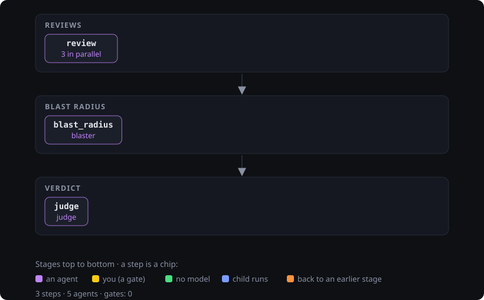

## Plan

### Writer & Reviewer

A writer drafts a document from your prompt, a reviewer scores it against your goal and sends notes back until it passes, and the supervisor checks it and asks you what to do.

Agents: writer, reviewer, signoff.

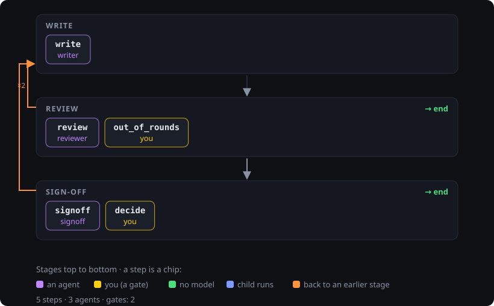

### AI Arena

Up to five models you pick write the same document in parallel, blindly critique each other, and an orchestrator merges the final document.

Agents: contender_1 to contender_5, synthesizer, verifier.

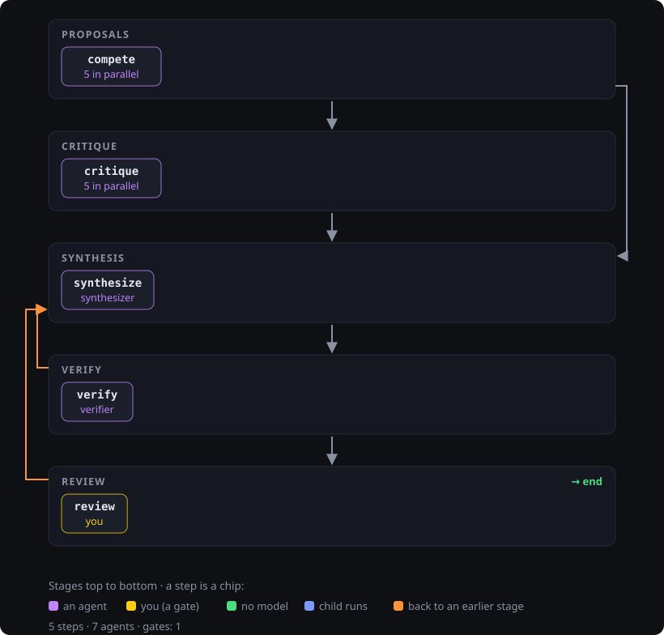

### Issue tracker

Turns a request in a few words into a triaged GitHub/GitLab issue (the code involved, the files to change, impact and complexity as labels, duplicates) and files it after you approve the draft, or as soon as it is written in automatic mode.

Agents: code_analyzer, issue_writer, issue_filer.

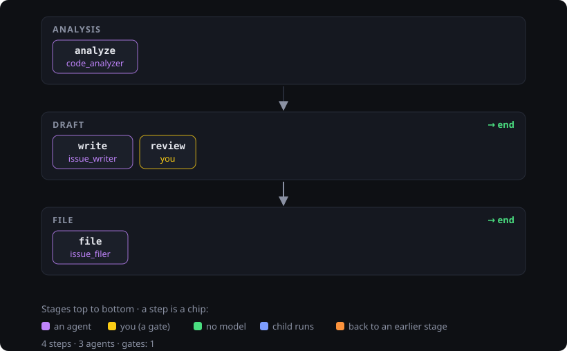

### Backlog refresh

Reviews every open issue against the code as it is now (renamed files, drifted lines, tasks already done, obsolete or duplicated issues), applies the safe fixes and asks you before closing anything.

Agents: refresher.

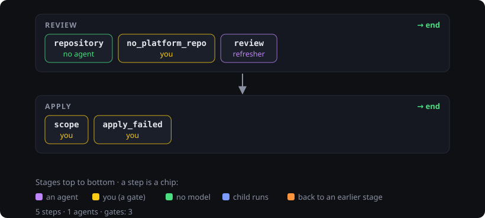

### Project map

The project's city plan and the Oracle's architecture analysis, as one run: the cartographer reads the repository and writes zones, districts, landmarks and ports as path rules; the plan is validated by rules and saved; then the Oracle analyses the project's hotspots.

Agents: cartographer.

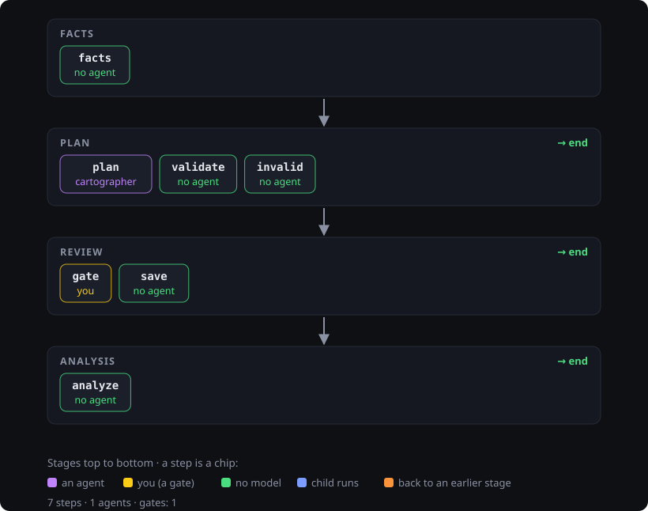

## Monitor

### Refactor proposals

Refactors suggested after a release: the architecture analysis of the project, focused on the Danger Zone and the files changed since a tag; the findings become Refactor tab proposals, the Product Owner ranks them and the top ones are filed as issues for the Refactor workflow.

Agents: analyst.

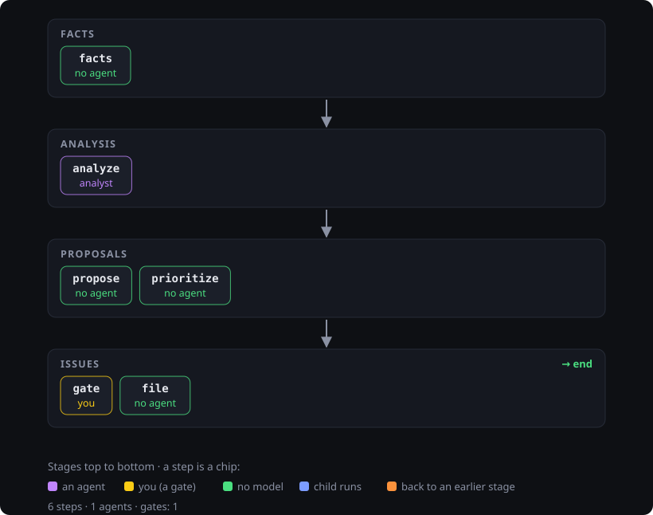

### Run retrospective

Analyzes a finished run's logs and proposes evidence-backed improvements to skills and workflows.

Agents: retro.

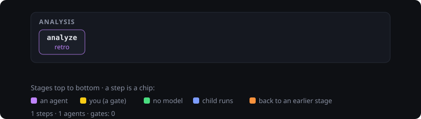
