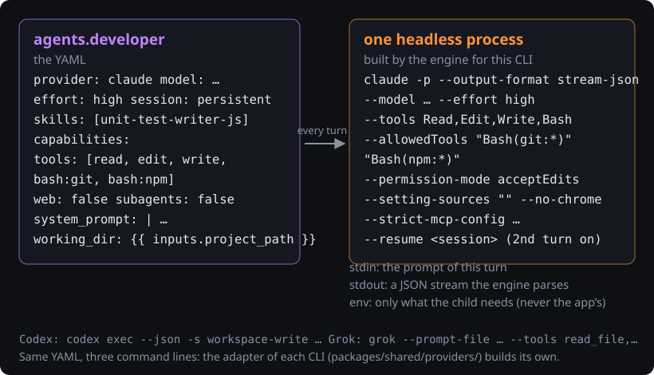
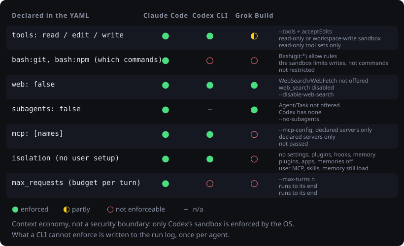
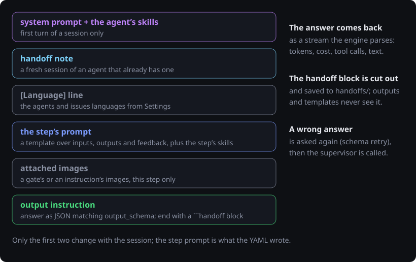

An agent is not a program. It is a block of YAML: which CLI and model, what it may touch, what it is told. The engine starts one headless process per turn and reads its stream.

## One agent, one process



| Key | What it sets |
| --- | --- |
| `provider`, `model`, `effort` | The CLI and the model. Changeable per run at Start, under Agents. |
| `session` | `persistent`, `ephemeral` or `handoff`. See the engine page. |
| `skills` | Loaded into the system prompt on the first turn. |
| `capabilities` | Tools, commands, web, sub-agents, MCP servers. |
| `system_prompt` | Who the agent is. A template, like every prompt. |
| `working_dir` | Where the process runs: the run's worktree by default. |

{.map}

## Providers

| Provider | Command | Note |
| --- | --- | --- |
| `claude-code` | `claude -p` | Required. Reads your Claude Code sign-in; never a model call to check it. |
| `codex-cli` | `codex exec` | Enables the multi-model workflows. OS-enforced sandbox. |
| `grok-cli` | `grok --prompt-file` | Few flags: its tools are restricted, the rest is not. |
| `mock` | none | Simulation mode: a whole run for free, no CLI started. |

{.map}

- **Fallbacks.** `fallbacks: [claude:claude-opus-5-5, codex:gpt-6-luna]` on an agent, or a list per provider in Settings. On a quota or credit error the turn reruns on the next entry, in a fresh session from the handoff note, and the run keeps that choice. A fallback never skips a step or a gate.
- **Limits per model.** `models: { <model>: { timeout_factor, max_total_cost_usd } }`: a slow or expensive model gets more time and budget wherever it is used.
- **Accounts.** Each CLI runs on the account of its config folder; Settings can hold several and pick one per run.

## Capabilities



```yaml
agents:
  ci_pusher:
    capabilities:
      tools: [read, bash:git, bash:gh]   # also edit, write, bash (any command)
      web: false
      subagents: false
      mcp: []
steps:
  - id: research
    agent: ci_pusher
    capabilities: { web: true }          # this step only
```

Fewer tools offered means a smaller prompt: a developer agent's first request went from 41k tokens with the user's setup to 22k isolated. Isolation is on by default; `isolation: false` loads your own CLI setup too.

## One turn



Whatever the CLI, the engine checks the turn's changes afterwards: a turn that edited test files when it must not is sent back.
