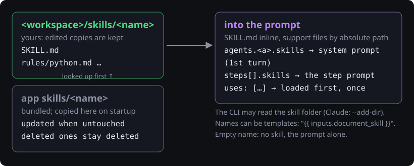
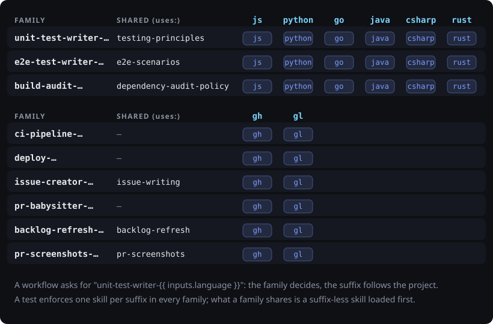

The workflow says **who**, **when** and **what must be answered**. The skill says **how**. Sixty-six ship with the app; yours live in the workspace and win over them.

## Where a skill comes from



```yaml
# skills/unit-test-writer-go/SKILL.md
---
name: unit-test-writer-go
description: ...
uses: [testing-principles]   # loaded first, once
---
How to write the tests ...
```

## Families



## What ships

| Kind | Skills |
| --- | --- |
| Writing documents | `prd-writing`, `rfc-writing`, `design-doc-writing`, `issue-writing`, `adr-writing`, `test-plan-writing` |
| Code | `code-review` (rules per language), `bug-diagnosis`, `merge-conflict-resolver`, `implementation-evidence`, `pr-description` |
| Tests | `unit-test-writer-*`, `e2e-test-writer-*`, `testing-principles`, `e2e-scenarios` |
| Platform | `ci-pipeline-*`, `deploy-*`, `issue-creator-*`, `pr-babysitter-*`, `backlog-refresh-*`, `pr-screenshots-*` |
| Review and judgment | `claim-verification`, `blast-radius`, `review-synthesis`, `clarity-score`, `arena-synthesis` |
| The app's own agents | `oracle`, `run-supervisor`, `backlog-product-owner`, `project-map`, `run-retrospective` |

{.map}

## Rules they all follow

- **Agents run unattended.** Where a skill would ask you, it records an assumption or a default instead.
- **English in the file**, your language in the output: Settings › Language is one line in every turn.
- **Edit in the workspace.** An edited copy is never overwritten by an app update; an untouched one is.
