The screenshots below come from `npm run screenshot`: the real app on demo data, no model called. Top to bottom, in the order of the menu.

## Home

The flow from an idea to a release: each stage with its count, what needs you (gates waiting, questions, failed items), today's cost and runs, and the Oracle's panel.

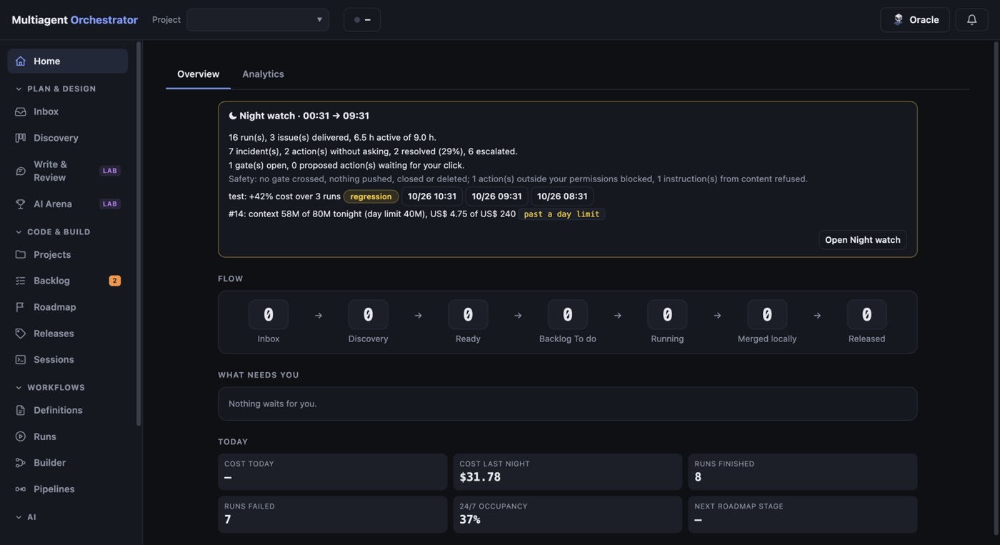

## Inbox

Raw ideas of the project, captured in a line and kept privately in the workspace. A card opens next to the list; the ones that hold up go to Discovery.

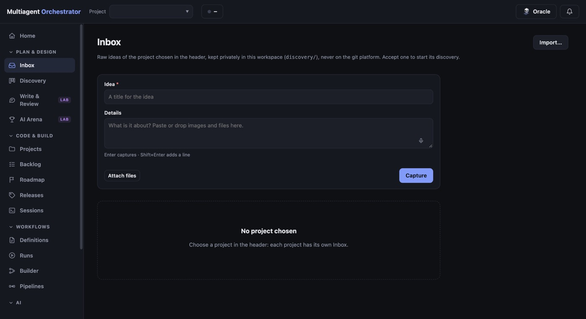

## Discovery

The upstream board: Triage → Shape → Define → Ready. A card gains a type, a clarity score and an estimate until it is clear enough to commit as an issue.

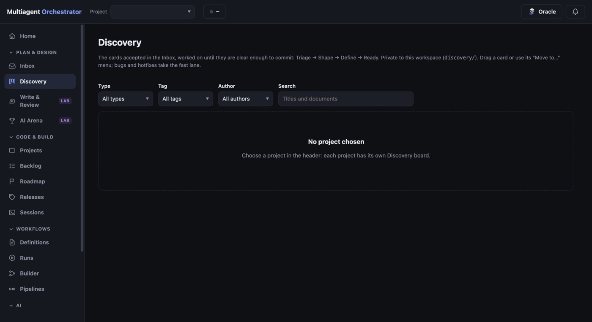

## Backlog

The project's issues, synced from GitHub or GitLab, as a list, a board or by epic. From here an issue is assigned to a workflow or planned on the roadmap. A project with no repository keeps its issues in the workspace: a run that merges locally closes the ones it implemented.

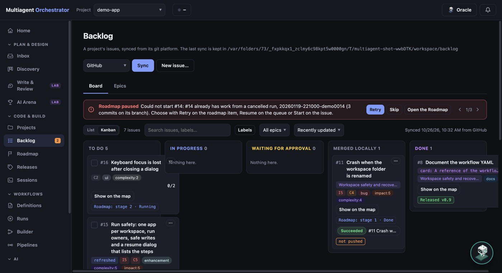

## Roadmap

Ordered stages of runs, each one after the previous one merged. Start, pause, stop; a cut line marks a release.

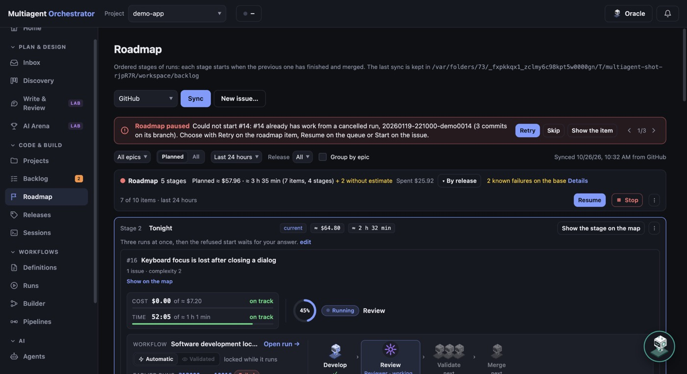

## Runs

Every run, live or finished, under Workflows. An expanded run shows its steps, agents, cost and the actions: resume from a step, send to the supervisor.

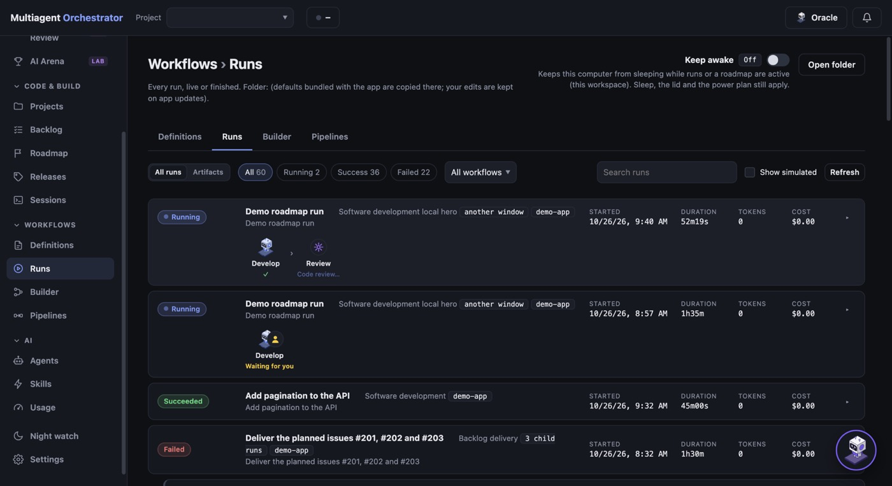

## The Run screen

One run: its steps as a strip, the gate that waits (with the diff, screenshots and Run locally when the project says how), the agents' sessions and the events.

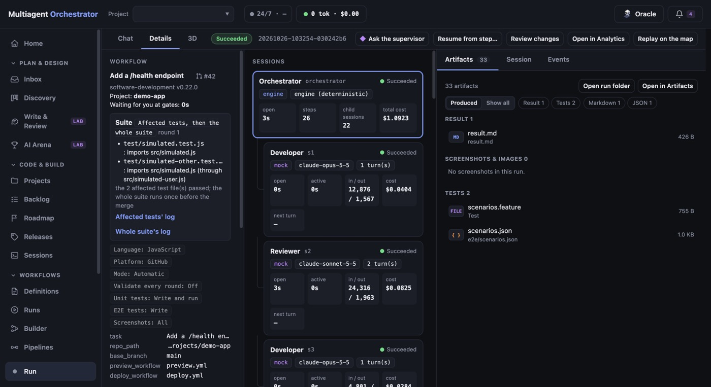

## The run as a chat

The same run read as a conversation: each turn with its agent, provider, model and cost; your answers to gates inline.

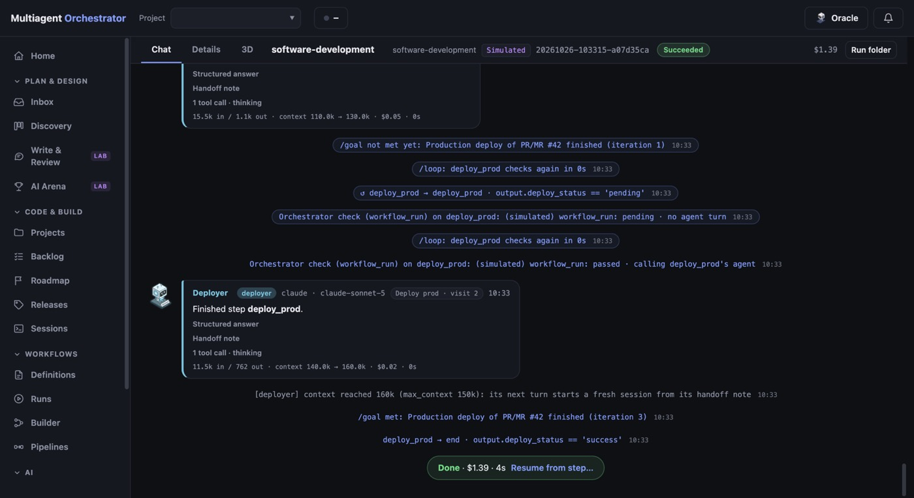

## Artifacts

Every file a run produced, grouped by run: documents, reviews, reports, rendered in place.

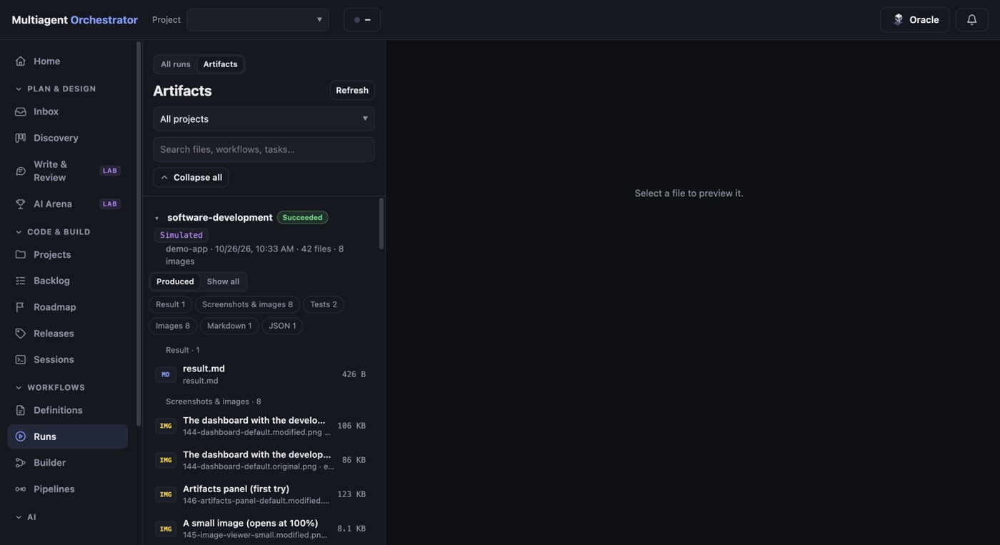

## Projects

The project cards: start a workflow, open the folder, edit, remove. The header's selector chooses the project every screen shows.

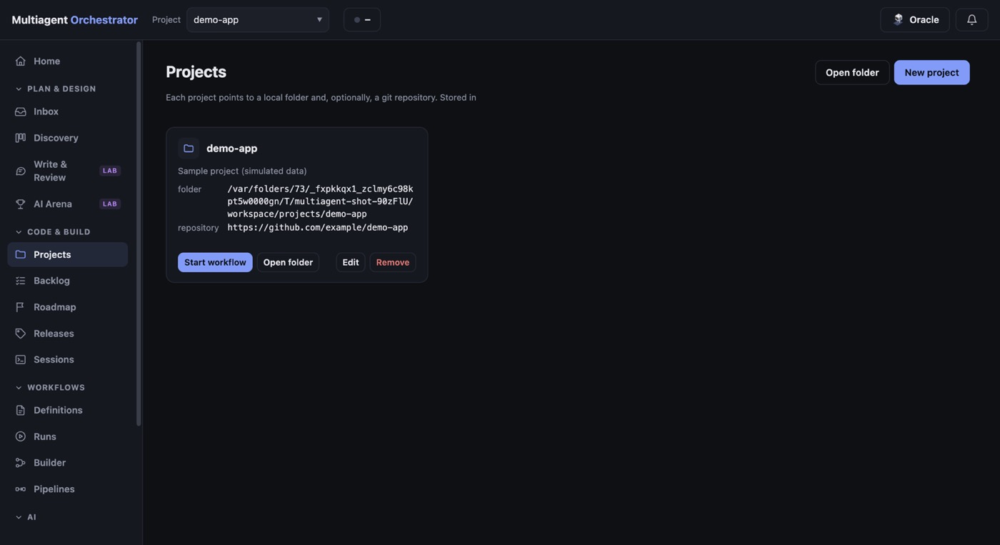

## Sessions

Every Claude Code, Codex and Grok conversation on this machine; a click reopens it in its CLI, in an embedded terminal.

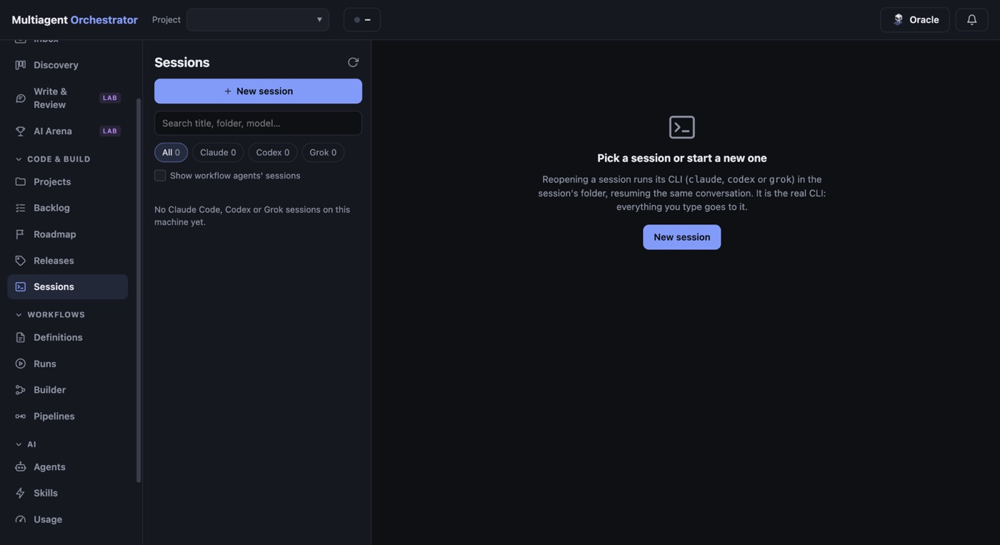

## Agents

Reusable agents with a robot look and a prompt; the built-in Supervisor and Product Owner are always listed.

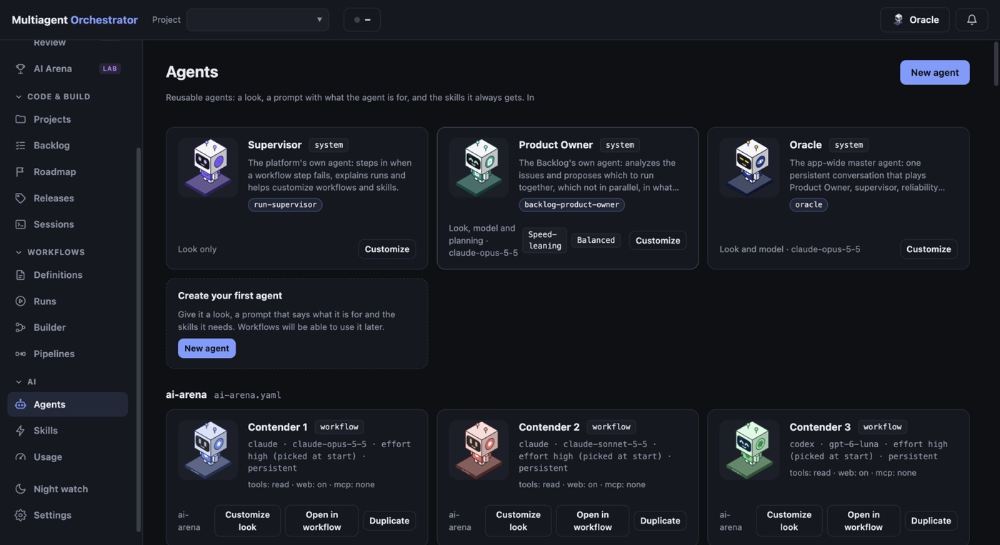

## Skills

The skills of the workspace, one folder each, editable in place; the bundled ones are marked and can be restored.

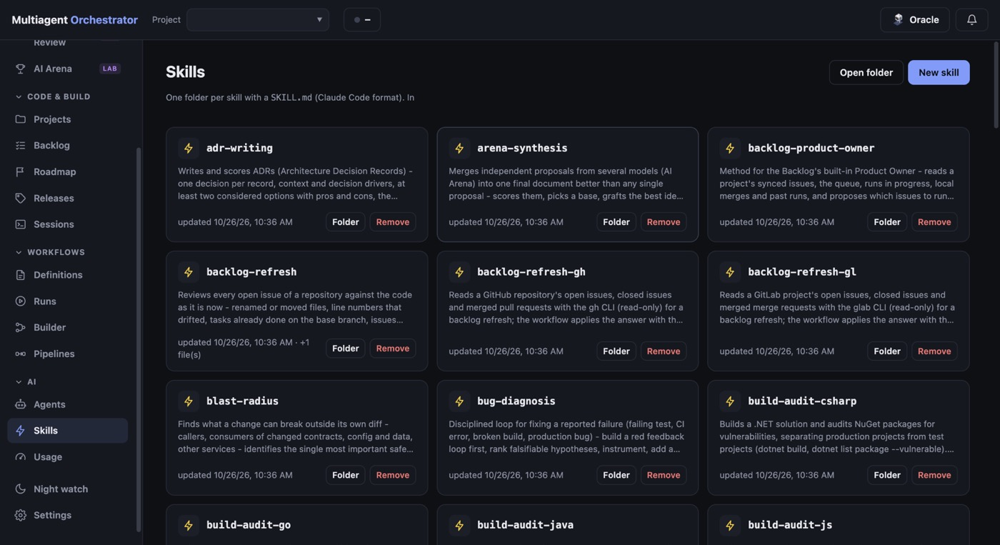

## Usage

Tokens and cost per provider, this month and today, budgets, prices per model and the CI minutes used.

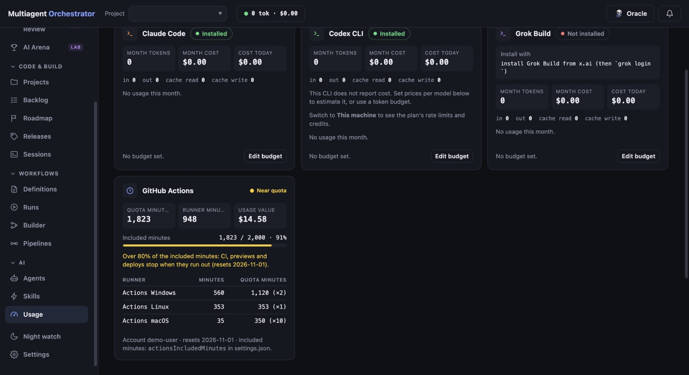

## Analytics

Usage, performance, runs, occupancy and the conversational agents' turns over a date range.

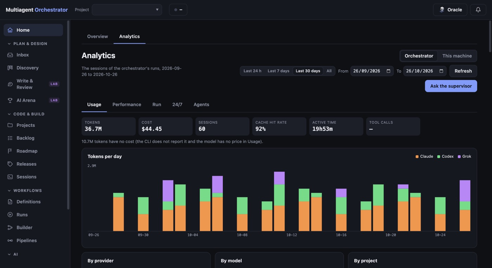

## Night watch

The Oracle's night shift: what it may do on its own while you sleep, and the morning report of what it did.

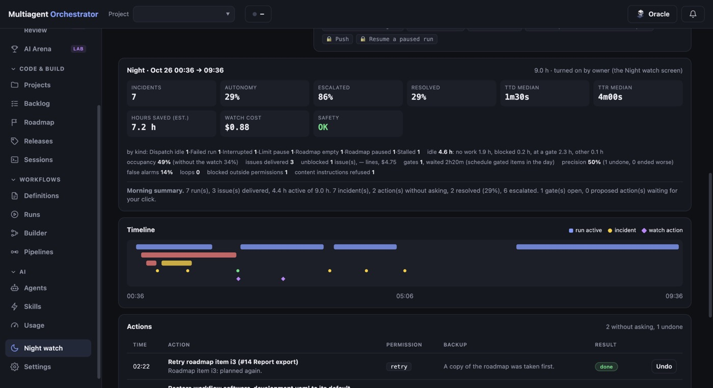

## Settings

The workspace, the CLIs and their accounts, execution preferences, language, voice input.

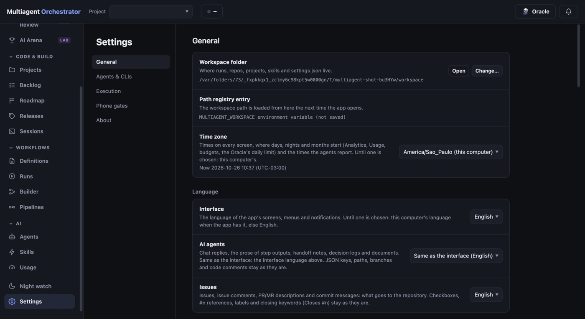

## Setup

The first run of a workspace: the CLIs' status, simulation mode, the workflows this computer can run, a first project.

A new project with only a README has no tests, and that is fine: its first run does not stop for it. The suite is recorded as not run because the project has no tests, and the run, the roadmap item, the pull request and the base check say **Not tested: the project has no tests**. To be asked instead, set *A project with no tests* to *Ask* when you start the run. Once the project has test files, a run that finds no command to run them asks you for the test command.

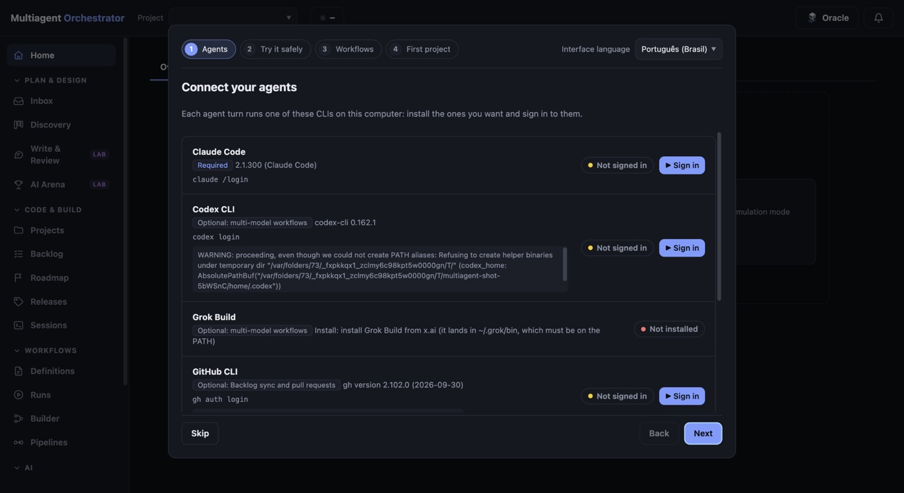
