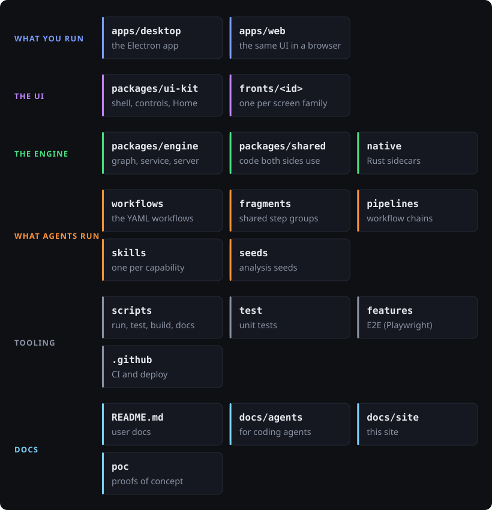
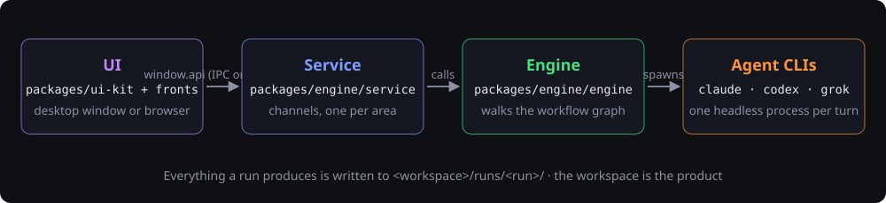

O repositório tem seis tipos de pasta. Tudo o que o usuário edita ou produz fica fora dele, na pasta do **workspace**.

## As pastas

| Pasta | Para que serve |
| --- | --- |
| `apps/desktop` | O app Electron: processo principal, preload, a página composta. |
| `apps/web` | A mesma UI servida pelo engine em `/`, para um navegador. |
| `packages/ui-kit` | HTML/CSS/JS puro: o shell, o núcleo da run, controles, Home, Settings. Sem bundler. |
| `fronts/<id>` | Famílias de telas (`analyser`, `build`, `plan`, `ai`), uma pasta por tela em `views/`. |
| `packages/engine` | O engine (executa o grafo YAML), o service (canais que a UI chama), o servidor HTTP. |
| `packages/shared` | Módulos usados pela UI e pelo engine, incluindo os provedores das CLIs. |
| `native` | Pequenos sidecars em Rust distribuídos junto do app: servidor MCP, tail de sessão, cliente de controle. |
| `workflows`, `fragments`, `pipelines` | O YAML incluído: workflows, grupos de passos reutilizáveis, cadeias de workflows. |
| `skills`, `seeds` | O que os agentes leem: uma skill por capacidade, seeds de análise. |
| `scripts`, `test`, `features`, `.github` | Scripts de execução, teste, build e docs; testes unitários; E2E; CI. |
| `README.md`, `docs/` | Docs do usuário, docs para agentes de código (`docs/agents`), este site (`docs/site`). |

{.map}

## Em execução

- A UI só fala com `window.api`. As mesmas telas rodam na janela do desktop e num navegador contra um engine remoto.
- O engine inicia cada turno de agente como um processo CLI sem interface e para nos gates humanos.
- Workflows e skills incluídos são **copiados para o workspace** na abertura; a pasta do app fica somente leitura.

## Onde mexer

| Você quer… | Olhe em |
| --- | --- |
| Mudar uma tela | `fronts/<id>/views/<view>/` ou `packages/ui-kit/` |
| Mudar como uma run funciona | `packages/engine/engine/` |
| Adicionar um canal que a UI chama | `packages/engine/service/channels/` |
| Mudar o que um agente faz | `workflows/*.yaml`, depois `skills/<nome>/SKILL.md` |
| Ler as regras | `AGENTS.md`, depois `docs/agents/` |

