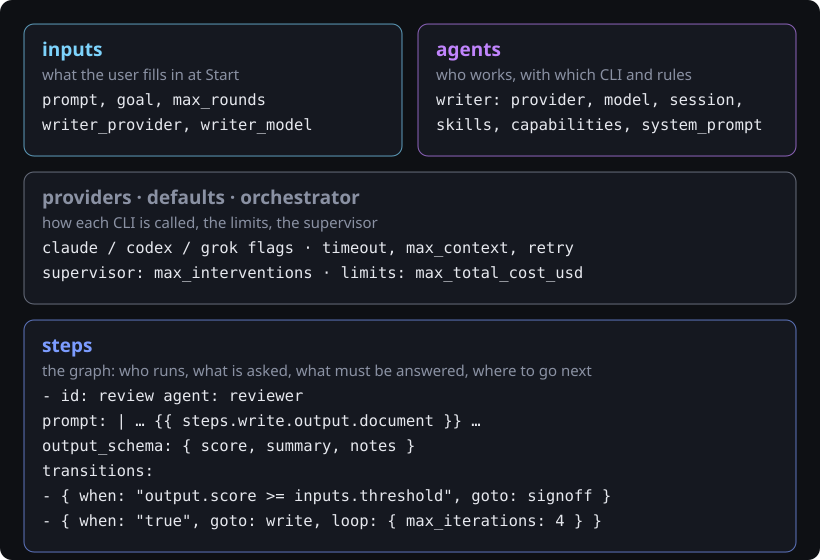
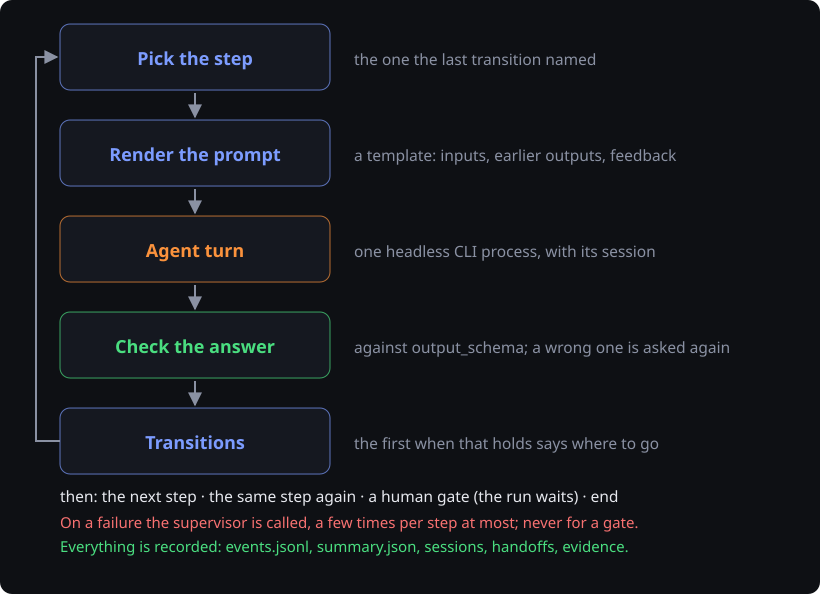
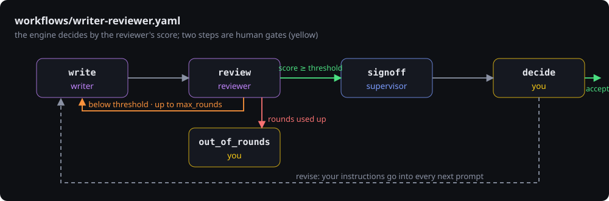

O engine não é uma IA. Ele lê um workflow em YAML, percorre seus passos e transições e inicia um processo CLI sem interface por turno de agente. Toda decisão entre passos é uma expressão no YAML, não a opinião de um modelo.

## Um workflow



| Parte | O que declara |
| --- | --- |
| `inputs` | O formulário do Start. Todo o resto os lê como `{{ inputs.x }}`. |
| `agents` | Quem trabalha: CLI e modelo, modo de sessão, skills, capacidades, system prompt. |
| `providers` | Como cada CLI é chamada. O engine transforma capacidades nas flags de cada CLI. |
| `defaults`, `orchestrator` | Timeouts, limites de contexto e retry, o orçamento da run, o supervisor. |
| `steps` | O grafo: quem roda, o prompt, o schema da resposta e as transições. |

{.map}

## Uma visita a um passo



- **Prompts são templates.** Leem os inputs, saídas anteriores (`steps.review.output.score`), o número da visita e o feedback do usuário.
- **Respostas são verificadas.** Um passo com `output_schema` recebe a resposta em JSON; uma resposta errada é pedida de novo, depois o supervisor é chamado.
- **Transições decidem.** As expressões `when` são testadas em ordem; `loop` limita quantas vezes um passo é revisitado e diz para onde ir quando acaba.
- **Gates param a run.** Um passo `human_approval` espera por você. Nada automático, nem o supervisor, responde um gate.

## Um exemplo



O reviewer responde `{ score, summary, notes }`. O engine compara a nota ao limiar: acima, o sign-off; abaixo, volta ao writer com as notas no próximo prompt, até `max_rounds`.

## Tipos de passo

| `type` | O que roda |
| --- | --- |
| *(agente)* | Um turno de agente. `agents: [a, b]` roda em paralelo. |
| `human_approval` | Um gate: opções, texto livre e imagens opcionais. |
| `suite`, `test_ids`, `check` | Os testes do projeto ou um comando, sem modelo. |
| `screenshots` | As telas do app como evidência para um revisor depois. |
| `workflow` | Outro workflow como runs filhas, com `foreach`. |

{.map}

## Sessões

| `session` | Cada turno |
| --- | --- |
| `persistent` | Continua a mesma conversa a run inteira (padrão). |
| `ephemeral` | Começa do zero só com o prompt. |
| `handoff` | Começa do zero a partir da nota de handoff do próprio agente. |

{.map}

Agentes persistentes escrevem uma **nota de handoff** após cada turno. Quando o contexto passa de `max_context`, ou o agente ficou parado além de `fresh_after_idle`, o turno seguinte abre uma sessão nova a partir dessa nota em vez de um resume frio e caro.

## Como uma run termina

| Status | Quando |
| --- | --- |
| `success` | Uma transição chega a `end`, ou publica. |
| `failed` | Um gate de falha é rejeitado, um limite é atingido, ou um passo não se recupera. |
| `cancelled` | Você a para, ou rejeita um gate de revisão. |
| `paused` | Você a pausa, ou um agente é cortado pelo orçamento de requests; retoma depois. |

{.map}

## Em disco

```
<workspace>/runs/<id>/
  events.jsonl      todo evento, em ordem (a fonte da verdade)
  summary.json      a run como as listas mostram
  sessions/         a conversa de cada agente
  handoffs/         <passo>-v<visita>-<agente>.md
  evidence/         screenshots por passo e rodada
  decisions.tsv     o que cada transição decidiu, e por quê
```

## No código

| Área | Arquivo |
| --- | --- |
| O loop da run | `packages/engine/engine/workflow.js` |
| Carregar e validar o YAML | `packages/engine/engine/run/load.js` |
| Transições, loops, merge, ship | `packages/engine/engine/run/transitions.js` |
| Gates | `packages/engine/engine/run/gates.js` |
| Sessões e notas de handoff | `packages/engine/engine/run/sessions.js` |
| A chamada ao provider, retries, fallbacks | `packages/engine/engine/run/turns.js` |
| O supervisor | `packages/engine/engine/run/supervision.js` |

{.map}
