Um workflow é um arquivo YAML em `workflows/`, copiado para o seu workspace na abertura. Os diagramas abaixo são desenhados a partir desses arquivos: cada linha é um estágio, cada chip um passo, colorido por quem o executa. Arcos laranja voltam a um estágio anterior; **→ end** marca um estágio de onde a run pode terminar.

Escolha um no **Start**; os que o computador não consegue rodar (sem Codex, sem GitHub CLI) ficam escondidos até conseguir.

## Build

### Software development

Implementa, revisa, testa, faz o build, acompanha o CI e o PR/MR, publica um preview e, aprovado, faz o merge e acompanha o deploy de produção. Funciona com várias linguagens, no GitHub ou no GitLab.

Agentes: developer, reviewer, test_writer, builder, verifier, evidence, ci_pusher, pr_babysitter, deployer.

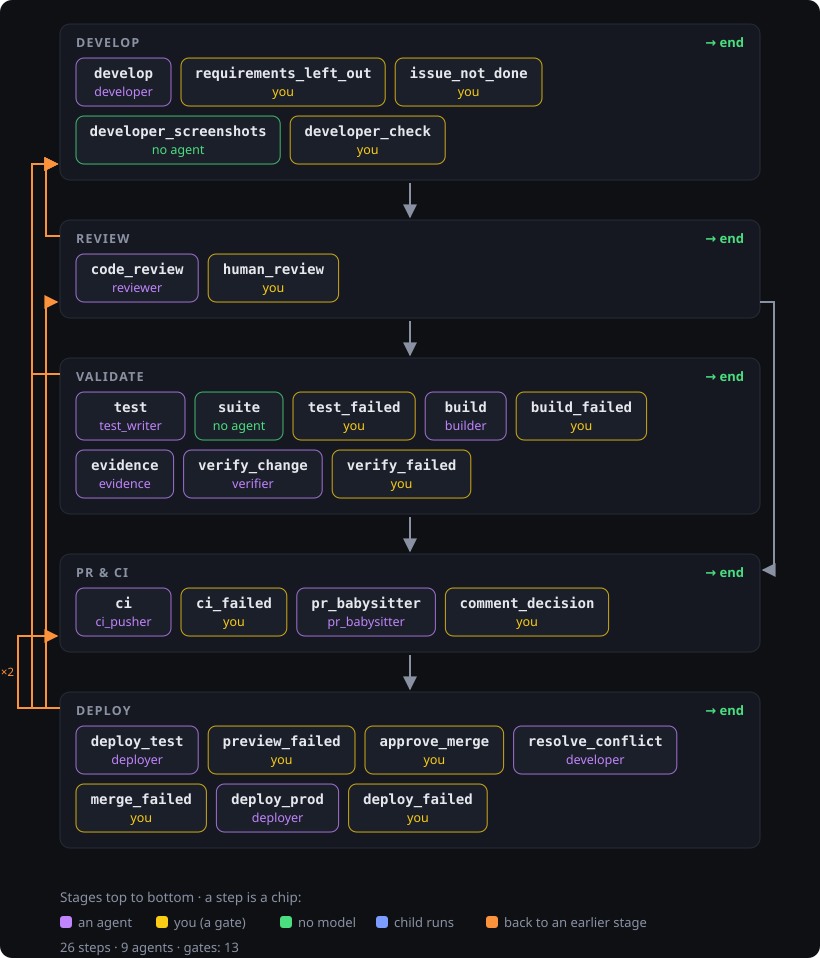

### Software development, local hero

Implementa, revisa, testa, faz o build e verifica uma mudança no seu próprio worktree, depois faz o merge na branch base local automaticamente, resolvendo conflitos no caminho. Sem push, sem PR, sem CI; você faz o push quando quiser.

Agentes: developer, reviewer, test_writer, builder, verifier, evidence.

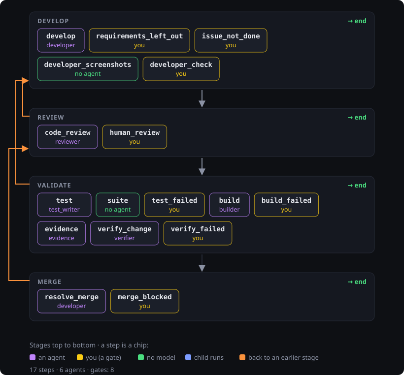

### AI development, local hero

Testes primeiro: o test writer escreve os testes de aceitação a partir da issue antes de qualquer código, o developer implementa até passarem (sem nunca editá-los), depois revisão, a suíte, build, verificação e o merge local. Sem push, sem PR, sem CI.

Agentes: developer, reviewer, ui_reviewer, test_writer, mapper, builder, verifier, evidence, healer.

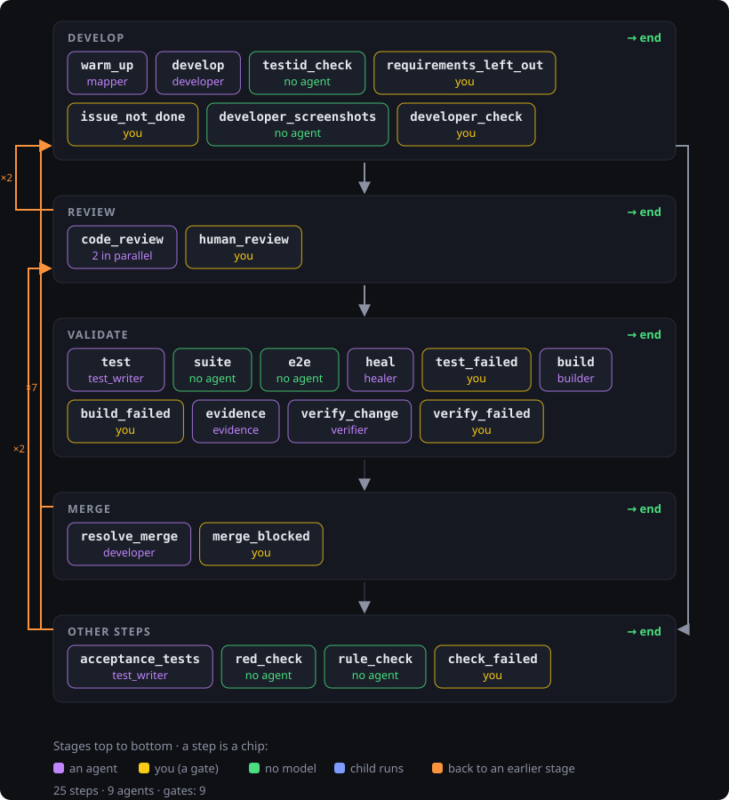

### Refactor

Um refactor, feito com segurança, em qualquer linguagem: o test writer fixa primeiro o comportamento atual do alvo, o developer muda só a estrutura, depois a suíte completa, a auditoria do build e uma revisão de "mesmo comportamento, estrutura mais simples?", e então o modo de trabalho do projeto: o merge local (Local) ou um pull request e seu CI (Remote, Fork + PR).

Agentes: test_writer, developer, reviewer, builder.

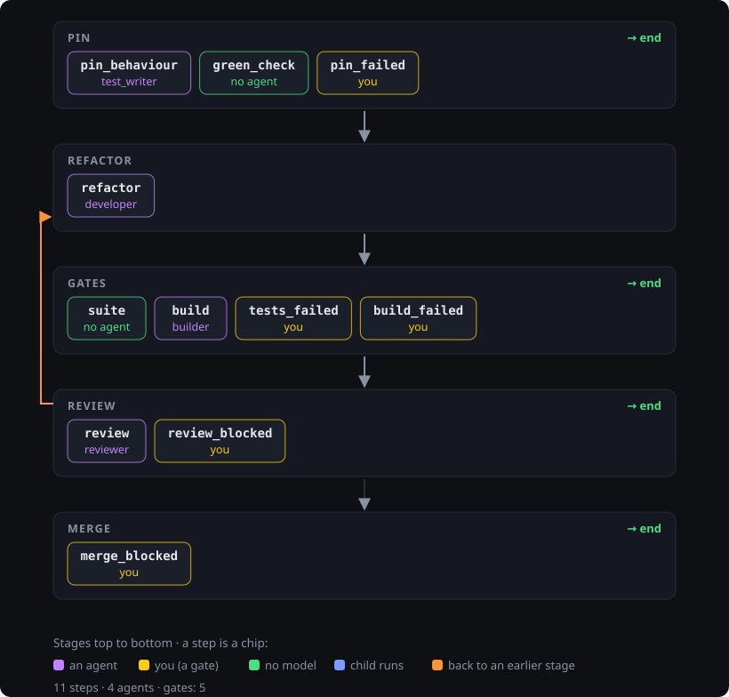

### Test batch

Escreve os testes que faltam para o trabalho mergeado localmente desde o último lote verde, numa única sessão do test writer, roda a suíte inteira uma vez por rodada sem agente e faz o merge dos testes na base local. Nunca faz push.

Agentes: test_writer, developer.

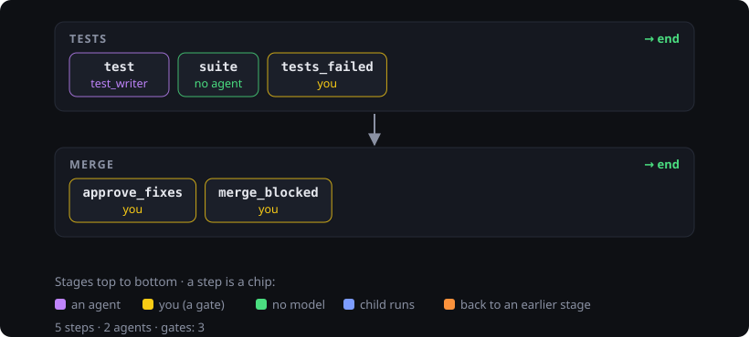

### E2E release

Roda a suíte end-to-end inteira do projeto uma vez, antes de uma release, num worktree próprio da base local; um cenário que falha vai ao developer e volta à suíte, depois você aprova a correção. Nunca faz push nem tag.

Agentes: e2e_runner, developer, reviewer.

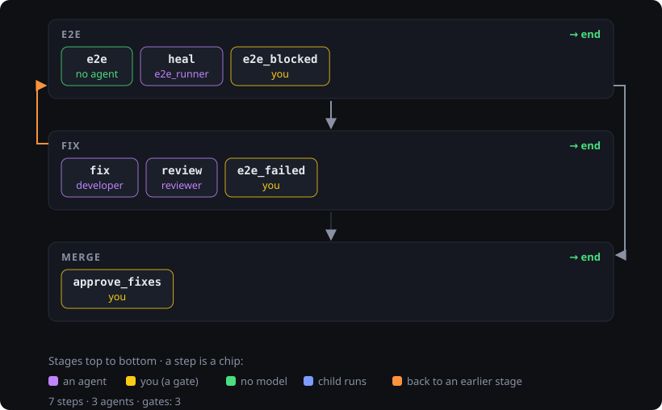

### Release

Verifica o que foi mergeado localmente desde a última release com a suíte unitária inteira e a suíte E2E inteira (sem agente enquanto estão verdes; uma regressão vai ao developer), depois você escolhe Ship (push da base local, tag, build opcional) ou Hold. Nada é publicado sem o seu Ship.

Agentes: developer, reviewer.

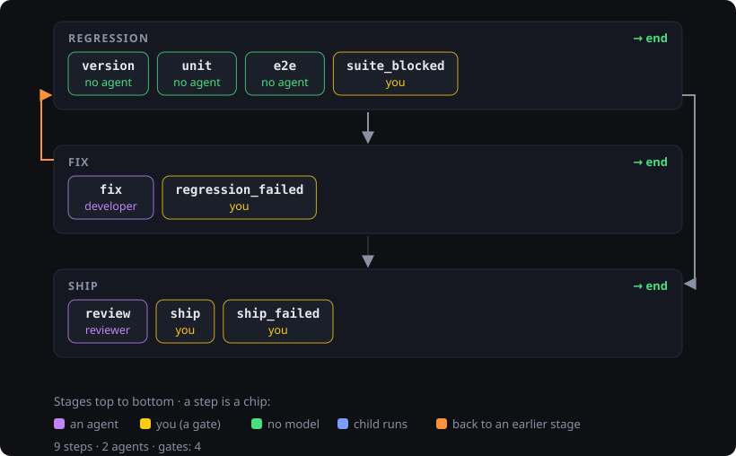

### Multi-model review

Vários modelos revisam o mesmo diff em paralelo, uma checagem de raio de impacto olha fora do diff, e um juiz líder junta, verifica e ordena os achados.

Agentes: opus, sonnet, gpt, blaster, judge.

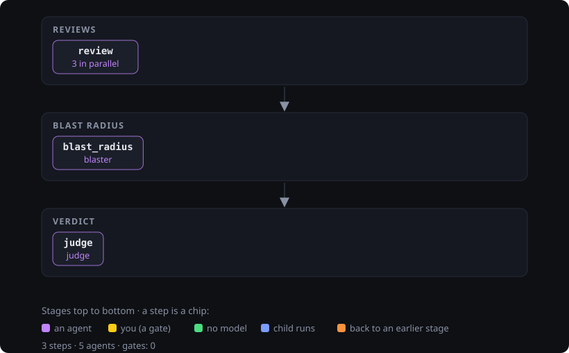

## Plan

### Writer & Reviewer

Um writer redige um documento a partir do seu prompt, um reviewer dá nota contra o seu objetivo e devolve observações até passar, e o supervisor confere e pergunta a você o que fazer.

Agentes: writer, reviewer, signoff.

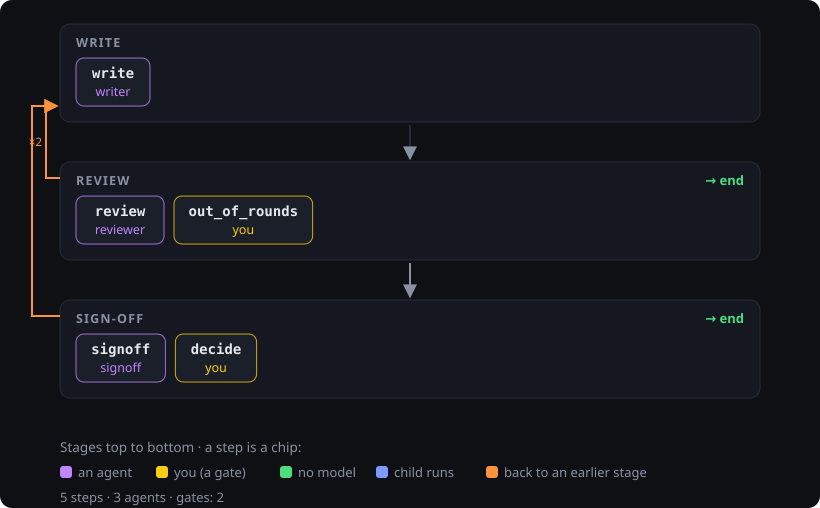

### AI Arena

Até cinco modelos que você escolhe escrevem o mesmo documento em paralelo, criticam uns aos outros às cegas, e um orquestrador junta o documento final.

Agentes: contender_1 a contender_5, synthesizer, verifier.

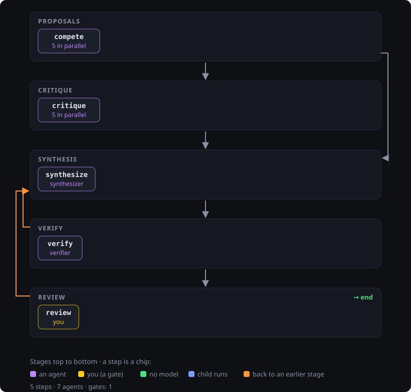

### Issue tracker

Transforma um pedido em poucas palavras numa issue triada no GitHub/GitLab (o código envolvido, os arquivos a mudar, impacto e complexidade como labels, duplicatas) e a registra depois que você aprova o rascunho, ou assim que é escrita no modo automático.

Agentes: code_analyzer, issue_writer, issue_filer.

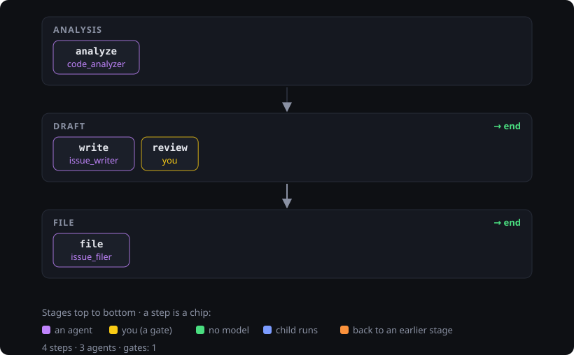

### Backlog refresh

Revisa toda issue aberta contra o código como está hoje (arquivos renomeados, linhas que mudaram, tarefas já feitas, issues obsoletas ou duplicadas), aplica as correções seguras e pergunta a você antes de fechar qualquer coisa.

Agentes: refresher.

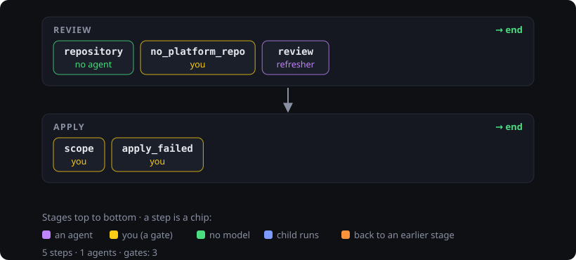

### Project map

O plano de cidade do projeto e a análise de arquitetura do Oracle, numa run só: o cartógrafo lê o repositório e escreve zonas, distritos, marcos e portos como regras de caminho; o plano é validado por regras e salvo; depois o Oracle analisa os hotspots do projeto.

Agentes: cartographer.

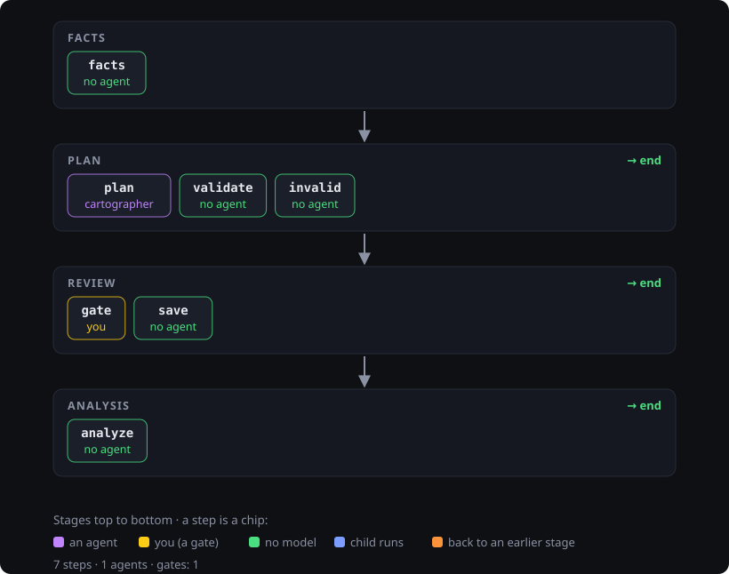

## Monitor

### Refactor proposals

Refactors sugeridos depois de uma release: a análise de arquitetura do projeto, focada na Danger Zone e nos arquivos mudados desde uma tag; os achados viram propostas na aba Refactor, o Product Owner as ordena e as primeiras são registradas como issues para o workflow Refactor.

Agentes: analyst.

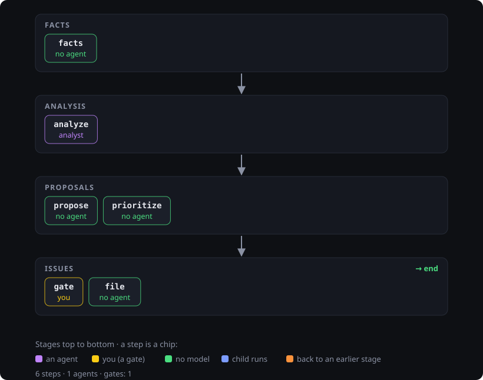

### Run retrospective

Analisa os logs de uma run terminada e propõe melhorias em skills e workflows, com evidências.

Agentes: retro.

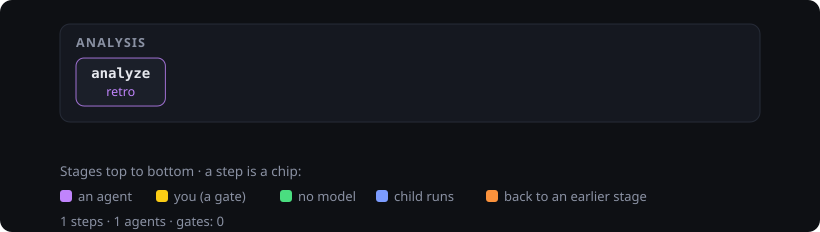
