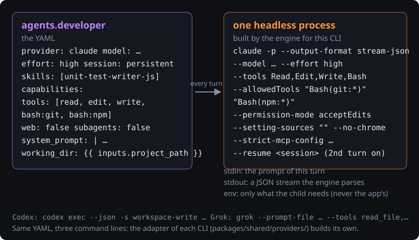
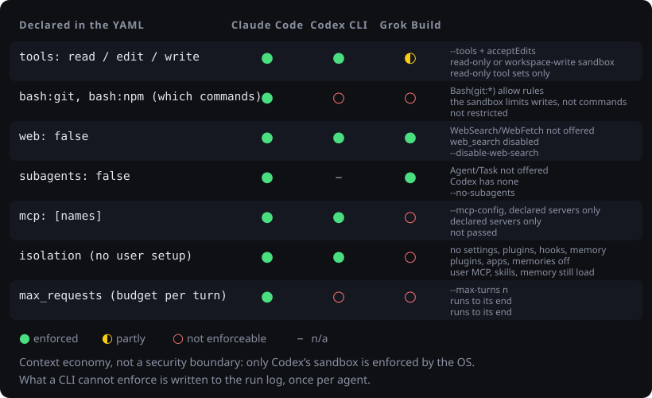
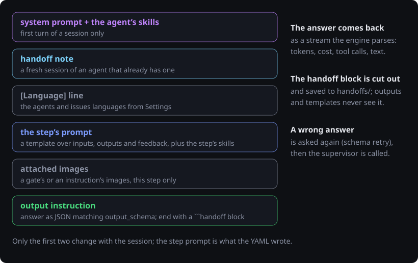

Um agente não é um programa. É um bloco de YAML: qual CLI e modelo, o que pode tocar, o que lhe é dito. O engine inicia um processo sem interface por turno e lê o seu stream.

## Um agente, um processo



| Chave | O que define |
| --- | --- |
| `provider`, `model`, `effort` | A CLI e o modelo. Mudáveis por run no Start, em Agents. |
| `session` | `persistent`, `ephemeral` ou `handoff`. Veja a página do engine. |
| `skills` | Carregadas no system prompt no primeiro turno. |
| `capabilities` | Ferramentas, comandos, web, sub-agentes, servidores MCP. |
| `system_prompt` | Quem o agente é. Um template, como todo prompt. |
| `working_dir` | Onde o processo roda: o worktree da run por padrão. |

{.map}

## Providers

| Provider | Comando | Nota |
| --- | --- | --- |
| `claude-code` | `claude -p` | Obrigatório. Lê o seu login do Claude Code; nunca uma chamada de modelo para conferir. |
| `codex-cli` | `codex exec` | Habilita os workflows multi-modelo. Sandbox imposto pelo SO. |
| `grok-cli` | `grok --prompt-file` | Poucas flags: as ferramentas são restritas, o resto não. |
| `mock` | nenhum | Modo simulação: uma run inteira de graça, sem CLI iniciada. |

{.map}

- **Fallbacks.** `fallbacks: [claude:claude-opus-5-5, codex:gpt-6-luna]` num agente, ou uma lista por provider em Settings. Num erro de cota ou crédito o turno roda de novo na próxima entrada, numa sessão nova a partir da nota de handoff, e a run mantém essa escolha. Um fallback nunca pula um passo nem um gate.
- **Limites por modelo.** `models: { <modelo>: { timeout_factor, max_total_cost_usd } }`: um modelo lento ou caro ganha mais tempo e orçamento onde quer que seja usado.
- **Contas.** Cada CLI roda na conta da sua pasta de configuração; Settings pode guardar várias e escolher uma por run.

## Capacidades



```yaml
agents:
  ci_pusher:
    capabilities:
      tools: [read, bash:git, bash:gh]   # também edit, write, bash (qualquer comando)
      web: false
      subagents: false
      mcp: []
steps:
  - id: research
    agent: ci_pusher
    capabilities: { web: true }          # só neste passo
```

Menos ferramentas oferecidas é um prompt menor: a primeira requisição de um agente developer caiu de 41k tokens com a configuração do usuário para 22k isolado. O isolamento vem ligado; `isolation: false` carrega também a sua configuração da CLI.

## Um turno



Seja qual for a CLI, o engine confere as mudanças do turno depois: um turno que editou arquivos de teste quando não devia é devolvido.
