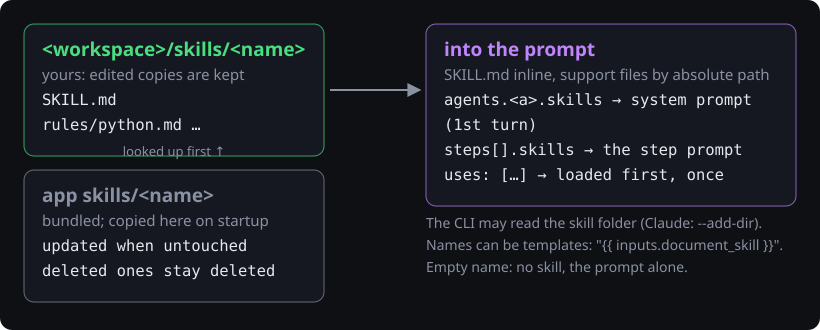
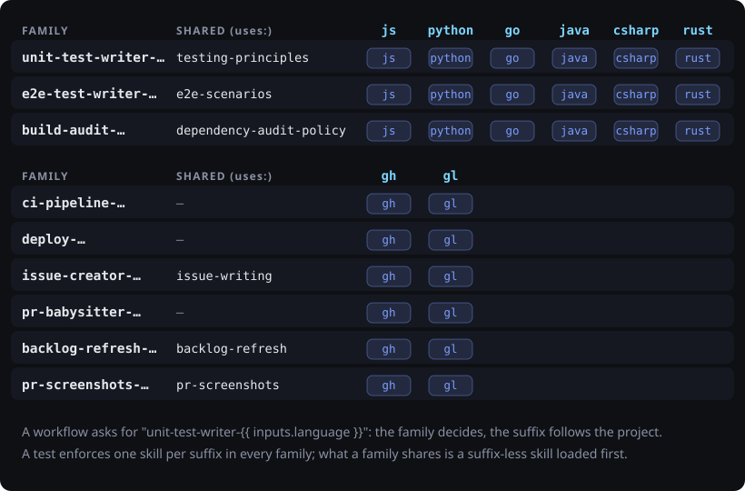

O workflow diz **quem**, **quando** e **o que deve ser respondido**. A skill diz **como**. Sessenta e seis vêm com o app; as suas ficam no workspace e ganham delas.

## De onde vem uma skill



```yaml
# skills/unit-test-writer-go/SKILL.md
---
name: unit-test-writer-go
description: ...
uses: [testing-principles]   # carregada antes, uma vez
---
Como escrever os testes ...
```

## Famílias



## O que vem incluído

| Tipo | Skills |
| --- | --- |
| Escrever documentos | `prd-writing`, `rfc-writing`, `design-doc-writing`, `issue-writing`, `adr-writing`, `test-plan-writing` |
| Código | `code-review` (regras por linguagem), `bug-diagnosis`, `merge-conflict-resolver`, `implementation-evidence`, `pr-description` |
| Testes | `unit-test-writer-*`, `e2e-test-writer-*`, `testing-principles`, `e2e-scenarios` |
| Plataforma | `ci-pipeline-*`, `deploy-*`, `issue-creator-*`, `pr-babysitter-*`, `backlog-refresh-*`, `pr-screenshots-*` |
| Revisão e julgamento | `claim-verification`, `blast-radius`, `review-synthesis`, `clarity-score`, `arena-synthesis` |
| Os agentes do próprio app | `oracle`, `run-supervisor`, `backlog-product-owner`, `project-map`, `run-retrospective` |

{.map}

## Regras que todas seguem

- **Agentes rodam sem supervisão.** Onde uma skill perguntaria a você, ela registra uma suposição ou um padrão.
- **Inglês no arquivo**, a sua língua na saída: Settings › Language é uma linha em todo turno.
- **Edite no workspace.** Uma cópia editada nunca é sobrescrita por uma atualização do app; uma intocada é.
