As capturas abaixo vêm de `npm run screenshot`: o app real com dados de demonstração, sem chamar modelo. De cima para baixo, na ordem do menu.

## Home

O fluxo de uma ideia até uma release: cada estágio com a sua contagem, o que precisa de você (gates esperando, perguntas, itens que falharam), o custo e as runs de hoje, e o painel do Oracle.

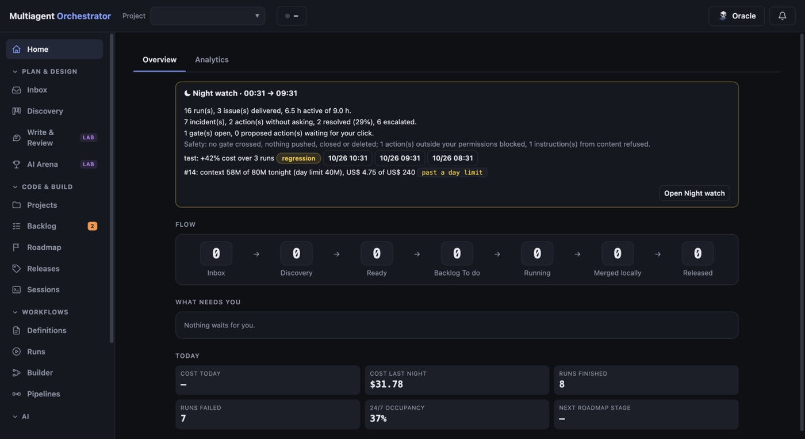

## Inbox

Ideias cruas do projeto, capturadas numa linha e guardadas em privado no workspace. Um card abre ao lado da lista; os que se sustentam vão para o Discovery.

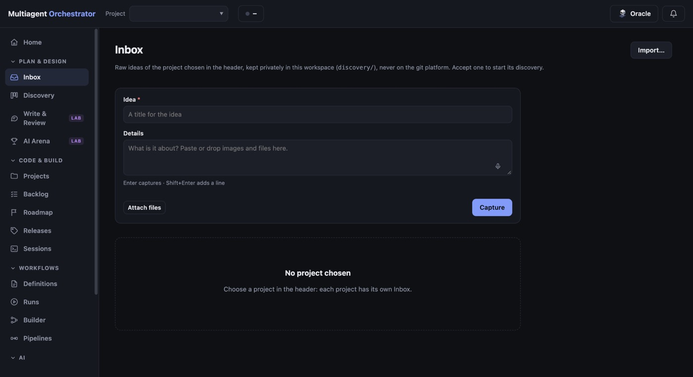

## Discovery

O quadro a montante: Triage → Shape → Define → Ready. Um card ganha tipo, nota de clareza e estimativa até estar claro o bastante para virar issue.

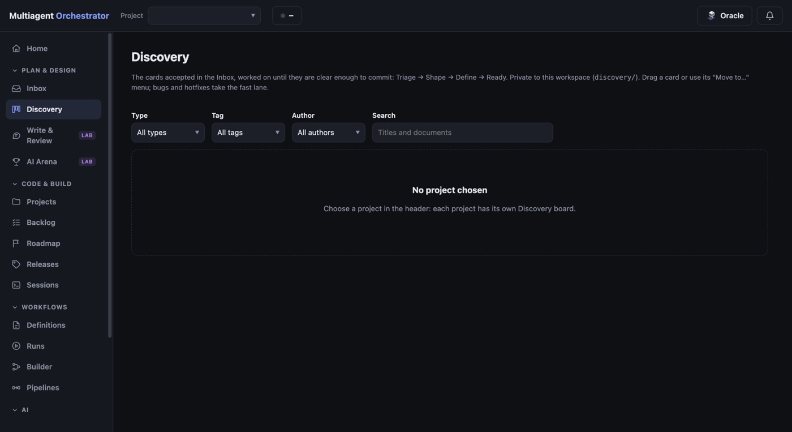

## Backlog

As issues do projeto, sincronizadas do GitHub ou do GitLab, como lista, quadro ou por épico. Daqui uma issue é atribuída a um workflow ou planejada no roadmap. Um projeto sem repositório guarda as issues no workspace: uma run que mescla localmente fecha as que implementou.

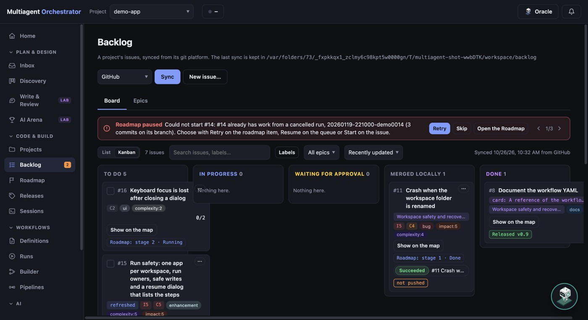

## Roadmap

Estágios ordenados de runs, cada um depois do anterior mergeado. Iniciar, pausar, parar; uma linha de corte marca uma release.

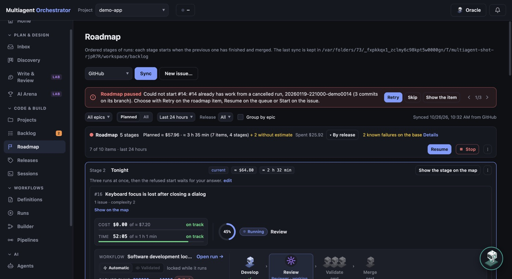

## Runs

Toda run, ao vivo ou terminada, em Workflows. Uma run expandida mostra passos, agentes, custo e as ações: retomar de um passo, enviar ao supervisor.

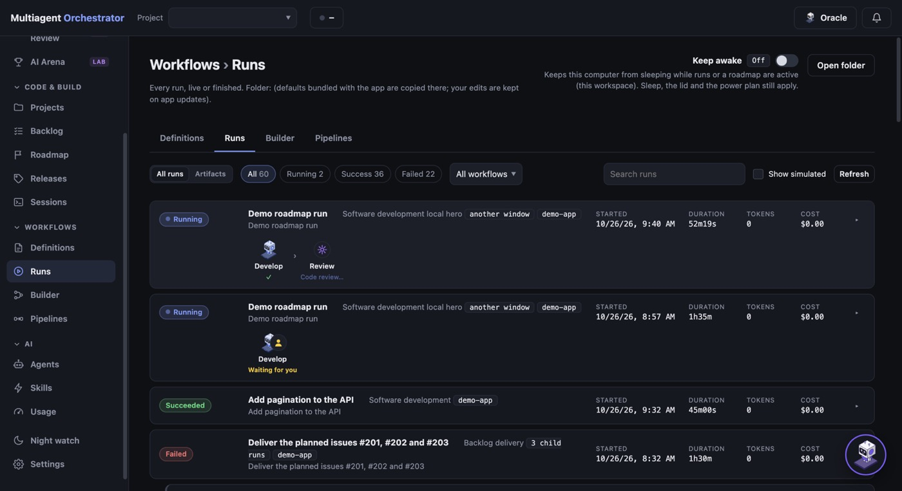

## A tela da Run

Uma run: os passos como uma faixa, o gate que espera (com o diff, screenshots e Run locally quando o projeto diz como), as sessões dos agentes e os eventos.

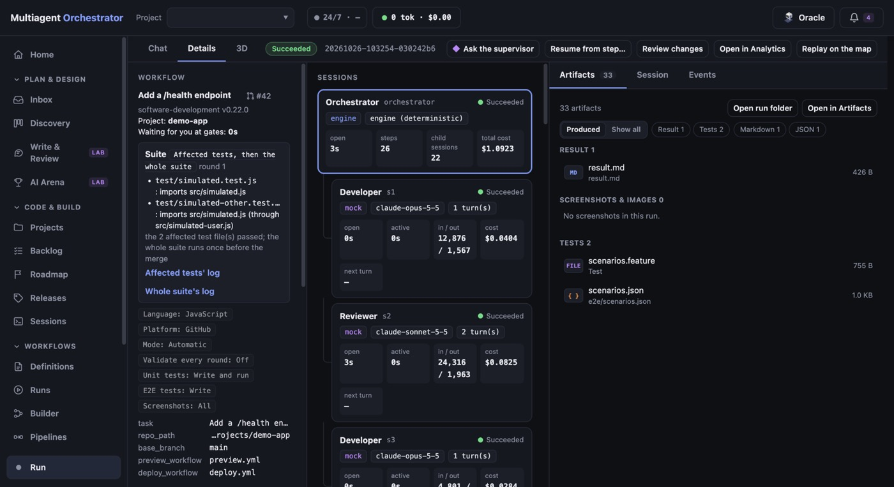

## A run como chat

A mesma run lida como conversa: cada turno com agente, provider, modelo e custo; as suas respostas aos gates no meio.

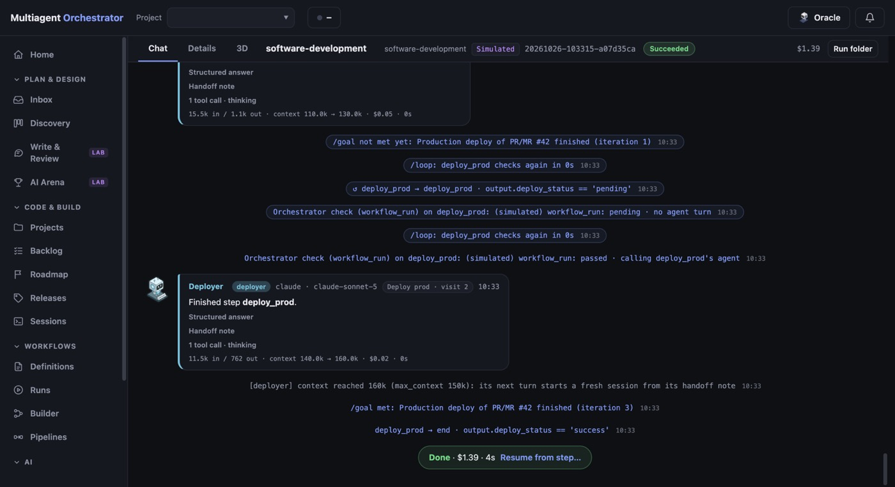

## Artifacts

Todo arquivo que uma run produziu, agrupado por run: documentos, revisões, relatórios, renderizados ali mesmo.

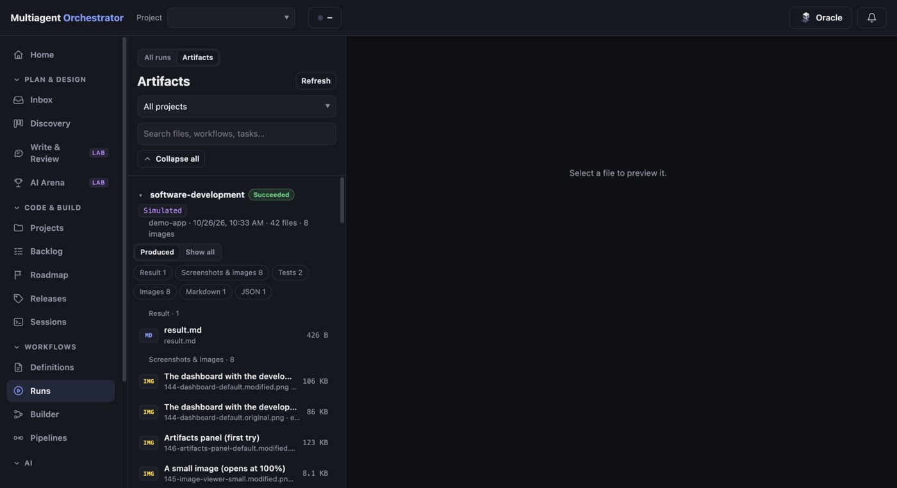

## Projects

Os cards de projeto: iniciar um workflow, abrir a pasta, editar, remover. O seletor do cabeçalho escolhe o projeto que todas as telas mostram.

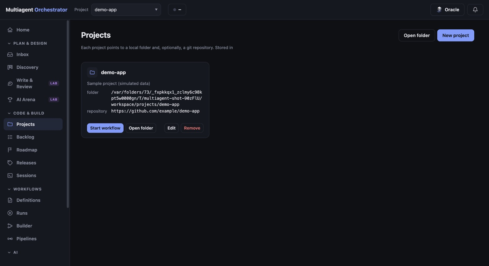

## Sessions

Toda conversa do Claude Code, Codex e Grok nesta máquina; um clique a reabre na sua CLI, num terminal embutido.

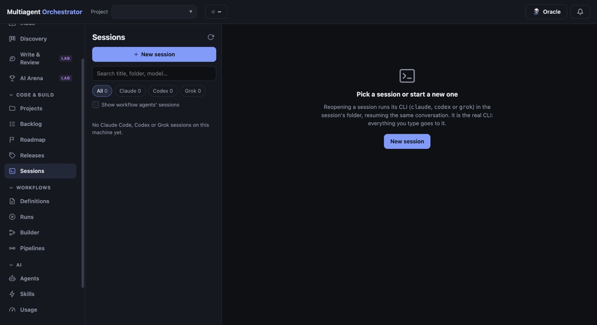

## Agents

Agentes reutilizáveis com um visual de robô e um prompt; o Supervisor e o Product Owner embutidos estão sempre na lista.

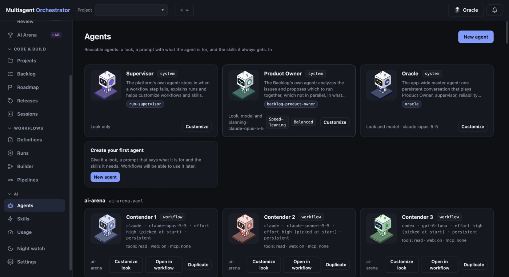

## Skills

As skills do workspace, uma pasta cada, editáveis ali; as incluídas são marcadas e podem ser restauradas.

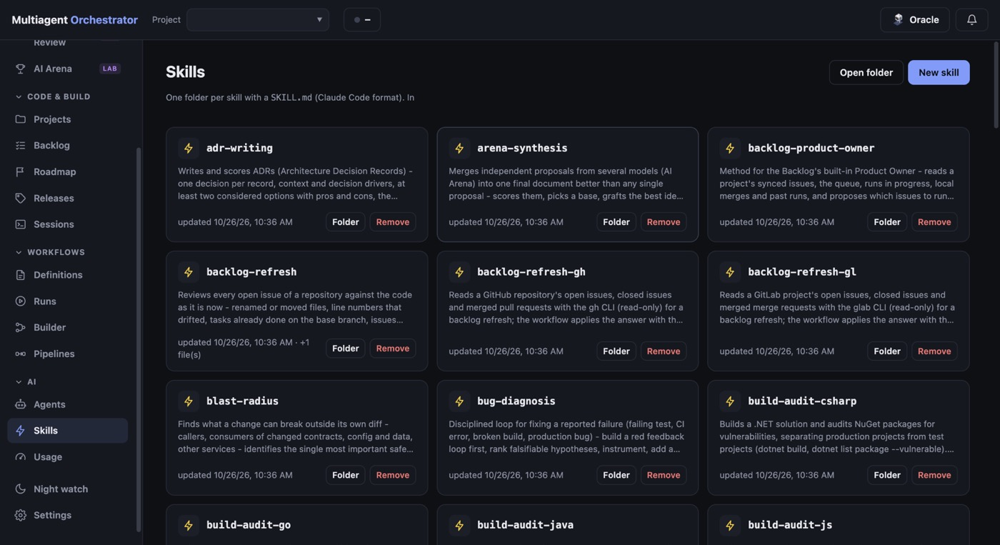

## Usage

Tokens e custo por provider, no mês e hoje, orçamentos, preços por modelo e os minutos de CI usados.

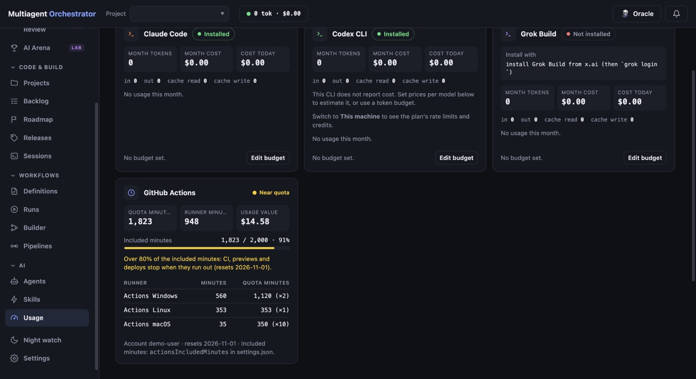

## Analytics

Uso, desempenho, runs, ocupação e os turnos dos agentes conversacionais num intervalo de datas.

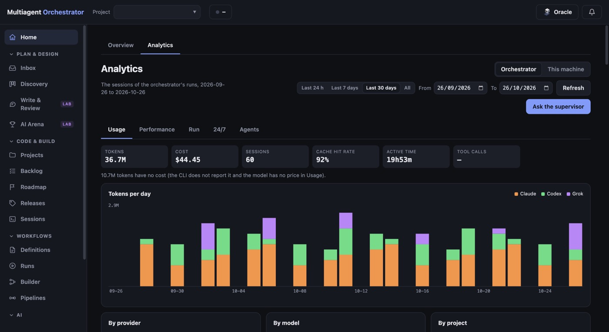

## Night watch

O turno da noite do Oracle: o que ele pode fazer sozinho enquanto você dorme, e o relatório da manhã do que fez.

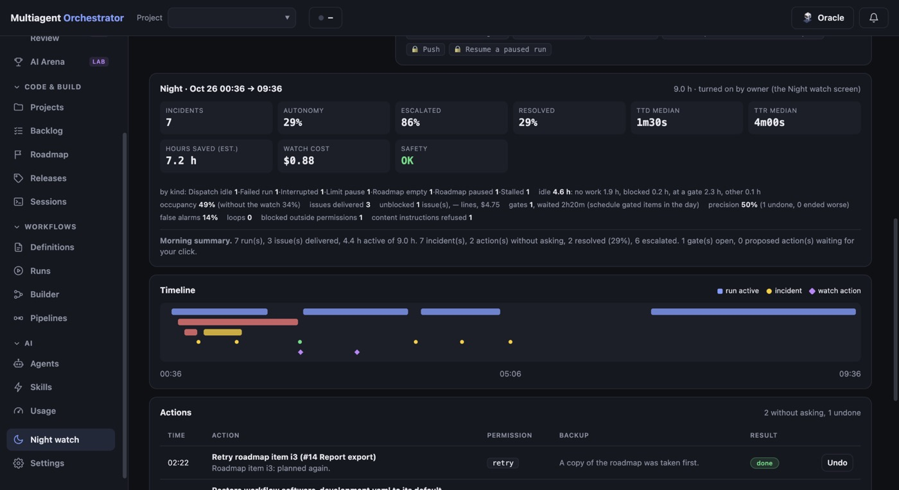

## Settings

O workspace, as CLIs e suas contas, preferências de execução, idioma, entrada por voz.

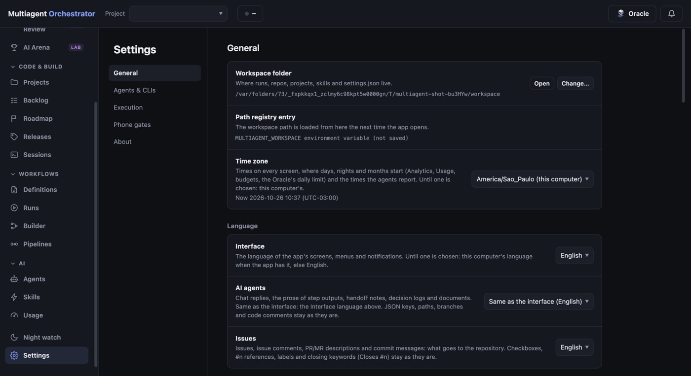

## Setup

A primeira abertura de um workspace: o estado das CLIs, o modo simulação, os workflows que este computador consegue rodar, um primeiro projeto.

Um projeto novo só com o README não tem testes, e tudo bem: a primeira run não para por isso. A suíte fica registrada como não executada porque o projeto não tem testes, e a run, o item do roadmap, o pull request e a checagem da base dizem **Não testado: o projeto não tem testes**. Para ser perguntado, escolha *Perguntar* em *Projeto sem testes* ao iniciar a run. Quando o projeto já tem arquivos de teste, uma run que não encontra o comando para rodá-los pede o comando de teste a você.

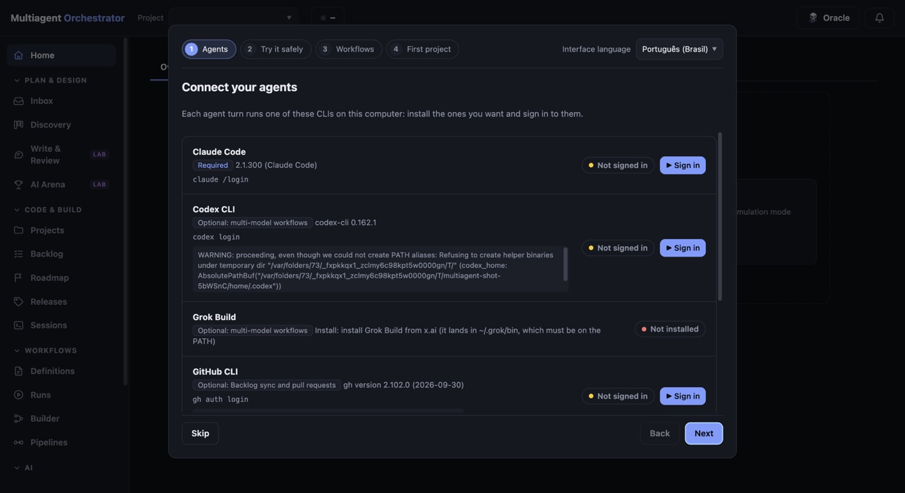
