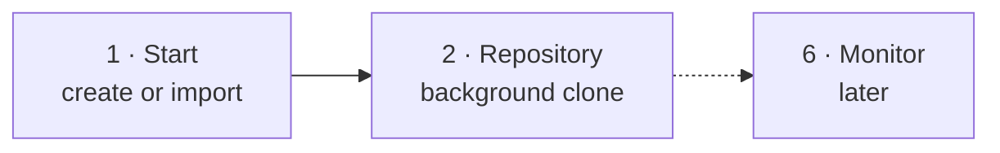

# SDLC document conventions

How the AI-native SDLC artifacts in `docs/work/<item>/` are written. Agents (the write doc writer, the documentation agent) and the reader page (`site/`) follow this file. Each block is plain GitHub markdown, so the files also read well on GitHub; the reader turns the blocks into richer views.

## Files of an item

| File | Stage | Written by | Approved by |
|---|---|---|---|
| `intent.md` | Plan | the writer, with the owner | product owner (`status: accepted`) |
| `spec.md` | Design | the writer, with the owner | product owner, tech lead for risky parts (`status: signed off`) |
| `plan.md` | Build | the writer or the developer | engineer (`status: accepted`) |
| `test.md` | Test | the runs | code owner |
| `deploy.md` | Deploy | the review and the release | code owner, release manager |
| `maintain.md` | Maintain | the Monitor and the Night watch | service owner |
| `images/` | all | screenshots and mock images | — |

- **Languages:** the English file is the source (`spec.md`), and the Portuguese translation sits beside it (`spec.pt-BR.md`). Edit the English first, then the translation. The front matter links the pair: `translation: spec.pt-BR.md` in the source, `source: spec.md (English)` in the translation.
- **No rendered HTML is committed.** The reader renders the markdown at runtime.

## Front matter

```yaml
---
item: first-project-onboarding
issue: "#628"
stage: design            # plan | design | build | test | deploy | maintain
status: signed off       # proposed | accepted | draft | signed off | not started | …
approver: Eduardo Galbiati (product owner)
date: 2026-10-31
translation: spec.pt-BR.md
---
```

Optional fields:
- `depends_on: write-doc` (or a list: `depends_on:` followed by `- write-doc` lines): the item folders this item builds on, with the reason as a `#` comment. The reader orders an item after the items it depends on and shows "after write-doc" on its card.

## Requirements

In `spec.md`, each requirement is a bold paragraph that starts with its id. The reader lists every requirement in the index.

```md
**R3. Import.**
- The repository and the project name.
```

## Decisions

A `## Decisions` section in `spec.md` keeps every decision with the options that were weighed, so a reader sees what was chosen and what was set aside. A table maps each requirement to its decisions. Each decision is:

- an `### Dn · Title` heading;
- an optional question line;
- a **task list**: `- [x]` is the chosen option, `- [ ]` the others. After the option's name, `· recommended` or `· decided by the owner` marks why it was chosen;
- under each option, its points: `- **+** …` for a pro, `- **−** …` for a con (bold, because a bare `+` starts another list);
- an optional `> [!TIP]` alert with the reason.

```md
### D3 · How the clone happens
- [ ] **A · Synchronous, as today**
  - **+** Nothing new.
  - **−** A big repository blocks the screen for minutes.
- [x] **B · A background job with a progress tray** · recommended
  - **+** The user picks analyses and workflows while it clones.
  - **−** A new job in the service, with state and events.

> [!TIP]
> **Recommendation:** B with a full clone.
```

On GitHub this shows checked boxes and a highlighted tip. The reader draws one card per option: the chosen one in green, pros and cons coloured, the tip below.

## Alerts

GitHub alerts, styled by the reader: `> [!TIP]` (a recommendation or reason), `> [!NOTE]` (context, "done when"), `> [!WARNING]` (a risk), `> [!IMPORTANT]`, `> [!CAUTION]`.

## Flow

A `mermaid` flowchart. GitHub draws it as a diagram, and the reader draws it as a step strip, in the order the nodes first appear. A dashed edge (`-.->`) marks a later step. Node labels use `Title<br/>subtitle`.

````md

````

## Progress

`plan.md` ends with a `## Progress` table, one row per step of the order of work, filled in by the runs. The reader shows "plan: N of M steps" from the rows whose Status is `done`.

```md
| Step | Status | Run | Commit / PR |
|---|---|---|---|
| 1. `onboarding-model.js` and tests | done | run-0142 | a1b2c3d |
```

## Images and screens

- Before/after screenshots and mock images live in `images/` and are referenced relatively (``).
- Interactive HTML mocks, once supported by the reader, live in `mockups/` and are embedded in a sandboxed iframe, with the image as a fallback.
