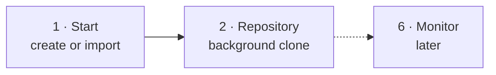

# Convenções dos documentos do SDLC

Como os artefatos do AI-native SDLC em `docs/work/<item>/` são escritos. Os agentes (o writer do write doc, o agente de documentação) e a página de leitura (`site/`) seguem este arquivo. Cada bloco é markdown comum do GitHub, então os arquivos também ficam legíveis no GitHub; o leitor transforma os blocos em visões mais ricas.

## Arquivos de um item

| Arquivo | Etapa | Quem escreve | Quem aprova |
|---|---|---|---|
| `intent.md` | Plan | o writer, com o dono | product owner (`status: accepted`) |
| `spec.md` | Design | o writer, com o dono | product owner, tech lead nas partes de risco (`status: signed off`) |
| `plan.md` | Build | o writer ou o desenvolvedor | engenheiro (`status: accepted`) |
| `test.md` | Test | os runs | code owner |
| `deploy.md` | Deploy | a revisão e a release | code owner, release manager |
| `maintain.md` | Maintain | o Monitor e o Night watch | service owner |
| `images/` | todas | screenshots e imagens dos mocks | — |

- **Idiomas:** o arquivo em inglês é a fonte (`spec.md`), e a tradução em português fica ao lado (`spec.pt-BR.md`). Edite o inglês primeiro, depois a tradução. O front matter liga o par: `translation: spec.pt-BR.md` na fonte, `source: spec.md (English)` na tradução.
- **Nenhum HTML renderizado é commitado.** O leitor renderiza o markdown na hora.

## Front matter

```yaml
---
item: first-project-onboarding
issue: "#628"
stage: design            # plan | design | build | test | deploy | maintain
status: signed off       # proposed | accepted | draft | signed off | not started | …
approver: Eduardo Galbiati (product owner)
date: 2026-10-31
translation: spec.pt-BR.md
---
```

Campos opcionais:
- `depends_on: write-doc` (ou uma lista: `depends_on:` seguido de linhas `- write-doc`): as pastas dos itens em que este item se apoia, com o motivo num comentário `#`. O leitor ordena um item depois dos itens de que ele depende e mostra "after write-doc" no cartão dele.

## Requisitos

No `spec.md`, cada requisito é um parágrafo em negrito que começa pelo id. O leitor lista todos os requisitos no índice.

```md
**R3. Import.**
- The repository and the project name.
```

## Decisões

Uma seção `## Decisions` no `spec.md` guarda cada decisão com as opções que foram pesadas, para quem lê ver o que foi escolhido e o que foi descartado. Uma tabela liga cada requisito às suas decisões. Cada decisão tem:

- um título `### Dn · Título`;
- uma linha de pergunta, opcional;
- uma **task list**: `- [x]` é a opção escolhida, `- [ ]` as outras. Depois do nome da opção, `· recommended` ou `· decided by the owner` marca por que ela foi escolhida;
- embaixo de cada opção, os pontos: `- **+** …` para um pró, `- **−** …` para um contra (em negrito, porque um `+` solto começa outra lista);
- um alerta `> [!TIP]` com o motivo, opcional.

```md
### D3 · How the clone happens
- [ ] **A · Synchronous, as today**
  - **+** Nothing new.
  - **−** A big repository blocks the screen for minutes.
- [x] **B · A background job with a progress tray** · recommended
  - **+** The user picks analyses and workflows while it clones.
  - **−** A new job in the service, with state and events.

> [!TIP]
> **Recommendation:** B with a full clone.
```

No GitHub isso aparece com as caixas marcadas e a dica destacada. O leitor desenha um cartão por opção: a escolhida em verde, prós e contras coloridos, a dica embaixo.

## Alertas

Os alertas do GitHub, estilizados pelo leitor: `> [!TIP]` (uma recomendação ou motivo), `> [!NOTE]` (contexto, "pronto quando"), `> [!WARNING]` (um risco), `> [!IMPORTANT]`, `> [!CAUTION]`.

## Fluxo

Um flowchart `mermaid`. O GitHub desenha como diagrama, e o leitor desenha como uma faixa de passos, na ordem em que os nós aparecem pela primeira vez. Uma ligação tracejada (`-.->`) marca um passo posterior. Os rótulos dos nós usam `Título<br/>subtítulo`.

````md

````

## Progresso

O `plan.md` termina com uma tabela `## Progress`, uma linha por passo da ordem do trabalho, preenchida pelos runs. O leitor mostra "plan: N of M steps" a partir das linhas com Status `done`.

```md
| Step | Status | Run | Commit / PR |
|---|---|---|---|
| 1. `onboarding-model.js` and tests | done | run-0142 | a1b2c3d |
```

## Imagens e telas

- Screenshots de antes e depois e imagens de mocks ficam em `images/` e são referenciados pelo caminho relativo (``).
- Mocks interativos em HTML, quando o leitor suportar, ficam em `mockups/` e são embutidos num iframe com sandbox, com a imagem como alternativa.
