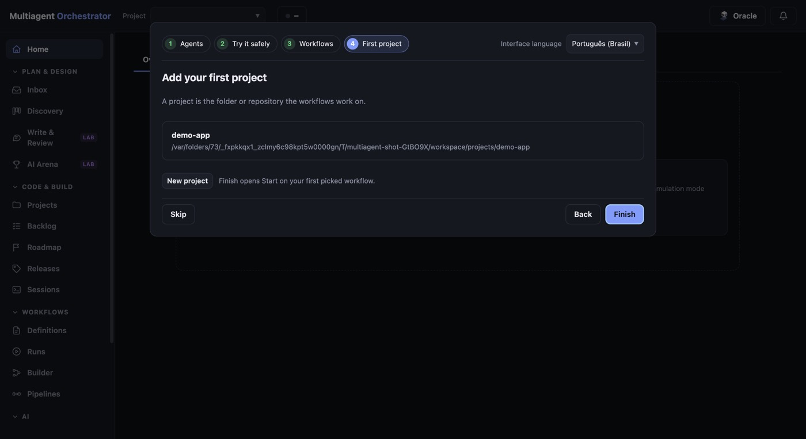
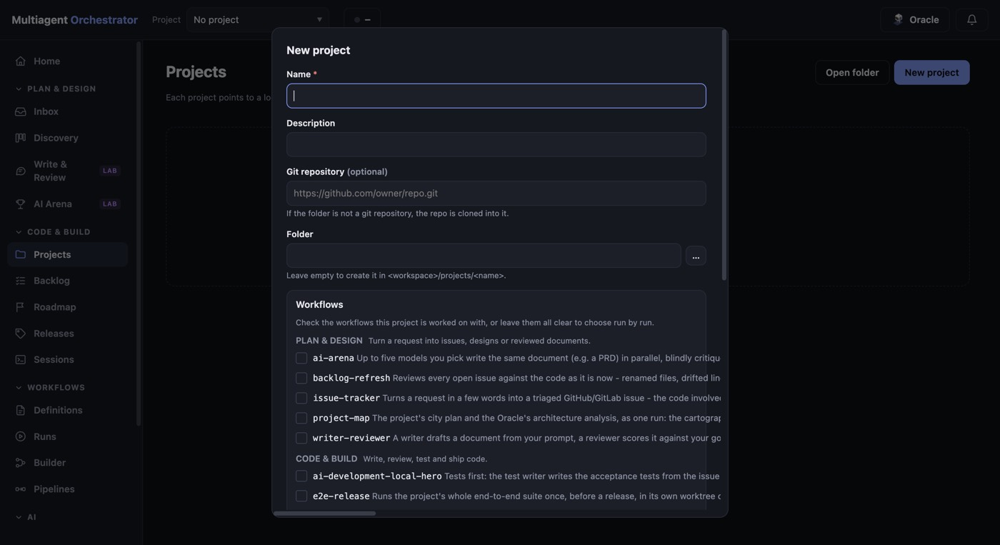

# Intent: onboarding do primeiro projeto

## Problema

Cadastrar o primeiro projeto é a primeira coisa que alguém faz no app, e hoje não garante o fluxo completo.

- O Setup termina abrindo o diálogo genérico **New project**. Ele pede nome, URL, pasta e 15 caixas de workflow antes de o app conhecer o projeto.
- O clone acontece **dentro** do Create (`createProject` espera o `git clone`): num repo grande, a tela trava.
- A análise (**Ways of working**), a **cidade** e o **backlog de refatoração** já existem, mas ficam escondidos em botões e abas da página do projeto, para descobrir depois.
- Os 15 workflows bundled se sobrepõem. O dono usa um só (`ai-development-local-hero`), e esse mesmo fluxo atende feature e fix.
- O perfil de trabalho pergunta "solo ou time", o que não muda o fluxo. E não separa o que muda de verdade: trabalhar só local ou local com PRs remotos, e onde o CI roda.

## Resultado esperado

Em poucos minutos, quem entra no app sai com um projeto pronto para trabalhar:

- o código clonado (ou um repositório novo criado);
- como o projeto trabalha hoje, lido do git (modo local ou remoto, CI, testes, release);
- três fluxos padrão escolhidos e explicados: **feature**, **fix** (com o modo hotfix) e **release**;
- a cidade do projeto e um backlog de refatoração ranqueado, com a nota de cada arquivo;
- o modelo de trabalho do projeto: quais artefatos (intent, spec, plan) cada item gera;
- próximos passos claros, e nada entrando no roadmap sem a escolha do usuário.

## Usuários e sistemas afetados

- **Usuários:** quem instala o app pela primeira vez, e quem adiciona mais um projeto. Muitas vezes não é técnico (vende ou planeja produto), mas trabalha com git.
- **Sistemas:**
  - Setup (`packages/ui-kit/setup.js`) e Projects (`fronts/build/views/projects/`);
  - `createProject` (`packages/engine/domains/project/projects.js`);
  - o Ways of working (#487: seed, interview, compose);
  - o `project-map` e o Refactor (#357);
  - os workflows bundled e os pipelines;
  - o auto-push do projeto, que sai;
  - o Backlog e o Roadmap.

## Restrições

- **Regras do AGENTS.md:**
  - o app em inglês;
  - o workspace é o produto;
  - agentes rodam sem supervisão (só o Grill me pergunta);
  - nenhuma automação atravessa um `human_approval`;
  - checagens só em simulação.
- Chamada a modelo real só com o custo mostrado antes e o clique do usuário.
- O onboarding nunca escreve no repositório do usuário. Arquivos do projeto (artefatos, CI, harness de screenshot) só por um run, no gate de sempre.
- Ações que saem da máquina (criar repo remoto, login no `gh`/`glab`) só com clique explícito.
- GitHub e GitLab pelo mesmo caminho.
- Os workflows de **Planning** (writer-reviewer, ai-arena, issue-tracker) ficam fora: são a próxima proposta.

## Perguntas em aberto

1. O passo Workflows do Setup some? *Proposta: sim.*
2. As análises com modelo vêm marcadas? *Proposta: sim, com o total visível e "Skip, analyze later".*
3. O hotfix é um workflow próprio ou um modo do fix? *Proposta: um modo do fix.*
4. Os nomes antigos dos workflows funcionam por quanto tempo? *Proposta: duas versões, por aliases.*
5. O Monitor (erros de produção virando intents) entra nesta entrega? *Proposta: não, é a última fase.*
