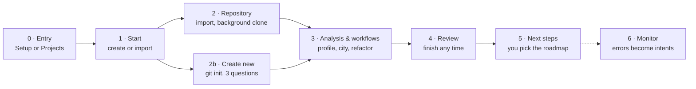
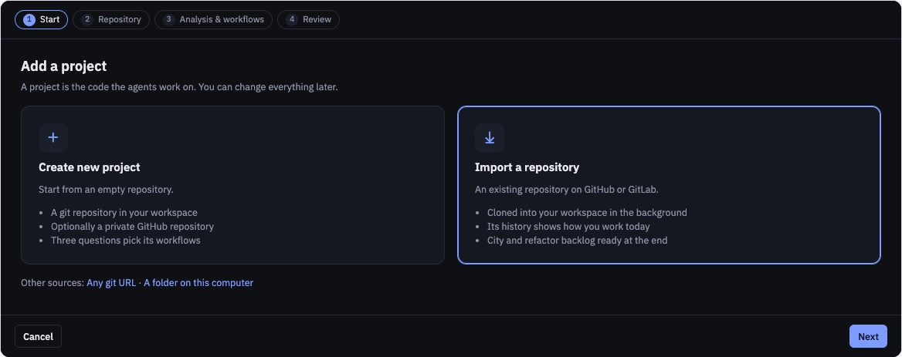
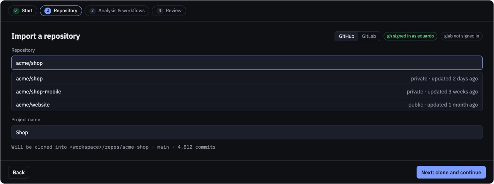
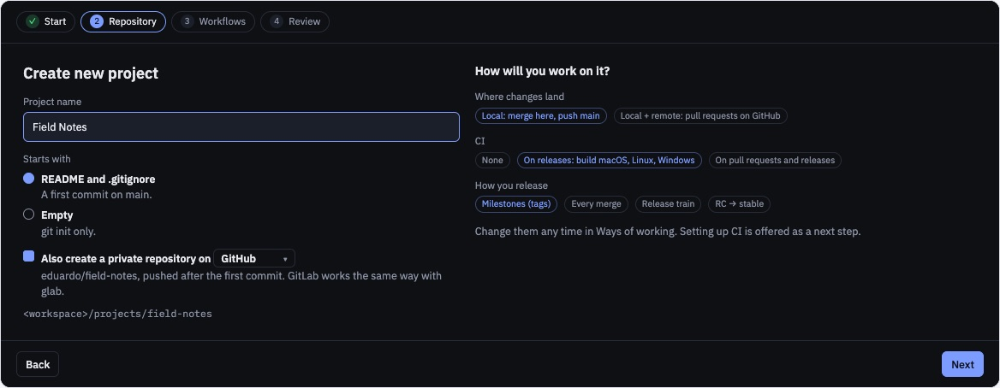
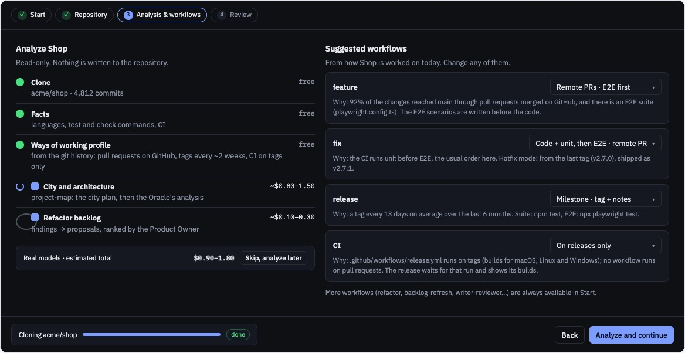
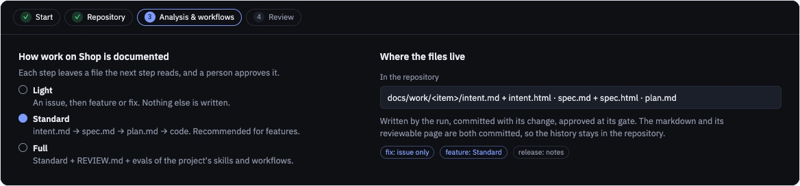
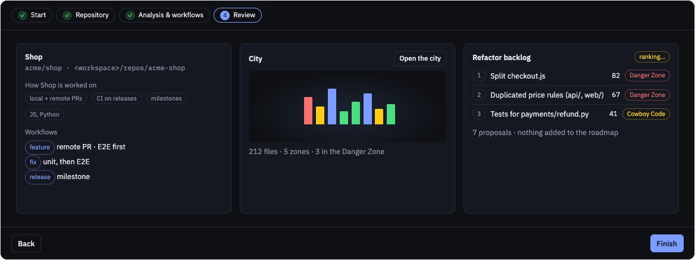
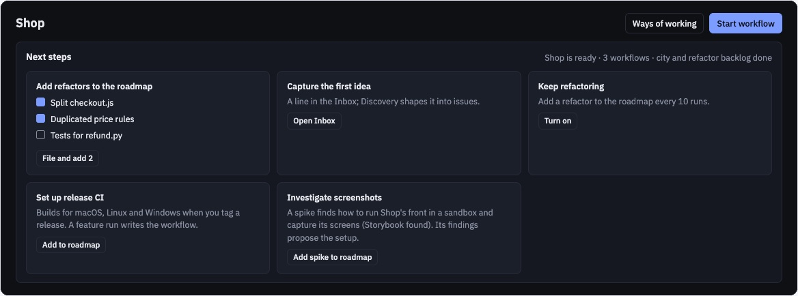
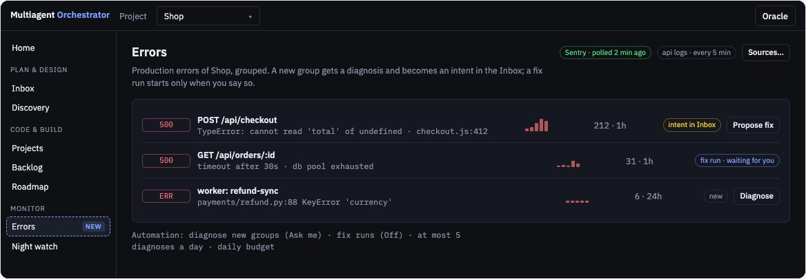

# Spec: first project onboarding

## Flow

## Requirements

**R1. Entry.** A four-step wizard (Start · Repository · Analysis & workflows · Review), opened as Setup's last step and from Projects › New project. Setup loses its Workflows step. The old dialog stays for Edit project only.

**R2. Source.** Two cards: "Create new project" and "Import a repository". GitHub and GitLab share one card, with the provider detected from the URL. Smaller links lead to any git URL and a local folder.

**R3. Import.**
- The repository (a URL or `owner/repo`, with the `gh`/`glab` list when signed in) and the project name.
- On Next, it checks access with `git ls-remote` and starts the clone in the background, with a progress tray.
- With no access, it offers the URL's provider sign-in. With no CLI, the import goes on, warning that issues and PRs will be unavailable.

**R4. Create new.**
- `git init`, a README, `.gitignore` and the first commit on `main`.
- An optional private remote on GitHub or GitLab, only with the CLI signed in and a click.
- Three questions: where changes land (Local or Local + remote), CI (none, on releases, or on PRs and releases) and the release style.

**R5. Analysis.**
- What is free always runs: the clone, the facts and the Ways of working profile from git.
- What costs comes checked, with the total shown, and runs only on the click: the city + architecture analysis (`project-map`) and the refactor ranking.
- Ways of working calls the model only for the fields git cannot settle.
- "Skip, analyze later" leaves everything to the tabs.
- (#725) The suggested workflows column starts with two choices, Analyze the repository (starts the analysis) or Define manually; analyzing dims the rows under a loading overlay; a failed profile shows its reason, Retry and Define manually.
- (#725) Continue is always enabled on this step: the analysis goes on in the background and the review shows what is pending.
- (#725) A failed job is a state of the analysis, never "not started": its row says why (CLI missing, invalid ranking, no folder, refused, timeout), shows "—" as amount and offers Retry, also in the tray and the review; running again reruns only what failed or never ran (a done project map is not paid twice).

**R6. Ways of working profile, revisited.**
- `team` leaves.
- `mode: local | remote | fork`.
- **Amended (#738): no push access.** The access check reads the push permission (`gh api repos/<owner>/<repo>`,
  `permissions.push`). Without it the import step holds on a notice: "You can't push to <owner/repo>. Create a
  fork in your account to contribute?" with **Create a fork** (`gh repo fork`, an existing fork of the owner
  reused; in the clone `origin` = the fork, `upstream` = the original; mode `fork`) and **Work locally** (mode
  `local`: no pull request). In `fork` mode each run fast-forwards the fork's default branch to upstream's and
  pushes it to the fork, pushes its branch to `origin` only, opens the PR against upstream following its
  CONTRIBUTING.md and PR template, and waits for that PR's CI; nothing is ever pushed to `upstream`.
- `ci: none | release | pr+release`, read from the CI files' triggers.
- `tests: unit | unit+e2e` and `e2eCommand`, read from configs, scripts and the order of the CI jobs.
- Unchanged: `release`, `testCommand`, `checkCommand` and `languages`.

**R7. Workflows suggested by rules**, each with its reason and a selector to change it:

| Field | Rule |
|---|---|
| `mode` | local: merge into the local base and **push main as the workflow's last step** (the project auto-push goes away); remote: a PR on GitHub/GitLab, followed and merged there; fork (#738, no push access): a PR from the owner's fork to the original, merged by its maintainer |
| `ci` | pr+release: remote feature waits for the PR's CI; release: the release pushes the tag and waits for the CI run; none: the local suite only |
| `tests` | unit+e2e: feature with E2E first, fix with E2E after; unit: implement, then write the unit tests |
| `release` | with tags: a hotfix branches from the last tag and ships as a patch; per-merge: from main |

**R8. The workflow set (Code & Build).** From 15 to 11, with aliases for the old names (manifests, `hiddenWorkflows`, the roadmap and the run history keep working):

| Today | New |
|---|---|
| `ai-development-local-hero`, `software-development-local-hero`, `software-development`, `multi-model-review` | `feature` (local/remote, E2E first/code first, single or multi-model review) and `fix` (new, with its hotfix mode) |
| `release`, `e2e-release` | `release` (E2E becomes a step) |
| `project-map`, `refactor-proposals` | `analyze-project` |
| `test-batch`, `run-retrospective` | `test-backfill`, `retrospective` |
| `refactor`, `backlog-refresh` | unchanged |
| `writer-reviewer`, `ai-arena`, `issue-tracker` | out (next proposal) |

**R9. Work model.**
- The project picks Light (issue → feature/fix), Standard (intent → spec → plan → code) or Full (+ `REVIEW.md` + evals).
- Feature starts at Standard and fix at Light.
- The artifacts (markdown, English source with a `.pt-BR.md` translation, plus their images) are committed in `docs/work/<item>/` by the SDLC flows around Code & Build, never by a Code & Build run: the pre-flow (intent, spec, plan, at their gates) and the post-flow chained after a successful run (Progress, test, deploy; decision of 2026-11-01). A reader renders the markdown at runtime.

**R10. Review.**
- Shows the profile, the workflows, the city and the refactor backlog with each file's score (0 to 100) and quadrant, as on the Facts view.
- Finish works at any time, and what is left arrives on the project page with a notification.

**R11. Next steps.**
- The cards: add chosen refactors to the roadmap, capture the first idea, the refactor cadence, "Set up release CI" when there is no release CI, and "Investigate screenshots".
- "Investigate screenshots" puts a spike on the project's roadmap to find how to run its front end in a sandbox.
- Nothing enters the roadmap without a click.

**R12. Monitor (last phase).**
- A new menu group, with Errors and the Night watch.
- The app polls production errors from connected sources and groups them with no model.
- The diagnosis becomes `intent.md` in an Inbox card. "Propose fix" starts `fix`, which stops at the gate.

## Decisions

Each decision lists the options that were weighed. The checked box is the one chosen, with its pros (**+**) and cons (**−**). Which requirement each decision shapes:

| Requirement | Decisions |
|---|---|
| R1 Entry | D1 |
| R2 Source | D2 |
| R3 Import | D3, D4 |
| R4 Create new | D5 |
| R5 Analysis | D6, D7 |
| R6 Ways of working | D13 |
| R7 Suggested workflows | D8, D14 |
| R8 Workflow set | D9, D10 |
| R9 Work model | D15, D16 |
| R10 Review | D11 |
| R11 Next steps | D12, D19 |
| R12 Monitor | D17, D18 |

### D1 · Where the onboarding flow lives
- [x] **A · Its own wizard, used by Setup and by Projects** · recommended
  - **+** One flow to maintain and test; the first project and the tenth take the same path.
  - **+** Removes Setup's Workflows step, chosen before any project exists.
  - **−** Setup changes shape (from 4 steps to 3).
- [ ] **B · Inside Setup only**
  - **+** Simpler the first time.
  - **−** The second project goes back to the old dialog; two flows drifting apart.
- [ ] **C · Improve today's New project dialog**
  - **+** Less new code.
  - **−** One screen cannot hold a background clone, an analysis and a review without becoming a huge form.

> [!TIP]
> **Recommendation:** A. Today's dialog stays for **Edit project** only.

### D2 · Which sources show
- [x] **A · Two cards, GitHub and GitLab together** · recommended
  - **+** The main choice is obvious: create or import.
  - **+** GitHub and GitLab differ little in the app (`gh` or `glab`, the same git URL): one card, the provider detected from the URL, a GitHub | GitLab selector for the repository list.
  - **+** Any git URL and a local folder stay as smaller links.
  - **−** The smaller links may go unnoticed.
- [ ] **B · Four cards of the same size**
  - **+** Everything equally visible.
  - **−** Dilutes the first screen's decision.
- [ ] **C · Separate GitHub and GitLab cards**
  - **+** Each brand visible.
  - **−** Two near-identical screens to maintain; three cards dilute the first choice.

### D3 · How the clone happens
- [ ] **A · Synchronous, as today**
  - **+** Nothing new.
  - **−** A big repository blocks the screen for minutes; the user does not know what is happening.
- [x] **B · A background job with a progress tray** · recommended
  - **+** The user picks analyses and workflows while it clones.
  - **+** The project is created as `status: cloning`; an error shows in the tray with Retry.
  - **−** A new job in the service, with state and events.
- [ ] **C · A shallow clone (`--depth`), completed later**
  - **+** Starts faster.
  - **−** Ways of working and the city need the history: shallow breaks the evidence.

> [!TIP]
> **Recommendation:** B with a full clone. A blobless partial clone (`--filter=blob:none`) is a later optimization, measured on big repositories.

### D4 · No `gh`, no sign-in or no access
- [x] **A · Check on Next and offer the fix right there** · recommended
  - **+** A public repository clones over HTTPS with no `gh`.
  - **+** A private repository with no access turns the `ls-remote` error into "Sign in to GitHub" or "Sign in to GitLab" (Setup's ▶ runs `gh auth login` in the terminal), then "Try again".
  - **+** With no `gh`: the card says issues and PRs will be unavailable, and the import goes on.
  - **−** One more error path to test.
- [ ] **B · Require `gh` signed in before anything**
  - **+** Simple.
  - **−** Blocks public repositories and local-only users.
- [ ] **C · Let the clone fail**
  - **+** No new code.
  - **−** The user finds the problem minutes later, in the tray.

> [!TIP]
> **GitHub and GitLab, same path:** the fix offered follows the URL's provider (`gh auth login` or `glab auth login`), and the rest of the flow does not change.

### D5 · What "Create new project" creates
- [ ] **A · An empty folder only (today, with no URL)**
  - **+** Nothing new.
  - **−** With no git, the workflows (worktrees, local merge) cannot run.
- [x] **B · A local git repository + an optional remote (GitHub or GitLab)** · recommended
  - **+** `git init`, a README and `.gitignore`, a first commit on `main`.
  - **+** "Also create a private repository on GitHub | GitLab" through `gh repo create --private` or `glab repo create --private`, offered only with the provider's CLI signed in.
  - **−** Creating a remote repository reaches outside the machine: it needs an explicit click.
- [ ] **C · A stack template (Node, Python…)**
  - **+** A project ready to run.
  - **−** Picking a stack is a product decision; better as the first roadmap item ("Scaffold the app"), done by the feature workflow.

### D6 · Automatic or optional analysis
- [ ] **A · Everything automatic**
  - **+** Zero clicks.
  - **−** Spends money without asking; AGENTS.md asks for explicit cost.
- [x] **B · What is free always runs; what costs comes checked, with the total, and runs on the click** · recommended
  - **+** The clone, the facts and the git profile cost nothing and unlock the workflow suggestion.
  - **+** "Skip, analyze later" leaves everything to the Architecture and Refactor tabs.
  - **−** One more click than A.
- [ ] **C · Nothing at onboarding**
  - **+** Instant onboarding.
  - **−** Misses the point: ending with a real city, backlog and suggested workflows.

> [!TIP]
> **Ways of working with a model:** the seed already has a deterministic path (what simulation mode runs). It is always used, and the model is called only for the fields left `null`, such as a release style with no clear tags.

### D7 · What runs alongside the clone
- [x] **A · A chain by dependency** · recommended
  - **+** Nothing reads the repository before the clone ends; then the profile and `project-map` run in parallel, and the refactor ranking waits for the findings.
  - **+** Respects the machine's slots (#367).
  - **−** A small job orchestrator in the service.
- [ ] **B · An "onboarding" bundled workflow**
  - **+** Shows in Runs like any run.
  - **−** A workflow for things that are not agents (clone, facts); heavier to change.

> [!TIP]
> **Recommendation:** A in the service, calling what exists: `createProject`, `architecture-facts`, `workflows:interview` and the `project-map` run, which still shows in Runs.

### D8 · How the workflow suggestion comes from the analysis
- [x] **A · Rules on the profile** · recommended
  - **+** #487's `composeWorkflowSet` already maps merge, release, commands and languages to the set.
  - **+** Deterministic, testable, and it explains why with the profile's evidence.
  - **−** Rare cases fall back to the default (and the user changes it).
- [ ] **B · A model picks the workflows**
  - **+** Flexible.
  - **−** Expensive, hard to test, and there are few choices anyway.
- [ ] **C · Always the same default set**
  - **+** Simple.
  - **−** Ignores the analysis the owner wants to use.

### D9 · Which workflows every project gets
- [x] **A · feature, fix, release (hotfix as a mode of fix)** · recommended
  - **+** The code's life cycle: make, fix, ship; a hotfix is the urgent fix, branched from the last tag.
  - **+** Separates what the local hero mixes today (features and fixes in one flow).
  - **+** Matches Discovery's bug/hotfix fast lane.
  - **−** Fix is the only new workflow.
- [ ] **B · intake + development + release (#487's set)**
  - **+** Already built.
  - **−** No urgent path; intake (filing an issue) is better as a Planning tool than as a project workflow.

### D10 · How to rename without breaking existing users
- [x] **A · Aliases in the loader + variants as inputs** · recommended
  - **+** An old name resolves to the new one with its variant's inputs (`software-development` → `feature` with `mode: remote`).
  - **+** Manifests, `settings.hiddenWorkflows`, roadmap items and the run history keep working.
  - **−** The alias table stays for two releases, then goes.
- [ ] **B · Rename at once**
  - **+** Clean code.
  - **−** Breaks repository manifests and the saved roadmap.
- [ ] **C · Keep all 15 and only hide some**
  - **+** No migration.
  - **−** Reduces nothing that has to be maintained; it only hides.

### D11 · Does the review wait for the analyses?
- [x] **A · It does not block** · recommended
  - **+** Finish at any time; what is left arrives on the project page, with a notification.
  - **−** The first visit to the city may be empty for a few minutes.
- [ ] **B · It waits for everything**
  - **+** The review is always complete.
  - **−** Keeps the user watching a bar for minutes.

### D12 · How the project reaches the roadmap
- [x] **A · The user picks in "Next steps"** · recommended
  - **+** Reuses `refactor:file` + `refactor:addToRoadmap` (#357, #435) and the cadence.
  - **+** Nothing starts without a click; the roadmap stays stopped until Start.
  - **−** One more card on the project page (gone once dismissed).
- [ ] **B · The PO builds an initial roadmap by itself**
  - **+** A project "ready for the night".
  - **−** Cost and decisions without the owner; goes against "the user decides what goes on the roadmap".

### D13 · The axes of a way of working
Revisits the Ways of working profile (#487). Today it has team (solo or team), merge (local or PR), release, commands, CI and languages.
- [x] **A · Mode (Local or Local + remote) and CI as the axes; team leaves** · recommended
  - **+** **Local:** the run merges into the local base and the workflow's last step pushes main, with no remote PR. The project auto-push (the Backlog toggle) leaves the app.
  - **+** **Local + remote:** the run opens the PR on GitHub/GitLab and follows it there (review, CI when it runs on PRs, merge).
  - **+** **CI:** none, on releases only (e.g. macOS, Linux and Windows builds on a tag), or on PRs and releases. Covers GitHub Free with no actions on PRs.
  - **−** Changes the profile model and the compose (phase 2).
- [ ] **B · Keep solo/team**
  - **+** Nothing changes.
  - **−** Solo and team run the same flow; the question decides nothing.
- [ ] **C · CI inside the mode (remote = with CI)**
  - **+** One question fewer.
  - **−** Wrong for someone who works locally and wants CI on releases only.

> [!TIP]
> **How CI is read:** from the CI files' triggers (`on: pull_request`, `on: push: tags`, `release` on GitHub; `rules` / `only: tags` on GitLab). With no CI, the wizard writes nothing: it offers "Set up release CI" in the next steps.

### D14 · The test strategy of feature and fix
Today `ai-development-local-hero` writes the tests before the code and serves both features and fixes.
- [x] **A · Follow the suite the project has** · recommended
  - **+** **With E2E:** feature writes the E2E scenarios first and implements until they pass (today's local hero); fix implements with unit tests and runs E2E after.
  - **+** **Unit only:** feature and fix implement and then write the unit tests, the flow many companies use.
  - **+** The analysis reads the E2E suite and the order of the CI jobs; with E2E, the wizard asks "Write the E2E tests first for features?" (default yes).
  - **−** Two variants per workflow to maintain (both exist today, in separate workflows).
- [ ] **B · Always tests first**
  - **+** One path.
  - **−** Odd for fixes and for teams on the usual flow; with no E2E, "tests first" is unit-only.
- [ ] **C · Always code first**
  - **+** Familiar.
  - **−** Loses what works well today for features with E2E.

### D15 · A work model per project
- [x] **A · Light / Standard / Full, per kind of work** · recommended
  - **+** The project picks at onboarding; feature uses Standard, fix uses Light, and any item can step up.
  - **+** The app's existing gates approve artifacts: the Discovery commit approves intent and spec, the developer's gate approves the plan.
  - **−** One more choice at onboarding (with a ready default).
- [ ] **B · Always the full model**
  - **+** Faithful to the playbook.
  - **−** Heavy for fixes and small projects; becomes bureaucracy.
- [ ] **C · Not now**
  - **+** Nothing new.
  - **−** The documents stay scattered (issue, card, brief), with no loop.

### D16 · Where the artifacts live
- [x] **A · Markdown in the repository, rendered at runtime** · decided by the owner
  - **+** The English source (`intent.md`) with the Portuguese translation beside it (`intent.pt-BR.md`) and the images, in `docs/work/<item>/`, versioned with the change.
  - **+** No HTML committed: a reader renders the markdown at runtime, with a theme, export to PDF and a home page; editing a markdown in Maintain needs nothing regenerated.
  - **+** The feature's and the issue's data, not the user's workspace data.
  - **−** The reader needs JavaScript and a server (the engine's) to open the files.
- [ ] **B · Markdown and pre-rendered HTML committed**
  - **+** Opens anywhere, even with a double click.
  - **−** Every markdown edit needs the HTML regenerated; it drifts.
- [ ] **C · Only in the workspace**
  - **+** Does not touch the repository.
  - **−** Gone for anyone who clones; outside agents cannot read it.

### D17 · How errors reach the app
- [x] **A · Polling connected sources** · recommended
  - **+** The app fetches now and then from Sentry, Datadog, CloudWatch, GCP Logging or a log URL / file with a filter (status 500, level error).
  - **+** Outgoing connections only: works in the .exe, exposing nothing.
  - **−** A few minutes of delay; one connector per source.
- [ ] **B · A webhook received by the app**
  - **+** Immediate.
  - **−** Needs a public URL for the desktop: only through the engine server, after the security review (#466–#470).
- [ ] **C · An agent reading logs on its own**
  - **+** Flexible.
  - **−** Expensive and unpredictable for what a filter does; the model only diagnoses.

### D18 · What happens with a new error
- [x] **A · The diagnosis becomes an intent; a fix only on a click** · recommended
  - **+** A read-only Oracle turn crosses the stack trace with the code and writes the diagnosis as `intent.md` in an Inbox card (the playbook's Maintain).
  - **+** "Propose fix" starts the `fix` workflow, which stops at the human gate like any run.
  - **+** Ask me / On / Off modes, like Discovery's column automations (#259), with a daily cap.
  - **−** One card per new group: the cap and deduplication prevent a flood.
- [ ] **B · An automatic fix up to the merge**
  - **+** Faster.
  - **−** Would cross the human gate: forbidden by AGENTS.md.
- [ ] **C · Only listing the errors**
  - **+** Cheap.
  - **−** No loop; one more dashboard.

### D19 · How the project gets automatic screenshots
- [x] **A · A spike on the project's roadmap, from "Next steps"** · recommended
  - **+** Step 3 already detects signals (Storybook, Playwright, mocks, the Local preview run command); the "Investigate screenshots" card puts a spike on the project's roadmap if the user wants.
  - **+** The spike runs in the project, read-only plus sandboxed tries (sample data, no network, no real secrets): it tries a generic capture through Local preview and evaluates a harness on the app's `screenshot` contract.
  - **+** Its result is a findings document (in the project's work model) and a proposed "Set up screenshots" item, approved like any item.
  - **−** One more run before automatic capture exists in the project.
- [ ] **B · Implement the harness straight away**
  - **+** Faster when it works.
  - **−** Writes code in the project without knowing the path works; expensive when it fails.
- [ ] **C · Generic capture only, no code in the project**
  - **+** Nothing changes in the repository.
  - **−** Breaks with login, empty data and external APIs.

## Design

- **Wizard:** `fronts/build/views/projects/project-wizard.js`. The pure rules (steps, suggestions, the cost sum) live in `packages/shared/onboarding-model.js`, testable with no DOM.
- **Background jobs:** `packages/engine/service/areas/project-onboarding.js` chains by dependency: clone → facts → (profile ∥ `project-map`) → refactor ranking. It respects the machine's slots and tells the UI through `onboarding:*` channels.
- **Project:** created with `status: cloning`, then `ready` or `failed`, with Retry.
- **Suggestion:** #487's `composeWorkflowSet`, extended for mode/ci/tests and to generate feature/fix/release.
- **Aliases:** in the workflow loader, where an old name resolves to the new one with its variant's inputs.
- **Where things live:** the project's workflows are referenced in the project's JSON, in the workspace. "Customize" writes to `.craftorio/`, uncommitted.

## Areas of concern

- **For the tech lead (the workflow changes):**
  - renaming workflows touches repository manifests, the saved roadmap and tests;
  - the aliases must land before any rename;
  - fix is the only new workflow.
- **Push in Local mode:** removing the auto-push and adding a final push step closes the #617 race, but it changes a behaviour that users with auto-push on already rely on.
- **Cost:** the model analyses cost about $1–2 per import (an unmeasured estimate) and count toward the daily budget.
- **Writes to the user's repository:** the artifacts (R9), CI (R11) and the screenshot harness only come through a run, with a gate.
- **Monitor security:** the sources' tokens live in the system keychain. A webhook only after the security review (#466–#470).

## Open questions (from the intent and new)

1. How long do the aliases last? *Proposed: two releases.*
2. Which work model comes checked? *Proposed: Standard for feature, Light for fix.*
3. Is the artifacts folder configurable? *Proposed: yes. The default is `docs/work/<item>/`, and Ways of working detects a folder already in use (`docs/rfcs`, `adr/`).*
4. Which error sources does the Monitor support first? *Proposed: Sentry and a log URL or file.*
5. Monorepo with several projects? *Proposed: one project per repository, for now.*
