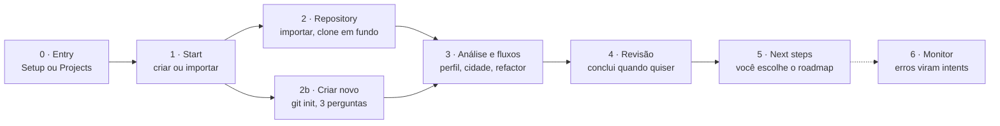
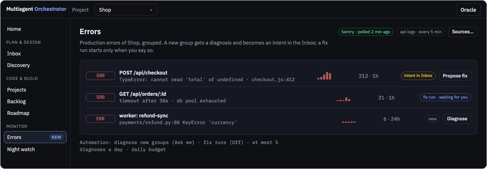

# Spec: onboarding do primeiro projeto

## Fluxo

## Requisitos

**R1. Entrada.** Um assistente de quatro etapas (Start · Repository · Analysis & workflows · Review), aberto como último passo do Setup e por Projects › New project. O Setup perde o passo Workflows. O diálogo antigo fica só para Edit project.

**R2. Origem.** Dois cards: "Create new project" e "Import a repository". GitHub e GitLab ficam no mesmo card, com o provedor detectado pela URL. Links menores levam a outra URL git e a uma pasta local.

**R3. Importar.**
- O repositório (URL ou `owner/repo`, com a lista do `gh`/`glab` quando logado) e o nome do projeto.
- No Next, valida o acesso com `git ls-remote` e começa o clone em segundo plano, com uma bandeja de progresso.
- Sem acesso, oferece o login do provedor da URL. Sem CLI, o import segue, avisando que issues e PRs ficam indisponíveis.

**R4. Criar novo.**
- `git init`, README, `.gitignore` e o primeiro commit em `main`.
- Remoto privado opcional no GitHub ou no GitLab, só com o CLI logado e o clique.
- Três perguntas: onde as mudanças chegam (Local ou Local + remoto), o CI (nenhum, só na release, ou nos PRs e na release) e o estilo de release.

**R5. Análise.**
- O que é grátis roda sempre: clone, fatos e o perfil do Ways of working pelo git.
- O que custa vem marcado, com o total visível, e só roda no clique: a cidade + análise de arquitetura (`project-map`) e o ranking da refatoração.
- O modelo é chamado no Ways of working só para os campos que o git não resolve.
- "Skip, analyze later" deixa tudo para as abas.
- (#725) A coluna de fluxos sugeridos começa com duas escolhas, Analisar o repositório (inicia a análise) ou Definir manualmente; analisando, as linhas ficam esmaecidas sob um overlay de carregamento; um perfil que falhou mostra o motivo, Tentar novamente e Definir manualmente.
- (#725) Continuar fica sempre habilitado nesta etapa: a análise segue em segundo plano e a revisão mostra o que está pendente.
- (#725) Um job que falhou é um estado da análise, nunca "não iniciado": a linha diz o porquê (CLI ausente, ranking inválido, sem pasta, recusa, tempo esgotado), mostra "—" no valor e oferece Tentar novamente, também na bandeja e na revisão; rodar de novo reexecuta só o que falhou ou nunca rodou (um mapa do projeto pronto não é pago duas vezes).

**R6. Perfil de trabalho (Ways of working revisitado).**
- `team` sai.
- `mode: local | remote | fork`.
- **Emenda (#738): sem permissão de push.** A checagem de acesso lê a permissão de push (`gh api repos/<owner>/<repo>`,
  `permissions.push`). Sem ela, o passo de importação para num aviso: "You can't push to <owner/repo>. Create a
  fork in your account to contribute?" com **Create a fork** (`gh repo fork`, um fork existente do dono é
  reaproveitado; no clone `origin` = o fork, `upstream` = o original; modo `fork`) e **Work locally** (modo
  `local`: sem pull request). No modo `fork`, cada run avança o branch padrão do fork até o do upstream e o envia
  ao fork, envia o próprio branch só ao `origin`, abre o PR contra o upstream seguindo o CONTRIBUTING.md e o
  template de PR dele, e espera o CI desse PR; nada é enviado ao `upstream`.
- `ci: none | release | pr+release`, lido dos gatilhos dos arquivos de CI.
- `tests: unit | unit+e2e` e `e2eCommand`, lidos de configs, scripts e da ordem dos jobs no CI.
- Ficam como estão: `release`, `testCommand`, `checkCommand` e `languages`.

**R7. Fluxos sugeridos por regra**, cada um com o porquê e um seletor para trocar:

| Campo | Regra |
|---|---|
| `mode` | local: merge na base local e **push do main como último passo do workflow** (o auto-push do projeto sai); remote: PR no GitHub/GitLab, acompanhado e mesclado lá; fork (#738, sem permissão de push): PR do fork do dono para o original, mesclado pelo mantenedor |
| `ci` | pr+release: o feature remoto espera o CI do PR; release: a release faz push da tag e espera o run de CI; none: só a suíte local |
| `tests` | unit+e2e: feature com E2E primeiro, fix com E2E depois; unit: implementa e depois escreve o unitário |
| `release` | com tags: o hotfix sai da última tag e vira patch; per-merge: sai de main |

**R8. Conjunto de workflows (Code & Build).** De 15 para 11, com aliases para os nomes antigos (manifestos, `hiddenWorkflows`, roadmap e histórico continuam funcionando):

| Hoje | Novo |
|---|---|
| `ai-development-local-hero`, `software-development-local-hero`, `software-development`, `multi-model-review` | `feature` (local/remote, E2E first/code first, review simples ou multi-modelo) e `fix` (novo, com o modo hotfix) |
| `release`, `e2e-release` | `release` (o E2E vira passo) |
| `project-map`, `refactor-proposals` | `analyze-project` |
| `test-batch`, `run-retrospective` | `test-backfill`, `retrospective` |
| `refactor`, `backlog-refresh` | sem mudança |
| `writer-reviewer`, `ai-arena`, `issue-tracker` | fora (próxima proposta) |

**R9. Modelo de trabalho.**
- O projeto escolhe entre Leve (issue → feature/fix), Padrão (intent → spec → plan → código) e Completo (+ `REVIEW.md` + evals).
- Feature começa no Padrão e fix no Leve.
- Os artefatos (markdown: a fonte em inglês com a tradução `.pt-BR.md`, e as imagens) são commitados em `docs/work/<item>/` pelos fluxos do SDLC em volta do Code & Build, nunca por um run de Code & Build: o fluxo anterior (intent, spec, plan, nos seus gates) e o fluxo posterior encadeado depois de um run com sucesso (Progress, teste, deploy; decisão de 2026-11-01). Um leitor renderiza o markdown na hora.

**R10. Revisão.**
- Mostra o perfil, os fluxos, a cidade e o backlog de refatoração com a nota de cada arquivo (0 a 100) e o quadrante, como na aba Facts.
- O Finish funciona a qualquer momento, e o que falta chega na página do projeto com uma notificação.

**R11. Next steps.**
- Os cartões: adicionar refatorações escolhidas ao roadmap, capturar a primeira ideia, a cadência de refatoração, "Set up release CI" quando não há CI de release, e "Investigate screenshots".
- "Investigate screenshots" coloca um spike no roadmap do projeto para achar como rodar o front em sandbox.
- Nada entra no roadmap sem clique.

**R12. Monitor (última fase).**
- Um grupo novo no menu, com Errors e o Night watch.
- O app busca os erros de produção por polling de fontes conectadas e agrupa sem modelo.
- O diagnóstico vira `intent.md` num card do Inbox. "Propose fix" começa o `fix`, que para no gate.

## Decisões

Cada decisão lista as opções que foram pesadas. A caixa marcada é a escolhida, com os prós (**+**) e os contras (**−**). Que requisito cada decisão define:

| Requisito | Decisões |
|---|---|
| R1 Entrada | D1 |
| R2 Origem | D2 |
| R3 Importar | D3, D4 |
| R4 Criar novo | D5 |
| R5 Análise | D6, D7 |
| R6 Ways of working | D13 |
| R7 Fluxos sugeridos | D8, D14 |
| R8 Conjunto de workflows | D9, D10 |
| R9 Modelo de trabalho | D15, D16 |
| R10 Revisão | D11 |
| R11 Next steps | D12, D19 |
| R12 Monitor | D17, D18 |

### D1 · Onde vive o fluxo de cadastro
- [x] **A · Assistente próprio, usado pelo Setup e por Projects** · recomendado
  - **+** Um fluxo só para manter e testar; o primeiro projeto e o décimo passam pelo mesmo caminho.
  - **+** Tira do Setup o passo Workflows, escolhido antes de existir projeto.
  - **−** O Setup muda de forma (de 4 para 3 passos).
- [ ] **B · Só dentro do Setup**
  - **+** Mais simples na primeira vez.
  - **−** O segundo projeto volta ao diálogo antigo; dois fluxos divergindo.
- [ ] **C · Melhorar o diálogo New project atual**
  - **+** Menos código novo.
  - **−** Uma tela só não comporta clone em fundo, análise e revisão sem virar um formulário enorme.

> [!TIP]
> **Recomendação:** A. O diálogo atual fica só para **Edit project**.

### D2 · Quais origens aparecem
- [x] **A · Dois cards, GitHub e GitLab juntos** · recomendado
  - **+** A escolha principal fica óbvia: criar ou importar.
  - **+** GitHub e GitLab mudam pouco no app (`gh` ou `glab`, a mesma URL git): um card só, o provedor detectado pela URL, com um seletor GitHub | GitLab para a lista de repos.
  - **+** Outra URL e pasta local seguem como links menores.
  - **−** Os links menores podem passar despercebidos.
- [ ] **B · Quatro cards do mesmo tamanho**
  - **+** Tudo igualmente visível.
  - **−** Dilui a decisão da primeira tela.
- [ ] **C · Cards separados para GitHub e GitLab**
  - **+** Cada marca visível.
  - **−** Duas telas quase iguais para manter; três cards diluem a primeira escolha.

### D3 · Como o clone acontece
- [ ] **A · Síncrono, como hoje**
  - **+** Nada novo.
  - **−** Um repo grande prende a tela por minutos; o usuário não sabe o que está acontecendo.
- [x] **B · Job em segundo plano com bandeja de progresso** · recomendado
  - **+** O usuário escolhe análises e fluxos enquanto clona.
  - **+** O projeto é criado como `status: cloning`; um erro aparece na bandeja com "Retry".
  - **−** Um job novo no serviço, com estado e eventos.
- [ ] **C · Clone raso (`--depth`) e depois completar**
  - **+** Começa mais rápido.
  - **−** O Ways of working e a cidade precisam da história: raso quebra a evidência.

> [!TIP]
> **Recomendação:** B com clone completo. Clone parcial sem blobs (`--filter=blob:none`) é uma otimização para depois, medida em repos grandes.

### D4 · Sem `gh`, sem login ou sem acesso
- [x] **A · Validar no Next e oferecer o conserto ali** · recomendado
  - **+** Repo público: clona por HTTPS sem `gh`.
  - **+** Repo privado sem acesso: o erro do `ls-remote` vira "Sign in to GitHub" ou "Sign in to GitLab" (o ▶ do Setup roda `gh auth login` no terminal), depois "Try again".
  - **+** Sem `gh`: o card avisa que issues e PRs ficam indisponíveis, mas o import segue.
  - **−** Um caminho de erro a mais para testar.
- [ ] **B · Exigir `gh` logado antes de tudo**
  - **+** Simples.
  - **−** Bloqueia repos públicos e quem trabalha só local.
- [ ] **C · Deixar o clone falhar**
  - **+** Nenhum código novo.
  - **−** O usuário descobre o problema minutos depois, na bandeja.

> [!TIP]
> **GitHub e GitLab, o mesmo caminho:** o conserto oferecido segue o provedor da URL (`gh auth login` ou `glab auth login`), e o resto do fluxo não muda.

### D5 · O que "Create new project" cria
- [ ] **A · Só uma pasta vazia (como hoje sem URL)**
  - **+** Nada novo.
  - **−** Sem git, os workflows (worktrees, merge local) não funcionam.
- [x] **B · Repo git local + remoto opcional (GitHub ou GitLab)** · recomendado
  - **+** `git init`, README e `.gitignore`, primeiro commit em `main`.
  - **+** "Also create a private repository on GitHub | GitLab" via `gh repo create --private` ou `glab repo create --private`, oferecido só com o CLI do provedor logado.
  - **−** Criar repo remoto é uma ação para fora: precisa do clique explícito.
- [ ] **C · Template de stack (Node, Python…)**
  - **+** Projeto pronto para rodar.
  - **−** Escolher stack é decisão de produto; melhor como o primeiro item do roadmap ("Scaffold the app"), feito pelo fluxo feature.

### D6 · Análise automática ou opcional
- [ ] **A · Tudo automático**
  - **+** Zero cliques.
  - **−** Gasta dinheiro sem pedir; o AGENTS.md pede custo explícito.
- [x] **B · O que é grátis roda sempre; o que custa vem marcado, com o total, e roda no clique** · recomendado
  - **+** Clone, fatos e o perfil do git não custam nada e destravam a sugestão de fluxos.
  - **+** "Skip, analyze later" deixa tudo para as abas Architecture e Refactor.
  - **−** Um clique a mais que no A.
- [ ] **C · Nada no cadastro**
  - **+** Cadastro instantâneo.
  - **−** Perde o objetivo: terminar com cidade, backlog e fluxos sugeridos de verdade.

> [!TIP]
> **Ways of working com modelo:** o seed já tem um caminho determinístico (é o que roda no modo simulado). A proposta usa esse caminho sempre e só chama o modelo para os campos que ficaram `null`, como o estilo de release sem tags claras.

### D7 · O que roda junto com o clone
- [x] **A · Pipeline encadeado por dependência** · recomendado
  - **+** Nada lê o repo antes de o clone terminar; depois, perfil e `project-map` correm em paralelo, e o ranking da refatoração espera os achados.
  - **+** Respeita os slots da máquina (#367).
  - **−** Um orquestrador pequeno de jobs no serviço.
- [ ] **B · Um workflow "onboarding" bundled**
  - **+** Aparece em Runs como qualquer run.
  - **−** Um workflow para coisas que não são agentes (clone, fatos); mais pesado de mudar.

> [!TIP]
> **Recomendação:** A no serviço, chamando o que já existe: `createProject`, `architecture-facts`, `workflows:interview` e o run do `project-map`, que continua aparecendo em Runs.

### D8 · Como a sugestão de fluxos sai da análise
- [x] **A · Regras sobre o perfil** · recomendado
  - **+** O `composeWorkflowSet` do #487 já mapeia time, merge, release, comandos e linguagens para o conjunto.
  - **+** Determinístico, testável, explica o porquê com a evidência do perfil.
  - **−** Casos raros caem no padrão (e o usuário troca).
- [ ] **B · Um modelo escolhe os fluxos**
  - **+** Flexível.
  - **−** Caro, difícil de testar, e as escolhas são poucas.
- [ ] **C · Sempre o mesmo conjunto padrão**
  - **+** Simples.
  - **−** Ignora a análise que o dono quer usar.

### D9 · Quais fluxos todo projeto recebe
- [x] **A · feature, fix, release (hotfix como modo do fix)** · recomendado
  - **+** É o ciclo de vida do código: fazer, consertar, entregar; o hotfix é o fix urgente, que sai da última tag.
  - **+** Separa o que hoje o local hero mistura (feature e fix no mesmo fluxo).
  - **+** Bate com o fast lane de bug/hotfix do Discovery.
  - **−** O fix é o único workflow novo.
- [ ] **B · intake + desenvolvimento + release (o conjunto do #487)**
  - **+** Já implementado.
  - **−** Sem caminho de urgência; o intake (issue) é melhor como ferramenta do Planning do que como fluxo do projeto.

### D10 · Como renomear sem quebrar quem já usa
- [x] **A · Aliases no carregador + variantes por input** · recomendado
  - **+** O nome antigo resolve para o novo com os inputs da variante (`software-development` → `feature` com `mode: remote`).
  - **+** Manifestos, `settings.hiddenWorkflows`, itens do roadmap e o histórico de runs continuam funcionando.
  - **−** A tabela de aliases fica por duas versões e depois sai.
- [ ] **B · Renomear de uma vez**
  - **+** Código limpo.
  - **−** Quebra manifestos de repositórios e o roadmap salvo.
- [ ] **C · Manter os 15 e só esconder**
  - **+** Nenhuma migração.
  - **−** Não reduz nada que precisa ser mantido; só esconde.

### D11 · A revisão espera as análises?
- [x] **A · Não bloqueia** · recomendado
  - **+** Finish a qualquer momento; o que falta chega na página do projeto, com notificação.
  - **−** A primeira visita à cidade pode estar vazia por alguns minutos.
- [ ] **B · Espera tudo terminar**
  - **+** A revisão é sempre completa.
  - **−** Prende o usuário minutos olhando uma barra.

### D12 · Como o projeto chega ao roadmap
- [x] **A · O usuário escolhe no "Next steps"** · recomendado
  - **+** Reaproveita `refactor:file` + `refactor:addToRoadmap` (#357, #435) e a cadência.
  - **+** Nada começa sem clique; o roadmap continua parado até Start.
  - **−** Mais um cartão na página do projeto (some quando dispensado).
- [ ] **B · O PO monta um roadmap inicial sozinho**
  - **+** Projeto "pronto para a noite".
  - **−** Custo e decisões sem o dono; vai contra "o usuário decide o que vai para o roadmap".

### D13 · Os eixos da forma de trabalho
Revisão do perfil do Ways of working (#487). Hoje ele tem time (solo ou time), merge (local ou PR), release, comandos, CI e linguagens.
- [x] **A · Modo (Local ou Local + remoto) e CI como eixos; time sai** · recomendado
  - **+** **Local:** o run mescla na base local e o último passo do workflow faz push do main, sem PR remoto. O auto-push do projeto (o botão do Backlog) sai do app.
  - **+** **Local + remoto:** o run abre o PR no GitHub/GitLab e acompanha por lá (revisão, CI quando roda no PR, merge).
  - **+** **CI:** nenhum, só na release (ex.: builds para macOS, Linux e Windows ao criar a tag) ou nos PRs e na release. Cobre o caso do GitHub Free sem actions nos PRs.
  - **−** Muda o modelo do perfil e o compose (fase 2).
- [ ] **B · Manter solo/time**
  - **+** Nada muda.
  - **−** Solo e time rodam o mesmo fluxo; a pergunta não decide nada.
- [ ] **C · CI dentro do modo (remoto = com CI)**
  - **+** Uma pergunta a menos.
  - **−** Errado para quem trabalha local e quer CI só na release.

> [!TIP]
> **Como o CI é lido:** pelos gatilhos dos arquivos de CI (`on: pull_request`, `on: push: tags`, `release` no GitHub; `rules` / `only: tags` no GitLab). Sem CI, o assistente não escreve nada: oferece "Set up release CI" nos próximos passos.

### D14 · A estratégia de testes de feature e fix
Hoje o `ai-development-local-hero` escreve os testes antes do código e serve tanto para feature quanto para fix.
- [x] **A · Pela suíte que o projeto tem** · recomendado
  - **+** **Com E2E:** a feature escreve os cenários E2E primeiro e implementa até passarem (o local hero de hoje); o fix implementa com unitário e roda o E2E depois.
  - **+** **Só unitário:** feature e fix implementam e depois escrevem o unitário, o fluxo que muitas empresas usam.
  - **+** A análise lê a suíte E2E e a ordem dos jobs no CI; com E2E, o assistente pergunta "Write the E2E tests first for features?" (padrão sim).
  - **−** Duas variantes por fluxo para manter (as duas já existem hoje em workflows separados).
- [ ] **B · Sempre testes primeiro**
  - **+** Um caminho só.
  - **−** Estranho para fix e para quem trabalha no fluxo tradicional; sem E2E, o "teste primeiro" vira só unitário.
- [ ] **C · Sempre código primeiro**
  - **+** Familiar.
  - **−** Perde o que funciona bem hoje para features com E2E.

### D15 · Modelo de trabalho por projeto
- [x] **A · Leve / Padrão / Completo, por tipo de trabalho** · recomendado
  - **+** O projeto escolhe no onboarding; feature usa Padrão, fix usa Leve, e cada item pode subir de nível.
  - **+** Os gates que o app já tem passam a aprovar artefatos: o commit do Discovery aprova o intent e o spec, o gate do desenvolvedor aprova o plano.
  - **−** Mais uma escolha no onboarding (com padrão pronto).
- [ ] **B · Sempre o modelo completo**
  - **+** Fiel ao playbook.
  - **−** Pesado para fix e projetos pequenos; vira burocracia.
- [ ] **C · Não adotar agora**
  - **+** Nada novo.
  - **−** Os documentos continuam soltos (issue, card, brief), sem o loop que o dono quer.

### D16 · Onde os artefatos ficam
- [x] **A · Markdown no repositório, renderizado na hora** · decidido pelo dono
  - **+** A fonte em inglês (`intent.md`) com a tradução em português ao lado (`intent.pt-BR.md`) e as imagens, em `docs/work/<item>/`, versionados com a mudança.
  - **+** Nenhum HTML commitado: um leitor renderiza o markdown na hora, com tema, export to PDF e uma página inicial com os itens; editar um markdown no Maintain não exige regenerar nada.
  - **+** São dados da feature e da issue, não do workspace do usuário.
  - **−** O leitor precisa de JavaScript e de um servidor (o do engine) para abrir os arquivos.
- [ ] **B · Markdown e HTML pré-renderizado commitados**
  - **+** Abre em qualquer lugar, até com duplo clique.
  - **−** Cada edição no markdown exige regenerar o HTML; ele fica desatualizado.
- [ ] **C · Só no workspace**
  - **+** Não toca o repositório.
  - **−** Some para quem clona; agentes de fora não leem.

### D17 · Como os erros chegam ao app
- [x] **A · Polling de fontes conectadas** · recomendado
  - **+** O app busca, de tempos em tempos: Sentry, Datadog, CloudWatch, GCP Logging ou uma URL / arquivo de log com filtro (status 500, nível error).
  - **+** Só conexões de saída: funciona no .exe, sem expor nada.
  - **−** Atraso de alguns minutos; um conector por fonte.
- [ ] **B · Webhook recebido pelo app**
  - **+** Na hora.
  - **−** Precisa de uma URL pública para o desktop: só pelo servidor do engine, e depois da revisão de segurança (#466–#470).
- [ ] **C · Agente lendo logs por conta própria**
  - **+** Flexível.
  - **−** Caro e imprevisível para algo que um filtro resolve; o modelo entra só no diagnóstico.

### D18 · O que acontece com um erro novo
- [x] **A · Diagnóstico vira intent; fix só com clique** · recomendado
  - **+** Um turno só-leitura do Oracle cruza o stack trace com o código e escreve o diagnóstico como `intent.md` num card do Inbox (o Maintain do playbook).
  - **+** "Propose fix" começa o fluxo `fix`, que para no gate humano como qualquer run.
  - **+** Modos Ask me / On / Off, como as automações das colunas do Discovery (#259), com teto diário.
  - **−** Um card por grupo novo: o teto e a deduplicação evitam enxurrada.
- [ ] **B · Fix automático até o merge**
  - **+** Mais rápido.
  - **−** Atravessaria o gate humano: proibido pelo AGENTS.md.
- [ ] **C · Só listar os erros**
  - **+** Barato.
  - **−** Não fecha o loop; vira mais um dashboard.

### D19 · Como o projeto ganha screenshots automáticos
- [x] **A · Um spike no roadmap do projeto, a partir do "Next steps"** · recomendado
  - **+** A etapa 3 já detecta sinais (Storybook, Playwright, mocks, o comando de run do Local preview); o cartão "Investigate screenshots" coloca um spike no roadmap do projeto, se o usuário quiser.
  - **+** O spike roda no projeto, só-leitura mais tentativas em sandbox (dados de exemplo, sem rede, sem segredos reais): tenta a captura genérica pelo Local preview e avalia um harness no contrato `screenshot` do app.
  - **+** O resultado é um documento de achados (no modelo de trabalho do projeto) e uma proposta de item "Set up screenshots", que o usuário aprova como qualquer item.
  - **−** Um run a mais antes da captura automática existir no projeto.
- [ ] **B · Implementar o harness direto**
  - **+** Mais rápido quando dá certo.
  - **−** Escreve código no projeto sem saber se o caminho funciona; caro quando falha.
- [ ] **C · Só captura genérica, sem código no projeto**
  - **+** Nada muda no repositório.
  - **−** Quebra com login, dados vazios e APIs externas.

## Design

- **Assistente:** `fronts/build/views/projects/project-wizard.js`. As regras puras (etapas, sugestões, soma do custo) ficam em `packages/shared/onboarding-model.js`, testáveis sem DOM.
- **Jobs em segundo plano:** `packages/engine/service/areas/project-onboarding.js` encadeia por dependência: clone → fatos → (perfil ∥ `project-map`) → ranking da refatoração. Respeita os slots da máquina e avisa a UI por canais `onboarding:*`.
- **Projeto:** criado com `status: cloning` e, depois, `ready` ou `failed`, com Retry.
- **Sugestão:** o `composeWorkflowSet` do #487, estendido para mode/ci/tests e para gerar feature/fix/release.
- **Aliases:** no carregador de workflows, onde o nome antigo resolve para o novo com os inputs da variante.
- **Onde fica cada coisa:** os fluxos do projeto ficam referenciados no JSON do projeto, no workspace. "Customize" escreve em `.craftorio/`, sem commit.

## Pontos de atenção

- **Para o tech lead (as mudanças de workflows):**
  - trocar nomes de workflows mexe em manifestos de repositórios, no roadmap salvo e em testes;
  - os aliases precisam entrar antes de qualquer rename;
  - o fix é o único workflow novo.
- **Push no modo Local:** tirar o auto-push e pôr o passo final de push fecha a corrida do #617, mas muda um comportamento que quem tem o auto-push ligado já usa.
- **Custo:** as análises com modelo custam cerca de $1–2 por import (estimativa sem medição) e contam no orçamento diário.
- **Escrita no repositório do usuário:** os artefatos (R9), o CI (R11) e o harness de screenshot só entram por run, com gate.
- **Segurança do Monitor:** os tokens das fontes ficam no cofre do sistema. Webhook só depois da revisão de segurança (#466–#470).

## Perguntas em aberto (vindas do intent e novas)

1. Por quanto tempo os aliases valem? *Proposta: duas versões.*
2. Qual modelo de trabalho vem marcado? *Proposta: Standard para feature, Light para fix.*
3. A pasta dos artefatos é configurável? *Proposta: sim. O padrão é `docs/work/<item>/`, e o Ways of working detecta uma pasta já usada (`docs/rfcs`, `adr/`).*
4. Quais fontes de erro o Monitor suporta primeiro? *Proposta: Sentry e uma URL ou arquivo de log.*
5. Monorepo com vários projetos? *Proposta: um projeto por repositório, por enquanto.*
