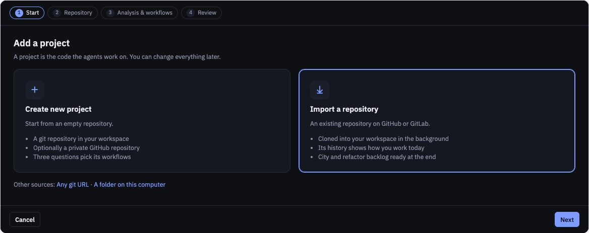
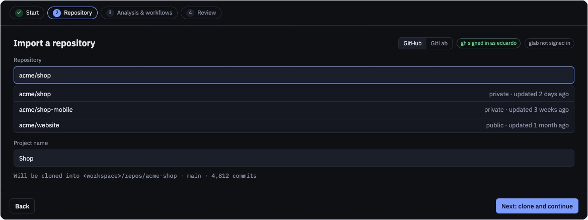
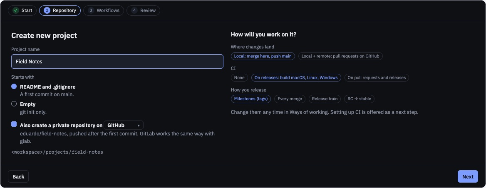
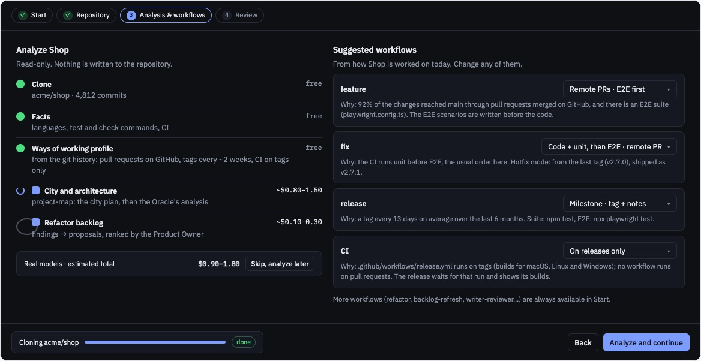
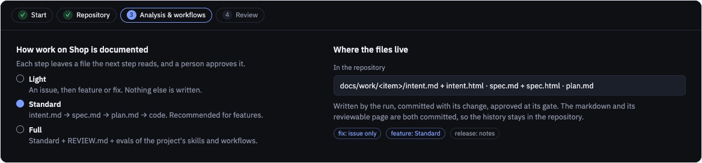
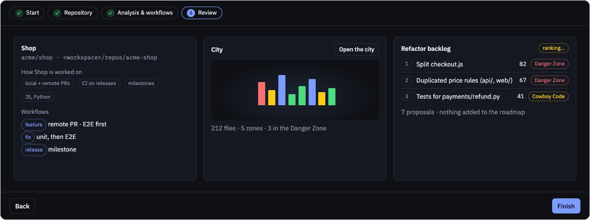
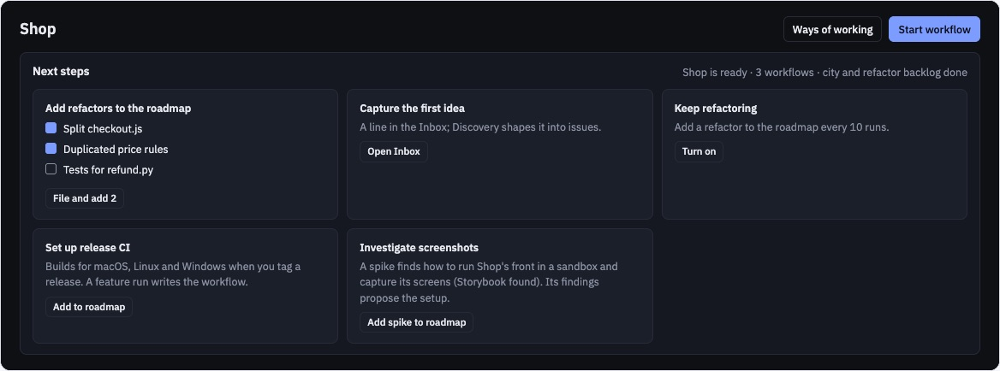

# Spec: onboarding do primeiro projeto

## Requisitos

**R1. Entrada.** Um assistente de quatro etapas (Start · Repository · Analysis & workflows · Review), aberto como último passo do Setup e por Projects › New project. O Setup perde o passo Workflows. O diálogo antigo fica só para Edit project.

**R2. Origem.** Dois cards: "Create new project" e "Import a repository". GitHub e GitLab ficam no mesmo card, com o provedor detectado pela URL. Links menores levam a outra URL git e a uma pasta local.

**R3. Importar.**
- O repositório (URL ou `owner/repo`, com a lista do `gh`/`glab` quando logado) e o nome do projeto.
- No Next, valida o acesso com `git ls-remote` e começa o clone em segundo plano, com uma bandeja de progresso.
- Sem acesso, oferece o login do provedor da URL. Sem CLI, o import segue, avisando que issues e PRs ficam indisponíveis.

**R4. Criar novo.**
- `git init`, README, `.gitignore` e o primeiro commit em `main`.
- Remoto privado opcional no GitHub ou no GitLab, só com o CLI logado e o clique.
- Três perguntas: onde as mudanças chegam (Local ou Local + remoto), o CI (nenhum, só na release, ou nos PRs e na release) e o estilo de release.

**R5. Análise.**
- O que é grátis roda sempre: clone, fatos e o perfil do Ways of working pelo git.
- O que custa vem marcado, com o total visível, e só roda no clique: a cidade + análise de arquitetura (`project-map`) e o ranking da refatoração.
- O modelo é chamado no Ways of working só para os campos que o git não resolve.
- "Skip, analyze later" deixa tudo para as abas.

**R6. Perfil de trabalho (Ways of working revisitado).**
- `team` sai.
- `mode: local | remote`.
- `ci: none | release | pr+release`, lido dos gatilhos dos arquivos de CI.
- `tests: unit | unit+e2e` e `e2eCommand`, lidos de configs, scripts e da ordem dos jobs no CI.
- Ficam como estão: `release`, `testCommand`, `checkCommand` e `languages`.

**R7. Fluxos sugeridos por regra**, cada um com o porquê e um seletor para trocar:

| Campo | Regra |
|---|---|
| `mode` | local: merge na base local e **push do main como último passo do workflow** (o auto-push do projeto sai); remote: PR no GitHub/GitLab, acompanhado e mesclado lá |
| `ci` | pr+release: o feature remoto espera o CI do PR; release: a release faz push da tag e espera o run de CI; none: só a suíte local |
| `tests` | unit+e2e: feature com E2E primeiro, fix com E2E depois; unit: implementa e depois escreve o unitário |
| `release` | com tags: o hotfix sai da última tag e vira patch; per-merge: sai de main |

**R8. Conjunto de workflows (Code & Build).** De 15 para 11, com aliases para os nomes antigos (manifestos, `hiddenWorkflows`, roadmap e histórico continuam funcionando):

| Hoje | Novo |
|---|---|
| `ai-development-local-hero`, `software-development-local-hero`, `software-development`, `multi-model-review` | `feature` (local/remote, E2E first/code first, review simples ou multi-modelo) e `fix` (novo, com o modo hotfix) |
| `release`, `e2e-release` | `release` (o E2E vira passo) |
| `project-map`, `refactor-proposals` | `analyze-project` |
| `test-batch`, `run-retrospective` | `test-backfill`, `retrospective` |
| `refactor`, `backlog-refresh` | sem mudança |
| `writer-reviewer`, `ai-arena`, `issue-tracker` | fora (próxima proposta) |

**R9. Modelo de trabalho.**
- O projeto escolhe entre Leve (issue → feature/fix), Padrão (intent → spec → plan → código) e Completo (+ `REVIEW.md` + evals).
- Feature começa no Padrão e fix no Leve.
- Os artefatos (markdown: a fonte em inglês com a tradução `.pt-BR.md`, e as imagens) são commitados em `docs/work/<item>/` pelo run, no gate de sempre. Um leitor renderiza o markdown na hora.

**R10. Revisão.**
- Mostra o perfil, os fluxos, a cidade e o backlog de refatoração com a nota de cada arquivo (0 a 100) e o quadrante, como na aba Facts.
- O Finish funciona a qualquer momento, e o que falta chega na página do projeto com uma notificação.

**R11. Next steps.**
- Os cartões: adicionar refatorações escolhidas ao roadmap, capturar a primeira ideia, a cadência de refatoração, "Set up release CI" quando não há CI de release, e "Investigate screenshots".
- "Investigate screenshots" coloca um spike no roadmap do projeto para achar como rodar o front em sandbox.
- Nada entra no roadmap sem clique.

**R12. Monitor (última fase).**
- Um grupo novo no menu, com Errors e o Night watch.
- O app busca os erros de produção por polling de fontes conectadas e agrupa sem modelo.
- O diagnóstico vira `intent.md` num card do Inbox. "Propose fix" começa o `fix`, que para no gate.

## Design

- **Assistente:** `fronts/build/views/projects/project-wizard.js`. As regras puras (etapas, sugestões, soma do custo) ficam em `packages/shared/onboarding-model.js`, testáveis sem DOM.
- **Jobs em segundo plano:** `packages/engine/service/areas/project-onboarding.js` encadeia por dependência: clone → fatos → (perfil ∥ `project-map`) → ranking da refatoração. Respeita os slots da máquina e avisa a UI por canais `onboarding:*`.
- **Projeto:** criado com `status: cloning` e, depois, `ready` ou `failed`, com Retry.
- **Sugestão:** o `composeWorkflowSet` do #487, estendido para mode/ci/tests e para gerar feature/fix/release.
- **Aliases:** no carregador de workflows, onde o nome antigo resolve para o novo com os inputs da variante.
- **Onde fica cada coisa:** os fluxos do projeto ficam referenciados no JSON do projeto, no workspace. "Customize" escreve em `.multiagent/`, sem commit.

## Pontos de atenção

- **Para o tech lead (as mudanças de workflows):**
  - trocar nomes de workflows mexe em manifestos de repositórios, no roadmap salvo e em testes;
  - os aliases precisam entrar antes de qualquer rename;
  - o fix é o único workflow novo.
- **Push no modo Local:** tirar o auto-push e pôr o passo final de push fecha a corrida do #617, mas muda um comportamento que quem tem o auto-push ligado já usa.
- **Custo:** as análises com modelo custam cerca de $1–2 por import (estimativa sem medição) e contam no orçamento diário.
- **Escrita no repositório do usuário:** os artefatos (R9), o CI (R11) e o harness de screenshot só entram por run, com gate.
- **Segurança do Monitor:** os tokens das fontes ficam no cofre do sistema. Webhook só depois da revisão de segurança (#466–#470).

## Perguntas em aberto (vindas do intent e novas)

1. Por quanto tempo os aliases valem? *Proposta: duas versões.*
2. Qual modelo de trabalho vem marcado? *Proposta: Standard para feature, Light para fix.*
3. A pasta dos artefatos é configurável? *Proposta: sim. O padrão é `docs/work/<item>/`, e o Ways of working detecta uma pasta já usada (`docs/rfcs`, `adr/`).*
4. Quais fontes de erro o Monitor suporta primeiro? *Proposta: Sentry e uma URL ou arquivo de log.*
5. Monorepo com vários projetos? *Proposta: um projeto por repositório, por enquanto.*
