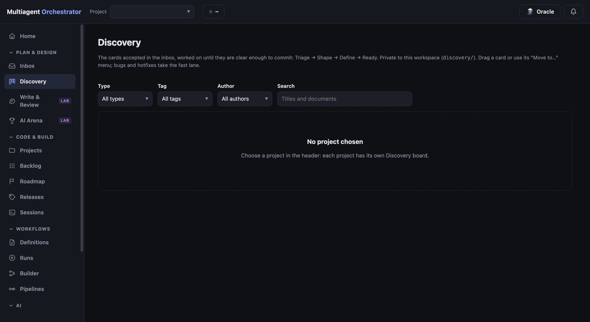
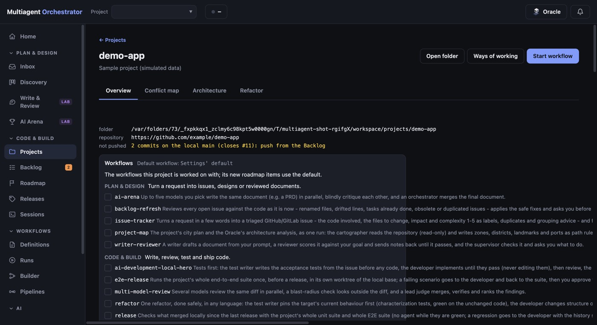
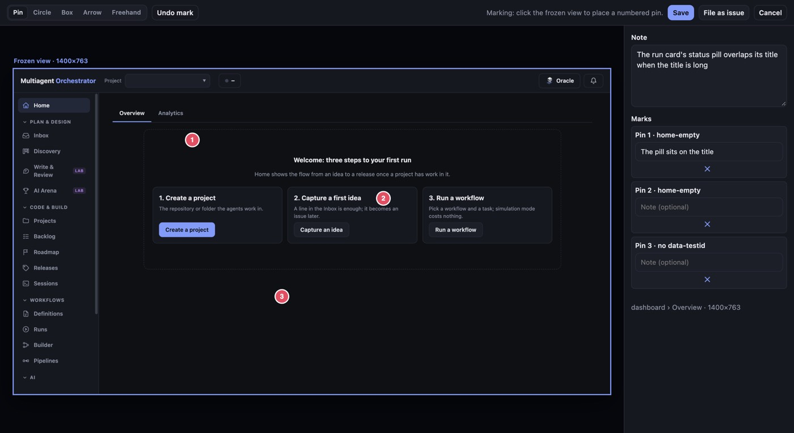

# Intent: project mockups

## Problem

There is no fast way to get screen previews of a project to validate a POC. Plan & Design (Inbox, Discovery, Write & Review, AI Arena) only handles text. The project's page (Overview, Conflict map, Architecture, Refactor) only looks at the code. Whoever plans a feature (often not technical) describes screens in words or draws them in another tool, and the agents implement without a visual reference.

What the app already has and can reuse:
- the element pins of the Findings overlay (#361);
- the separate Agents window (#263) and the shared chat (`agent-chat.js`, #274);
- images pasted into prompts (#130);
- the read-only cartographer of `project-map`;
- the `design-system` skill ("another project: its own tokens");
- Run App / local preview;
- the screenshot checks with axe-core (#387);
- the Discovery commit to the backlog (#258).

## Proposed outcome

From Plan & Design, anyone can generate **high-fidelity screens of any project**, built from a **visual kit**: the project's existing design system when it has one (detected in the code, or imported by hand), otherwise a kit extracted from its own code, and refine them by **selecting a part of the screen and asking in a side chat**. The screens become part of the item's **Design** (referenced from its `spec.md`), can be linked into a clickable flow to show someone, and hand off to Discovery, the Backlog and the development workflows, where the UI review compares the result with the mockup.

## Affected users and systems

- **Users:**
  - whoever plans a feature (product, sales, design) and needs to show a screen;
  - the developers and the UI reviewer, who get a visual reference.
- **Systems:**
  - a new screen in Plan & Design;
  - the shared artifact editor of the write doc flow, plus a screen renderer;
  - a new kit-extraction workflow (`ui-kit-map`);
  - a designer agent and its skills;
  - Discovery cards;
  - the development workflows' UI review.

## Constraints

- **AGENTS.md rules:**
  - the app in English;
  - agents run unattended (only Grill me asks);
  - no automation crosses a `human_approval`;
  - the supervisor never edits the user's code;
  - checks in simulation only.
- Agent-written HTML is isolated: a sandboxed iframe with no network and no `window.api`.
- An item's mockups and the project's kit are committed in the project repository only through a run, at its usual gate (`docs/work/<item>/mockups/`, `docs/work/_kit/`).
- **It depends on the write doc flow (#636):** it reuses its artifact editor instead of building a second one.
- Every real-model action shows its cost first and counts toward the daily budget.

## Open questions

1. Name in the interface: Mockups, Previews or Studio? *Proposed: Mockups.*
2. Should the kit become the project's official design system? *Proposed: not at first; it lives in `docs/work/_kit/` and grows from the mockups.*
3. Default models? *Proposed: Opus to generate the kit and screens, Sonnet to edit.*
4. A project with no interface (API, CLI, greenfield)? *Proposed: "Start from references" (the designer proposes a kit from pasted images and a brand description).*
5. Which frames? *Proposed: Desktop 1440, Tablet 768, Phone 390.*
6. May the designer write JavaScript in mockups? *Proposed: yes, only inside the sandboxed iframe with no network.*
