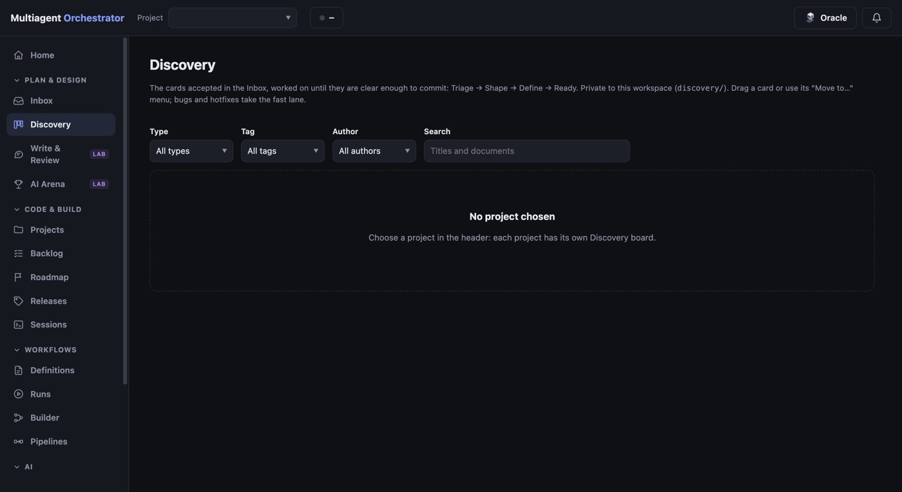
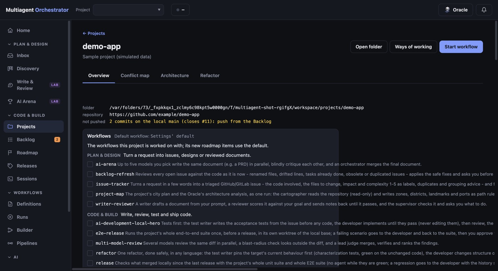
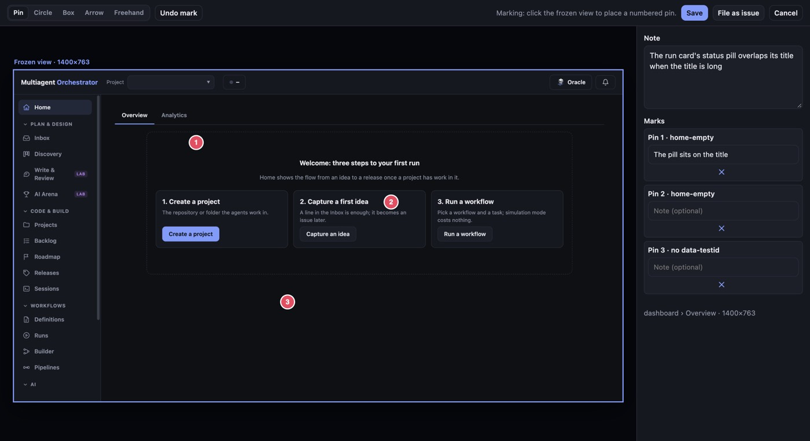

# Intent: mockups de projeto

## Problema

Não existe um jeito rápido de ter prévias de tela de um projeto para validar uma POC. O Plan & Design (Inbox, Discovery, Write & Review, AI Arena) só lida com texto. A página do projeto (Overview, Conflict map, Architecture, Refactor) só olha o código. Quem planeja uma feature, muitas vezes sem ser técnico, descreve as telas em palavras ou desenha em outra ferramenta, e os agentes implementam sem referência visual.

O que o app já tem e pode reaproveitar:
- os pinos de elementos do overlay do Findings (#361);
- a janela separada de Agents (#263) e o chat compartilhado (`agent-chat.js`, #274);
- imagens coladas em prompts (#130);
- o cartógrafo só-leitura do `project-map`;
- a skill `design-system` ("outro projeto: os tokens dele");
- o Run App / local preview;
- as checagens de screenshot com axe-core (#387);
- o commit do Discovery para o backlog (#258).

## Resultado esperado

A partir do Plan & Design, qualquer pessoa gera **telas de alta fidelidade de qualquer projeto**, montadas a partir de um **kit visual**: o design system que o projeto já tem, quando tem (detectado no código ou importado à mão), ou então um kit extraído do próprio código, e as refina **selecionando uma parte da tela e pedindo num chat ao lado**. As telas passam a fazer parte do **Design** do item (referenciadas pelo `spec.md`) e podem ser ligadas num fluxo clicável para mostrar a alguém. Depois seguem para o Discovery, o Backlog e os workflows de desenvolvimento, onde a revisão de UI compara o resultado com o mockup.

## Usuários e sistemas afetados

- **Usuários:**
  - quem planeja uma feature (produto, vendas, design) e precisa mostrar uma tela;
  - os desenvolvedores e o UI reviewer, que ganham uma referência visual.
- **Sistemas:**
  - uma tela nova no Plan & Design;
  - o editor de artefatos compartilhado do fluxo de write doc, mais um renderizador de telas;
  - um workflow novo de extração do kit (`ui-kit-map`);
  - um agente designer e as skills dele;
  - os cards do Discovery;
  - a revisão de UI dos workflows de desenvolvimento.

## Restrições

- **Regras do AGENTS.md:**
  - o app em inglês;
  - agentes rodam sem supervisão (só o Grill me pergunta);
  - nenhuma automação atravessa um `human_approval`;
  - o supervisor nunca edita o código do usuário;
  - checagens só em simulação.
- O HTML escrito pelo agente fica isolado: um iframe com sandbox, sem rede e sem `window.api`.
- Os mockups de um item e o kit do projeto são commitados no repositório do projeto só por um run, no gate de sempre (`docs/work/<item>/mockups/`, `docs/work/_kit/`).
- **Depende do fluxo de write doc (#636):** reaproveita o editor de artefatos dele em vez de construir um segundo.
- Toda ação com modelo real mostra o custo antes e conta no orçamento diário.

## Perguntas em aberto

1. Nome na interface: Mockups, Previews ou Studio? *Proposta: Mockups.*
2. O kit deve virar o design system oficial do projeto? *Proposta: não no começo; ele fica em `docs/work/_kit/` e cresce a partir dos mockups.*
3. Modelos padrão? *Proposta: Opus para gerar o kit e as telas, Sonnet para editar.*
4. Projeto sem interface (API, CLI, greenfield)? *Proposta: "Start from references" (o designer propõe um kit a partir de imagens coladas e de uma descrição da marca).*
5. Quais frames? *Proposta: Desktop 1440, Tablet 768, Phone 390.*
6. O designer pode escrever JavaScript nos mockups? *Proposta: sim, só dentro do iframe com sandbox e sem rede.*
