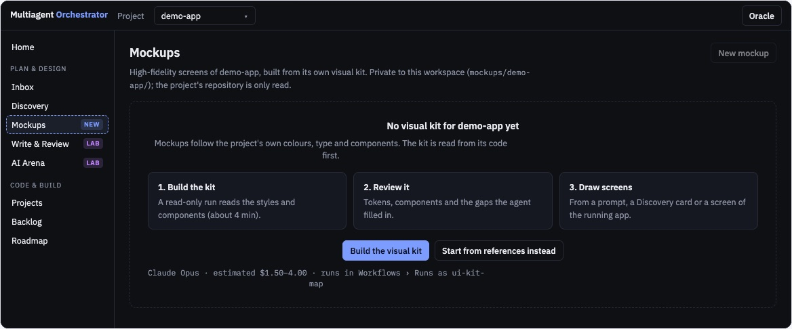
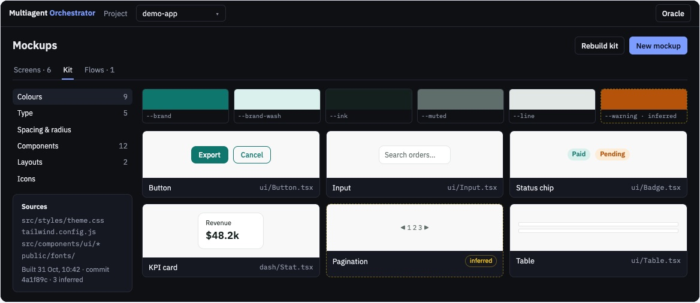
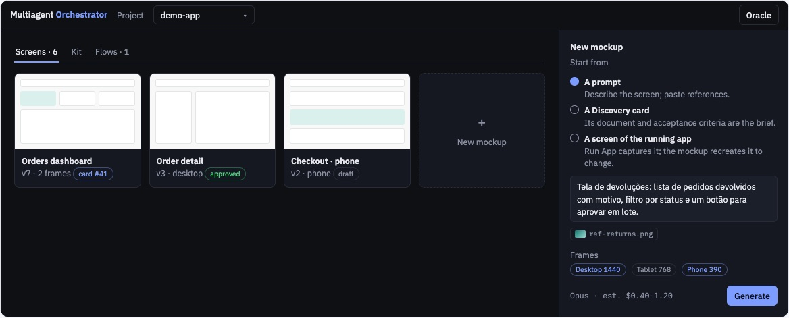
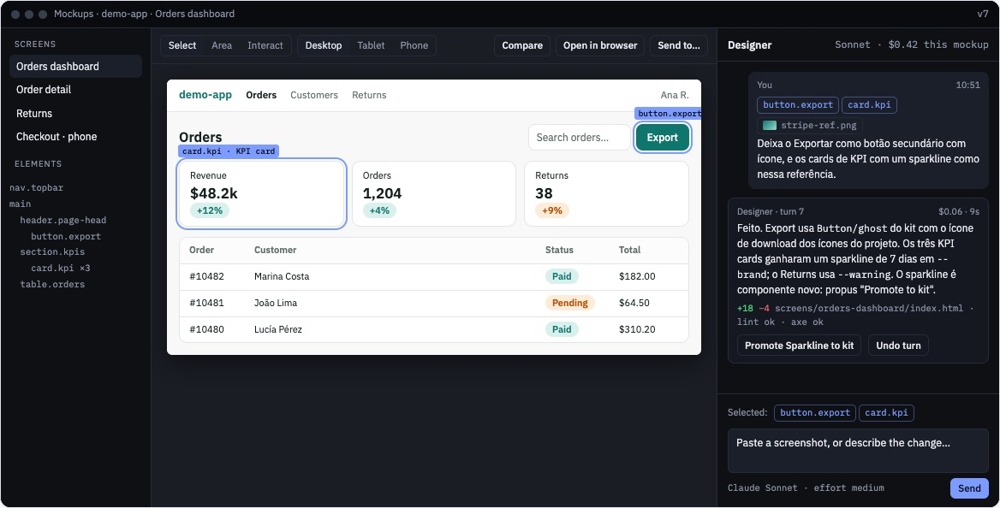
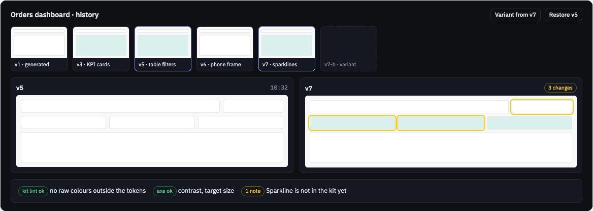
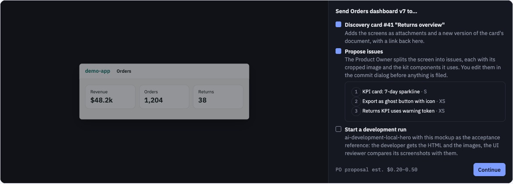

# Spec: project mockups

## Flow

```mermaid
flowchart LR
  A[1 · Open Mockups<br/>Plan & Design] --> B[2 · Find or build the kit<br/>existing design system first]
  B --> C[3 · Review the kit<br/>tokens, components, gaps]
  C --> D[4 · Create a mockup<br/>prompt, card or screen]
  D --> E[5 · Edit with chat<br/>select, ask, commit]
  E --> F[6 · Iterate<br/>versions, variants, lint]
  F --> G[7 · Flow and POC<br/>link screens, share]
  G --> H[8 · Handoff<br/>card, issues, run]
  H -.-> I[9 · Dev checks<br/>UI review vs mockup]
```

## Requirements

**R1. Entry.** A new screen, `Plan & Design › Mockups`, following the header's project, with shortcuts from the Discovery card ("Mock this card") and the project's Overview. With no kit yet, the empty state explains the steps and shows the cost before any real call.

**R2. Visual kit.** A read-only workflow (`ui-kit-map`) gives the project its kit, starting from what it already has:
- **first it looks for an existing design system** in the code: a component library package (MUI, Chakra, Ant, shadcn/ui, Radix, Bootstrap…), design token files (W3C design tokens or Style Dictionary JSON, a Tailwind theme, CSS custom properties sets), a Storybook, or an internal `design-system`/`ui` package in a monorepo. The result shows on the empty state: "Design system found: shadcn/ui + Tailwind theme (3 sources)" or "**No design system found**";
- **when one is found, it is imported as the kit's source**: its tokens and components are mapped (Storybook stories become the catalogue) instead of being re-extracted, and the kit references it rather than copying it;
- the owner can also **import one by hand**: a tokens JSON file, a package name, or later a Storybook URL or a Figma tokens export;
- with none found, a deterministic machine step collects the CSS variables, theme files, fonts and icons;
- **the kit's source is a project setting** (D18): **Design system (synced)** keeps the kit in step with the design system and flags it "out of sync" when the design system changes, with "Sync now"; **Code components** reads the components as the app's code actually implements and uses them. The default is the design system when one is found, the code otherwise;
- an agent works out the components and layout patterns;
- the kit (`tokens.css`, `components.css`, a renderable catalogue, the sources) goes to `docs/work/_kit/`.

A greenfield project starts from references instead (pasted images, a brand description).

**R3. Kit review.** The Kit tab shows each token and component with its source (file and line, or the design system and its version); inferred items show dashed. With both sources available, it also shows the drift: components the code uses that the design system lacks, and design system components the code overrides. It is not a gate. New components drawn in mockups can be promoted to the kit.

**R4. Create a mockup.**
- One HTML + CSS file per screen, importing the kit's CSS, from a prompt with references, a Discovery card or (later) a screen of the running app.
- Frames: desktop, tablet, phone.
- The first generation is a short run with its cost.

**R5. Edit with selection and a side chat.**
- The **shared artifact editor** of the write doc flow, with a screen renderer: the mockup runs in a sandboxed iframe (no network, no `window.api`) with an inspector.
- A click on an element sends its id (`data-mid`), selector, HTML snippet, kit component and a cropped image with the message.
- A designer agent edits only the mockup files. Each request becomes a commit with its diff.
- Pasted images are references.

**R6. Iterate.**
- The history with thumbnails, compare side by side, variants.
- On every turn, a kit lint (raw values outside the tokens) and axe, with no model.
- "Review this screen" on demand.

**R7. Flows and POC.** Screens linked into a clickable flow (Interact mode), opened in the local browser; a static export later.

**R8. Handoff.**
- A mockup becomes an attachment and a version of a Discovery card, and is referenced from the item's `spec.md`.
- The Product Owner proposes issues with cropped images.
- The development workflows get a `mockup` input pointing to a frozen commit, and the UI reviewer compares its screenshots with it.

**R9. Storage.** An item's mockups in `docs/work/<item>/mockups/`, the project's kit in `docs/work/_kit/`, committed by the run at its usual gate.

**R10. Cost.** An estimate before every real action, counted toward the daily budget.

## Decisions

Each decision lists the options that were weighed. The checked box is the one chosen, with its pros (**+**) and cons (**−**). Which requirement each decision shapes:

| Requirement | Decisions |
|---|---|
| R1 Entry | D1 |
| R2 Visual kit | D2, D3, D17, D18 |
| R3 Kit review | D3, D18 |
| R4 Create a mockup | D4, D5 |
| R5 Edit with selection and chat | D6, D7, D8, D9, D16 |
| R6 Iterate | D10, D11 |
| R7 Flows and POC | D12 |
| R8 Handoff | D13 |
| R9 Storage | D14 |
| R10 Cost | D15 |

### D1 · Where the feature lives
The request talks about Planning; the project lives in Code & Build.
- [x] **A · Plan & Design › Mockups** · recommended
  - **+** It is a planning phase: sits next to Discovery and Write & Review.
  - **+** Follows the header's project, a known pattern.
  - **−** One more menu entry.
- [ ] **B · A "Mockups" tab on the project's page**
  - **+** Next to Architecture, where the kit read from the code belongs.
  - **−** The project's page is under Code & Build; hides the feature from whoever plans.
- [ ] **C · Only as a Discovery card action**
  - **+** No new menu entry.
  - **−** No place for the kit or to see all screens; does not serve a POC without a card.

> [!TIP]
> **Recommendation:** A as the home, with two shortcuts: "Mock this card" in the Discovery card's panel (step 5) and a "Mockups" link on the project's Overview. One screen, three doors.

### D2 · How the kit is extracted
- [ ] **A · The agent reading the code only**
  - **+** Simple, works in any stack.
  - **−** Spends tokens reading what a script would find for free; gets exact values wrong.
- [ ] **B · Render the real app and measure**
  - **+** Maximum fidelity: computed styles and captures of the real screens.
  - **−** Needs the app running (Run App configured); slow; fails on many projects.
- [x] **C · Hybrid** · recommended
  - **+** A deterministic scanner for tokens + an agent for components and patterns.
  - **+** A capture of the real app as an optional step when the project has a local preview.
  - **−** Two steps to maintain.
- [ ] **D · Import from Figma / an existing DS**
  - **+** Great when it exists.
  - **−** External integration and credentials; few projects in a workspace have it.

> [!TIP]
> **Recommendation:** C. A project with no front end (greenfield) falls back to "Start from references": you paste captures or describe the brand, and the designer proposes a starting kit and records its assumptions, without asking (only Grill me asks).

### D3 · How big the kit is in its first version
- [ ] **A · A full design system**
  - **+** Rich documentation, reusable outside the app.
  - **−** Expensive and slow before the first screen; becomes a project of its own.
- [x] **B · A minimal kit that grows** · recommended
  - **+** Tokens + the 8 to 15 most used components + 2 layout patterns.
  - **+** New components from the mockups are promoted to the kit in one click.
  - **−** Rare components are missing at first (the designer draws them in the style).
- [ ] **C · No kit, reference screenshots only**
  - **+** No preparation.
  - **−** Every screen reinvents the style; fidelity drops with each iteration.

### D4 · Mockup format
- [x] **A · HTML + the kit's CSS** · recommended
  - **+** One `index.html` per screen importing `kit/tokens.css` and `kit/components.css`.
  - **+** No bundler (like the app itself); opens in the app, a browser and a PR.
  - **+** Agents of every CLI write it well; readable diffs.
  - **−** Does not reuse the code of the real components.
- [ ] **B · The project's real components (React/Vue)**
  - **+** Code fidelity: the mockup is already halfway to the implementation.
  - **−** Needs installing and building the project; every stack is a case; slow to iterate.
- [ ] **C · A generated image**
  - **+** Fast for a moodboard.
  - **−** No element selection, no measuring; does not follow the tokens.
- [ ] **D · A project branch with real code**
  - **+** It is the final result.
  - **−** That is development already (existing workflows); loses the lightness of a POC.

> [!TIP]
> **Recommendation:** A for the MVP. B comes in phase 4 as "live components" for projects with Storybook, where the rendering already exists.

### D5 · Where the first version comes from
- [x] **A · A prompt + references** · mvp
  - **+** Serves a POC with no card; covers greenfield.
  - **−** The brief may be short: the designer records its assumptions in the screen's note.
- [x] **B · A Discovery card** · mvp
  - **+** Its document and acceptance criteria become the brief; the mockup goes back to the card.
  - **−** Depends on the card being reasonably clear (the clarity score helps).
- [ ] **C · A screen of the running app** · phase 3
  - **+** "Change this existing screen" with full fidelity.
  - **−** Needs Run App configured and a capture in the worktree.

### D6 · Where the editor opens
- [x] **A · Its own Electron window** · recommended
  - **+** Same pattern as the Agents window (#263): the app's preload and isolation, position remembered.
  - **+** Can sit on a second monitor while the main app goes on.
  - **−** One more `BrowserWindow` to maintain.
- [ ] **B · A tab in the main window**
  - **+** Nothing new in the main process.
  - **−** Contradicts the request ("outside the project view"); fights the menu for space.
- [ ] **C · A browser via `npm run serve`**
  - **+** Shareable on the network (Tailscale).
  - **−** Depends on the server running; not the default flow of the .exe.

> [!TIP]
> **Recommendation:** A, with "Open in browser" for C in step 8. The canvas is an `iframe` with `sandbox` and a CSP with no network, served on its own protocol (`mockup://`): the HTML the agent writes never runs with access to `window.api`, and the window still never navigates (`window-guards.js`, #466).

> [!NOTE]
> **Revisited by D16:** the editor is the one shared with the write doc flow; Mockups add their screen renderer to it, so where it opens follows the write doc editor.

### D7 · How the selection reaches the agent
- [ ] **A · Pins on a capture (like Findings)**
  - **+** Reuses the #361 model.
  - **−** Box and position only: the agent has to guess which HTML node it is.
- [x] **B · A live inspector with stable ids** · recommended
  - **+** The generator puts `data-mid` on every element; a click returns the id, a selector, an HTML snippet, the kit component and a cropped image.
  - **+** The agent edits the exact node.
  - **−** Needs an inspection script injected into the iframe (via `postMessage`).
- [ ] **C · A free region (rectangle / drawing)**
  - **+** Good for "this whole area" or "put something here".
  - **−** Ambiguous on its own.

> [!TIP]
> **Recommendation:** B, with C as the "Area" mode for what is not an element. The payload is small and explicit (see Architecture).

### D8 · How the chat becomes CLI calls
- [ ] **A · An ephemeral turn per message**
  - **+** Simple; each turn with the files only.
  - **−** Loses the thread; pays the kit's context again every time.
- [x] **B · A designer agent with a persistent session per mockup** · recommended
  - **+** Like the Oracle's and the Product Owner's chat: `agent-chat.js`, history in the service, handoff note and `fresh_after_idle: 55m`.
  - **+** The prompt cache makes edits cheap.
  - **+** `cwd` = the mockup's folder; the project's repository read-only.
  - **−** A new kind of chat session to look after.
- [ ] **C · Every message is a workflow run**
  - **+** Everything shows in Runs, with a reviewer.
  - **−** Heavy and expensive for "change this button's colour".

> [!TIP]
> **Recommendation:** B for edits; C only for big operations (build the kit, generate a new screen, generate a set of screens). Any supported CLI (Claude, Codex, Grok) through `chat-models.js`; Sonnet by default to edit, Opus to generate.

> [!NOTE]
> **Revisited by D16:** the side chat, the selection payload and one commit per request come from the shared editor; the designer agent and its skills stay specific to Mockups.

### D9 · Visual references (screenshots, links)
- [x] **A · Paste and drop images** · recommended
  - **+** The same mechanism as #130; files in the mockup's `refs/`, with a size limit.
  - **−** None.
- [ ] **B · A website URL as a reference**
  - **+** Handy.
  - **−** The app would have to fetch external pages; privacy and prompt-injection risk. Later, with an explicit capture.

### D10 · Versioning
- [x] **A · Local git in `mockups/<project>/`** · recommended
  - **+** One commit per turn: diff, restore and variants (branches) for free.
  - **+** Git is already a requirement of the app.
  - **−** One more repository per project (small, no remote).
- [ ] **B · Copies v1, v2… like Discovery**
  - **+** Same as the cards' version history.
  - **−** No cheap diff; variants are manual.

> [!NOTE]
> **Revisited by D14 and D16:** an item's mockups now live in the project repository (`docs/work/<item>/mockups/`), versioned by the shared editor's commit per request instead of a separate local git.

### D11 · Fidelity check on every turn
- [x] **A · Kit lint + axe, no model** · recommended
  - **+** Colours, sizes and radii outside the tokens become warnings; capture and axe-core reuse the screenshots' `checks.js`.
  - **−** Does not judge taste.
- [ ] **B · A UI reviewer (model) on every turn**
  - **+** Uses the #387 rubric.
  - **−** Doubles the cost of every edit. Better on demand: a "Review this screen" button.

### D12 · How to share the POC
- [x] **A · Open in the local browser** · mvp
  - **+** The mockup is plain HTML: opens straight from the workspace.
  - **−** Only on your machine.
- [x] **B · Export a static package (.zip)** · phase 2
  - **+** Kit + screens + flow, no dependencies; send it to anyone.
  - **−** One file at a time, no comments back.
- [ ] **C · A link through the engine server (Tailscale)**
  - **+** Live, always the latest version.
  - **−** Needs the server running and care with the token and exposure; only after the security review (#466–#470).

### D13 · How a mockup becomes work
- [x] **A · An attachment of the Discovery card** · default
  - **+** Enters the loop that already exists (clarity, Grill me, commit).
  - **+** The card keeps the why; the mockup keeps the how.
  - **−** Needs a card (created automatically when there is none).
- [x] **B · Issues proposed by the PO** · phase 3
  - **+** Each issue with its cropped image: the developer knows exactly what to do.
  - **−** Costs a PO turn.
- [ ] **C · A development run straight away**
  - **+** Fastest for small changes.
  - **−** Skips the Backlog; only as an explicit shortcut.

> [!TIP]
> **Recommendation:** A always, B as the next step in the card's commit, C as a shortcut. In all of them, the development workflows' new `mockup` input carries the path of the frozen version (a commit), so the run does not change if the mockup changes later.

### D14 · Where the files live
- [ ] **A · In the workspace, `<workspace>/mockups/<project>/`** · first proposal
  - **+** Private to the workspace; touches nothing in the user's repository.
  - **−** Gone for anyone who clones; out of step with the AI-native SDLC artifacts.
- [x] **B · In the project repository, next to the item's SDLC artifacts** · decided by the owner
  - **+** An item's mockups in `docs/work/<item>/mockups/`, referenced from its `spec.md`: they are part of Design.
  - **+** The project's visual kit, shared by every item, in `docs/work/_kit/`.
  - **+** Versioned with the change, readable by any agent and anyone who clones.
  - **−** Writes to the user's repository: only through a run, at its usual gate.
- [ ] **C · SQLite only**
  - **+** Fast to list.
  - **−** No diff, nothing to open in a browser.

### D15 · Cost of real-model calls
- [x] **A · An estimate before every real action, counted toward the daily budget (#206)** · recommended
  - **+** Building the kit about $1.50–4.00 per project; a new screen $0.40–1.20; a chat edit turn $0.03–0.30 with the prompt cache; lint, axe, thumbnails and diffs $0.
  - **+** A typical POC (kit + 5 screens + about 40 edits) lands around $6–15.
  - **−** Unmeasured estimates until the first real runs.
- [ ] **B · No estimate, only the bill afterwards**
  - **+** Simpler.
  - **−** Against AGENTS.md: real-model cost is shown first.

### D16 · One artifact editor for Mockups and write doc
Mockups and write doc proposed the same editor: select on the rendered artifact, a side chat, the selection mapped to the source, one commit per request with its diff, a review gate.
- [x] **A · One shared editor, two renderers** · decided by the owner
  - **+** The write doc editor is the base (its renderer extension point: `render`, `mapSelection`, `applyDiff`); Mockups add the screen renderer (a sandboxed iframe with a `data-mid` inspector) and the visual kit.
  - **+** One chat, one way to version and one review gate across the app.
  - **−** Mockups wait for the write doc editor to be built.
- [ ] **B · Two editors**
  - **+** Each moves at its own pace.
  - **−** Two side chats, two ways to version, two places to store: drift and double maintenance.

> [!TIP]
> **Order:** the write doc comes first (#636) and builds the shared editor; Mockups build on what exists then.

### D17 · An existing design system: detect and import
Many projects already have a design system. Re-extracting it as a generated kit would duplicate it and drift from it.
- [x] **A · Detect first, import what is found, generate only what is missing** · recommended
  - **+** A deterministic scan finds the usual signals (component library packages, token files, Tailwind theme, Storybook, an internal `ui` package); the agent confirms and maps them, and says "No design system found" when there is none.
  - **+** The kit references the project's design system (its tokens, its components, its stories), so mockups use exactly what developers use.
  - **+** Manual import for what a scan cannot see: a tokens JSON, a package, later a Storybook URL or a Figma tokens export.
  - **−** One importer per kind of source (token formats, Storybook); the first version covers the common ones.
- [ ] **B · Always generate the kit from the code**
  - **+** One path.
  - **−** Duplicates an existing design system and drifts from it.
- [ ] **C · Ask the owner whether there is a design system**
  - **+** No detection code.
  - **−** Agents run unattended; and the code already answers the question.

> [!TIP]
> **Recommendation:** A. The detection result shows on the empty state before any real call; importing a found design system costs no model call when its tokens are machine-readable.

### D18 · The kit's source: synced with the design system, or read from the code
A design system and the code drift apart: the code overrides components, adds local ones, or lags a version behind. Which one the mockups follow is the owner's call per project.
- [x] **A · A project setting with both modes, and the drift shown** · recommended
  - **+** **Design system (synced):** the design system is the source of truth; when its package version or token files change, the kit shows "out of sync" with "Sync now" (no model call when the tokens are machine-readable). Mockups show the product as it is meant to be.
  - **+** **Code components:** the kit reads the components the app actually implements and uses (the files, the props in use, local overrides), re-scanned on "Rebuild kit" or after merges that touch them. Mockups show the product as it is.
  - **+** With both available, the Kit tab lists the drift (used but missing from the design system, overridden by the code), which is useful on its own.
  - **−** Two scanners to maintain, and a setting to explain.
- [ ] **B · Always the design system when there is one**
  - **+** One source of truth.
  - **−** Mockups promise components the code does not render that way.
- [ ] **C · Always the code**
  - **+** Mockups match what ships today.
  - **−** Ignores the design system the team agreed on; drift becomes the norm.

> [!TIP]
> **Default:** the design system when one is found, the code otherwise. The setting lives in the project (the Kit tab and Edit project), and switching it rebuilds the kit.

## Design

- **Screen:** `fronts/plan/views/mockups/` (gallery, kit tab, flows), registered in Plan & Design between Discovery and Write & Review.
- **Editor:** the write doc's shared artifact editor plus a **screen renderer** that implements its extension point (`render`, `mapSelection`, `applyDiff`):
  - a sandboxed iframe served on a `mockup://` protocol;
  - an inspector injected over `postMessage`.
- **Kit:** `workflows/ui-kit-map.yaml`: a machine step for the deterministic tokens, then a read-only agent. The output goes in `docs/work/_kit/`.
- **Designer agent:** a persistent session per mockup. Its `cwd` is the mockup folder and the project code is read-only. Its skills are `mockup-design` and `design-system`.
- **Domain and channels:** `packages/engine/fronts/plan/domains/mockups.js` and `mockups:*` channels (list, create, render, lint).
- **Handoff:** the Discovery card's attachments; the #258 commit dialog with crops; a `mockup` input on the dev workflows; a UI review rubric item.

## Areas of concern

- **For the tech lead:**
  - the sandbox: agent-written HTML and JS never reach `window.api`, and the window never navigates;
  - the extension point must stay small, so the write doc editor does not grow Mockups-specific code.
- **Dependency:** nothing in R5 can be built before the write doc editor exists (#636).
- **Repository size:** mockups and kit images are committed. Compressed JPEG for images; HTML stays small.
- **Cost:** estimates are unmeasured until the first real runs.

## Open questions (from the intent and new)

1. Should the kit be shared across items from the first version? *Proposed: yes, `docs/work/_kit/`.*
2. When does "recreate a screen of the running app" arrive? *Proposed: after the screenshots spike in the user's project (onboarding D19).*
3. Live components (Storybook) instead of HTML? *Proposed: later, only for projects that already have Storybook.*
4. Which design system sources does the first importer read? *Proposed: W3C / Style Dictionary token JSON, the Tailwind theme, CSS custom properties, and the component libraries detected from `package.json`; Storybook and Figma later.*
