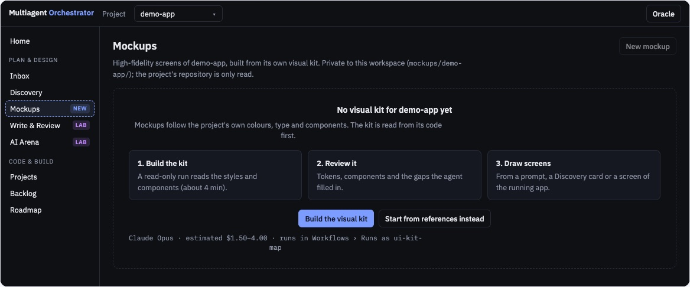
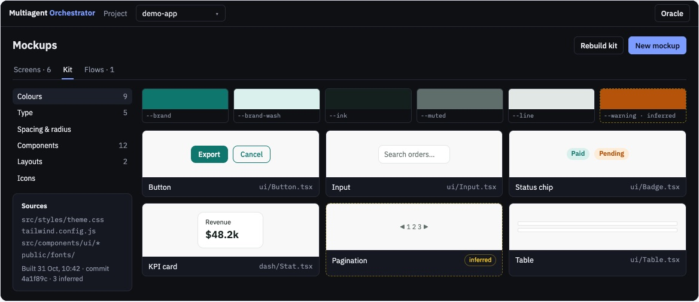
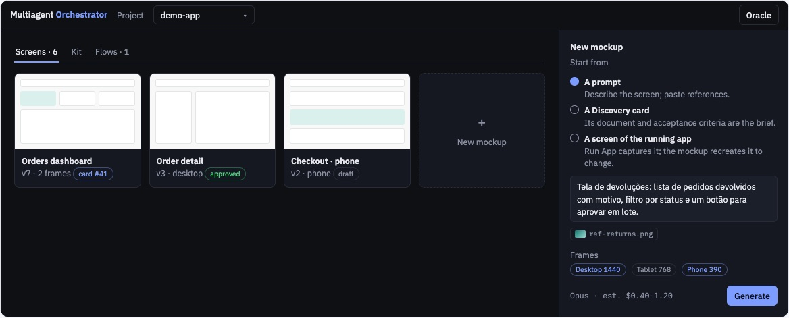
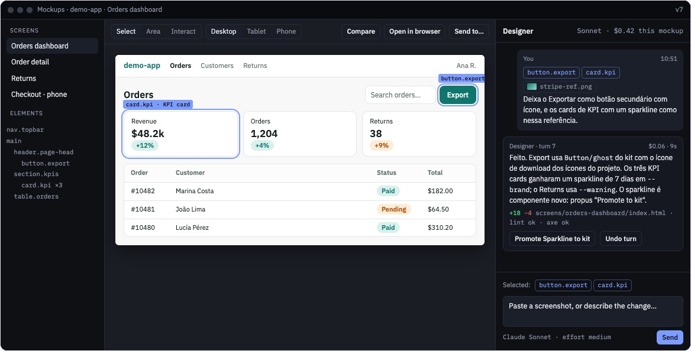
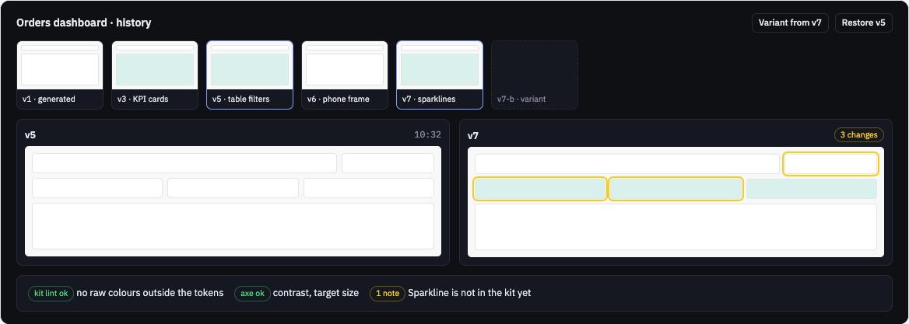
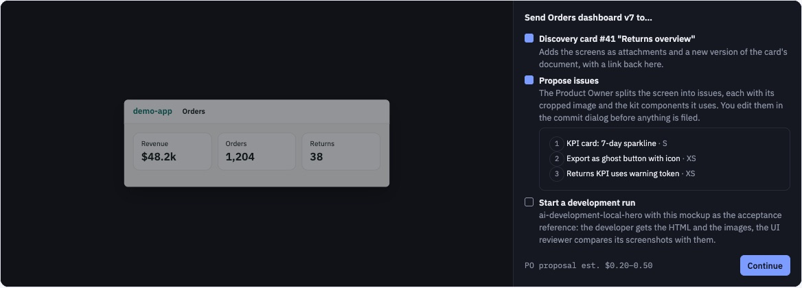

# Spec: mockups de projeto

## Fluxo

```mermaid
flowchart LR
  A[1 · Abrir Mockups<br/>Plan & Design] --> B[2 · Achar ou gerar o kit<br/>design system existente primeiro]
  B --> C[3 · Revisar o kit<br/>tokens, componentes, lacunas]
  C --> D[4 · Criar um mockup<br/>prompt, card ou tela]
  D --> E[5 · Editar com chat<br/>selecionar, pedir, commit]
  E --> F[6 · Iterar<br/>versões, variantes, lint]
  F --> G[7 · Fluxo e POC<br/>ligar telas, compartilhar]
  G --> H[8 · Handoff<br/>card, issues, run]
  H -.-> I[9 · Dev confere<br/>revisão de UI vs mockup]
```

## Requisitos

**R1. Entrada.** Uma tela nova, `Plan & Design › Mockups`, que segue o projeto do header, com atalhos a partir do card do Discovery ("Mock this card") e do Overview do projeto. Sem kit ainda, o estado vazio explica os passos e mostra o custo antes de qualquer chamada real.

**R2. Kit visual.** Um workflow só-leitura (`ui-kit-map`) dá ao projeto o seu kit, partindo do que ele já tem:
- **primeiro ele procura um design system existente** no código: um pacote de biblioteca de componentes (MUI, Chakra, Ant, shadcn/ui, Radix, Bootstrap…), arquivos de design tokens (JSON no formato W3C ou Style Dictionary, um tema do Tailwind, conjuntos de variáveis CSS), um Storybook, ou um pacote interno `design-system`/`ui` num monorepo. O resultado aparece no estado vazio: "Design system found: shadcn/ui + Tailwind theme (3 sources)" ou "**No design system found**";
- **quando encontra, ele é importado como a fonte do kit**: os tokens e componentes são mapeados (as stories do Storybook viram o catálogo) em vez de extraídos de novo, e o kit referencia o DS em vez de copiá-lo;
- o dono também pode **importar um à mão**: um arquivo JSON de tokens, o nome de um pacote, ou depois uma URL de Storybook ou um export de tokens do Figma;
- sem nenhum encontrado, um passo de máquina determinístico coleta as variáveis CSS, os arquivos de tema, as fontes e os ícones;
- **a fonte do kit é uma configuração do projeto** (D18): **Design system (synced)** mantém o kit em sintonia com o design system e marca "out of sync" quando o DS muda, com "Sync now"; **Code components** lê os componentes como o código do app de fato implementa e usa. O padrão é o design system quando há um, senão o código;
- um agente identifica os componentes e os padrões de layout;
- o kit (`tokens.css`, `components.css`, um catálogo renderizável, as fontes) vai para `docs/work/_kit/`.

Projeto greenfield começa a partir de referências (imagens coladas, uma descrição da marca).

**R3. Revisão do kit.** A aba Kit mostra cada token e componente com a sua origem (arquivo e linha, ou o design system e a versão dele); o que foi inferido aparece tracejado. Com as duas fontes disponíveis, ela mostra também a divergência: componentes que o código usa e o design system não tem, e componentes do design system que o código sobrescreve. Não é um gate. Componentes novos desenhados nos mockups podem ser promovidos ao kit.

**R4. Criar um mockup.**
- Um arquivo HTML + CSS por tela, importando o CSS do kit, a partir de um prompt com referências, de um card do Discovery ou (depois) de uma tela do app rodando.
- Frames: desktop, tablet, celular.
- A primeira geração é um run curto, com o custo.

**R5. Editar com seleção e chat ao lado.**
- O **editor de artefatos compartilhado** do fluxo de write doc, com um renderizador de telas: o mockup roda num iframe com sandbox (sem rede, sem `window.api`) com um inspetor.
- Um clique num elemento manda, junto com a mensagem, o id (`data-mid`), o seletor, um trecho do HTML, o componente do kit e um recorte da imagem.
- Um agente designer edita só os arquivos do mockup. Cada pedido vira um commit com o diff.
- Imagens coladas são referências.

**R6. Iterar.**
- O histórico com miniaturas, comparação lado a lado, variantes.
- A cada turno, um lint do kit (valores soltos fora dos tokens) e axe, sem modelo.
- "Review this screen" sob demanda.

**R7. Fluxos e POC.** Telas ligadas num fluxo clicável (modo Interact), abertas no navegador local; um export estático depois.

**R8. Handoff.**
- Um mockup vira anexo e versão de um card do Discovery, e é referenciado pelo `spec.md` do item.
- O Product Owner propõe as issues com as imagens recortadas.
- Os workflows de desenvolvimento recebem um input `mockup` que aponta para um commit congelado, e o UI reviewer compara as capturas com ele.

**R9. Armazenamento.** Os mockups de um item em `docs/work/<item>/mockups/`, o kit do projeto em `docs/work/_kit/`, commitados pelo run no gate de sempre.

**R10. Custo.** Uma estimativa antes de cada ação real, contando no orçamento diário.

## Decisões

Cada decisão lista as opções que foram pesadas. A caixa marcada é a escolhida, com os prós (**+**) e os contras (**−**). Que requisito cada decisão define:

| Requisito | Decisões |
|---|---|
| R1 Entrada | D1 |
| R2 Kit visual | D2, D3, D17, D18 |
| R3 Revisão do kit | D3, D18 |
| R4 Criar um mockup | D4, D5 |
| R5 Editar com seleção e chat | D6, D7, D8, D9, D16 |
| R6 Iterar | D10, D11 |
| R7 Fluxos e POC | D12 |
| R8 Handoff | D13 |
| R9 Armazenamento | D14 |
| R10 Custo | D15 |

### D1 · Onde a funcionalidade entra
O pedido fala do Planning; o projeto mora em Code & Build.
- [x] **A · Plan & Design › Mockups** · recomendado
  - **+** É fase de planejamento: fica ao lado de Discovery e Write & Review.
  - **+** Segue o projeto do header, padrão já conhecido.
  - **−** Uma entrada a mais no menu.
- [ ] **B · Aba "Mockups" na página do projeto**
  - **+** Junto de Architecture, onde está o kit lido do código.
  - **−** A página do projeto está em Code & Build; esconde a função de quem planeja.
- [ ] **C · Só como ação do card do Discovery**
  - **+** Zero menu novo.
  - **−** Sem lugar para o kit nem para ver todas as telas; não serve para POC sem card.

> [!TIP]
> **Recomendação:** A como casa, com dois atalhos: "Mock this card" no painel do card do Discovery (passo 5) e um link "Mockups" no Overview do projeto. Uma tela, três portas.

### D2 · Como o kit é extraído
- [ ] **A · Só o agente lendo o código**
  - **+** Simples, funciona em qualquer stack.
  - **−** Gasta tokens lendo o que um script acharia de graça; erra valores exatos.
- [ ] **B · Renderizar o app real e medir**
  - **+** Fidelidade máxima: estilos computados e capturas das telas reais.
  - **−** Precisa do app rodando (Run App configurado); lento; falha em muitos projetos.
- [x] **C · Híbrido** · recomendado
  - **+** Scanner determinístico para tokens + agente para componentes e padrões.
  - **+** Captura do app real como etapa opcional quando o projeto tem local preview.
  - **−** Dois passos para manter.
- [ ] **D · Importar de Figma / DS existente**
  - **+** Ótimo quando existe.
  - **−** Integração externa e credenciais; poucos projetos do workspace têm.

> [!TIP]
> **Recomendação:** C. Projeto sem front (greenfield) cai em "Start from references": você cola capturas ou descreve a marca, e o designer propõe um kit inicial registrando as suposições, sem perguntar (só o Grill me pergunta).

### D3 · Quão grande é o kit na primeira versão
- [ ] **A · Design system completo**
  - **+** Documentação rica, reutilizável fora daqui.
  - **−** Caro e lento antes da primeira tela; vira um projeto em si.
- [x] **B · Kit mínimo que cresce** · recomendado
  - **+** Tokens + 8 a 15 componentes mais usados + 2 padrões de layout.
  - **+** Componentes novos dos mockups são promovidos ao kit com um clique.
  - **−** No começo faltam componentes raros (o designer os desenha no estilo).
- [ ] **C · Sem kit, só screenshots de referência**
  - **+** Zero preparo.
  - **−** Cada tela reinventa o estilo; fidelidade cai a cada iteração.

### D4 · Formato do mockup
- [x] **A · HTML + CSS do kit** · recomendado
  - **+** Um `index.html` por tela que importa `kit/tokens.css` e `kit/components.css`.
  - **+** Sem bundler (como o próprio app), abre no app, no navegador e em PR.
  - **+** Agentes de qualquer CLI escrevem bem; diffs legíveis.
  - **−** Não reaproveita o código dos componentes reais.
- [ ] **B · Componentes reais do projeto (React/Vue)**
  - **+** Fidelidade de código: o mockup já é meio caminho da implementação.
  - **−** Precisa instalar e buildar o projeto; cada stack é um caso; lento para iterar.
- [ ] **C · Imagem gerada**
  - **+** Rápido para moodboard.
  - **−** Não dá para selecionar elementos nem medir; não segue tokens.
- [ ] **D · Branch do projeto com código real**
  - **+** É o resultado final.
  - **−** Isso já é desenvolvimento (workflows existentes); perde a leveza de POC.

> [!TIP]
> **Recomendação:** A no MVP. B entra na fase 4 como "live components" para projetos com Storybook, onde o render já existe.

### D5 · De onde nasce a primeira versão
- [x] **A · Prompt + referências** · mvp
  - **+** Serve POC sem card; cobre greenfield.
  - **−** Brief às vezes curto: o designer registra as suposições na nota da tela.
- [x] **B · Card do Discovery** · mvp
  - **+** Documento e critérios de aceite viram o brief; o mockup volta ao card.
  - **−** Depende do card estar razoavelmente claro (clarity score ajuda).
- [ ] **C · Tela do app rodando** · fase 3
  - **+** "Mude esta tela que já existe" com fidelidade total.
  - **−** Precisa de Run App configurado e da captura no worktree.

### D6 · Onde o editor abre
- [x] **A · Janela própria do Electron** · recomendado
  - **+** Mesmo molde da janela de Agents (#263): preload e isolamento do app, posição lembrada.
  - **+** Pode ficar num segundo monitor enquanto o app principal segue.
  - **−** Mais um `BrowserWindow` para manter.
- [ ] **B · Aba dentro da janela principal**
  - **+** Nada novo no processo principal.
  - **−** Contradiz o pedido ("fora da visão do projeto"); disputa espaço com o menu.
- [ ] **C · Navegador via `npm run serve`**
  - **+** Compartilhável na rede (Tailscale).
  - **−** Depende do servidor ligado; não é o fluxo padrão do .exe.

> [!TIP]
> **Recomendação:** A, com "Open in browser" para C no passo 8. O canvas é um `iframe` com `sandbox` e CSP sem rede, servido por um protocolo próprio (`mockup://`): o HTML escrito pelo agente nunca roda com acesso ao `window.api`, e a janela continua sem navegar (`window-guards.js`, #466).

> [!NOTE]
> **Revisto pela D16:** o editor é o mesmo do fluxo de write doc; os Mockups acrescentam a ele o renderizador de telas, então onde ele abre segue o editor do write doc.

### D7 · Como a seleção chega ao agente
- [ ] **A · Pinos sobre uma captura (como o Findings)**
  - **+** Reaproveita o modelo de #361.
  - **−** Só caixa e posição: o agente precisa adivinhar qual nó do HTML é.
- [x] **B · Inspetor ao vivo com IDs estáveis** · recomendado
  - **+** O gerador põe `data-mid` em cada elemento; o clique devolve id, seletor, trecho do HTML, componente do kit e um recorte da imagem.
  - **+** O agente edita o nó exato.
  - **−** Precisa de um script de inspeção injetado no iframe (via `postMessage`).
- [ ] **C · Região livre (retângulo / desenho)**
  - **+** Bom para "esta área toda" ou "coloque algo aqui".
  - **−** Ambíguo sozinho.

> [!TIP]
> **Recomendação:** B, com C como modo "Area" para o que não é um elemento. A carga útil é pequena e explícita (veja Arquitetura).

### D8 · Como o chat vira chamadas aos CLIs
- [ ] **A · Turno efêmero por mensagem**
  - **+** Simples; cada turno só com os arquivos.
  - **−** Perde o fio da conversa; repaga o contexto do kit a cada vez.
- [x] **B · Agente designer com sessão persistente por mockup** · recomendado
  - **+** Como o chat do Oracle e do Product Owner: `agent-chat.js`, histórico no serviço, handoff note e `fresh_after_idle: 55m`.
  - **+** Prompt cache barateia as edições.
  - **+** `cwd` = pasta do mockup; repositório do projeto só-leitura.
  - **−** Um tipo novo de sessão de chat para cuidar.
- [ ] **C · Cada mensagem é um run de workflow**
  - **+** Tudo aparece em Runs, com revisor.
  - **−** Pesado e caro para "muda a cor deste botão".

> [!TIP]
> **Recomendação:** B para as edições; C só para operações grandes (gerar o kit, gerar uma tela nova, gerar um conjunto de telas). Qualquer CLI suportado (Claude, Codex, Grok) via `chat-models.js`; padrão Sonnet para editar, Opus para gerar.

> [!NOTE]
> **Revisto pela D16:** o chat lateral, a carga da seleção e um commit por pedido vêm do editor compartilhado; o agente designer e as skills dele continuam específicos dos Mockups.

### D9 · Referências visuais (screenshots, links)
- [x] **A · Colar e arrastar imagens** · recomendado
  - **+** Mesmo mecanismo de #130; arquivos em `refs/` do mockup, com limite de tamanho.
  - **−** Nenhum.
- [ ] **B · URL de site como referência**
  - **+** Prático.
  - **−** O app teria que buscar páginas externas; risco de privacidade e de injeção de prompt. Fica para depois, com captura explícita.

### D10 · Versionamento
- [x] **A · Git local em `mockups/<projeto>/`** · recomendado
  - **+** Um commit por turno: diff, restaurar e variantes (branches) de graça.
  - **+** Git já é requisito do app.
  - **−** Um repositório a mais por projeto (pequeno, sem remoto).
- [ ] **B · Cópias v1, v2… como no Discovery**
  - **+** Igual ao histórico de versões dos cards.
  - **−** Sem diff barato; variantes ficam manuais.

> [!NOTE]
> **Revisto pelas D14 e D16:** os mockups de um item passam a ficar no repositório do projeto (`docs/work/<item>/mockups/`), versionados pelo commit por pedido do editor compartilhado, em vez de um git local separado.

### D11 · Checagem de fidelidade a cada turno
- [x] **A · Lint do kit + axe, sem modelo** · recomendado
  - **+** Cores, tamanhos e raios fora dos tokens viram aviso; captura e axe-core reaproveitam o `checks.js` das screenshots.
  - **−** Não julga gosto.
- [ ] **B · Revisor de UI (modelo) a cada turno**
  - **+** Usa o rubric de #387.
  - **−** Dobra o custo de cada edição. Melhor sob demanda: botão "Review this screen".

### D12 · Como compartilhar a POC
- [x] **A · Abrir no navegador local** · mvp
  - **+** O mockup é HTML puro: abre direto do workspace.
  - **−** Só na sua máquina.
- [x] **B · Exportar pacote estático (.zip)** · fase 2
  - **+** Kit + telas + fluxo, sem dependências; manda para quem quiser.
  - **−** Um arquivo por vez, sem comentários de volta.
- [ ] **C · Link pelo servidor do engine (Tailscale)**
  - **+** Ao vivo, sempre na última versão.
  - **−** Exige o servidor ligado e cuidado com token e exposição; só depois da revisão de segurança (#466–#470).

### D13 · Como um mockup vira trabalho
- [x] **A · Anexo do card do Discovery** · padrão
  - **+** Entra no ciclo que já existe (clarity, Grill me, commit).
  - **+** O card guarda o porquê; o mockup guarda o como.
  - **−** Exige um card (criado automaticamente se não houver).
- [x] **B · Issues propostas pelo PO** · fase 3
  - **+** Cada issue com a imagem recortada: o dev sabe exatamente o que fazer.
  - **−** Custa um turno do PO.
- [ ] **C · Run de dev direto**
  - **+** Mais rápido para mudanças pequenas.
  - **−** Pula o Backlog; usar só como atalho explícito.

> [!TIP]
> **Recomendação:** A sempre, B como passo seguinte no commit do card, C como atalho. Em todos, o input novo `mockup` dos workflows de dev leva o caminho da versão congelada (commit), para o run não mudar se o mockup mudar depois.

### D14 · Onde os arquivos ficam
- [ ] **A · No workspace, `<workspace>/mockups/<projeto>/`** · primeira proposta
  - **+** Privado ao workspace; não toca o repositório do usuário.
  - **−** Some para quem clona; fora de sintonia com os artefatos do AI-native SDLC.
- [x] **B · No repositório do projeto, ao lado dos artefatos do SDLC do item** · decidido pelo dono
  - **+** Os mockups de um item em `docs/work/<item>/mockups/`, referenciados pelo `spec.md` dele: fazem parte do Design.
  - **+** O kit visual do projeto, de todos os itens, em `docs/work/_kit/`.
  - **+** Versionados com a mudança, lidos por qualquer agente e por quem clona.
  - **−** Escreve no repositório do usuário: só por um run, no gate de sempre.
- [ ] **C · Só no SQLite**
  - **+** Rápido para listar.
  - **−** Sem diff, nada para abrir no navegador.

### D15 · Custo das chamadas a modelo real
- [x] **A · Uma estimativa antes de cada ação real, contando no orçamento diário (#206)** · recomendado
  - **+** Gerar o kit custa cerca de $1.50–4.00 por projeto; uma tela nova $0.40–1.20; um turno de edição no chat $0.03–0.30 com o prompt cache; lint, axe, miniaturas e diffs $0.
  - **+** Uma POC típica (kit + 5 telas + umas 40 edições) fica em cerca de $6–15.
  - **−** Estimativas sem medição até os primeiros runs reais.
- [ ] **B · Sem estimativa, só a conta depois**
  - **+** Mais simples.
  - **−** Contra o AGENTS.md: o custo de modelo real aparece antes.

### D16 · Um editor de artefatos só para Mockups e write doc
Mockups e write doc propuseram o mesmo editor: selecionar sobre o artefato renderizado, um chat ao lado, a seleção mapeada para a fonte, um commit por pedido com o diff, um gate de revisão.
- [x] **A · Um editor compartilhado, dois renderizadores** · decidido pelo dono
  - **+** O editor do write doc é a base (o ponto de extensão do renderizador: `render`, `mapSelection`, `applyDiff`); os Mockups acrescentam o renderizador de telas (um iframe com sandbox e um inspetor por `data-mid`) e o kit visual.
  - **+** Um chat, um jeito de versionar e um gate de revisão no app inteiro.
  - **−** Os Mockups esperam o editor do write doc ficar pronto.
- [ ] **B · Dois editores**
  - **+** Cada um anda no seu ritmo.
  - **−** Dois chats laterais, dois jeitos de versionar, dois lugares para guardar: divergência e manutenção dobrada.

> [!TIP]
> **Ordem:** o write doc vem primeiro (#636) e constrói o editor compartilhado; os Mockups constroem em cima do que existir.

### D17 · Um design system existente: detectar e importar
Muitos projetos já têm um design system. Extraí-lo de novo como kit gerado duplicaria o DS e divergiria dele.
- [x] **A · Detectar primeiro, importar o que encontrar, gerar só o que faltar** · recomendado
  - **+** Uma varredura determinística encontra os sinais de sempre (pacotes de biblioteca de componentes, arquivos de tokens, tema do Tailwind, Storybook, um pacote interno `ui`); o agente confirma e mapeia, e diz "No design system found" quando não há.
  - **+** O kit referencia o design system do projeto (os tokens, os componentes, as stories), então os mockups usam exatamente o que os desenvolvedores usam.
  - **+** Importação manual para o que a varredura não vê: um JSON de tokens, um pacote, depois uma URL de Storybook ou um export de tokens do Figma.
  - **−** Um importador por tipo de fonte (formatos de token, Storybook); a primeira versão cobre os mais comuns.
- [ ] **B · Sempre gerar o kit a partir do código**
  - **+** Um caminho só.
  - **−** Duplica um design system existente e diverge dele.
- [ ] **C · Perguntar ao dono se existe um design system**
  - **+** Sem código de detecção.
  - **−** Os agentes rodam sem supervisão; e o código já responde a pergunta.

> [!TIP]
> **Recomendação:** A. O resultado da detecção aparece no estado vazio antes de qualquer chamada real; importar um design system encontrado não custa chamada a modelo quando os tokens dele são legíveis por máquina.

### D18 · A fonte do kit: sincronizada com o design system, ou lida do código
Design system e código divergem: o código sobrescreve componentes, cria os seus próprios ou fica uma versão atrás. Qual dos dois os mockups seguem é decisão do dono, por projeto.
- [x] **A · Uma configuração do projeto com os dois modos, mostrando a divergência** · recomendado
  - **+** **Design system (synced):** o design system é a fonte da verdade; quando a versão do pacote ou os arquivos de tokens mudam, o kit mostra "out of sync" com "Sync now" (sem chamada a modelo quando os tokens são legíveis por máquina). Os mockups mostram o produto como ele deveria ser.
  - **+** **Code components:** o kit lê os componentes que o app de fato implementa e usa (os arquivos, as props em uso, as sobrescritas locais), varrido de novo no "Rebuild kit" ou depois de merges que mexem neles. Os mockups mostram o produto como ele é.
  - **+** Com os dois disponíveis, a aba Kit lista a divergência (usado mas ausente do design system, sobrescrito pelo código), o que já é útil por si só.
  - **−** Dois scanners para manter, e uma configuração para explicar.
- [ ] **B · Sempre o design system quando houver**
  - **+** Uma fonte da verdade só.
  - **−** Os mockups prometem componentes que o código não desenha daquele jeito.
- [ ] **C · Sempre o código**
  - **+** Os mockups batem com o que está em produção hoje.
  - **−** Ignora o design system que o time combinou; a divergência vira regra.

> [!TIP]
> **Padrão:** o design system quando há um, senão o código. A configuração fica no projeto (na aba Kit e no Edit project), e trocar reconstrói o kit.

## Design

- **Tela:** `fronts/plan/views/mockups/` (galeria, aba Kit, fluxos), registrada no Plan & Design entre Discovery e Write & Review.
- **Editor:** o editor de artefatos compartilhado do write doc, mais um **renderizador de telas** que implementa o ponto de extensão dele (`render`, `mapSelection`, `applyDiff`):
  - um iframe com sandbox servido pelo protocolo `mockup://`;
  - um inspetor injetado via `postMessage`.
- **Kit:** `workflows/ui-kit-map.yaml`: um passo de máquina para os tokens determinísticos e depois um agente só-leitura. A saída vai para `docs/work/_kit/`.
- **Agente designer:** uma sessão persistente por mockup. O `cwd` é a pasta do mockup e o código do projeto é só-leitura. As skills são `mockup-design` e `design-system`.
- **Domínio e canais:** `fronts/plan/engine/domains/mockups.js` e os canais `mockups:*` (listar, criar, renderizar, lint).
- **Handoff:** os anexos do card do Discovery; o diálogo de commit do #258 com os recortes; um input `mockup` nos workflows de dev; um item no rubric da revisão de UI.

## Pontos de atenção

- **Para o tech lead:**
  - o sandbox: o HTML e o JS escritos pelo agente nunca chegam ao `window.api`, e a janela nunca navega;
  - o ponto de extensão precisa ficar pequeno, para o editor do write doc não ganhar código específico dos Mockups.
- **Dependência:** nada do R5 pode ser construído antes de o editor do write doc existir (#636).
- **Tamanho do repositório:** as imagens dos mockups e do kit são commitadas. JPEG comprimido para as imagens; o HTML continua pequeno.
- **Custo:** as estimativas não foram medidas até os primeiros runs reais.

## Perguntas em aberto (vindas do intent e novas)

1. O kit deve ser compartilhado entre os itens desde a primeira versão? *Proposta: sim, em `docs/work/_kit/`.*
2. Quando chega o "recriar uma tela do app rodando"? *Proposta: depois do spike de screenshots no projeto do usuário (D19 do onboarding).*
3. Componentes vivos (Storybook) em vez de HTML? *Proposta: depois, só para projetos que já têm Storybook.*
4. Quais fontes de design system o primeiro importador lê? *Proposta: JSON de tokens W3C / Style Dictionary, o tema do Tailwind, variáveis CSS, e as bibliotecas de componentes detectadas no `package.json`; Storybook e Figma depois.*
