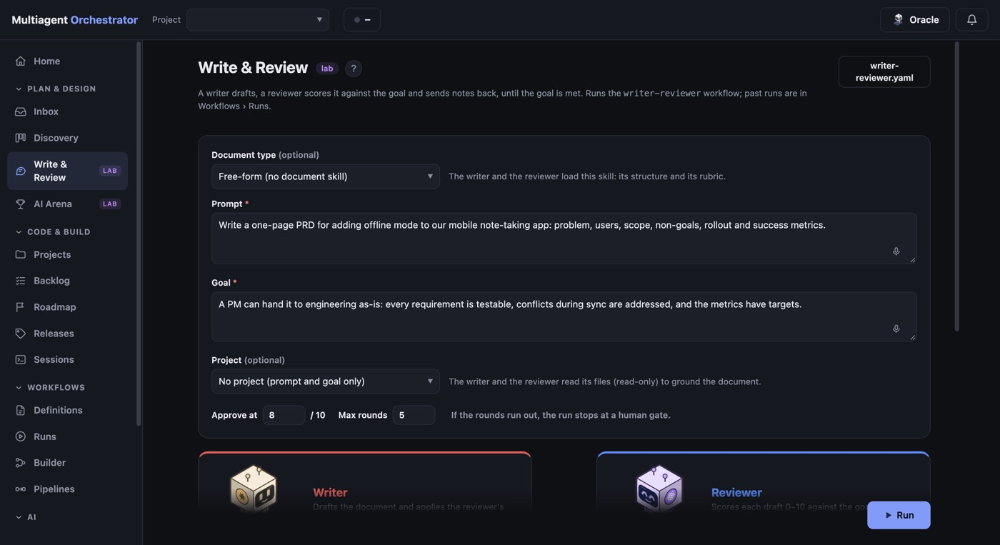
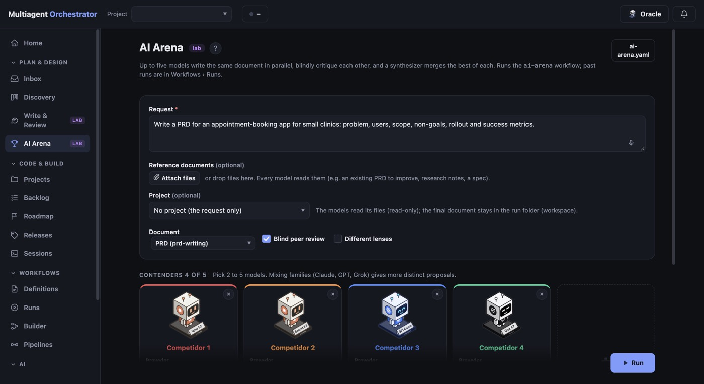

# Intent: write doc

## Problem

Writing a plan or a proposal with the agents today does not leave a document anyone can review well, nor one that stays tied to what gets built.

- **Write & Review** and **AI Arena** start from a prompt and end in a markdown file that you accept or send back whole. To fix one passage, you have to describe where it is; in practice, you quote a section number in the chat.
- After several requests, there is no way to see what the AI changed in each one, so revalidating means rereading everything.
- The person who writes a plan is often not technical and cannot run the project's app to take the "before" screenshots.
- The document lives in a run folder. Nothing links it to the intent it came from, to the issues it produced, or to the code, the tests and the release that followed.
- The Planning workflows overlap: `writer-reviewer`, `ai-arena` and the `ai-arena-write-review` pipeline all write a document, each with its own gate.

## Proposed outcome

Each work item has **one living document** in the project's repository, from the intent to monitoring, along the six stages of Anthropic's AI-native SDLC (Plan, Design, Build, Test, Deploy, Maintain):

- Plan (`intent.md`) and Design (`spec.md`) are written by a writer and approved by a person;
- you edit by selecting a passage on the rendered page and saying, in a chat beside it, what to change;
- each request is a commit, and you can see exactly what the AI changed in it;
- the "before" screenshots come without running anything, and pasted images are welcome;
- approving the spec opens the epic, one sub-issue per phase, and the Build through `plan.md`;
- the workflows fill in Build, Test, Deploy and Maintain.

## Affected users and systems

- **Users:** the owner and anyone who writes a plan or a proposal, often not technical; the tech lead, who signs off the risky points; the engineer, who accepts `plan.md`.
- **Plan & Design:** Write & Review and AI Arena become one screen, Documents.
- **Engine:** a new human gate that accepts requests while it waits (`human_edit`); the Planning workflows and pipelines are renamed, with aliases.
- **The document reader** (prototyped separately): renders the markdown on the fly; the editor depends on it.
- **The project's repository:** `docs/work/<item>/` with the markdown (English source and pt-BR translation) and the images, committed by the run at the usual gate.

## Constraints

- The writer writes **markdown only**, never HTML. No rendered HTML is generated or committed.
- The source is in **English**; the translation sits next to it and is updated with every request.
- No automation crosses a human gate: editing, accepting the intent and signing off the spec end only with a person.
- Writes outside the machine (issues, push, PR) need the owner's click.
- Automated checks run simulated only, and every real model call shows its cost first.
- The app stays in English.

## Open questions

1. Does AI Arena keep its own screen? *Proposed: no; it becomes "Several writers" in the draft.*
2. May the markdown contain raw HTML? *Proposed: no; the reader strips it.*
3. Can other people comment? *Proposed: not at first.*
