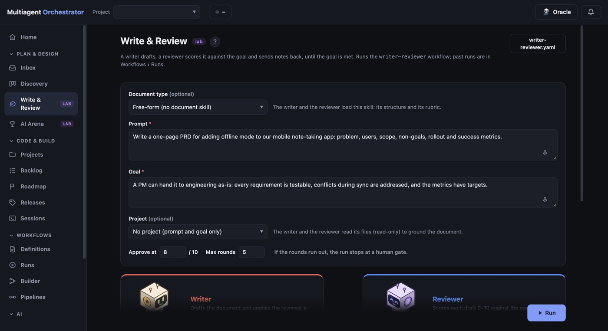
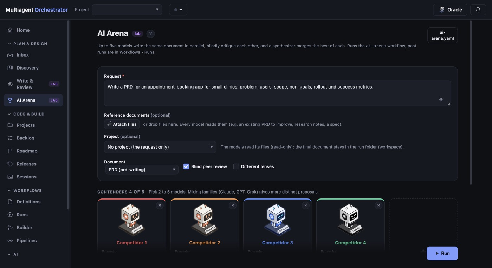

# Intent: write doc

## Problema

Escrever um plano ou uma proposta com os agentes hoje não deixa um documento que alguém consiga revisar bem, nem que fique ligado ao que é construído depois.

- **Write & Review** e **AI Arena** partem de um prompt e terminam num markdown que você aceita ou devolve inteiro. Para corrigir um trecho, é preciso descrever onde ele está; na prática, citando o número da seção no chat.
- Depois de vários pedidos, não dá para ver o que a IA mudou em cada um, então revalidar significa reler tudo.
- Quem escreve um plano muitas vezes não é técnico e não consegue rodar o app do projeto para tirar os screenshots de "antes".
- O documento vive numa pasta de run. Nada o liga ao intent de onde veio, às issues que gerou, nem ao código, aos testes e à release que vieram depois.
- Os workflows de Planning se sobrepõem: `writer-reviewer`, `ai-arena` e o pipeline `ai-arena-write-review` escrevem um documento, cada um com o seu gate.

## Resultado esperado

Cada item de trabalho tem **um documento vivo** no repositório do projeto, do intent ao monitoramento, nas seis etapas do AI-native SDLC da Anthropic (Plan, Design, Build, Test, Deploy, Maintain):

- Plan (`intent.md`) e Design (`spec.md`) são escritos por um writer e aprovados por uma pessoa;
- você edita selecionando um trecho na página renderizada e dizendo, num chat ao lado, o que mudar;
- cada pedido é um commit, e dá para ver exatamente o que a IA mudou nele;
- os screenshots de "antes" vêm sem rodar nada, e imagens coladas são bem-vindas;
- assinar o spec abre a épica, uma sub-issue por fase, e o Build pelo `plan.md`;
- os workflows preenchem Build, Test, Deploy e Maintain.

## Usuários e sistemas afetados

- **Usuários:** o dono e quem escreve um plano ou uma proposta, muitas vezes sem ser técnico; o tech lead, que assina os pontos de risco; o engenheiro, que aceita o `plan.md`.
- **Plan & Design:** Write & Review e AI Arena viram uma tela só, Documents.
- **Engine:** um gate humano novo que aceita pedidos enquanto espera (`human_edit`); os workflows e pipelines de Planning são renomeados, com aliases.
- **O leitor de documentos** (prototipado à parte): renderiza o markdown na hora; o editor depende dele.
- **O repositório do projeto:** `docs/work/<item>/` com o markdown (fonte em inglês e tradução pt-BR) e as imagens, commitados pelo run no gate de sempre.

## Restrições

- O writer escreve **só markdown**, nunca HTML. Nenhum HTML renderizado é gerado ou commitado.
- A fonte é em **inglês**; a tradução fica ao lado e é atualizada a cada pedido.
- Nenhuma automação atravessa um gate humano: a edição, o aceite do intent e o sign-off do spec só terminam com uma pessoa.
- Escritas para fora da máquina (issues, push, PR) pedem o clique do dono.
- As checagens automáticas rodam só no simulado, e toda chamada a modelo real mostra o custo antes.
- O app continua em inglês.

## Perguntas em aberto

1. O AI Arena continua com tela própria? *Proposta: não; vira "Several writers" no rascunho.*
2. O markdown pode ter HTML cru? *Proposta: não; o leitor remove.*
3. Outras pessoas podem comentar? *Proposta: não no começo.*
