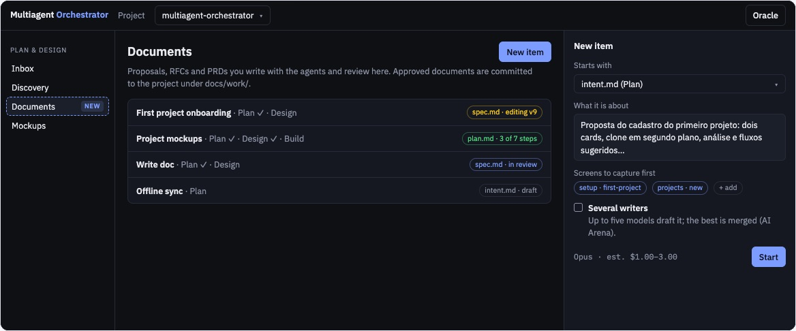
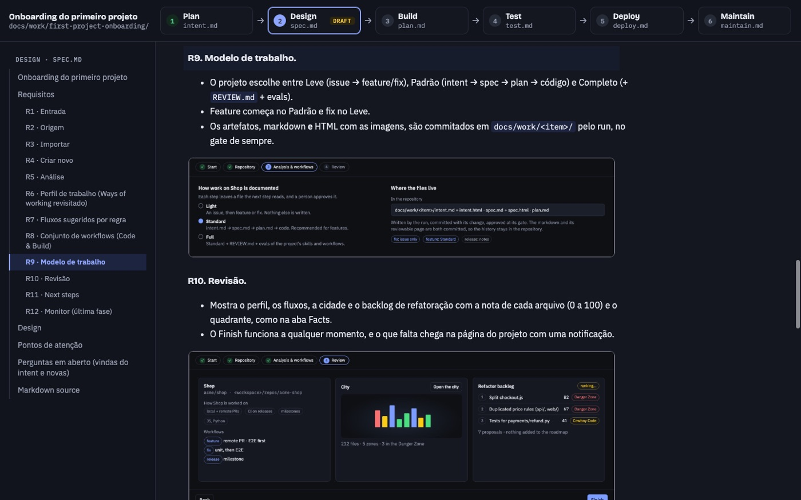
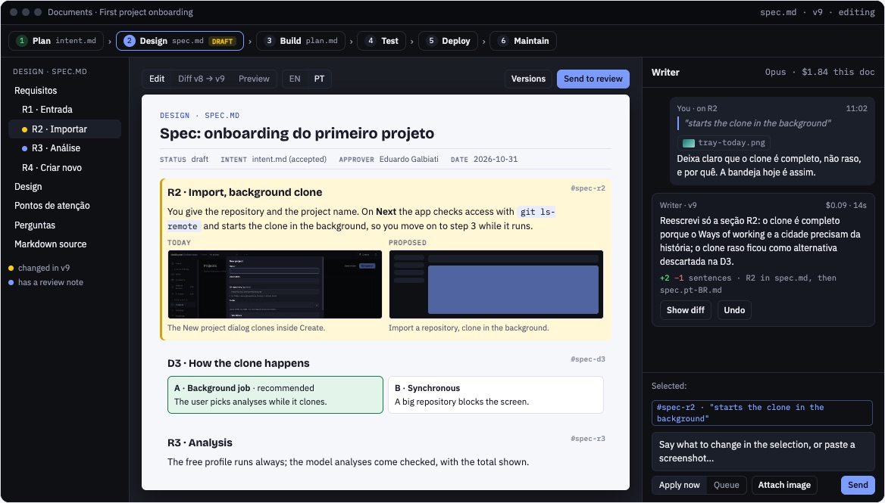
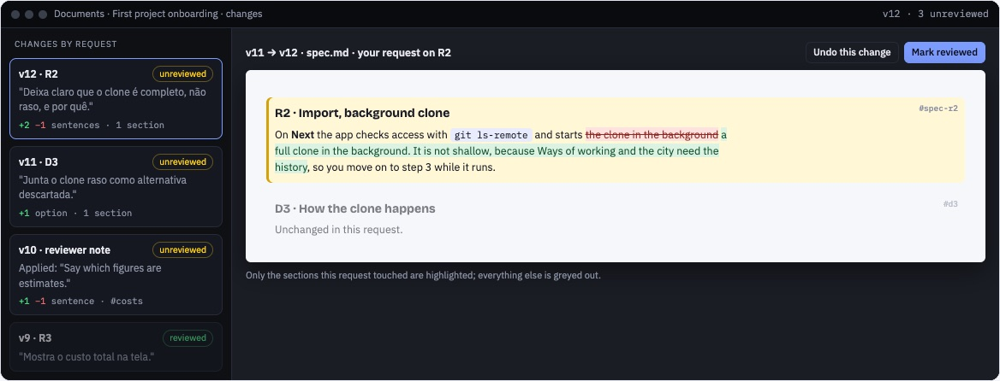
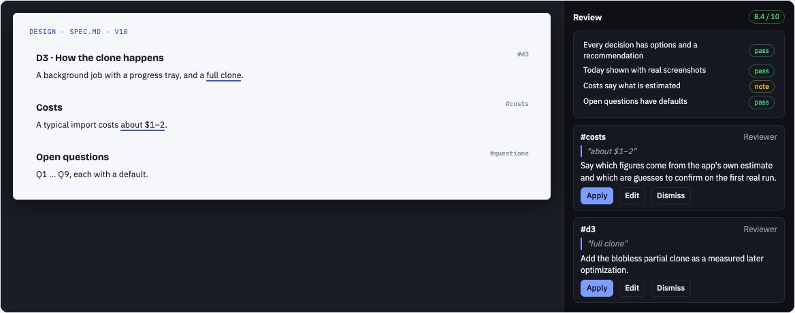
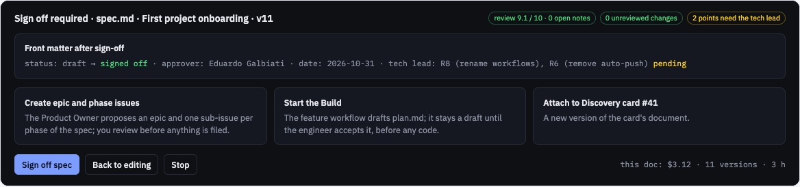

# Spec: write doc

The full proposal, with the options behind each decision: [docs/write-doc-proposal-2026-10/](../../write-doc-proposal-2026-10/README.md).

## Requirements

**R1. Documents screen.** Plan & Design › Documents replaces Write & Review and AI Arena. It lists the header project's items with each one's stage, read from the repository's `docs/work/` and the runs in progress. "New item" starts with the intent; an accepted intent offers "Write the spec". A Discovery card offers "Write a document".

**R2. The living document.** One folder per item, `docs/work/<item>/`, committed to the project's repository:
- `intent.md` and `spec.md`, written and approved;
- `plan.md` (with a Progress table), `test.md`, `deploy.md` and `maintain.md`, filled in by the workflows;
- `images/` with the before and after screenshots.

Each `.md` has a front matter (`item`, `issue`, `stage`, `status`, `approver`, `date`, the link to the previous artifact, and `translation:` or `source:`) and the playbook's sections:
- intent: Problem · Proposed outcome · Affected users and systems · Constraints · Open questions;
- spec: Requirements (each as `**R1. Title.**`) · Design · Areas of concern · Open questions;
- plan: Files that change · Order of work · Risks · Proof · Progress.

**R3. English source, translation beside it.** Each artifact has its source in English and a pt-BR translation next to it (`spec.pt-BR.md`, with `source: spec.md`). The writer edits the English first, then updates the translation in the same commit.

**R4. Markdown only, read by the reader.** The writer generates and edits markdown only, never HTML. The document reader (a dependency, prototyped separately) renders it on the fly: the stages at the top, the open stage's contents on the left, the wide document in the centre, the metadata at the top and the original markdown at the end, an EN / PT selector. No rendered HTML is generated or committed. *Tech lead:* the reader's contract (source positions, selection events) is a dependency of the editor.

**R5. The `write-doc` workflow.** Run once per stage document (intent, then spec): evidence (machine) → draft (one writer, or several in Arena mode) → **edit with you** (`human_edit`) → review → **approval** (`human_approval`). A machine lint checks the markdown before you see it: front matter, the playbook's sections, requirements R1…, a `**Recommended:**` line in every decision, images that exist.

**R6. Document types.** Two skills: `intent-writing` and `spec-writing`. The spec carries the format of this series' proposals (requirements, before/after, decisions with options and a recommendation, phases, costs, questions with defaults). RFC, PRD and design sketch become spec templates.

**R7. Evidence without running anything.** The writer names the screens; a machine step captures them into `images/`, from, in order:
1. the project's screenshot command (`npm run screenshot` here, `.multiagent/screenshot.yaml` elsewhere), "before" with `--ref <base>`;
2. a capture through Run App (local preview + headless browser);
3. a manual attachment.

The "after" comes from the same command on the run's branch, the Mockups' screens (#625), or pasted images. A project with no screenshot command gets one through onboarding's "Investigate screenshots" card.

**R8. The editor.** On the validated layout, with the writer's chat on the right. The document narrows to a minimum reading width (about 70 characters per line); below it, the contents become the ☰ with the current section as a tab, and the chat can collapse to a thin bar.

**R9. Selection → source.** The selection happens on the rendered page. The reader tags each block with its source lines (`data-src="41-52"`) and each heading and `R1`, `D3` with an anchor (`spec-r2`). The chat sends the file, the anchor, the lines, the passage, its context and the version; the writer returns the new section only. A selection made in the translation applies to the source: same anchors in both files, blocks aligned by order inside the section, and the whole section sent when the alignment fails. *Tech lead:* `human_edit` is a new engine step, a gate that accepts requests while it waits, in the protected list.

**R10. Editing.** Each request is a turn of the writer in the same session (persistent, with a handoff note and `fresh_after_idle: 55m`). "Apply now" by default, "Queue" to collect requests. You can paste or attach a screenshot in the chat (#130). Only your "Send to review" ends the step.

**R11. Review by request.** Each request (yours, or a reviewer note you applied) is a commit on the run's branch, with the English source and its translation, and the message id in the commit. Clicking a message shows that turn's diff inline, only in the sections it touched. A queue of unreviewed changes, with "Mark reviewed" and "Undo this change", and a count at the approval gate.

**R12. The reviewer.** It scores against the skill's rubric and the goal, and returns notes anchored to sections, with Apply / Edit / Dismiss. "Auto-apply notes" is an option, off by default.

**R13. The SDLC gates.** "Accept intent" (product owner) and "Sign off spec" (owner; the tech lead for the points the spec marks) are `human_approval` gates that change the front matter (status, approver, date) and commit. After the sign-off: "Create epic and phase issues" (the Product Owner proposes the epic and one sub-issue per phase; the owner reviews before anything is filed) and "Start the Build" (the feature workflow writes `plan.md`, a draft until the engineer accepts it, before any code). *Tech lead:* renaming the Planning workflows (R14).

**R14. The Planning workflows.** `writer-reviewer` and `ai-arena` (with the `ai-arena-write-review` pipeline) become `write-doc` (writers 1–5); `issue-tracker` becomes `issue`, with a "from a spec" input; `rfc-to-issues` becomes `spec-to-issues`; `enrich-save-develop` becomes `enrich-issue`. The old names stay as aliases.

**R15. One editor for the app's artifacts.** The editor is the common base of the artifact editors: selection on the rendered output, the side chat (`agent-chat.js`), selection → source, one commit per request with its diff, the unreviewed queue and the review gate. The renderer is its extension point: `render(source)`, `mapSelection(selection)`, `applyDiff(diff)`. Write doc brings the markdown renderer (the reader); the Mockups (#625) add a screen renderer as the second consumer.

**R16. The rest of the living document (later phases).** The feature/fix workflow writes `plan.md` and a Progress line per run, commit and PR; runs record the evidence in `test.md`; the review and the release with the Ship go in `deploy.md`. The Monitor and the Night watch record incidents and post-mortems in `maintain.md` and open a new intent.

## Design

- **Documents screen and editor:** `fronts/plan/views/docs/` (`docs.js`, `doc-editor.js`). The reader opens in an `iframe sandbox="allow-scripts"` with an opaque origin, served on `doc://` with a CSP that allows no network and no `window.api`; the selection comes out through `postMessage`, already mapped to the `.md`.
- **Pure rules:** `packages/shared/doc-model.js` (the selection payload, translation alignment, the markdown lint), testable with no DOM.
- **Service:** `fronts/plan/engine/` (`channels/docs.js`, `domains/docs.js`): lists `docs/work/`, reads the runs in progress, swaps a section's lines, commits each request in the run's worktree.
- **Engine:** the `human_edit` step; `write-doc.yaml`; the aliases in the workflow loader.
- **Where things live:** the artifacts in the project's repository, `docs/work/<item>/`; the run's data (chat, notes, costs) in the workspace run folder.
- **Cost (estimates, not measured):** intent draft $0.30–1.00; spec draft $1.00–3.00 (Arena $3–10); an edit request $0.05–0.40; review $0.20–0.60; first translation $0.30–1.00, then $0.02–0.10 per request. Capture, lint, diff and versions cost nothing.

## Areas of concern

- **For the tech lead:**
  - the reader's contract (R4) is outside this item and gates phase 0;
  - `human_edit` (R9) changes how gates work: it must stay in the protected list;
  - renaming the Planning workflows (R14) touches saved pipelines, manifests and tests, so the aliases land first.
- **Selection in the translation:** aligning blocks by order fails when the translation splits or merges a paragraph; the fallback sends the whole section.
- **Anchor stability:** renaming a heading changes its anchor; the app follows the heading through the diff.
- **Cost of long drafts:** a spec in this format is long; the first draft is the expensive turn, and edits use the prompt cache.
- **Writes to the user's repository:** only through the run, at the usual gate; issues, push and PR need the owner's click.

## Open questions (from the intent and new)

1. Does AI Arena keep its own screen? *Proposed: no; "Several writers (AI Arena)" in the draft.*
2. May the markdown contain raw HTML? *Proposed: no; the reader strips it.*
3. Do edits apply at once? *Proposed: yes, with "Queue".*
4. Does the reviewer rewrite by itself? *Proposed: no; "Auto-apply notes" off by default.*
5. The item folder's name? *Proposed: `docs/work/<slug>/`, with the issue in the front matter.*
6. Can other people comment? *Proposed: not at first.*

## Phases

- **Phase 0, spike:** the editor on the reader prototype, with the onboarding example; selection → source lines. No model.
- **Phase 1, MVP:** R1–R13 for intent and spec, with one writer; evidence through this app's `npm run screenshot`.
- **Phase 2:** Arena mode and the Planning reorganization (R14), with aliases.
- **Phase 3:** captures through a project's own command or Run App; "Write a document" on a Discovery card.
- **Phase 4:** the living document in Build, Test and Deploy (R16).
- **Phase 5:** Maintain from the Monitor, a front to browse intents, interactive mocks.
