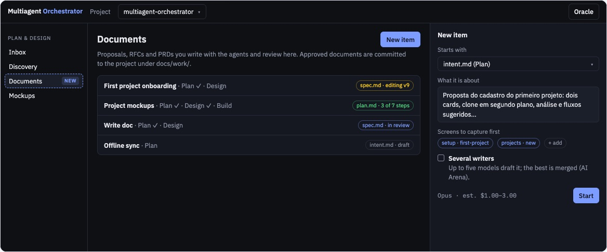
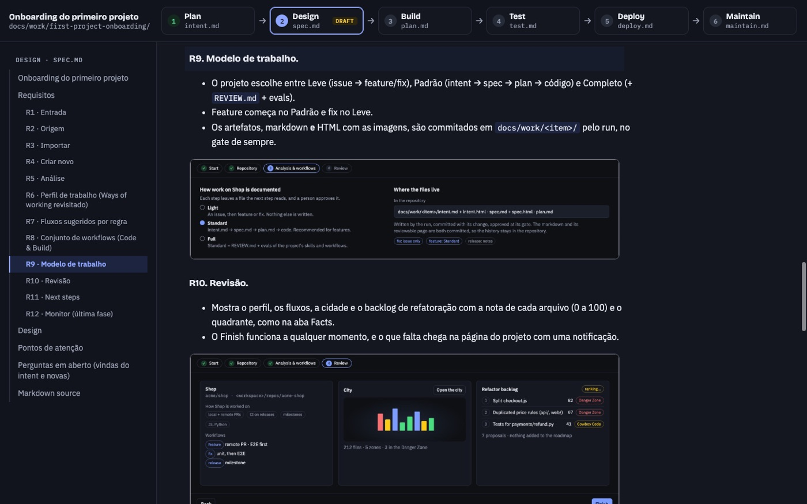
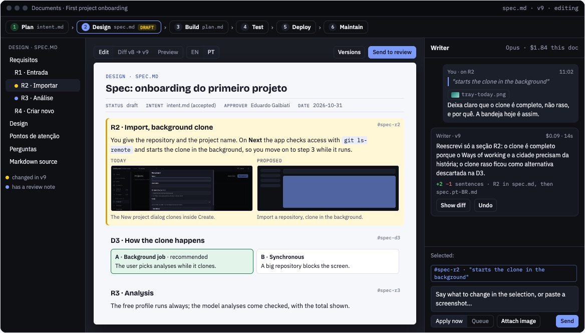
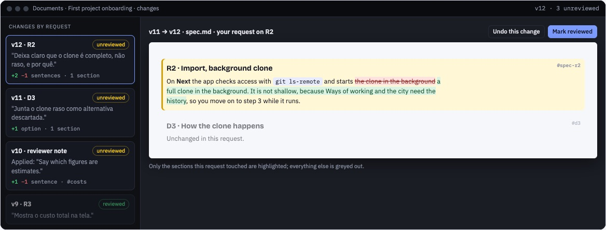
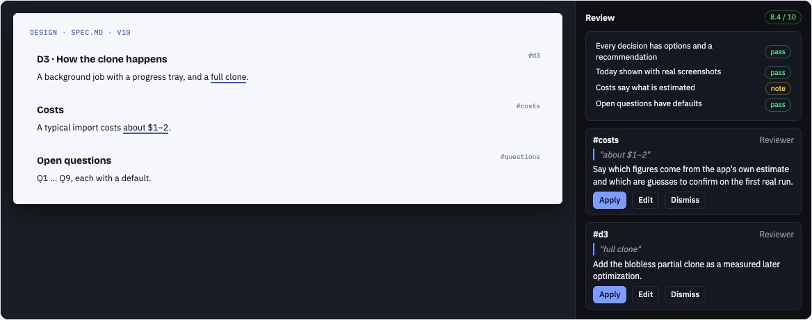
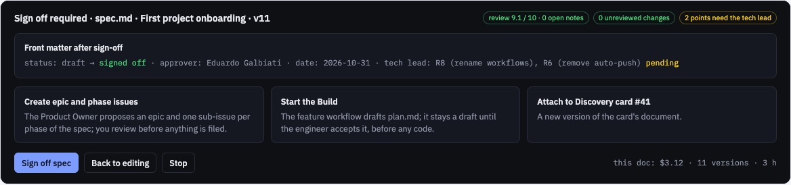

# Spec: write doc

A proposta completa, com as opções por trás de cada decisão: [docs/write-doc-proposal-2026-10/](../../write-doc-proposal-2026-10/README.pt-BR.md).

## Requisitos

**R1. Tela Documents.** Plan & Design › Documents substitui Write & Review e AI Arena. Ela lista os itens do projeto do header com a etapa de cada um, lidos do `docs/work/` do repositório e dos runs em andamento. "New item" começa pelo intent; um intent aceito oferece "Write the spec". Um card do Discovery oferece "Write a document".

**R2. O documento vivo.** Uma pasta por item, `docs/work/<item>/`, commitada no repositório do projeto:
- `intent.md` e `spec.md`, escritos e aprovados;
- `plan.md` (com uma tabela de Progresso), `test.md`, `deploy.md` e `maintain.md`, preenchidos pelos workflows;
- `images/` com os screenshots de antes e depois.

Cada `.md` tem um front matter (`item`, `issue`, `stage`, `status`, `approver`, `date`, o link para o artefato anterior e `translation:` ou `source:`) e as seções do playbook:
- intent: Problema · Resultado esperado · Usuários e sistemas afetados · Restrições · Perguntas em aberto;
- spec: Requisitos (cada um como `**R1. Título.**`) · Design · Pontos de atenção · Perguntas em aberto;
- plan: Arquivos que mudam · Ordem do trabalho · Riscos · Prova · Progresso.

**R3. Fonte em inglês, tradução ao lado.** Cada artefato tem a fonte em inglês e uma tradução pt-BR ao lado (`spec.pt-BR.md`, com `source: spec.md`). O writer edita primeiro o inglês e depois atualiza a tradução, no mesmo commit.

**R4. Só markdown, lido pelo leitor.** O writer gera e edita só markdown, nunca HTML. O leitor de documentos (dependência, prototipado à parte) renderiza na hora: as etapas no topo, o índice da etapa aberta à esquerda, o documento largo no centro, os metadados no topo e o markdown original no fim, e um seletor EN / PT. Nenhum HTML renderizado é gerado ou commitado. *Tech lead:* o contrato do leitor (posições de origem, eventos de seleção) é uma dependência do editor.

**R5. O workflow `write-doc`.** Roda uma vez por documento de etapa (intent, depois spec): evidências (máquina) → rascunho (um writer, ou vários no modo Arena) → **edição com você** (`human_edit`) → revisão → **aprovação** (`human_approval`). Um lint de máquina confere o markdown antes de você ver: front matter, as seções do playbook, os requisitos R1…, uma linha `**Recommended:**` em cada decisão, imagens que existem.

**R6. Tipos de documento.** Duas skills: `intent-writing` e `spec-writing`. O spec tem o formato das propostas desta série (requisitos, antes/depois, decisões com opções e recomendação, fases, custos, perguntas com padrão). RFC, PRD e design sketch viram modelos de spec.

**R7. Evidências sem rodar nada.** O writer nomeia as telas; um passo de máquina as captura em `images/`, nesta ordem:
1. o comando de screenshot do projeto (`npm run screenshot` aqui, `.multiagent/screenshot.yaml` nos outros), com o "antes" via `--ref <base>`;
2. a captura pelo Run App (local preview + browser headless);
3. o anexo manual.

O "depois" vem do mesmo comando na branch do run, das telas dos Mockups (#625) ou de imagens coladas. Um projeto sem comando de screenshot ganha um pelo cartão "Investigate screenshots" do onboarding.

**R8. O editor.** No layout validado, com o chat do writer à direita. O documento encolhe até uma largura mínima de leitura (cerca de 70 caracteres por linha); abaixo disso, o índice vira o ☰ com a seção atual como aba, e o chat pode ser recolhido para uma barra fina.

**R9. Seleção → fonte.** A seleção acontece na página renderizada. O leitor marca cada bloco com as linhas de origem (`data-src="41-52"`) e cada título e cada `R1`, `D3` com uma âncora (`spec-r2`). O chat envia o arquivo, a âncora, as linhas, o trecho, o contexto e a versão; o writer devolve só a seção nova. Uma seleção feita na tradução vale para a fonte: as mesmas âncoras nos dois arquivos, os blocos alinhados pela ordem dentro da seção, e a seção inteira quando o alinhamento falha. *Tech lead:* `human_edit` é um passo novo do engine, um gate que aceita pedidos enquanto espera, na lista protegida.

**R10. Edição.** Cada pedido é um turno do writer na mesma sessão (persistente, com handoff note e `fresh_after_idle: 55m`). "Apply now" por padrão, "Queue" para juntar pedidos. Você pode colar ou anexar um screenshot no chat (#130). Só o seu "Send to review" encerra o passo.

**R11. Revisão por pedido.** Cada pedido (seu, ou uma nota do reviewer que você aplicou) é um commit na branch do run, com a fonte em inglês e a tradução, e o id da mensagem no commit. Clicar numa mensagem mostra o diff daquele turno, inline, só nas seções que ele tocou. Uma fila de mudanças não revisadas, com "Mark reviewed" e "Undo this change", e um contador no gate de aprovação.

**R12. O reviewer.** Ele pontua contra a rubrica da skill e o objetivo, e devolve notas ancoradas nas seções, com Apply / Edit / Dismiss. "Auto-apply notes" é uma opção, desligada por padrão.

**R13. Os portões do SDLC.** "Accept intent" (product owner) e "Sign off spec" (dono; o tech lead nos pontos que o spec marca) são gates `human_approval` que mudam o front matter (status, aprovador, data) e commitam. Depois do sign-off: "Create epic and phase issues" (o Product Owner propõe a épica e uma sub-issue por fase; o dono revisa antes de abrir) e "Start the Build" (o fluxo anterior escreve o `plan.md`, em draft até o engenheiro aceitar, e abre os passos como issues; os workflows de Build só recebem essas issues). *Tech lead:* a renomeação dos workflows de Planning (R14).

**R14. Os workflows de Planning.** `writer-reviewer` e `ai-arena` (com o pipeline `ai-arena-write-review`) viram `write-doc` (writers 1–5); `issue-tracker` vira `issue`, com uma entrada "from a spec"; `rfc-to-issues` vira `spec-to-issues`; `enrich-save-develop` vira `enrich-issue`. Os nomes antigos ficam como aliases.

**R15. Um editor para os artefatos do app.** O editor é a base comum dos editores de artefatos: a seleção sobre o que está renderizado, o chat lateral (`agent-chat.js`), seleção → fonte, um commit por pedido com o diff, a fila de não revisadas e o gate de revisão. O renderizador é o ponto de extensão: `render(source)`, `mapSelection(selection)`, `applyDiff(diff)`. O write doc traz o renderizador de markdown (o leitor); os Mockups (#625) acrescentam um renderizador de telas como o segundo consumidor.

**R16. O resto do documento vivo (fases seguintes).** Um fluxo posterior, encadeado depois de cada run de feature/fix com sucesso (`then`), escreve a linha de Progresso do `plan.md` (run, commit, PR) e a evidência do run no `test.md`, a partir das saídas declaradas do run; a revisão e a release com o Ship vão para o `deploy.md` do mesmo jeito. Os workflows de Code & Build nunca escrevem em `docs/work/` (decisão de 2026-11-01). O Monitor e o Night watch registram incidentes e post-mortems no `maintain.md` e abrem um novo intent.

## Design

- **Tela Documents e editor:** `fronts/plan/views/docs/` (`docs.js`, `doc-editor.js`). O leitor abre num `iframe sandbox="allow-scripts"` de origem opaca, servido por `doc://`, com CSP sem rede e sem `window.api`; a seleção sai por `postMessage`, já mapeada para o `.md`.
- **Regras puras:** `packages/shared/doc-model.js` (a carga da seleção, o alinhamento da tradução, o lint do markdown), testável sem DOM.
- **Serviço:** `fronts/plan/engine/` (`channels/docs.js`, `domains/docs.js`): lista o `docs/work/`, lê os runs em andamento, troca as linhas de uma seção e commita cada pedido no worktree do run.
- **Engine:** o passo `human_edit`; o `write-doc.yaml`; os aliases no carregador de workflows.
- **Onde as coisas ficam:** os artefatos no repositório do projeto, `docs/work/<item>/`; os dados do run (chat, notas, custos) na pasta do run, no workspace.
- **Custo (estimativas, sem medição):** rascunho do intent $0.30–1.00; rascunho do spec $1.00–3.00 (Arena $3–10); um pedido de edição $0.05–0.40; revisão $0.20–0.60; primeira tradução $0.30–1.00, depois $0.02–0.10 por pedido. Captura, lint, diff e versões não custam nada.

## Pontos de atenção

- **Para o tech lead:**
  - o contrato do leitor (R4) está fora deste item e é pré-requisito da fase 0;
  - o `human_edit` (R9) muda como os gates funcionam e precisa ficar na lista protegida;
  - renomear os workflows de Planning (R14) mexe em pipelines salvos, manifestos e testes, então os aliases entram antes.
- **Seleção na tradução:** alinhar blocos pela ordem falha quando a tradução divide ou junta um parágrafo; o plano B manda a seção inteira.
- **Estabilidade das âncoras:** renomear um título muda a âncora; o app segue o título pelo diff.
- **Custo de rascunhos longos:** um spec neste formato é longo; o primeiro rascunho é o turno caro, e as edições usam o prompt cache.
- **Escritas no repositório do usuário:** só pelo run, no gate de sempre; issues, push e PR pedem o clique do dono.

## Perguntas em aberto (vindas do intent e novas)

1. O AI Arena continua com tela própria? *Proposta: não; "Several writers (AI Arena)" no rascunho.*
2. O markdown pode ter HTML cru? *Proposta: não; o leitor remove.*
3. As edições se aplicam na hora? *Proposta: sim, com "Queue".*
4. O reviewer reescreve sozinho? *Proposta: não; "Auto-apply notes" desligado por padrão.*
5. O nome da pasta do item? *Proposta: `docs/work/<slug>/`, com a issue no front matter.*
6. Outras pessoas podem comentar? *Proposta: não no começo.*

## Fases

- **Fase 0, spike:** o editor sobre o protótipo do leitor, com o exemplo do onboarding; seleção → linhas da fonte. Sem modelo.
- **Fase 1, MVP:** R1–R13 para intent e spec, com um writer; evidências pelo `npm run screenshot` deste app.
- **Fase 2:** o modo Arena e a reorganização do Planning (R14), com aliases.
- **Fase 3:** captura pelo comando do próprio projeto ou pelo Run App; "Write a document" no card do Discovery.
- **Fase 4:** o documento vivo no Build, Test e Deploy (R16).
- **Fase 5:** o Maintain a partir do Monitor, um front para navegar pelos intents, mocks interativos.
