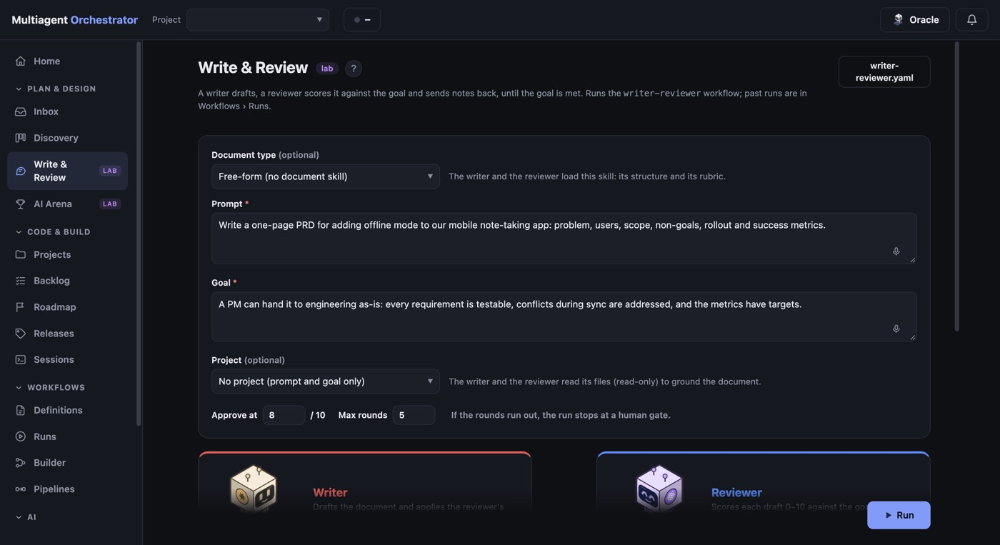
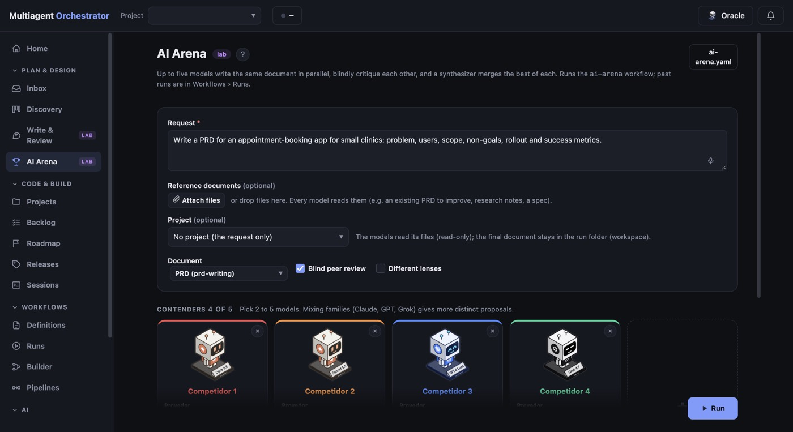
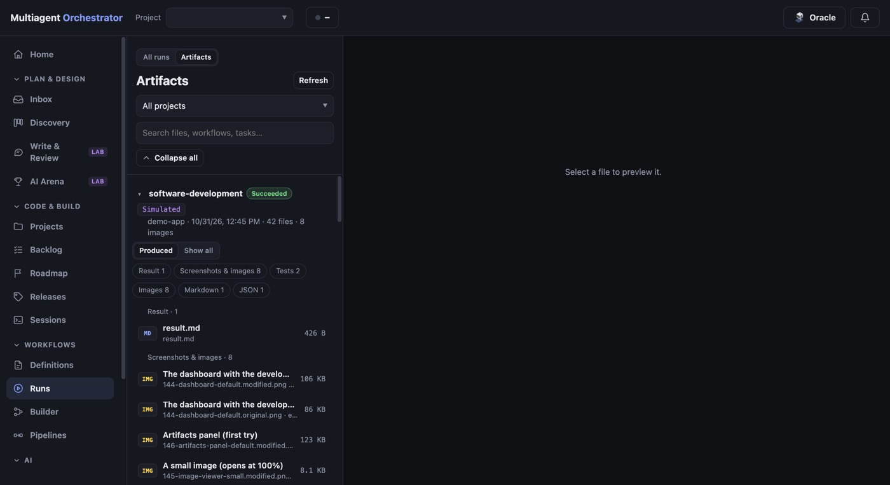
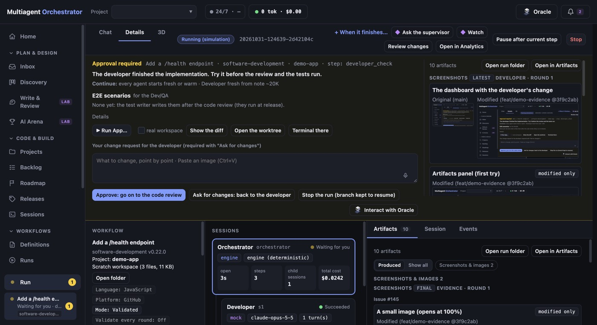
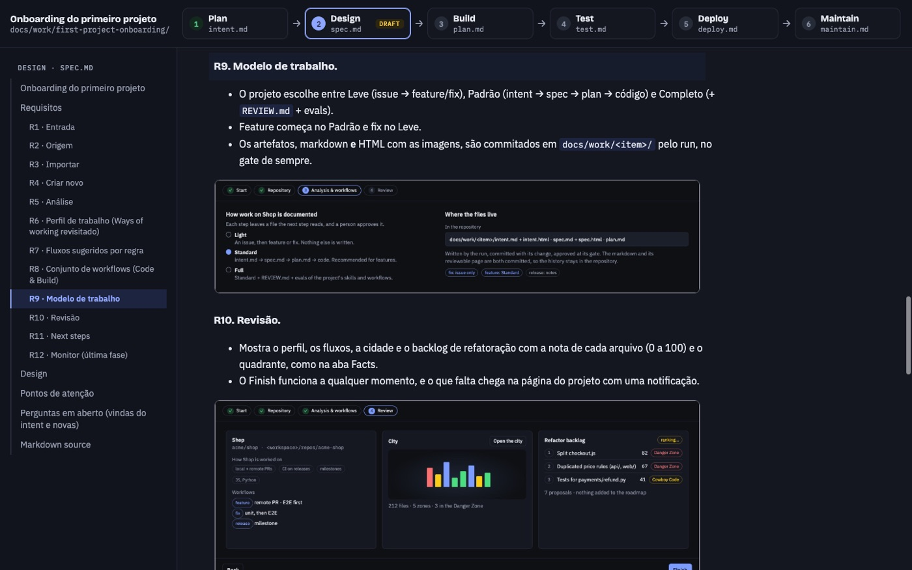
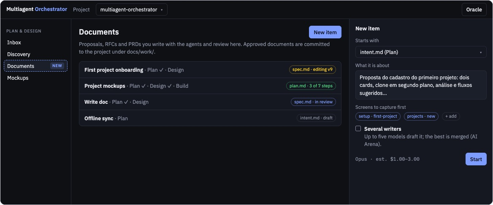
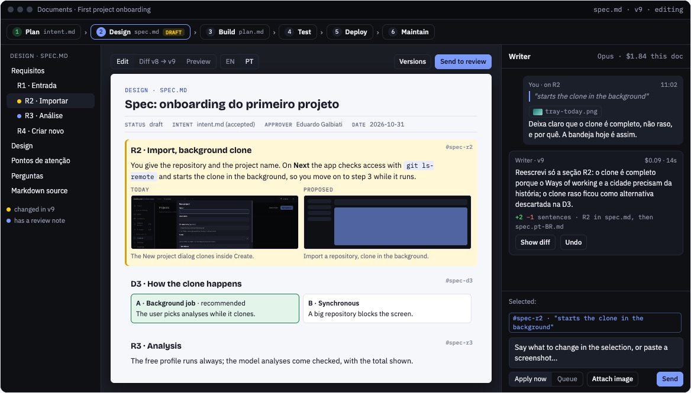
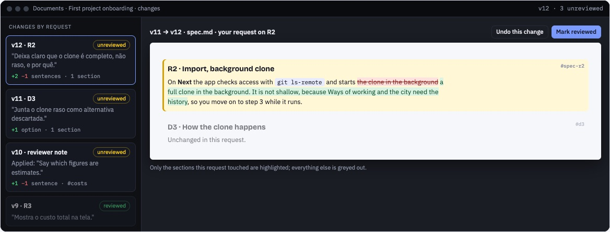
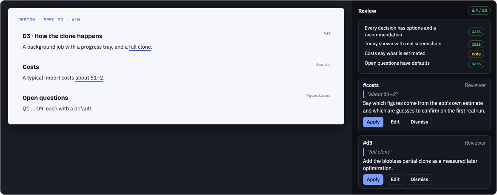
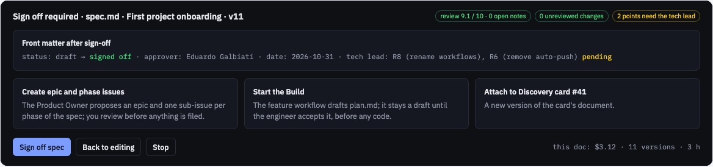

# Write Doc: proposal

**Status:** proposal, waiting for the owner's decisions · **Epic:** #636 · **Date:** 2026-10-31 · [Português](README.pt-BR.md)

This proposal turns the way the proposals of this series were written ([Project mockups](../project-mockups-proposal-2026-10/README.md), [First project onboarding](../first-project-onboarding-proposal-2026-10/README.md)) into a feature of the app.
- Every work item gets **one living document** in `docs/work/<item>/`, from the intent to monitoring, along the six stages of the AI-native SDLC.
- A writer drafts Plan (`intent.md`) and Design (`spec.md`) in markdown, with screenshots of "before" and mock screens of "after".
- You iterate like in an editor: select a passage and say, in the chat beside it, what to fix. A reviewer comments, and a person approves.
- The workflows fill in the rest: Build, Test, Deploy and Maintain.

It also covers the reorganization of the Planning workflows that the onboarding proposal left out.

The same proposal as a page, with a clickable editor mock: [index.html](index.html) ([pt-BR](index.pt-BR.html)). Open it locally; GitHub shows HTML as source.

Nothing here is built yet. The decisions are recommendations until the owner confirms them; then they go to [docs/agents/decisions.md](../agents/decisions.md).

## Contents

- [The recommendations](#the-recommendations)
- [Where we are today](#where-we-are-today)
- [The format: one living document per item](#the-format-one-living-document-per-item)
- [End-to-end flow](#end-to-end-flow)
- [The Planning workflows: old → new](#the-planning-workflows-old--new)
- [Architecture](#architecture)
- [Cost of real-model calls](#cost-of-real-model-calls)
- [Phased plan](#phased-plan)
- [Files and areas](#files-and-areas)
- [Open questions](#open-questions)
- [Hard rules check](#hard-rules-check)
- [How to contribute](#how-to-contribute)

## The recommendations

1. **One living document per item** (the owner's decision), in `docs/work/<item>/`, from the intent to monitoring, along the six stages of the AI-native SDLC.
   - **Plan** (`intent.md`) and **Design** (`spec.md`) are written here and approved by a person.
   - **Build** (`plan.md`, with its Progress table), **Test**, **Deploy** and **Maintain** are filled in by the workflows and the Monitor.
2. **Markdown is the only source.** The writer generates and edits markdown only, never HTML. Reading is done by the document reader (prototyped in a separate session), which renders the `.md` on the fly with JavaScript; no rendered HTML is generated or committed. **Dependency:** this proposal uses that reader and does not propose a renderer of its own. The validated layout:
   - the six stages at the top, horizontal and fixed, with their status and the current stage marked;
   - on the left, the open stage's contents: it follows the scroll, keeps the current section in view and scrolls smoothly on click; requirements R1… are items;
   - the wide document in the centre, with the front matter's metadata at the top and the original markdown at the end;
   - on a phone: ☰ plus the current section as a tab, and a drawer with the full contents.
3. **One screen, Plan & Design › Documents**, replacing Write & Review and AI Arena. "Several writers" becomes an option of the draft.
4. **One workflow, `write-doc`**, run once for the intent and once for the spec: evidence → draft → **editing with you** → review → **approval**. Both human steps are gates that no automation crosses.
5. **Two document types:**
   - `intent-writing`: problem, outcome, users and systems, constraints, questions.
   - `spec-writing`, with this series' format: requirements R1…Rn, before/after, decisions with options and a recommendation, phases, costs, questions with defaults.
6. **Selection → agent:** every markdown heading becomes a stable anchor. The chat sends the file, the section, the exact passage and its context, and the writer rewrites that section only. No more "fix item 3 of D7".
7. **Screenshots without running anything:** whoever writes only names the screens. The app uses, in this order:
   - the project's screenshot command, when there is one;
   - a capture through Run App;
   - a manual attachment.

   The "after" comes from the same command on the run's branch, the Mockups proposal's screens (#625), or pasted images. The writer never writes HTML.
8. **Images in the chat:** in any iteration you can paste or attach a screenshot in the chat (the #130 mechanism), and it goes to the writer with the selection.
9. **Review by request:** each request becomes a commit linked to its message. Clicking the message shows only what the AI changed in that turn, in red and green inside the document. A queue of unreviewed changes says what is left to validate.
10. **The reviewer comments, it does not rewrite:** its notes are anchored to sections, and you pick which to apply.
11. **The SDLC gates in the app:** "Accept intent" and "Sign off spec" are human gates that change the front matter and commit (the tech lead signs the higher-risk points). After the sign-off come "Create epic and phase issues" and the handoff to the Build through `plan.md`, which the engineer accepts before any code.
12. **An English source, with the translation next to it:** each artifact has its source in English (`intent.md`, `spec.md`…) and a Portuguese translation beside it (`intent.pt-BR.md`…); the front matter links the pair (`translation:` in the source, `source:` in the translation). The writer edits the English first, then updates the translation. A request made in Portuguese on a passage of the translation is applied to the source and propagated. The reader has an EN / PT selector.

## Where we are today

Both document flows today start from a prompt and end in a markdown file that you accept or send back whole. There is no way to point at a passage, and nothing ties the document to what gets built afterwards.

| | |
|---|---|
|  |  |
| **Write & Review** (`writer-reviewer.yaml`): prompt + goal. The writer writes, the reviewer scores 0–10 and sends notes until the threshold, and the supervisor checks and asks what to do. | **AI Arena** (`ai-arena.yaml`): up to five models write the same document and critique blindly; a synthesizer merges, and another family verifies. |
|  |  |
| **Artifacts**: run documents show as sanitized markdown (marked + DOMPurify, no forms). Good for reading, not for editing or pointing. | **A gate with evidence**: development runs keep *original* and *modified* screenshot pairs in `evidence/`. The same mechanism gives a document its "before". |

The pain behind the request, in the owner's words: to fix something in these proposals, they had to find the spot and quote the section number in the chat. And after several requests, they could not tell what the AI had changed.

## The format: one living document per item

This is the owner's decision. Each work item has **one document**, from the intent to monitoring, organized along the six stages of Anthropic's [AI-native SDLC playbook](https://claude.com/blog/the-ai-native-sdlc-playbook): Plan → Design → Build → Test → Deploy → Maintain. Each stage ends in a versioned artifact that a person approves.

Everything is committed in `docs/work/<item>/`: each stage's markdown and the before and after images in `images/`. No HTML is committed: the document reader renders the `.md` files on the fly. Write doc **writes** Plan and Design; the workflows fill in the rest.



| Stage | File | Filled by | Approved by |
|---|---|---|---|
| Plan | `intent.md`: problem, expected outcome, affected users and systems, constraints, open questions | **write-doc** (writer + you) | the product owner |
| Design | `spec.md`: requirements R1…Rn and the design, with the decisions and points of attention | **write-doc** (writer + you + reviewer) | the owner / tech lead |
| Build | `plan.md`: files that change, order, risks, proof, and the **Progress** table | the feature/fix workflow: the plan at the start, then a line per run, commit and PR | the developer's gate |
| Test | `test.md`: the evidence | the runs: suite, E2E, original/modified screenshots, axe | the code owner |
| Deploy | `deploy.md`: the review and the release | each PR's review (against the project's `REVIEW.md`) and the `release` workflow with the Ship | the code owner; the owner gives the Ship |
| Maintain | `maintain.md`: incidents and post-mortems | the Monitor and the Night watch: an incident lands here, produces a post-mortem and a **new intent** | the service owner; the product owner for product findings |

Each `.md` has a front matter and the playbook's sections:

```
---
item: first-project-onboarding
stage: design
status: draft         # draft → signed off
intent: intent.md     # the previous artifact
translation: spec.pt-BR.md
approver: Eduardo Galbiati (product owner)
date: 2026-10-31
---
```

- **intent.md:** Problem · Expected outcome · Affected users and systems · Constraints · Open questions.
- **spec.md:** Requirements (each as `**R1. Title.**`) · Design · Points of attention · Questions.
- **plan.md:** Files that change · Order of work · Risks · Proof · Progress.

The source is always in English; the Portuguese translation sits next to it (`spec.pt-BR.md`, with `source: spec.md` in its front matter) with the same content. The reader switches between the two with its EN / PT selector.

**D15. The document's format and lifecycle**
- **The owner's decision:** one living document per item, with markdown as the only source, read through the document reader.
  - The item's history is in one committed place, and a future front can browse the intents and validate each one.
  - The agent writes markdown only. The reader renders it on the fly with the same layout for every document (light/dark theme, accent, export to PDF, a home page with every item), which simplifies safety (D5) and the lint.
  - The workflows fill in the stages nobody writes: `plan.md`'s Progress table, the evidence, the review, the release, the incidents.
- Alternatives:
  - Markdown plus committed rendered HTML: two sources that drift, and every edit becomes two diffs.
  - An agent-written HTML per proposal (the earlier design): one format per document, agent HTML to isolate, and nothing ties the proposal to what was built.
  - Intent and spec only: the document dies at approval.
- **What this proposal delivers:** the `.md` format, the editor on top of the reader, and the writing of Plan and Design.
- **Left for later:** the workflows filling in Build, Test and Deploy (phase 4), the Monitor feeding Maintain (phase 5), and the front that browses intents.

## End-to-end flow

`write-doc` runs once for `intent.md` and once for `spec.md`, with the same seven steps:

1. New item (**D1**, **D2**, **D3**).
2. Evidence: before and after screenshots (**D4**).
3. Draft: one writer or several.
4. **Edit with you**: selection + chat (**D5**–**D9**). A human gate.
5. Review: anchored notes (**D10**).
6. **Approval**: Accept intent / Sign off spec, human gates (**D16**).
7. Next stage (**D12**): intent → spec → epic and phase issues → Build.

The Planning reorganization is **D11**, storage **D13**, cost **D14**, the living document **D15** and the SDLC gates **D16**.

### 1 · New item

The **Documents** screen lists the header project's items with each one's stage, read from the repository's `docs/work/` and the runs in progress. "New item" starts with the intent; once the intent is approved, the same item offers "Write the spec". "Several writers" turns on the Arena mode for the draft.



**D1. Where the feature lives**
- **Recommended:** one Documents screen, replacing Write & Review and AI Arena. "Write a document" is also offered on a Discovery card.
- Alternatives:
  - A third screen next to the two: three screens for one idea.
  - Only inside a Discovery card: not every item starts from a card.

**D2. The source and the page**
- **Recommended (the owner's decision):** markdown only; the reader renders it on the fly.
  - The writer generates and edits only the stage's `.md`, with its front matter (`item`, `stage`, `status`, `approver`, `date` and the link to the previous artifact).
  - The reader (a dependency) renders with JavaScript, in the app and outside it; no HTML is generated or committed. Text diffs stay clean.
  - The editor depends on the reader exposing each block's position in the `.md` (D6).
  - **Markdown conventions:**
    - the playbook's sections per stage;
    - requirements as `**R1. Title.**`, which become contents items;
    - a decision inside Design as `### D3 · title`, with its options and a `**Recommended:**` line;
    - an image as ``.

    The lint checks all of them.
- Alternatives:
  - Markdown plus generated, committed HTML: opens without JavaScript, but two sources, and the HTML ages.
  - Agent-written HTML: a different layout every time, and agent HTML to isolate.
  - A Google Docs-style editor: the owner said explicitly they do not want it.

**D3. Document types**
- **Recommended:** `intent-writing` and `spec-writing`.
  - The intent covers the problem, the expected outcome, the affected users and systems, the constraints and the open questions.
  - The spec carries this series' format. RFC, PRD and design sketch become spec templates.
- Alternative: a single `product-proposal` skill, which mixes what the product owner approves (the intent) with what the team approves (the spec).

### 2 · Evidence: before and after screenshots

Whoever writes a plan or a proposal is often not technical and cannot run the project's app to take screenshots. So capture is a machine step before the draft: the writer only says which screens it wants, and the app takes the images.

| Order | Source | Before | After |
|---|---|---|---|
| 1 | **The project's screenshot command**: this app's `npm run screenshot`, or a project's own command (`.multiagent/screenshot.yaml`) | the base, with simulated data (`--ref <base>`) | the same command on the run's branch |
| 2 | **A capture through Run App**: the local preview starts the front in a sandbox, and a headless browser takes the requested URLs | today's screens | the run's branch |
| 3 | **A manual attachment**: images pasted or attached (#130), in "New item" or in the editing chat | what you paste | what you paste |

**D4. Where the images come from**
- **Recommended:** the most faithful source available, in that order. The app picks it and says which one it used for each image. People who are not technical never run anything: they name the screens, or paste an image.
  - A project with no screenshot command gets one through onboarding's "Investigate screenshots" card, which puts a spike on that project's own roadmap.
  - Until then, the manual attachment covers it.
- **The "after"** comes from the same screenshot command on the run's branch, the Mockups proposal's screens (#625) when it exists, or pasted images. The writer never writes HTML; it only references the images from the markdown. All images are files in `docs/work/<item>/images/`.
- Alternatives:
  - Pasted images only: back to depending on someone who can run the app.
  - The writer runs whatever it wants: costly and fragile.

### 3 · Draft

With one writer, the draft is one long turn. It reads the code (read-only), the evidence and the skill, and writes the stage's markdown (`intent.md` or `spec.md`), pointing to the images in `images/`. With several writers, it is today's Arena mode. A machine lint checks the markdown (front matter, the playbook's sections, requirements R1…, a recommendation in every decision, images that exist) before you see it.

### 4 · Edit with you

On the validated layout: the stages at the top, the contents on the left, the document rendered by the reader in the centre and the writer's chat on the right. You select a passage and write what you want. The writer rewrites that section of the markdown only, and it shows as changed. You can also paste or attach a screenshot in the chat (#130).

**The document and the chat together:** the chat takes the right side, the space that is the wide document's in the reader. The document narrows down to a minimum reading width (about 70 characters per line). Below that, the contents become the ☰ with the current section as a tab, as on a phone, and the chat can collapse to a thin bar to get back to full reading. The "Selected" chip and the change marks stay visible in both modes.



**D5. Showing the document safely**
- **Recommended:** the reader, in an isolated `iframe`, over sanitized markdown.
  - The agent writes markdown only. The reader renders it with the sanitizer (marked + DOMPurify, no forms, no raw HTML in the markdown); the only JavaScript that runs is the reader's own.
  - In the editor, the reader opens in an `iframe sandbox="allow-scripts"` with an opaque origin, served on `doc://` with a CSP that allows no network and no `window.api`. The selection comes out through `postMessage`, already mapped to the `.md` (D6).
  - The editor depends on the reader's contract (source positions, selection events).
- Alternatives:
  - Agent-written HTML: agent code inside the app, and against the markdown-only decision.
  - A renderer of the editor's own: two renderers for the same markdown, which drift; the reader already exists.

**D6. How the selection reaches the writer**
- **Recommended:** the selection happens on the rendered page. The reader tags each block with its source lines in the `.md` (for example `data-src="41-52"`), and every heading and every `R1`, `D3` becomes an anchor such as `spec-r2`. The chat sends the file, the anchor, the lines, the passage, 200 characters before and after, and the version. The writer returns the new section of the markdown only; the app swaps the lines, records the version, and the reader shows it again.
- Alternatives:
  - Pins on an image (Findings #361): text is not an image.
  - Section numbers in the chat: today's pain.

**Selecting in the translation (a point of attention):** when you select a passage in `spec.pt-BR.md`, the request applies to the source.
- The source and the translation share the same headings and anchors (`spec-r2` in both), so the section is exact.
- Inside the section, the app aligns blocks by order (the translation's 3rd paragraph is the source's 3rd). It sends the writer the Portuguese passage, the matching English block and the whole section in both languages.
- The writer fixes the source first, then the translation, in the same commit.
- If the alignment fails (the translation has one block more or less), the app says so and sends the whole section.

```json
{ "item": "first-project-onboarding", "file": "spec.pt-BR.md", "source": "spec.md", "version": 9,
  "anchor": "spec-r2", "lines": [41, 52],
  "quote": "starts the clone in the background",
  "before": "…On Next the app checks access with git ls-remote and ",
  "after": ", so you move on to step 3 while it runs.",
  "message": "Make clear the clone is full, not shallow, and why." }
```

**D7. Apply now or collect comments**
- **Recommended:** apply now by default, with "Queue" to collect several requests into one cheaper turn.
- Alternative: batched comments only, which loses the quick conversation.

**D8. How the chat becomes agent turns**
- **Recommended:** a human editing gate inside the run, using the writer's session. A new step, `human_edit`:
  - The run waits for you, and each request is a turn of the writer in the same session (persistent, with a handoff note and `fresh_after_idle: 55m`).
  - Only your "Send to review" ends it.
- Alternatives:
  - A chat outside the run: splits the history.
  - A new run per request: loses context and costs more.

#### Review only what the AI changed in each request

After many requests, it is hard to know what changed so you can revalidate it. So each request is linked to the exact change it caused.
- Clicking a chat message opens that turn's change, in red and green inside the rendered document.
- A queue of unreviewed changes shows what is left to validate. **Mark reviewed** takes a change off the queue, and **Undo this change** reverts that turn only.
- The approval gate shows how many changes are still unreviewed.



**D9. Versions and review by request**
- **Recommended:** one commit per request, linked to its message, with a review queue.
  - Each request (yours, or a reviewer note you applied) becomes a commit on the run's branch, with the stage's English source and its translation in `docs/work/<item>/`, and the message id in the commit.
  - Clicking the message shows that turn's diff, inline and only in the sections it touched.
  - Approval merges the branch like any run (local merge or PR, per the project).
- Alternatives:
  - Only "Diff vN → vM": it mixes several requests.
  - Today's `drafts/vN` copies: no diff and no link to the request.

### 5 · Review

"Send to review" calls the reviewer. It scores against the skill's rubric and the goal, and returns notes anchored to sections, with Apply / Edit / Dismiss on each.



**D10. What the reviewer does**
- **Recommended:** it scores and comments, and you decide. "Auto-apply notes" is an option, off by default.
- Alternatives:
  - Today's writer ↔ reviewer loop: it rewrites what you already fixed.
  - No reviewer: loses the rubric check.

### 6 · Approval: Accept intent and Sign off spec

After the review, the run stops at the stage's `human_approval` gate.
- For the intent, the button is **Accept intent**, and the product owner approves.
- For the spec, it is **Sign off spec**, given by the owner. The points the spec marks as higher risk (for example renaming workflows or removing the auto-push) also need the tech lead.
- Approving changes the `.md`'s front matter (`status: accepted` or `signed off`, with the approver and the date) and commits it on the run's branch.
- The other answers are Back to editing and Stop. No automation answers the gate.



**D16. The SDLC gates as steps of the app**

This is the flow the onboarding item followed by hand after the owner's review: intent accepted, spec signed off (with the tech lead on the risky points), the artifacts committed in a docs PR, an epic with one sub-issue per phase, and the Build starting from `plan.md`.
- **Recommended:** the gates inside the app.
  - **Accept intent** and **Sign off spec** are human gates that change the front matter (status, approver, date) and commit; the points marked in the spec need the tech lead.
  - After the sign-off, **Create epic and phase issues**: the Product Owner proposes the epic and one sub-issue per phase, from the spec's requirements and phases. The epic carries the SDLC status at the top and links to the artifacts. The owner reviews before anything is filed.
  - **The handoff to the Build is `plan.md`:** the feature workflow writes the plan, and it stays `draft` until the engineer accepts it (plan mode), before any code. The implementation then fills in the Progress table.
  - Creating issues and opening PRs still need the owner's click.
- Alternatives:
  - The gates outside the app, by hand (as today): the front matter, the epic and the docs PR depend on someone remembering.
  - Approval only, without changing the front matter: the document does not show who approved or when.
- **Outside the sign-off:** recording the signed decisions in `docs/agents/decisions.md` is left to the run that implements them, as an epic task, because the log has an entry limit.

### 7 · Next stage

**D12. What approval opens**
- An accepted intent → the item offers "Write the spec".
- A signed-off spec → "Create epic and phase issues" (D16), which replaces `rfc-to-issues`, and "Start the Build", which writes `plan.md` for the engineer to accept.
- **Already in the repository:** the artifacts (intent, spec, plan, and empty test, deploy and maintain files) go to `docs/work/<item>/` in a docs PR or a local merge, the project's way.
- Discovery card: an attachment and a new version of the card's document. Save to an issue: today's "Save to issue".
- **Languages:** the source is always in English, and the Portuguese translation is updated with every request, in the same commit.

## The Planning workflows: old → new

**D11.** 3 workflows and 3 pipelines become 2 workflows and 2 pipelines.

| Today | Proposed | Action |
|---|---|---|
| `writer-reviewer` | **`write-doc`**: evidence → draft → editing with you → review with notes → approval, for `intent.md` or `spec.md` | base |
| `ai-arena` | `write-doc` with `writers: 2–5` in the draft | becomes a mode |
| `issue-tracker` | **`issue`**, with a "from a spec" input | renamed |
| pipeline `ai-arena-write-review` | `write-doc` with writers 2–5 | absorbed |
| pipeline `rfc-to-issues` | **`spec-to-issues`**: write-doc (spec) → issue (validated) | renamed |
| pipeline `enrich-save-develop` | **`enrich-issue`**: write-doc with `issue-writing` on the issue → Save to issue → feature | renamed |

## Architecture

```
Documents screen ──► the document reader (iframe sandbox="allow-scripts", opaque origin, doc://, no network) renders the .md
      │ selection + request                         ▲ new version (markdown → page)
      ▼                                             │
Run write-doc: capture (machine) → draft (writer / Arena) → human_edit (you) → review → human_approval (approver)
      │ writer turn                                 ▲ rewritten markdown section
      ▼                                             │
Writer / reviewer: any CLI, reads the project, writes only docs/work/<item>/<stage>.md and images/, in the run's worktree
```

**D13. Storage** (the owner's decision)
- The artifacts are data of the feature and the issue, not the user's. They are committed to the project's repository in `docs/work/<item>/`.
- The run writes and commits on its branch, and approval merges it through the usual gate.
- What belongs to the run (chat, notes, costs) stays in the workspace run folder.

```
<project repo>/docs/work/<item>/      (committed; item = issue or card)
  intent.md          Plan (English source), approved by the product owner
  intent.pt-BR.md    the translation, with source: intent.md
  spec.md            Design (English source), approved by the owner
  spec.pt-BR.md      the translation, with source: spec.md
  plan.md            Build: the plan and the Progress table (workflows)
  test.md            Test: the evidence (runs)
  deploy.md          Deploy: review and release (PRs, Ship)
  maintain.md        Maintain: incidents and post-mortems (Monitor)
  images/            before-*.png, after-*.png

<workspace>/runs/<run>/                (run data)
  chat.jsonl, notes.json, evidence/
```

What changes in the engine:
- **A `human_edit` step:** a gate that accepts requests while it waits. It sits in the protected list, so no automation answers it.
- **A capture step** (machine): the project's screenshot command, else Run App's capture, into `images/`; pasted images take the same path.
- **A document lint** (machine): front-matter, the skill's required sections, unique anchors, a "Recommended" line in every decision, images that exist.
- **No new renderer:** the editor and the workflows use the document reader.

**The editor is the common base of the app's artifact editors** (the owner's decision). The Mockups (epic #625), which come later, reuse it and swap only the renderer. What is shared: selection on the rendered output, the side chat (`agent-chat.js`), the map from a selection to the source passage, one commit per request with its diff, the "unreviewed" queue and the review gate. The renderer is the editor's extension point, with a small interface:
- `render(source)`: draw the source;
- `mapSelection(selection)`: turn a selection into the source passage (file, lines, quote);
- `applyDiff(diff)`: show a request's change on the rendered output.

Write doc brings the markdown renderer (the document reader); the Mockups add a screen renderer (a sandboxed iframe with a `data-mid` inspector) as the second consumer.

## Cost of real-model calls

**D14.** These are orders of magnitude, not measured. All development runs on the mock provider (`CRAFTORIO_SIMULATION_ONLY=1`). Every action shows its cost first and counts toward the daily budget (#206).

| Action | Default model | Estimate |
|---|---|---|
| Evidence capture, lint, diff, versions | none | $0 |
| Intent draft | Opus | $0.30–1.00 |
| Spec draft with one writer | Opus | $1.00–3.00 |
| Spec draft with several writers (Arena) | mixed families | $3.00–10.00 |
| An edit request on one section (prompt cache) | Opus or Sonnet | $0.05–0.40 |
| Review with notes | Sonnet | $0.20–0.60 |
| First translation (pt-BR) of an intent or spec | Sonnet | $0.30–1.00 |
| Updating the translation after a request (the section only) | Sonnet | $0.02–0.10 |

An item like the ones in this series (an intent, a spec, ~20 edit requests, two reviews) would cost about $5–12. These are guesses to confirm on the first real run, announced first.

## Phased plan

**Phase 0: spike, the editor on the reader**
- `poc/doc-editor.html`, opening the onboarding example in the reader prototype with the chat beside it.
- `poc/doc-editor.html`, opening the onboarding example.
- Selection → the payload with file, anchor, passage and context. No model.

**Phase 1: MVP, write-doc for intent and spec**
- The `intent-writing` and `spec-writing` skills and the markdown lint; the reader as a dependency.
- The `write-doc` workflow: one writer, `human_edit`, a reviewer with notes, `human_approval`.
- The Documents screen and the editor: selection, chat with images, versions, review by request.
- The files in `docs/work/<item>/`, merged on approval. Evidence capture through this app's `npm run screenshot`.
- Mock-provider scenarios, a screenshot seed and an E2E feature.
- Done when: an item goes from the intent to an approved spec, all simulated.

**Phase 2: Arena and the reorganization**
- The "several writers" mode.
- Aliases (`writer-reviewer`, `ai-arena` → `write-doc`; `issue-tracker` → `issue`).
- `spec-to-issues` and `enrich-issue`. The old screens leave the menu.

**Phase 3: handoffs and other projects**
- More translation languages than Portuguese, if someone asks.
- Captures through a project's screenshot command or Run App.
- "Write a document" on a Discovery card; "Split into issues".

**Phase 4: the living document in Build, Test and Deploy**
- The feature/fix workflow writes `plan.md` and adds a Progress line per run, commit and PR.
- Runs record the evidence in `test.md`, and the review and the release with the Ship go in `deploy.md`.
- Done when: an item goes from the intent to the release with all six stages filled in.

**Phase 5: later**
- The Monitor and the Night watch record incidents in `maintain.md`, write the post-mortem and open a new intent.
- A front to browse the intents.
- Interactive mocks in an opaque origin.

## Files and areas

**New**
- Plan front:
  - `fronts/plan/views/docs/docs.js` and `docs.css`
  - `fronts/plan/views/docs/doc-editor.js` (iframe, selection, stages rail)
  - `fronts/plan/engine/channels/docs.js`
  - `fronts/plan/engine/domains/docs.js` (lists the repository's `docs/work/` and the runs in progress)
- Shared:
  - `packages/shared/doc-model.js` (the selection payload, the pure lint)
  - The document reader (a dependency: source positions and selection events)
- Engine: the `human_edit` step, in the protected gates
- Workflows and skills:
  - `workflows/write-doc.yaml`
  - `skills/intent-writing/`, `skills/spec-writing/`
  - `pipelines/spec-to-issues.yaml`, `pipelines/enrich-issue.yaml`
- Tests and docs:
  - `scripts/screenshot/views/docs.js`
  - `features/docs.feature`
  - `docs/agents/renderer/documents.md`

**Changed**
- `fronts/plan/views/duo` and `fronts/plan/views/arena`
- `fronts/plan/views/discovery/discovery.js`
- `packages/ui-kit/agent-chat.js` (the selection chip)
- `apps/desktop/host/main.js` (`doc://`) and `window-guards.js`
- `workflows/issue-tracker.yaml` → `issue`
- The workflow loader (aliases)
- `docs/agents/engine/gates-and-run-end.md` and `docs/agents/worktrees.md`
- `docs/agents/decisions.md`, once decided

## Open questions

Each has a recommended default.

- **Q-1.** Name: Documents, Write doc or Work items? Default: **a "Documents" screen and a `write-doc` workflow**.
- **Q-2.** Does AI Arena keep its own screen? Default: **no**; it becomes "Several writers (AI Arena)" in the draft.
- **Q-3.** May the markdown contain raw HTML? Default: **no**; the reader strips raw HTML, and the only JavaScript that runs is the reader's.
- **Q-4.** Do edits apply at once? Default: **yes**, with "Queue".
- **Q-5.** Does the reviewer rewrite by itself? Default: **no**; "Auto-apply notes" is off by default.
- **Q-6.** Languages? Default: **an English source and a pt-BR translation**, with the translation's language taken from Settings › Language.
- **Q-7.** The writer's model? Default: **Opus for the draft and the same session for editing**; Sonnet for review and translation.
- **Q-8.** The item folder's name? Default: **`docs/work/<issue>-<slug>/`**, or `card-<id>-<slug>` until there is an issue.
- **Q-9.** Can other people comment? Default: **not at first**.

## Hard rules check

How the proposal follows [AGENTS.md](../../AGENTS.md):
- The app stays in English, and so does each artifact's source, with its translation next to it.
- What belongs to the user and the run stays in the workspace. Approved artifacts are data of the feature and live in the project's repository (the owner's decision).
- `human_edit` and `human_approval` end only with a person. The Supervisor and the Night watch never answer them.
- Agents run unattended in the draft and the review and record their assumptions; only a person talks to the writer, in the editing step.
- The writer and the reviewer read the project and write only in `docs/work/<item>/`, in the run's worktree; a machine step refuses changes elsewhere.
- The agent writes markdown only. The reader renders it sanitized, in an opaque-origin iframe with no network and no `window.api`, and the window never navigates.
- Automated checks run simulated only, and every real action shows its cost first.

## How to contribute

1. Read [AGENTS.md](../../AGENTS.md) and the topic docs for your area, especially [renderer.md](../agents/renderer.md), [engine.md](../agents/engine.md), [storage.md](../agents/storage.md) and [testing.md](../agents/testing.md).
2. Comment on the epic (#636) before picking a phase.
3. Start with phase 0. It needs no engine change and no model call.
4. Work on a branch and open a PR. Never run real models in checks.
