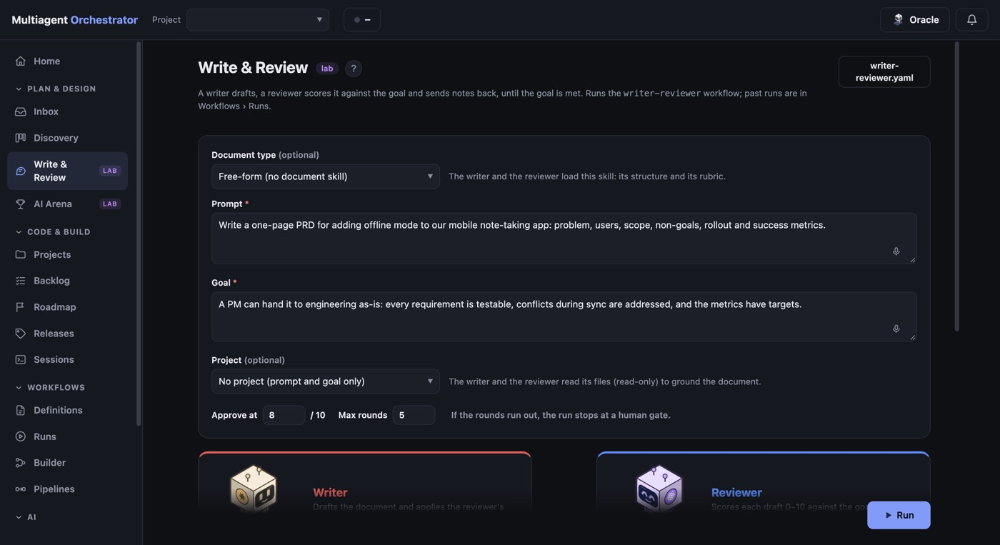
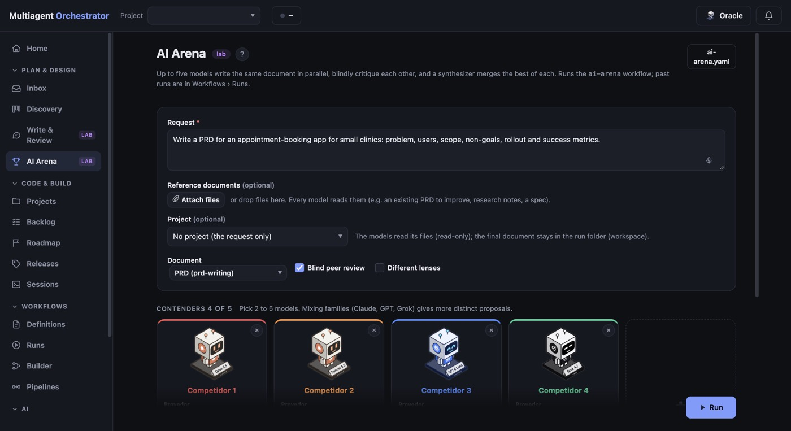
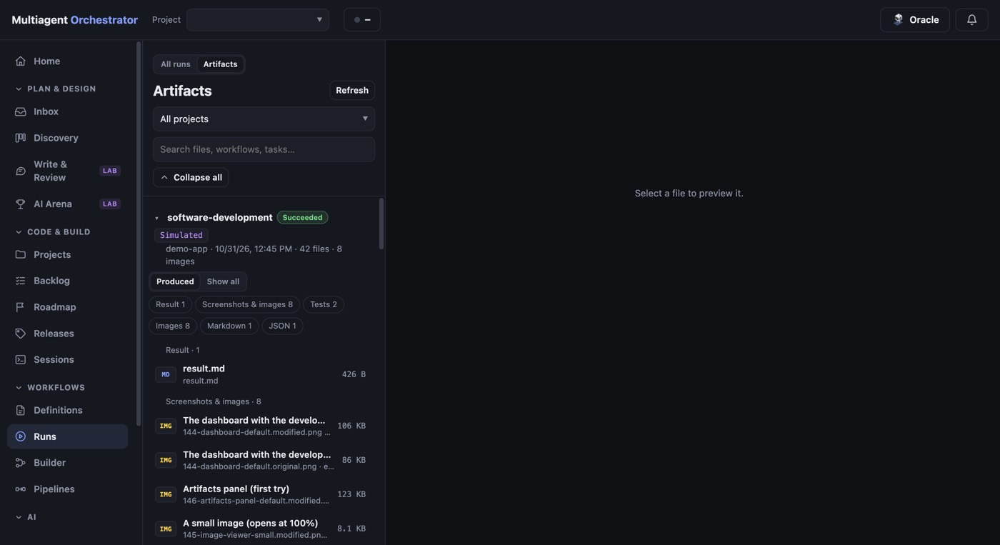
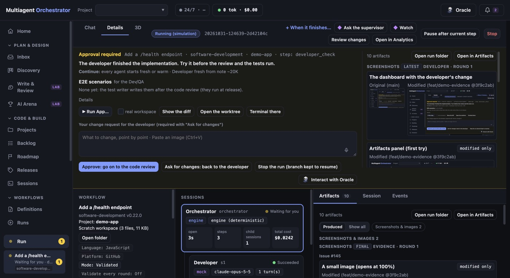
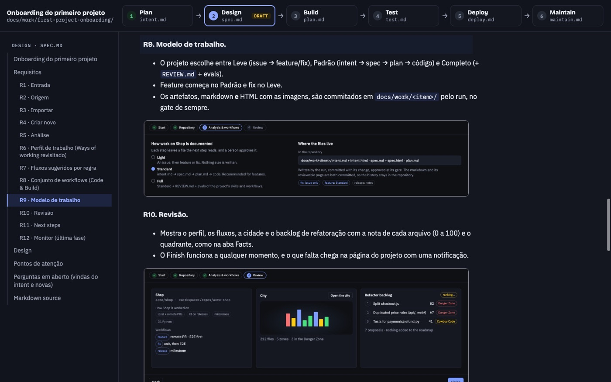
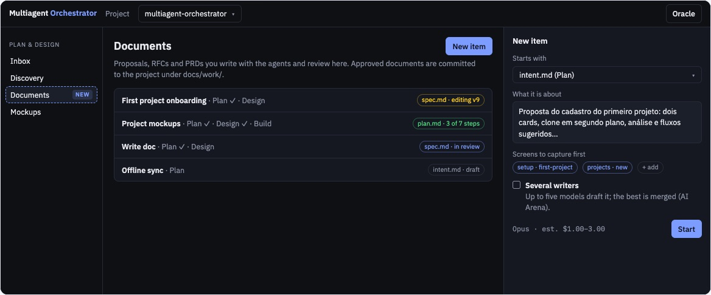
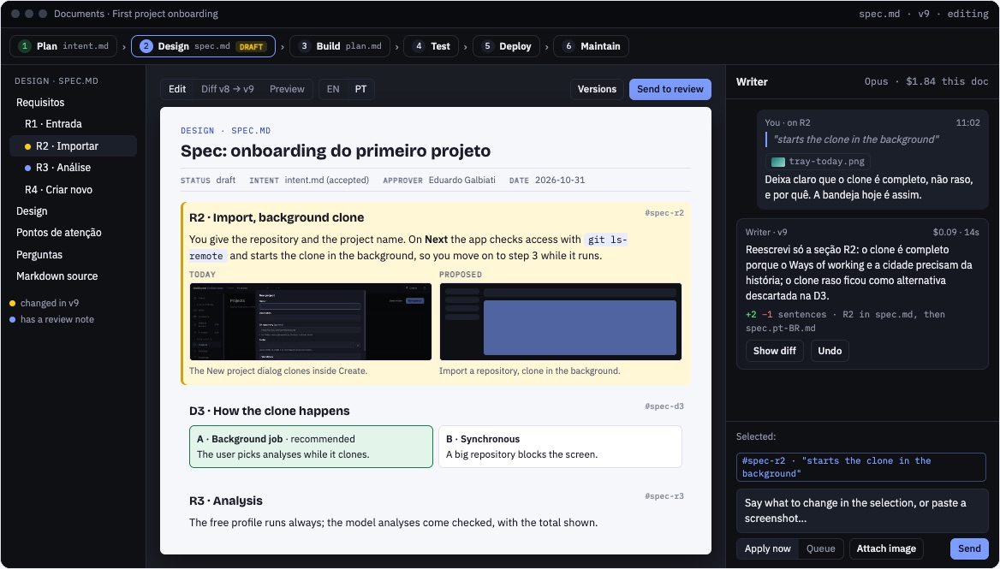
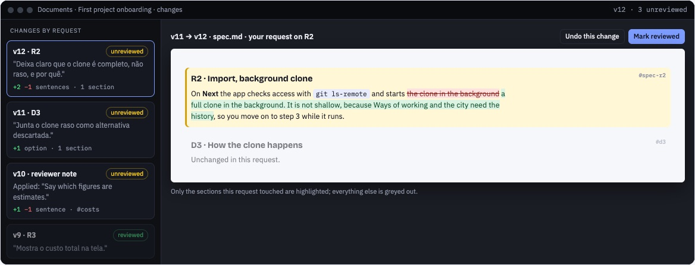
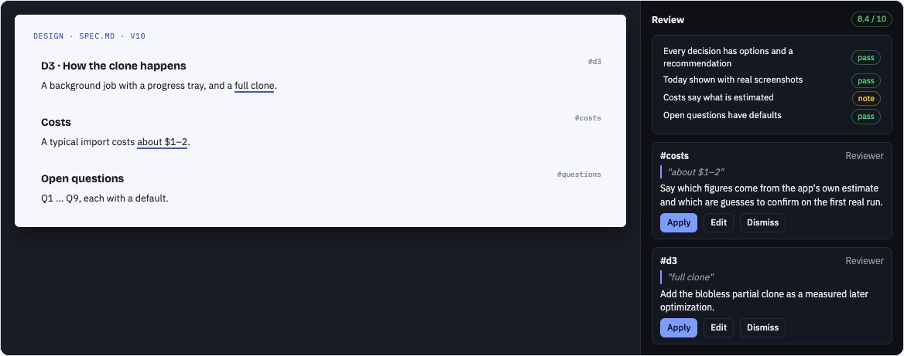
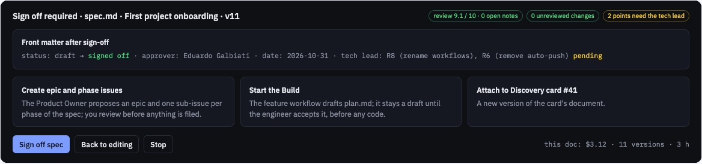

# Write Doc: proposta

**Status:** proposta, aguardando as decisões do dono · **Épico:** #636 · **Data:** 2026-10-31 · [English](README.md)

Esta proposta transforma o jeito como as propostas desta série foram escritas ([Mockups de projeto](../project-mockups-proposal-2026-10/README.pt-BR.md), [Onboarding do primeiro projeto](../first-project-onboarding-proposal-2026-10/README.pt-BR.md)) numa função do app.
- Cada item de trabalho ganha **um documento vivo** em `docs/work/<item>/`, do intent ao monitoramento, nas seis etapas do AI-native SDLC.
- Um writer escreve Plan (`intent.md`) e Design (`spec.md`) em markdown, com screenshots de "antes" e telas mock de "depois".
- Você itera como num editor: seleciona um trecho e diz, no chat ao lado, o que corrigir. Um reviewer comenta, e uma pessoa aprova.
- Os workflows preenchem o resto: Build, Test, Deploy e Maintain.

Ela também cobre a reorganização dos workflows de Planning, que a proposta de onboarding deixou de fora.

A mesma proposta como página, com o mock do editor clicável: [index.pt-BR.html](index.pt-BR.html) ([English](index.html)). Abra localmente, porque o GitHub mostra HTML como código.

Nada disso está construído. As decisões são recomendações até o dono confirmar; confirmadas, vão para [docs/agents/decisions.md](../agents/decisions.md).

## Conteúdo

- [As recomendações](#as-recomendações)
- [Onde estamos hoje](#onde-estamos-hoje)
- [O formato: um documento vivo por item](#o-formato-um-documento-vivo-por-item)
- [Fluxo ponta a ponta](#fluxo-ponta-a-ponta)
- [Os workflows de Planning: antigo → novo](#os-workflows-de-planning-antigo--novo)
- [Arquitetura](#arquitetura)
- [Custo das chamadas reais](#custo-das-chamadas-reais)
- [Plano faseado](#plano-faseado)
- [Arquivos e áreas](#arquivos-e-áreas)
- [Perguntas em aberto](#perguntas-em-aberto)
- [Regras do AGENTS.md](#regras-do-agentsmd)
- [Como contribuir](#como-contribuir)

## As recomendações

1. **Um documento vivo por item** (decisão do dono), em `docs/work/<item>/`, do intent ao monitoramento, nas seis etapas do AI-native SDLC.
   - **Plan** (`intent.md`) e **Design** (`spec.md`) são escritos aqui e aprovados por uma pessoa.
   - **Build** (`plan.md`, com a tabela de Progresso), **Test**, **Deploy** e **Maintain** são preenchidos pelos workflows e pelo Monitor.
2. **O markdown é a única fonte.** O writer gera e edita só markdown, nunca HTML. A leitura é feita pelo leitor de documentos (prototipado numa sessão à parte), que renderiza o `.md` na hora, com JavaScript; nada de HTML renderizado é gerado nem commitado. **Dependência:** esta proposta usa esse leitor e não propõe um renderer próprio. O layout validado:
   - as seis etapas no topo, na horizontal e fixas, com status e a etapa atual marcada;
   - à esquerda, o índice da etapa aberta: acompanha a rolagem, mantém a seção atual visível e faz rolagem animada no clique; os requisitos R1… entram como itens;
   - o documento largo no centro, com os metadados do front matter no topo e o markdown original no fim;
   - no celular: ☰ + a seção atual como aba, e uma gaveta com o índice completo.
3. **Uma tela, Plan & Design › Documents**, no lugar de Write & Review e AI Arena. "Several writers" vira uma opção do rascunho.
4. **Um workflow, `write-doc`**, rodado uma vez para o intent e outra para o spec: evidências → rascunho → **edição com você** → revisão → **aprovação**. Os dois passos humanos são gates que nenhuma automação atravessa.
5. **Dois tipos de documento:**
   - `intent-writing`: problema, resultado, usuários e sistemas, restrições, perguntas.
   - `spec-writing`, com o formato desta série: requisitos R1…Rn, antes/depois, decisões com opções e recomendação, fases, custos e perguntas com padrão.
6. **Seleção → agente:** cada título do markdown vira uma âncora estável. O chat envia o arquivo, a seção, o trecho exato e o contexto, e o writer reescreve só aquela seção. Acabou o "corrige o item 3 da D7".
7. **Screenshots sem rodar nada:** quem escreve só nomeia as telas. O app usa, nesta ordem:
   - o comando de screenshot do projeto, quando ele existe;
   - a captura pelo Run App;
   - o anexo manual.

   O "depois" vem do mesmo comando na branch do run, das telas da proposta de Mockups (#625) ou de imagens coladas. O writer nunca escreve HTML.
8. **Imagens no chat:** em qualquer iteração você cola ou anexa um screenshot no chat (o mecanismo do #130), e ele vai para o writer junto com a seleção.
9. **Revisão por pedido:** cada pedido vira um commit ligado à mensagem. Clicar na mensagem mostra só o que a IA mudou naquele turno, em vermelho e verde dentro do documento. Uma fila de mudanças não revisadas diz o que falta validar.
10. **O reviewer comenta, não reescreve:** as notas ficam ancoradas nas seções, e você escolhe quais aplicar.
11. **Portões do SDLC no app:** "Accept intent" e "Sign off spec" são gates humanos que mudam o front matter e commitam (o tech lead assina os pontos de risco maior). Depois do sign-off vêm "Create epic and phase issues" e o handoff para o Build pelo `plan.md`, que o engenheiro aceita antes do código.
12. **Fonte em inglês, tradução ao lado:** cada artefato tem a fonte em inglês (`intent.md`, `spec.md`…) e a tradução em português ao lado (`intent.pt-BR.md`…); o front matter liga o par (`translation:` na fonte, `source:` na tradução). O writer edita primeiro o inglês e depois atualiza a tradução. Um pedido feito em português, sobre um trecho da tradução, é aplicado na fonte e propagado. O leitor tem um seletor EN / PT.

## Onde estamos hoje

Os dois fluxos de documento de hoje partem de um prompt e terminam num markdown que você aceita ou devolve inteiro. Não há como apontar para um trecho, e nada liga o documento ao que é construído depois.

| | |
|---|---|
|  |  |
| **Write & Review** (`writer-reviewer.yaml`): prompt + objetivo. O writer escreve, o reviewer pontua de 0 a 10 e devolve notas até o limite, e o supervisor confere e pergunta o que fazer. | **AI Arena** (`ai-arena.yaml`): até cinco modelos escrevem o mesmo documento e criticam às cegas; um sintetizador junta e outra família verifica. |
|  |  |
| **Artifacts**: os documentos dos runs aparecem como markdown sanitizado (marked + DOMPurify, sem forms). Serve para ler, não para editar nem apontar. | **Um gate com evidências**: os runs de desenvolvimento guardam pares *original* e *modified* em `evidence/`. É o mesmo mecanismo que dá o "antes" de um documento. |

A dor por trás do pedido, nas palavras do dono: para corrigir algo nestas propostas, era preciso achar o ponto e citar o número da seção no chat. E depois de vários pedidos, não dava para saber o que a IA tinha mudado.

## O formato: um documento vivo por item

Esta é uma decisão do dono. Cada item de trabalho tem **um documento só**, do intent ao monitoramento, organizado nas seis etapas do [AI-native SDLC playbook](https://claude.com/blog/the-ai-native-sdlc-playbook) da Anthropic: Plan → Design → Build → Test → Deploy → Maintain. Cada etapa termina num artefato versionado, aprovado por uma pessoa.

Tudo é commitado em `docs/work/<item>/`: o markdown de cada etapa e as imagens de antes e depois, em `images/`. Nenhum HTML é commitado: o leitor de documentos renderiza os `.md` na hora. O write doc **escreve** Plan e Design; os workflows preenchem o resto.



| Etapa | Arquivo | Quem preenche | Quem aprova |
|---|---|---|---|
| Plan | `intent.md`: problema, resultado esperado, usuários e sistemas afetados, restrições, perguntas em aberto | **write-doc** (writer + você) | o product owner |
| Design | `spec.md`: requisitos R1…Rn e o design, com as decisões e os pontos de atenção | **write-doc** (writer + você + reviewer) | o dono / tech lead |
| Build | `plan.md`: arquivos que mudam, ordem, riscos, prova, e a tabela de **Progresso** | o workflow feature/fix: o plano no começo, depois uma linha por run, commit e PR | o gate do developer |
| Test | `test.md`: a evidência | os runs: suíte, E2E, screenshots original/modificado, axe | o code owner |
| Deploy | `deploy.md`: a revisão e a release | a revisão de cada PR (pelo `REVIEW.md` do projeto) e o workflow `release` com o Ship | o code owner; o dono dá o Ship |
| Maintain | `maintain.md`: incidentes e post-mortems | o Monitor e o Night watch: um incidente entra aqui, gera um post-mortem e um **novo intent** | o service owner; o product owner para achados de produto |

Cada `.md` tem um front matter e as seções do playbook:

```
---
item: first-project-onboarding
stage: design
status: draft         # draft → signed off
intent: intent.md     # o artefato anterior
translation: spec.pt-BR.md
approver: Eduardo Galbiati (product owner)
date: 2026-10-31
---
```

- **intent.md:** Problema · Resultado esperado · Usuários e sistemas afetados · Restrições · Perguntas em aberto.
- **spec.md:** Requisitos (cada um como `**R1. Título.**`) · Design · Pontos de atenção · Perguntas.
- **plan.md:** Arquivos que mudam · Ordem do trabalho · Riscos · Prova · Progresso.

A fonte é sempre em inglês; a tradução em português fica ao lado (`spec.pt-BR.md`, com `source: spec.md` no front matter), com o mesmo conteúdo. O leitor troca entre as duas com o seletor EN / PT.

**D15. O formato e o ciclo de vida do documento**
- **Decisão do dono:** um documento vivo por item, com o markdown como única fonte, lido pelo leitor de documentos.
  - O histórico do item fica num lugar só, commitado, e um front futuro pode navegar pelos intents e validar cada um.
  - O agente escreve só markdown. O leitor renderiza na hora, com o mesmo layout em todo documento (tema claro/escuro, accent, export para PDF, uma página inicial com todos os itens), o que simplifica a segurança (D5) e o lint.
  - Os workflows preenchem as etapas que ninguém escreve: a tabela de Progresso do `plan.md`, a evidência, a revisão, a release, os incidentes.
- Alternativas:
  - Markdown + HTML renderizado commitado: duas fontes que divergem, e cada edição vira dois diffs.
  - Um HTML escrito pelo agente por proposta (o desenho anterior): um formato por documento, HTML de agente para isolar, e nada liga a proposta ao que foi construído.
  - Só intent e spec: o documento morre na aprovação.
- **O que esta proposta entrega:** o formato dos `.md`, o editor sobre o leitor e a escrita de Plan e Design.
- **Fica para depois:** os workflows preenchendo Build, Test e Deploy (fase 4), o Monitor alimentando o Maintain (fase 5) e o front que navega pelos intents.

## Fluxo ponta a ponta

O `write-doc` roda uma vez para o `intent.md` e outra para o `spec.md`, com os mesmos sete passos:

1. Novo item (**D1**, **D2**, **D3**).
2. Evidências: screenshots de antes e depois (**D4**).
3. Rascunho: um writer ou vários.
4. **Editar com você**: seleção + chat (**D5**–**D9**). Um gate humano.
5. Revisão: notas ancoradas (**D10**).
6. **Aprovação**: Accept intent / Sign off spec, gates humanos (**D16**).
7. Próxima etapa (**D12**): intent → spec → épica e sub-issues por fase → Build.

A reorganização do Planning é a **D11**, o armazenamento a **D13**, o custo a **D14**, o documento vivo a **D15** e os portões do SDLC a **D16**.

### 1 · Novo item

A tela **Documents** lista os itens do projeto do header com a etapa de cada um, lidos do `docs/work/` do repositório e dos runs em andamento. "New item" começa pelo intent; quando o intent é aprovado, o mesmo item oferece "Write the spec". "Several writers" liga o modo Arena no rascunho.



**D1. Onde a função vive**
- **Recomendado:** uma tela Documents, no lugar de Write & Review e AI Arena. O "Write a document" também aparece no card do Discovery.
- Alternativas:
  - Uma terceira tela ao lado das duas: três telas para a mesma ideia.
  - Só dentro do card do Discovery: nem todo item nasce de um card.

**D2. A fonte e a página**
- **Recomendado (decisão do dono):** só markdown; o leitor renderiza na hora.
  - O writer gera e edita só o `.md` da etapa, com o front matter (`item`, `stage`, `status`, `approver`, `date` e o link para o artefato anterior).
  - O leitor (dependência) renderiza com JavaScript, no app e fora dele; nada de HTML é gerado nem commitado. Os diffs de texto ficam limpos.
  - O editor depende de o leitor expor a posição de cada bloco no `.md` (D6).
  - **Convenções do markdown:**
    - as seções do playbook por etapa;
    - requisitos como `**R1. Título.**`, que viram itens do índice;
    - uma decisão dentro de Design como `### D3 · título`, com as opções e uma linha `**Recommended:**`;
    - uma imagem como ``.

    O lint confere todas elas.
- Alternativas:
  - Markdown + HTML gerado e commitado: abre sem JavaScript, mas são duas fontes, e o HTML envelhece.
  - HTML escrito pelo agente: um layout diferente a cada vez, e HTML de agente para isolar.
  - Um editor estilo Google Docs: o dono disse explicitamente que não quer.

**D3. Os tipos de documento**
- **Recomendado:** `intent-writing` e `spec-writing`.
  - O intent cobre o problema, o resultado esperado, os usuários e sistemas afetados, as restrições e as perguntas em aberto.
  - O spec tem o formato desta série. RFC, PRD e design sketch viram modelos de spec.
- Alternativa: uma skill só, `product-proposal`, que mistura o que o product owner aprova (o intent) com o que o time aprova (o spec).

### 2 · Evidências: screenshots de antes e depois

Quem escreve um plano ou uma proposta muitas vezes não é técnico e não consegue rodar o app do projeto para tirar screenshots. Por isso a captura é um passo de máquina antes do rascunho: o writer só diz quais telas quer, e o app tira as imagens.

| Ordem | Fonte | Antes | Depois |
|---|---|---|---|
| 1 | **O comando de screenshot do projeto**: o `npm run screenshot` deste app, ou o comando do próprio projeto (`.multiagent/screenshot.yaml`) | a base, com dados simulados (`--ref <base>`) | o mesmo comando na branch do run |
| 2 | **Captura pelo Run App**: o local preview sobe o front em sandbox, e um browser headless tira as URLs pedidas | as telas de hoje | a branch do run |
| 3 | **Anexo manual**: imagens coladas ou anexadas (#130), no "New item" ou no chat da edição | o que você colar | o que você colar |

**D4. De onde vêm as imagens**
- **Recomendado:** a fonte mais fiel disponível, nessa ordem. O app escolhe e diz qual usou em cada imagem. Quem não é técnico nunca roda nada: nomeia as telas ou cola uma imagem.
  - Um projeto sem comando de screenshot ganha um pelo cartão "Investigate screenshots" do onboarding, que põe um spike no roadmap do próprio projeto.
  - Até lá, o anexo manual cobre.
- **O "depois"** vem do mesmo comando de screenshot na branch do run, das telas da proposta de Mockups (#625) quando ela existir, ou de imagens coladas. O writer nunca escreve HTML; só referencia as imagens no markdown. Todas as imagens são arquivos em `docs/work/<item>/images/`.
- Alternativas:
  - Só imagens coladas: volta a depender de alguém que consiga rodar o app.
  - O writer roda o que quiser: caro e frágil.

### 3 · Rascunho

Com um writer, o rascunho é um turno longo. Ele lê o código (só leitura), as evidências e a skill, e escreve o markdown da etapa (`intent.md` ou `spec.md`), apontando para as imagens em `images/`. Com vários writers, é o modo Arena de hoje. Um lint de máquina confere o markdown (front matter, seções do playbook, requisitos R1…, uma recomendação em cada decisão, imagens que existem) antes de você ver.

### 4 · Editar com você

Sobre o layout validado: as etapas no topo, o índice à esquerda, o documento renderizado pelo leitor no centro e o chat com o writer à direita. Você seleciona um trecho e escreve o que quer. O writer reescreve só aquela seção do markdown, e ela aparece marcada como alterada. Você também pode colar ou anexar um screenshot no chat (#130).

**Documento e chat juntos:** o chat ocupa a direita, no espaço que no leitor é do documento largo. O documento encolhe até uma largura mínima de leitura (cerca de 70 caracteres por linha). Abaixo disso, o índice vira o ☰ com a seção atual como aba, como no celular, e o chat pode ser recolhido para uma barra fina e voltar à leitura cheia. O chip "Selected" e as marcas de mudança continuam visíveis nos dois modos.



**D5. Mostrar o documento com segurança**
- **Recomendado:** o leitor, num `iframe` isolado, sobre markdown sanitizado.
  - O agente escreve só markdown. O leitor renderiza com o sanitizador (marked + DOMPurify, sem forms e sem HTML cru no markdown); o único JavaScript que roda é o do próprio leitor.
  - No editor, o leitor abre num `iframe sandbox="allow-scripts"` de origem opaca, servido por `doc://`, com CSP sem rede e sem `window.api`. A seleção sai por `postMessage`, já mapeada para o `.md` (D6).
  - O editor depende do contrato do leitor (posições de origem, eventos de seleção).
- Alternativas:
  - HTML escrito pelo agente: código do agente dentro do app, e contra a decisão de usar só markdown.
  - Um renderer próprio no editor: dois renderers para o mesmo markdown, que divergem; o leitor já existe.

**D6. Como a seleção chega ao writer**
- **Recomendado:** a seleção acontece na página renderizada. O leitor marca cada bloco com as linhas de origem no `.md` (por exemplo `data-src="41-52"`), e cada título e cada `R1`, `D3` vira uma âncora como `spec-r2`. O chat envia o arquivo, a âncora, as linhas, o trecho, 200 caracteres antes e depois e a versão. O writer devolve só a seção nova do markdown; o app troca as linhas, grava a versão e o leitor mostra de novo.
- Alternativas:
  - Pinos sobre uma imagem (Findings #361): texto não é imagem.
  - Número da seção no chat: é a dor de hoje.

**Seleção na tradução (ponto de atenção):** quando você seleciona um trecho do `spec.pt-BR.md`, o pedido vale para a fonte.
- Fonte e tradução têm os mesmos títulos e as mesmas âncoras (`spec-r2` nas duas), então a seção é exata.
- Dentro da seção, o app alinha os blocos pela ordem (o 3º parágrafo da tradução é o 3º da fonte). Ele manda ao writer o trecho em português, o bloco correspondente em inglês e a seção inteira nas duas línguas.
- O writer corrige a fonte e depois a tradução, no mesmo commit.
- Se o alinhamento falhar (a tradução tem um bloco a mais ou a menos), o app avisa e manda a seção inteira.

```json
{ "item": "first-project-onboarding", "file": "spec.pt-BR.md", "source": "spec.md", "version": 9,
  "anchor": "spec-r2", "lines": [41, 52],
  "quote": "starts the clone in the background",
  "before": "…On Next the app checks access with git ls-remote and ",
  "after": ", so you move on to step 3 while it runs.",
  "message": "Deixa claro que o clone é completo, não raso, e por quê." }
```

**D7. Aplicar na hora ou juntar comentários**
- **Recomendado:** na hora por padrão, com "Queue" para juntar vários pedidos num turno só, mais barato.
- Alternativa: só comentários em lote, que perde a conversa rápida.

**D8. Como o chat vira turnos de agente**
- **Recomendado:** um gate humano de edição dentro do run, usando a sessão do writer. Um passo novo, `human_edit`:
  - O run espera por você, e cada pedido é um turno do writer na mesma sessão (persistente, com handoff note e `fresh_after_idle: 55m`).
  - Só o seu "Send to review" o encerra.
- Alternativas:
  - Um chat fora do run: parte o histórico.
  - Um run novo por pedido: perde o contexto e custa mais.

#### Revisar só o que a IA mudou em cada pedido

Depois de vários pedidos, fica difícil saber o que mudou para revalidar. Por isso cada pedido fica ligado à mudança exata que ele causou.
- Clicar numa mensagem do chat abre a mudança daquele turno, em vermelho e verde dentro do documento renderizado.
- Uma fila de mudanças não revisadas mostra o que falta validar. **Mark reviewed** tira a mudança da fila, e **Undo this change** desfaz só aquele turno.
- O gate de aprovação mostra quantas mudanças ainda não foram revisadas.



**D9. Versões e revisão por pedido**
- **Recomendado:** um commit por pedido, ligado à mensagem, com fila de revisão.
  - Cada pedido (seu, ou uma nota do reviewer que você aplicou) vira um commit na branch do run, com a fonte em inglês e a tradução da etapa em `docs/work/<item>/`, e o id da mensagem no commit.
  - Clicar na mensagem mostra o diff daquele turno, inline e só nas seções tocadas.
  - A aprovação mescla a branch como qualquer run (merge local ou PR, conforme o projeto).
- Alternativas:
  - Só "Diff vN → vM": junta vários pedidos.
  - As cópias `drafts/vN` de hoje: sem diff e sem ligação com o pedido.

### 5 · Revisão

"Send to review" chama o reviewer. Ele pontua contra a rubrica da skill e o objetivo, e devolve notas ancoradas nas seções, cada uma com Apply / Edit / Dismiss.



**D10. O que o reviewer faz**
- **Recomendado:** ele pontua e comenta, e você decide. "Auto-apply notes" é uma opção, desligada por padrão.
- Alternativas:
  - O loop writer ↔ reviewer de hoje: reescreve o que você já tinha acertado.
  - Sem reviewer: perde a checagem da rubrica.

### 6 · Aprovação: Accept intent e Sign off spec

Depois da revisão, o run para no gate `human_approval` da etapa.
- No intent, o botão é **Accept intent**, e quem aprova é o product owner.
- No spec, é **Sign off spec**, dado pelo dono. Os pontos que o spec marca como de risco maior (por exemplo, renomear workflows ou tirar o auto-push) pedem também o tech lead.
- Aprovar muda o front matter do `.md` (`status: accepted` ou `signed off`, com o aprovador e a data) e commita na branch do run.
- As outras respostas são Back to editing e Stop. Nenhuma automação responde o gate.



**D16. Os portões do SDLC como etapas do app**

É o fluxo que o item do onboarding seguiu à mão depois da revisão do dono: intent aceito, spec assinado (com o tech lead nos pontos de risco), os artefatos commitados num PR de docs, uma épica com uma sub-issue por fase, e o Build começando pelo `plan.md`.
- **Recomendado:** os portões dentro do app.
  - **Accept intent** e **Sign off spec** são gates humanos que mudam o front matter (status, aprovador, data) e commitam; os pontos marcados no spec pedem o tech lead.
  - Depois do sign-off, **Create epic and phase issues**: o Product Owner propõe a épica e uma sub-issue por fase, a partir dos requisitos e das fases do spec. A épica traz o status do SDLC no topo e o link para os artefatos. O dono revisa antes de abrir.
  - **O handoff para o Build é o `plan.md`:** o workflow feature escreve o plano, que fica `draft` até o engenheiro aceitar (plan mode), antes de qualquer código. Depois a implementação preenche a tabela de Progresso.
  - Criar issues e abrir PR continuam pedindo o clique do dono.
- Alternativas:
  - Os portões fora do app, à mão (como hoje): o front matter, a épica e o PR de docs dependem de alguém lembrar.
  - Só a aprovação, sem mudar o front matter: o documento não mostra quem aprovou nem quando.
- **Fora do sign-off:** registrar as decisões assinadas em `docs/agents/decisions.md` fica para o run que implementa, como tarefa da épica, porque o log tem um limite de entradas.

### 7 · Próxima etapa

**D12. O que a aprovação abre**
- Intent aceito → o item oferece "Write the spec".
- Spec assinado → "Create epic and phase issues" (D16), que substitui o `rfc-to-issues`, e "Start the Build", que escreve o `plan.md` para o engenheiro aceitar.
- **Já está no repositório:** os artefatos (intent, spec, plan e os test, deploy e maintain vazios) vão para `docs/work/<item>/` num PR de docs ou num merge local, do jeito do projeto.
- Card do Discovery: anexo e nova versão do documento do card. Salvar numa issue: o "Save to issue" de hoje.
- **Idiomas:** a fonte é sempre em inglês, e a tradução em português é atualizada a cada pedido, no mesmo commit.

## Os workflows de Planning: antigo → novo

**D11.** 3 workflows e 3 pipelines viram 2 workflows e 2 pipelines.

| Hoje | Proposta | Ação |
|---|---|---|
| `writer-reviewer` | **`write-doc`**: evidências → rascunho → edição com você → revisão com notas → aprovação, para o `intent.md` ou o `spec.md` | base |
| `ai-arena` | `write-doc` com `writers: 2–5` no rascunho | vira modo |
| `issue-tracker` | **`issue`**, com a entrada "from a spec" | renomeia |
| pipeline `ai-arena-write-review` | `write-doc` com writers 2–5 | absorvido |
| pipeline `rfc-to-issues` | **`spec-to-issues`**: write-doc (spec) → issue (validated) | renomeia |
| pipeline `enrich-save-develop` | **`enrich-issue`**: write-doc com `issue-writing` sobre a issue → Save to issue → feature | renomeia |

## Arquitetura

```
Tela Documents ──► o leitor de documentos (iframe sandbox="allow-scripts", origem opaca, doc://, sem rede) renderiza o .md
      │ seleção + pedido                            ▲ versão nova (markdown → página)
      ▼                                             │
Run write-doc: captura (máquina) → rascunho (writer / Arena) → human_edit (você) → revisão → human_approval (aprovador)
      │ turno do writer                             ▲ seção do markdown reescrita
      ▼                                             │
Writer / reviewer: qualquer CLI, lê o projeto, escreve só docs/work/<item>/<etapa>.md e images/, no worktree do run
```

**D13. Armazenamento** (decisão do dono)
- Os artefatos são dado da feature e da issue, não do usuário. Ficam commitados no repositório do projeto, em `docs/work/<item>/`.
- O run escreve e commita na branch dele, e a aprovação mescla pelo gate de sempre.
- O que é do run (chat, notas, custos) fica na pasta do run, no workspace.

```
<repo do projeto>/docs/work/<item>/   (commitado; item = issue ou card)
  intent.md          Plan (fonte em inglês), aprovado pelo product owner
  intent.pt-BR.md    a tradução, com source: intent.md
  spec.md            Design (fonte em inglês), aprovado pelo dono
  spec.pt-BR.md      a tradução, com source: spec.md
  plan.md            Build: o plano e a tabela de Progresso (workflows)
  test.md            Test: a evidência (runs)
  deploy.md          Deploy: revisão e release (PRs, Ship)
  maintain.md        Maintain: incidentes e post-mortems (Monitor)
  images/            before-*.png, after-*.png

<workspace>/runs/<run>/                (dado do run)
  chat.jsonl, notes.json, evidence/
```

O que muda no engine:
- **Um passo `human_edit`:** um gate que aceita pedidos enquanto espera. Fica na lista protegida, então nenhuma automação o responde.
- **Um passo de captura** (máquina): o comando de screenshot do projeto, senão a captura do Run App, gravando em `images/`; as imagens coladas seguem o mesmo caminho.
- **Um lint de documento** (máquina): front-matter, as seções obrigatórias da skill, âncoras únicas, uma linha "Recommended" em cada decisão e imagens que existem.
- **Nenhum renderer novo:** o editor e os workflows usam o leitor de documentos.

## Custo das chamadas reais

**D14.** São ordens de grandeza, sem medição. Todo o desenvolvimento roda no provedor simulado (`MULTIAGENT_SIMULATION_ONLY=1`). Cada ação mostra o custo antes e conta no orçamento diário (#206).

| Ação | Modelo padrão | Estimativa |
|---|---|---|
| Captura das evidências, lint, diff, versões | nenhum | $0 |
| Rascunho do intent | Opus | $0.30–1.00 |
| Rascunho do spec com um writer | Opus | $1.00–3.00 |
| Rascunho do spec com vários writers (Arena) | mistura de famílias | $3.00–10.00 |
| Um pedido de edição numa seção (prompt cache) | Opus ou Sonnet | $0.05–0.40 |
| Revisão com notas | Sonnet | $0.20–0.60 |
| Primeira tradução (pt-BR) de um intent ou spec | Sonnet | $0.30–1.00 |
| Atualizar a tradução depois de um pedido (só a seção) | Sonnet | $0.02–0.10 |

Um item como os desta série (um intent, um spec, uns 20 pedidos de edição, duas revisões) custaria cerca de $5–12. São chutes a confirmar no primeiro run real, avisado antes.

## Plano faseado

**Fase 0: spike, o editor sobre o leitor**
- `poc/doc-editor.html`, abrindo o exemplo do onboarding no protótipo do leitor, com o chat ao lado.
- `poc/doc-editor.html`, abrindo o exemplo do onboarding.
- Seleção → a carga com arquivo, âncora, trecho e contexto. Sem modelo.

**Fase 1: MVP, write-doc para intent e spec**
- As skills `intent-writing` e `spec-writing` e o lint do markdown; o leitor como dependência.
- O workflow `write-doc`: um writer, `human_edit`, um reviewer com notas, `human_approval`.
- A tela Documents e o editor: seleção, chat com imagens, versões, revisão por pedido.
- Os arquivos em `docs/work/<item>/`, mesclados na aprovação. A captura de evidências pelo `npm run screenshot` deste app.
- Cenários do provedor mock, um seed de screenshot e uma feature E2E.
- Pronto quando: um item vai do intent ao spec aprovado, todo no simulado.

**Fase 2: Arena e a reorganização**
- O modo "several writers".
- Aliases (`writer-reviewer`, `ai-arena` → `write-doc`; `issue-tracker` → `issue`).
- `spec-to-issues` e `enrich-issue`. As telas antigas saem do menu.

**Fase 3: entregas e outros projetos**
- Outras línguas de tradução além do português, se alguém pedir.
- Capturas pelo comando de screenshot do projeto ou pelo Run App.
- "Write a document" no card do Discovery; "Split into issues".

**Fase 4: o documento vivo no Build, Test e Deploy**
- O workflow feature/fix escreve o `plan.md` e acrescenta uma linha de Progresso por run, commit e PR.
- Os runs gravam a evidência no `test.md`, e a revisão e a release com o Ship vão para o `deploy.md`.
- Pronto quando: um item vai do intent à release com as seis etapas preenchidas.

**Fase 5: depois**
- O Monitor e o Night watch registram incidentes no `maintain.md`, escrevem o post-mortem e abrem um novo intent.
- Um front para navegar pelos intents.
- Mocks interativos numa origem opaca.

## Arquivos e áreas

**Novos**
- Front plan:
  - `fronts/plan/views/docs/docs.js` e `docs.css`
  - `fronts/plan/views/docs/doc-editor.js` (iframe, seleção, trilho das etapas)
  - `fronts/plan/engine/channels/docs.js`
  - `fronts/plan/engine/domains/docs.js` (lista o `docs/work/` do repositório e os runs em andamento)
- Compartilhado:
  - `packages/shared/doc-model.js` (a carga da seleção, o lint puro)
  - O leitor de documentos (dependência: posições de origem e eventos de seleção)
- Engine: o passo `human_edit`, na lista de gates protegidos
- Workflows e skills:
  - `workflows/write-doc.yaml`
  - `skills/intent-writing/`, `skills/spec-writing/`
  - `pipelines/spec-to-issues.yaml`, `pipelines/enrich-issue.yaml`
- Testes e docs:
  - `scripts/screenshot/views/docs.js`
  - `features/docs.feature`
  - `docs/agents/renderer/documents.md`

**Alterados**
- `fronts/plan/views/duo` e `fronts/plan/views/arena`
- `fronts/plan/views/discovery/discovery.js`
- `packages/ui-kit/agent-chat.js` (o chip de seleção)
- `apps/desktop/host/main.js` (`doc://`) e `window-guards.js`
- `workflows/issue-tracker.yaml` → `issue`
- O carregador de workflows (aliases)
- `docs/agents/engine/gates-and-run-end.md` e `docs/agents/worktrees.md`
- `docs/agents/decisions.md`, depois das decisões

## Perguntas em aberto

Cada uma tem um padrão recomendado.

- **Q-1.** Nome: Documents, Write doc ou Work items? Padrão: **uma tela "Documents" e um workflow `write-doc`**.
- **Q-2.** O AI Arena continua com tela própria? Padrão: **não**; vira "Several writers (AI Arena)" no rascunho.
- **Q-3.** O markdown pode ter HTML cru? Padrão: **não**; o leitor remove HTML cru, e o único JavaScript que roda é o do leitor.
- **Q-4.** As edições se aplicam na hora? Padrão: **sim**, com "Queue".
- **Q-5.** O reviewer reescreve sozinho? Padrão: **não**; "Auto-apply notes" vem desligado.
- **Q-6.** Idiomas? Padrão: **fonte em inglês e tradução em pt-BR**, com a língua da tradução vinda de Settings › Language.
- **Q-7.** O modelo do writer? Padrão: **Opus no rascunho, e a mesma sessão na edição**; Sonnet para revisão e tradução.
- **Q-8.** O nome da pasta do item? Padrão: **`docs/work/<issue>-<slug>/`**, ou `card-<id>-<slug>` enquanto não há issue.
- **Q-9.** Outras pessoas podem comentar? Padrão: **não no começo**.

## Regras do AGENTS.md

Como a proposta segue o [AGENTS.md](../../AGENTS.md):
- O app continua em inglês, e a fonte de cada artefato também, com a tradução ao lado.
- O que é do usuário e do run fica no workspace. Os artefatos aprovados são dado da feature e ficam no repositório do projeto (decisão do dono).
- `human_edit` e `human_approval` só terminam com uma pessoa. O Supervisor e o Night watch nunca os respondem.
- No rascunho e na revisão, os agentes rodam sem supervisão e registram suposições; só uma pessoa conversa com o writer, no passo de edição.
- Writer e reviewer leem o projeto e escrevem só em `docs/work/<item>/`, no worktree do run; um passo de máquina recusa mudanças fora dali.
- O agente escreve só markdown. O leitor renderiza sanitizado, num iframe de origem opaca, sem rede e sem `window.api`, e a janela não navega.
- As checagens automáticas rodam só no simulado, e toda ação real mostra o custo antes.

## Como contribuir

1. Leia o [AGENTS.md](../../AGENTS.md) e os docs de tópico da sua área, principalmente [renderer.md](../agents/renderer.md), [engine.md](../agents/engine.md), [storage.md](../agents/storage.md) e [testing.md](../agents/testing.md).
2. Comente no épico (#636) antes de pegar uma fase.
3. Comece pela fase 0. Ela não mexe no engine e não chama modelo.
4. Trabalhe numa branch e abra um PR. Nunca rode modelos reais nas checagens.
